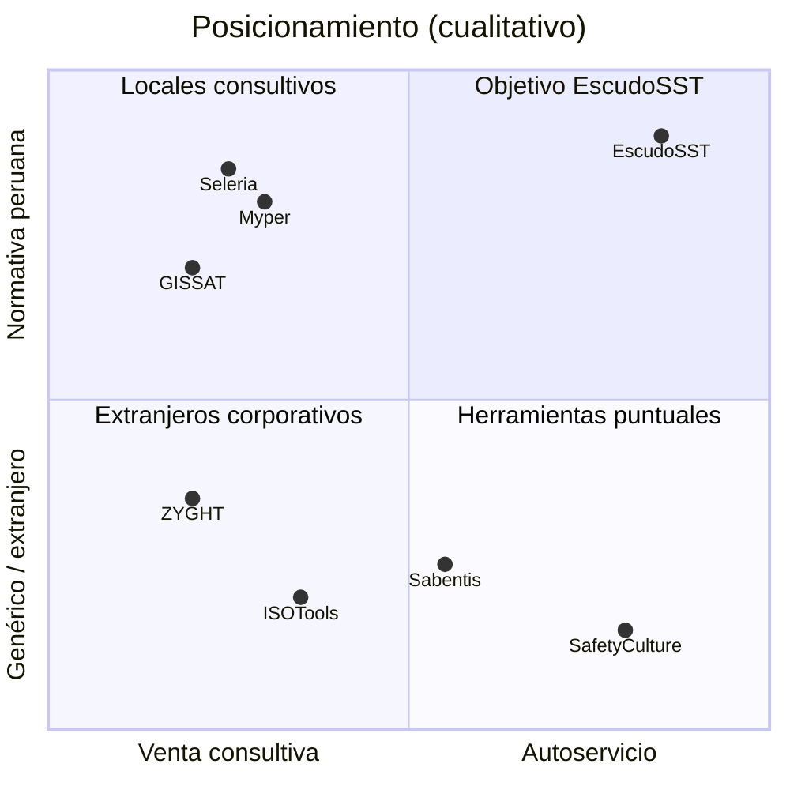
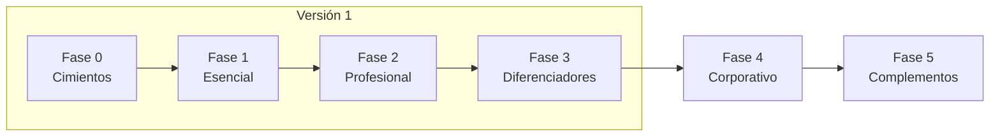

# 00 · Visión y alcance

> **EscudoSST**.
> Lema: «Cumple la Ley 29783 y llega preparado a SUNAFIL».
> Producto propio de GRUPO DE SOLUCIONES CREATIVAS. SaaS multiempresa por suscripción. No es un desarrollo a medida.

Fuente única de módulos y tablas: `spec/catalogo.json`. Si este documento y el catálogo difieren, manda el catálogo.

## 1. El problema

Las empresas peruanas deben implementar un Sistema de Gestión de SST (Ley 29783, D.S. 005-2012-TR). En la práctica:

- La gestión vive en Excel, Word, carpetas compartidas y papel.
- Los 9 registros obligatorios se arman a mano y quedan incompletos.
- Cuando llega SUNAFIL, el responsable SST pasa días juntando evidencias por trabajador y periodo.
- Los vencimientos (EMO, SCTR, capacitaciones, EPP, extintores) se pierden.
- Los permisos de alto riesgo (PETAR) y los ATS se llenan en papel en campo y no vuelven al sistema.
- El trabajador no instala apps; no reporta actos ni condiciones subestándar.
- La capacitación, la credencial del trabajador y el control en campo están desconectados.
- Las capacitaciones virtuales no prueban cuánto estudió cada trabajador, los certificados no se pueden verificar y los institutos de seguridad venden cursos por WhatsApp y transferencias sin control.
- Las consultoras SST atienden a varios clientes sin una herramienta común.
- Una infracción muy grave para una empresa no MYPE puede llegar a **52.53 UIT** (UIT 2026 = S/ 5,500). Los sectores más inspeccionados por accidentes son manufactura, servicios, construcción, minería y comercio.

## 2. El producto

Una plataforma web + PWA que cubre el ciclo completo del SG-SST:

1. **Planificar:** línea base, política, requisitos legales, plan y programa anual, IPERC, comité.
2. **Operar en campo:** inspecciones, actos y condiciones, charlas, ATS, PETAR, EPP, emergencias.
3. **Personas y salud:** capacitaciones con matriz por cargo y certificados verificables, aula virtual propia, venta de cursos, fotocheck con QR, EMO y aptitud con base médica separada.
4. **Eventos y mejora:** accidentes, investigación, acciones correctivas, auditorías, estadísticas, 9 registros.
5. **Contratistas:** acreditación, SCTR, ingreso por QR.
6. **Demostrar cumplimiento:** Modo Inspección SUNAFIL, que arma el expediente por trabajador y periodo.

Reglas de producto:

- Solo nube. Sin instalación on-premise.
- Solo Perú en esta etapa. Interfaz en español (Perú), moneda soles, zona horaria America/Lima.
- Todo valor legal es un parámetro con vigencia, marcado «a confirmar por especialista SST/legal».
- Al bajar de plan nunca se borran datos: pasan a solo lectura.

## 3. Segmento de entrada

| Aspecto | Definición |
|---|---|
| Plan de entrada | **Profesional** |
| Tamaño | 20 a 200 trabajadores, con Comité SST paritario |
| Sectores | Manufactura, servicios, comercio, construcción |
| Canales | Venta directa (autoservicio con prueba gratuita) y venta por consultoras SST (plan Consultora) |
| Comprador | Jefe SST, gerente general o de RR. HH. |
| Usuario diario | Jefe SST, supervisor SST, jefes de área, comité |
| Usuario masivo | Trabajador (PWA sin instalar desde tienda, QR, WhatsApp) |

Segmentos siguientes: empresas pequeñas con Supervisor SST (plan Esencial) y empresas grandes con contratistas y PETAR (plan Corporativo).

## 4. Planes y complementos

Precios: **por definir** (en pantallas usar «S/ —»).

| Plan | Código | Para quién | Módulos |
|---|---|---|---|
| Esencial | E | Menos de 20 trabajadores, con Supervisor SST | 22 |
| Profesional | P | 20 a 200 trabajadores, con Comité SST | 39 (Esencial + 17) |
| Corporativo | C | Empresas grandes, contratistas, alto riesgo | 51 (Profesional + 12) |
| Complementos (7) | + | Contratables con cualquier plan | MOC, OFF, IAA, PSE, ISO, AMB, HOM |
| Consultora | K | Consultoras SST con varios clientes | CON. Precio por empresa gestionada. Cada empresa cliente conserva su propio plan |
| Interno | I | Equipo EscudoSST | SUS (panel del dueño del SaaS) y WEB (sitio web público y CMS) |

Los planes son acumulativos: Profesional incluye Esencial; Corporativo incluye ambos.

**Módulos activables por empresa.** El aula virtual (AUL) y la venta de cursos (VTA) forman parte del plan Profesional, pero cada empresa decide si los usa: (a) no usa aula y capacita solo de forma presencial en CAP; (b) capacita solo a su personal con el aula y sin pasarela (VTA desactivado); (c) es un instituto o una consultora que además vende cursos (AUL y VTA activos). **VTA viene desactivado por defecto.** Detalle en `docs/03-multiempresa-planes-y-suscripcion.md`.

### 4.1 Los 61 módulos

| Código | # | Módulo | Grupo | Plan | Fase |
|---|---|---|---|---|---|
| TEN | 1.1 | Empresas, sedes y áreas | Núcleo de la plataforma | Esencial | 0 |
| USR | 1.2 | Usuarios, roles y permisos | Núcleo de la plataforma | Esencial | 0 |
| TRB | 1.3 | Trabajadores y legajo | Núcleo de la plataforma | Esencial | 0 |
| DOC | 1.4 | Gestión documental | Núcleo de la plataforma | Esencial | 0 |
| NOT | 1.5 | Alertas y notificaciones | Núcleo de la plataforma | Esencial | 0 |
| DSH | 1.6 | Dashboard e indicadores | Núcleo de la plataforma | Esencial | 0 |
| FIR | 1.7 | Firma electrónica de registros | Núcleo de la plataforma | Profesional | 0 |
| AUD | 1.8 | Bitácora de auditoría | Núcleo de la plataforma | Esencial | 0 |
| SUS | 1.9 | Suscripciones y facturación | Núcleo de la plataforma | Interno | 0 |
| WEB | 1.10 | Sitio web público y CMS | Núcleo de la plataforma | Interno | 1 |
| LBA | 2.1 | Diagnóstico de línea base | Planificación del sistema de gestión | Esencial | 1 |
| POL | 2.2 | Política y objetivos SST | Planificación del sistema de gestión | Esencial | 1 |
| MRL | 2.3 | Matriz de requisitos legales | Planificación del sistema de gestión | Profesional | 2 |
| PLA | 2.4 | Plan Anual SST | Planificación del sistema de gestión | Esencial | 1 |
| PAS | 2.5 | Programa Anual SST (PASST) | Planificación del sistema de gestión | Esencial | 1 |
| PCA | 2.6 | Programa anual de capacitación | Planificación del sistema de gestión | Esencial | 1 |
| RIS | 2.7 | RISST | Planificación del sistema de gestión | Profesional | 2 |
| COM | 2.8 | Comité o Supervisor SST | Planificación del sistema de gestión | Esencial | 1 |
| PRE | 2.9 | Presupuesto SST | Planificación del sistema de gestión | Corporativo | 4 |
| IPC | 3.1 | Matriz IPERC | Gestión de riesgos | Esencial | 1 |
| MAP | 3.2 | Mapa de riesgos | Gestión de riesgos | Profesional | 2 |
| MAG | 3.3 | Monitoreo de agentes | Gestión de riesgos | Profesional | 2 |
| PSI | 3.4 | Riesgos ergonómicos y psicosociales | Gestión de riesgos | Corporativo | 4 |
| PET | 3.5 | PETS y procedimientos | Gestión de riesgos | Corporativo | 4 |
| MOC | 3.6 | Gestión del cambio | Gestión de riesgos | Complemento | 5 |
| INS | 4.1 | Inspecciones | Operación en campo | Esencial | 1 |
| ACT | 4.2 | Actos y condiciones subestándar | Operación en campo | Esencial | 1 |
| CH5 | 4.3 | Charlas de 5 minutos | Operación en campo | Profesional | 2 |
| ATS | 4.4 | ATS | Operación en campo | Profesional | 2 |
| PTR | 4.5 | PETAR y permisos de alto riesgo | Operación en campo | Corporativo | 4 |
| OBS | 4.6 | Observación de conducta segura | Operación en campo | Corporativo | 4 |
| EPP | 4.7 | EPP | Operación en campo | Esencial | 1 |
| EQE | 4.8 | Equipos de emergencia y botiquines | Operación en campo | Profesional | 2 |
| SIM | 4.9 | Simulacros y brigadas | Operación en campo | Profesional | 2 |
| CAP | 5.1 | Capacitaciones e inducciones | Personas y salud ocupacional | Esencial | 1 |
| AUL | 5.2 | Aula virtual SST | Personas y salud ocupacional | Profesional | 2 |
| FOT | 5.3 | Fotocheck SST con QR | Personas y salud ocupacional | Profesional | 2 |
| EMO | 5.4 | EMOs y aptitud | Personas y salud ocupacional | Profesional | 2 |
| VMD | 5.5 | Vigilancia médica | Personas y salud ocupacional | Corporativo | 4 |
| DES | 5.6 | Descansos médicos y ausentismo | Personas y salud ocupacional | Corporativo | 4 |
| VUL | 5.7 | Grupos vulnerables | Personas y salud ocupacional | Corporativo | 4 |
| VTA | 5.8 | Venta de cursos y pagos | Personas y salud ocupacional | Profesional | 2 |
| ACC | 6.1 | Accidentes, incidentes y enfermedades | Eventos y mejora continua | Esencial | 1 |
| INV | 6.2 | Investigación de causas | Eventos y mejora continua | Profesional | 2 |
| ACR | 6.3 | Acciones correctivas | Eventos y mejora continua | Esencial | 1 |
| AUI | 6.4 | Auditorías | Eventos y mejora continua | Profesional | 2 |
| EST | 6.5 | Estadísticas SST | Eventos y mejora continua | Esencial | 1 |
| RVD | 6.6 | Revisión por la dirección | Eventos y mejora continua | Corporativo | 4 |
| REG | 6.7 | Registros obligatorios | Eventos y mejora continua | Esencial | 1 |
| CTR | 7.1 | Acreditación de contratistas | Contratistas y terceros | Corporativo | 4 |
| SCT | 7.2 | Control de SCTR | Contratistas y terceros | Profesional | 2 |
| ING | 7.3 | Ingreso de terceros por QR | Contratistas y terceros | Corporativo | 4 |
| HOM | 7.4 | Homologación de proveedores | Contratistas y terceros | Complemento | 5 |
| SUN | 8.1 | Modo Inspección SUNAFIL | Diferenciadores e integraciones | Profesional | 2 |
| OFF | 8.2 | App móvil offline | Diferenciadores e integraciones | Complemento | 3 |
| IAA | 8.3 | Asistente IA | Diferenciadores e integraciones | Complemento | 3 |
| CON | 8.4 | Modo consultora y marca blanca | Diferenciadores e integraciones | Consultora | 3 |
| PSE | 8.5 | Paquetes sectoriales | Diferenciadores e integraciones | Complemento | 3 |
| ISO | 8.6 | Sistema integrado ISO | Diferenciadores e integraciones | Complemento | 5 |
| AMB | 8.7 | Medio ambiente (SSOMA) | Diferenciadores e integraciones | Complemento | 5 |
| API | 8.8 | API e integraciones | Diferenciadores e integraciones | Corporativo | 4 |

## 5. Diferenciadores

| # | Diferenciador | Módulo | Plan | Brecha de mercado que cubre |
|---|---|---|---|---|
| 1 | Modo Inspección SUNAFIL | SUN | P | La inspección se prepara a mano. Aquí el expediente por trabajador y periodo se genera solo y se comparte con un link temporal |
| 2 | Fotocheck SST con QR | FOT | P | Capacitación, credencial y campo desconectados. El QR muestra en campo si el trabajador está habilitado |
| 3 | Reporte sin app por QR o WhatsApp | ACT | E | El trabajador no instala apps. Escanea un QR o escribe por WhatsApp |
| 4 | Modo consultora y marca blanca | CON | K | Las consultoras no tienen herramienta multi-cliente |
| 5 | App offline nativa | OFF | + | En la competencia el offline es a pedido o no existe |
| 6 | Asistente IA en la gestión diaria | IAA | + | La IA se usa poco en el trabajo diario. Aquí sugiere IPERC, guía investigaciones, lee documentos y redacta actas, siempre con aprobación humana |
| 7 | Paquetes sectoriales | PSE | + | Cada empresa arma sus formatos desde cero |

Diferenciadores comerciales transversales:

- **Precios publicados y autoservicio.** Ningún competidor peruano los publica. Registro con RUC, prueba gratuita y asistente de línea base.
- **PETAR digital** con aprobaciones en cadena y uso en campo (plan Corporativo + OFF).
- **Base médica separada y cifrada**, con re-autenticación y bitácora de accesos (Ley 29733).

### 5.1 Aula virtual propia y venta de cursos (plan Profesional)

- **Aula virtual propia (AUL)**, sin depender de otra plataforma: todo se trabaja dentro del curso (contenido, participantes, calificaciones, evaluaciones y configuración); contenidos de texto, video alojado en Vimeo, documento, enlace y evaluación; recorrido secuencial; bancos de preguntas generales y por curso con importación desde Excel y preguntas al azar; escalas de calificación por curso (0-20, 0-10, 0-100, AD/A/B/C, A/B/C/D); capacitador con permisos configurables y su disponibilidad; compromiso de culminación; **tiempo de permanencia real por actividad**, no por ventana abierta. La conexión con Moodle por API es opcional para quien ya lo use.
- **Capacitaciones (CAP)** con **matriz de capacitación por cargo**, control de vencimientos y **certificados** con plantilla, validación del administrador, anulación y verificación pública por código.
- **Venta de cursos y pagos (VTA)**: catálogo público por empresa, precio definido por la empresa, cupones, carrito, pasarela de pagos (por definir), matrícula automática al confirmarse el pago, venta de cupos a empresas, portal del participante externo, comprobantes electrónicos de la empresa vendedora y reembolsos.
- **Recomendación de cursos (funcionalidad destacada, pedida por los clientes).** El aula recomienda a trabajadores, participantes externos y empresas compradoras el curso que necesitan: por **reglas automáticas** (brechas de la matriz por cargo, recapacitación antes de que venza un certificado, siguiente curso de una ruta, complementarios del curso aprobado, cursos ligados a hallazgos de inspección o accidentes del área, perfil similar de compra), por **recomendación manual** del Jefe SST, el capacitador o el administrador, y con el complemento IAA por **sugerencias de IA que una persona aprueba**. Se muestran en «Recomendados para ti» y en el catálogo público, y se envían por correo o WhatsApp con consentimiento y límite de envíos; nunca usan datos médicos y se mide su conversión (vista, clic, matrícula o compra).

### 5.2 Sitio web público y CMS (módulo interno WEB, fase 1)

La web de venta de EscudoSST es parte del producto y de la versión 1, y la administra el Dueño de la plataforma sin tocar código (especificación: `docs/modulos/M-WEB.md`; referencia de estructura: sell-saas.com):

- **Portada:** barra de anuncio; cabecera con logo, menú «Productos» desplegable, «Cómo funciona», «Planes», «Iniciar sesión», «Agenda una demo» y «Prueba gratis»; héroe con ventajas en viñetas; **videos** (presentación y tutorial, incrustados desde YouTube o Vimeo); **módulos** con un bloque por grupo o diferenciador con descripción, viñetas, **maqueta visual de la pantalla** y botones «Probar gratis» y «Ver demo»; **cómo funciona** en pasos; **planes y precios**; **demostración** (agendar y demo interactiva); **formularios** de demo, contacto y cotización; **botón flotante de WhatsApp** con número y mensaje por página; **otros productos de GRUPO DE SOLUCIONES CREATIVAS**; preguntas frecuentes; **testimonios** con consentimiento y aprobación (los de demo, rotulados «ejemplo»); **sellos de confianza veraces** (ninguna certificación que no se tenga); CTA final; pie con datos legales, políticas, Libro de Reclamaciones y redes.
- **Otras páginas:** producto y módulos, una por cada uno de los 7 diferenciadores, páginas por sector para SEO (construcción, minería, agroindustria, manufactura, retail, oficinas, clínicas), complementos, consultoras, casos, «Prueba gratis» (registro autoservicio con RUC de SUS/TEN) e «Iniciar sesión».
- **Blog en WordPress, aparte:** el dueño lo mantiene en WordPress; la web enlaza a él (URL editable) y la portada muestra sus últimos artículos leyendo la API REST pública con caché. EscudoSST no tiene editor de blog propio.
- **Precios editables:** la web lee `plans.price_reference` y `addons.price_reference`; si un plan no tiene precio publicado muestra «Solicitar cotización». Cambiar un plan en el panel lo cambia en la web.
- **Marca y dominio:** logo editable desde el panel (provisional hasta que el dueño diseñe el definitivo); dominio **escudosst.com**, editable en los ajustes.
- **SEO técnico:** metadatos editables por página, `sitemap.xml`, `robots.txt`, datos estructurados, URLs canónicas, redirecciones 301, renderizado en servidor (Next.js) y Core Web Vitals como criterio de aceptación.
- **Legal:** datos del titular editables (GRUPO DE SOLUCIONES CREATIVAS SAC, RUC 20607431117, domicilio legal por completar); políticas versionadas con re-aceptación obligatoria (Términos, Privacidad, Cookies, Encargo de tratamiento, SLA); aviso de cookies por categorías; **Libro de Reclamaciones virtual** completo (hoja, constancia, seguimiento por código, plazos con semáforo, prórroga, reporte para Indecopi, no se borra). Plazos y conservación como parámetros a confirmar con abogado. Es distinto del Libro de Reclamaciones que pueda necesitar una empresa cliente que vende cursos (VTA).
- **Panel:** editor de páginas por bloques, marca y logo, menú, WhatsApp, planes visibles, otros productos, testimonios, preguntas frecuentes, políticas, bandeja de reclamos y de solicitudes, redirecciones.

## 6. Competencia y posicionamiento

| Competidor | Origen | Fortalezas | Debilidades frente a EscudoSST |
|---|---|---|---|
| Seleria (Data Mining Solutions) | Perú | +200 empresas, ISO 27001, app Seleria+, salud ocupacional para clínicas, contratistas con IA que lee manuscritos, integración Odoo | Sin precios publicados ni autoservicio; venta consultiva |
| Myper SSOMA | Perú | 17 módulos, nube Azure u on-premise, implementación guiada, prueba gratuita, clientes mineros | Offline solo a pedido; sin autoservicio; enfoque minero |
| GISSAT | Perú | SaaS + tercerización BPO, IPER automatizado, SCAT, mapas de riesgo | Empresa pequeña; depende del servicio humano |
| Novasoft | Colombia | ERP con módulo SG-SST | Norma colombiana; no cubre los registros peruanos |
| Sabentis | España | Planes publicados, IA generativa | No adaptado a normativa peruana ni a SUNAFIL |
| ZYGHT | Chile | Gran empresa, plataforma amplia | Orientado a corporativos; complejo para pymes |
| SafetyCulture | Global | Inspecciones móviles muy buenas | No es un SG-SST peruano; sin registros obligatorios |
| ISOTools | España | Sistemas integrados ISO | Genérico; poco campo; sin normativa peruana específica |

**Posicionamiento:** el SG-SST peruano más fácil de empezar. Precio publicado, autoservicio, cumplimiento de la Ley 29783 desde el primer día y expediente SUNAFIL listo. Hecho para pymes formales con Comité SST y para las consultoras que las atienden.

## 7. Fases

Las fases no tienen fechas. El orden es obligatorio: una fase se apoya en la anterior.

| Fase | Nombre | Contenido | Versión |
|---|---|---|---|
| 0 | Cimientos | Multiempresa, usuarios y permisos, trabajadores, documentos, notificaciones, dashboard, firma, auditoría, suscripciones | V1 |
| 1 | Plan Esencial | Los 15 módulos de ley para empezar: línea base, política, plan y programa, comité, IPERC, inspecciones, actos, EPP, capacitaciones, accidentes, acciones, estadísticas, registros; y el sitio web público con su CMS (WEB, interno) para captar clientes | V1 |
| 2 | Plan Profesional | Los 16 módulos que completan el plan de entrada, incluidos SUN, FOT, el aula virtual (AUL) y la venta de cursos (VTA) | V1 |
| 3 | Diferenciadores | OFF, IAA, CON, PSE. **Cierra la versión 1** | V1 |
| 4 | Plan Corporativo | PRE, PSI, PET, PTR, OBS, VMD, DES, VUL, RVD, CTR, ING, API | Posterior |
| 5 | Complementos restantes | MOC, HOM, ISO, AMB | Posterior |

Nota: FIR pertenece al plan Profesional pero se construye en la fase 0 porque otros módulos lo usan.

## 8. Qué no hace el producto

- No se instala en servidores del cliente (sin on-premise).
- No atiende otros países ni otra normativa en esta etapa (sin norma colombiana, chilena ni otras).
- No es un sistema de historia clínica completo ni reemplaza el sistema de una clínica. Guarda lo necesario para la vigilancia ocupacional.
- No calcula planillas, no paga sueldos y no reemplaza a T-Registro ni al PLAME. Importa trabajadores desde Excel.
- No emite el SCTR ni contrata pólizas. Controla vigencias.
- No presenta trámites ante SUNAFIL, MTPE ni otras entidades en nombre del cliente. Prepara la información y los formatos.
- No da asesoría legal. Los valores legales son parámetros que confirma un especialista.
- La IA no aprueba nada por sí sola. Todo lo que sugiere requiere aprobación humana.
- No ofrece servicio de tercerización (BPO) de la gestión SST. Las consultoras lo hacen con el plan Consultora.
- No vende hardware (lectores, tablets, torniquetes).
- No vende cursos propios de EscudoSST ni opera un marketplace entre empresas: cada empresa vende sus cursos, con sus precios y sus comprobantes.
- No guarda datos de tarjeta: los pagos los procesa la pasarela que configure cada empresa.
