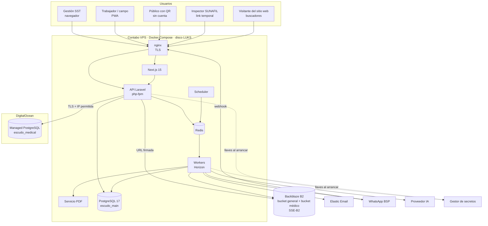
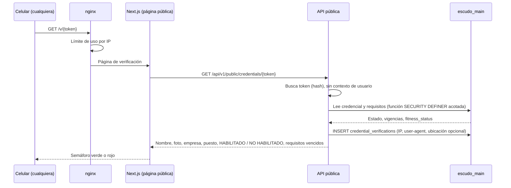
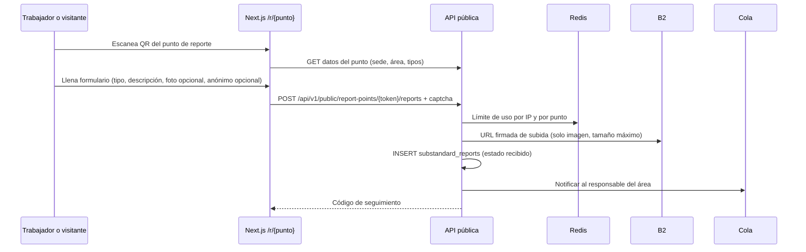
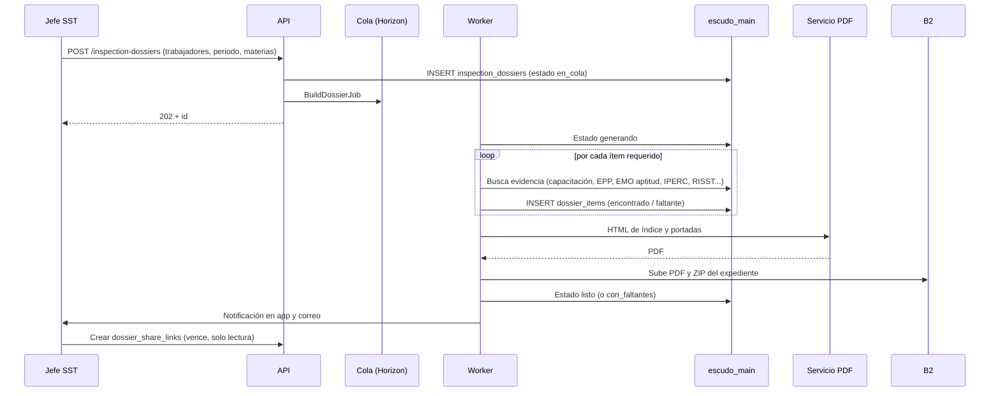
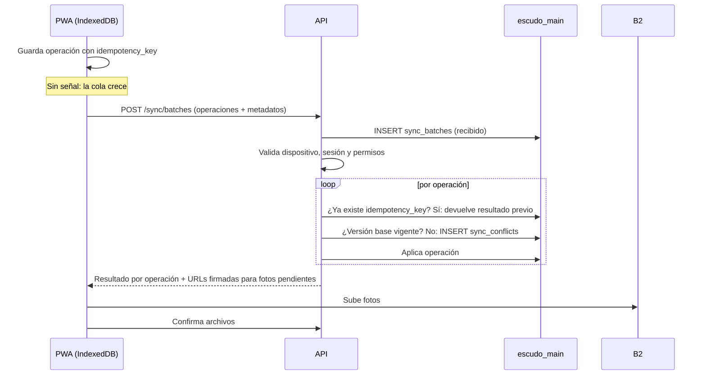

# 01 · Arquitectura

Decisiones obligatorias en `spec/contexto.md`. Este documento las detalla. Infraestructura y despliegue: `15-infraestructura-y-despliegue.md`.

## 1. Principios

1. **Solo nube.** Una sola instalación multiempresa. Sin on-premise.
2. **Aislamiento por RLS forzado** en PostgreSQL, no solo en la aplicación.
3. **Datos médicos en otra base, otro proveedor.** La base principal solo conoce `fitness_status`.
4. **Proveedores detrás de interfaces:** almacenamiento, correo, mensajería, IA, firma, PDF.
5. **Trabajo pesado en colas:** PDF, expedientes, importaciones, notificaciones, IA, sincronización.
6. **Campo primero:** PWA instalable, offline con IndexedDB y sincronización idempotente.
7. **Monolito modular.** Un solo backend Laravel dividido por módulos del catálogo. Sin microservicios, salvo el servicio de PDF.

## 2. Componentes

| Componente | Tecnología | Ubicación | Responsabilidad |
|---|---|---|---|
| API | Laravel 12 / PHP 8.4, php-fpm detrás de nginx | Contabo | API REST `/api/v1`, autenticación, permisos, feature flags, reglas de negocio, RLS por petición |
| Workers de cola | Laravel Horizon sobre Redis | Contabo | PDF, expediente SUNAFIL, carga masiva, envíos de correo y WhatsApp, IA, procesamiento de lotes offline, webhooks salientes |
| Scheduler | `php artisan schedule:work` | Contabo | Vencimientos, recordatorios, snapshots de KPI, caducidad de links y accesos temporales, limpieza |
| Web | Next.js 15 + TypeScript (App Router) | Contabo | Aplicación de gestión, panel consultora, panel del dueño, páginas públicas (verificación de fotocheck, reporte por QR) y **sitio web público de EscudoSST** (módulo WEB) con renderizado en servidor |
| PWA trabajador/campo | Next.js 15, service worker, IndexedDB | Navegador del dispositivo | Vista del trabajador y de campo; offline con cola de sincronización |
| Servicio de PDF | Contenedor con Chromium headless (Gotenberg o similar) | Contabo, red interna | Convierte HTML a PDF. Sin acceso a internet ni a bases de datos |
| Redis | Redis 7 | Contabo | Colas, caché, límites de uso, bloqueos |
| Base principal | PostgreSQL 17, `escudo_main` | Contabo, disco LUKS | Todos los datos de negocio no médicos |
| Base médica | DigitalOcean Managed PostgreSQL, `escudo_medical` | DigitalOcean | Tablas `db: med`: EMO, VMD, DES, VUL |
| Almacenamiento | Backblaze B2 (API S3) con SSE-B2 | B2 | Evidencias, fotos, PDF, firmas, respaldos. Bucket médico separado |
| Correo | Elastic Email | Externo | Correos transaccionales |
| WhatsApp | WhatsApp Business API vía BSP (por definir) | Externo | Alertas y reporte de actos/condiciones |
| IA | Proveedor LLM (por definir) | Externo | Sugerencias del asistente (IAA) |
| Gestor de secretos | Por definir (ver `13-decisiones-abiertas.md`) | Fuera del servidor de datos | Llaves de cifrado y credenciales |

### 2.1 Interfaces de proveedor (backend)

| Interfaz | Implementación v1 | Alternativas futuras |
|---|---|---|
| `FileStorage` | B2 (S3 compatible) | S3, R2, MinIO |
| `MailChannel` | Elastic Email | SES, Postmark |
| `MessagingChannel` | BSP de WhatsApp | Otro BSP, SMS |
| `AiProvider` | Proveedor LLM elegido | Otro LLM |
| `SignatureProvider` | Firma simple con evidencias | Firma digital con certificado |
| `PdfRenderer` | Servicio interno de PDF | Otro motor |
| `MedicalRepository` | Conexión `medical` a DigitalOcean | — |

## 3. Diagrama general



## 4. Petición típica y aislamiento

1. nginx termina TLS y pasa la petición a la API.
2. Middleware `Authenticate`: token de sesión (Sanctum) y MFA si aplica.
3. Middleware `ResolveCompany`: lee el encabezado `X-Company-Id`, valida la membresía del usuario y sus alcances (sede/área).
4. Middleware `SetTenantContext`: abre transacción y ejecuta `SET LOCAL app.company_id = '<uuid>'` y `SET LOCAL app.user_id = '<uuid>'`.
5. Middleware `FeatureGate`: verifica que el módulo esté en el plan o complementos. Si no, `403 module_not_in_plan`. Si el plan bajó, permite solo lectura (`403 module_read_only` en escrituras).
6. Policy de Laravel: permiso `module.resource.action` del rol.
7. Controlador → servicio de dominio → repositorio. Las consultas pasan por RLS.
8. `audit_logs` registra la escritura.

Los jobs de cola guardan `company_id` y `user_id` en su carga y repiten el paso 4 al ejecutarse. Un job sin `company_id` solo puede tocar tablas globales.

## 5. Flujos clave

### 5.1 Verificación pública de fotocheck (FOT)

El fotocheck lleva un QR con una URL pública y un token opaco. No lleva datos personales en el QR.



Reglas:
- Muestra solo lo especificado en `M-FOT`. Nunca diagnósticos ni restricciones médicas detalladas; solo «Aptitud médica: vigente / no vigente».
- El token se puede revocar. Una credencial revocada responde «No válida».
- Si un usuario autenticado de la empresa escanea, ve el detalle extendido según su rol.

### 5.2 Reporte de acto o condición por QR (ACT)



Por WhatsApp el flujo es igual: el webhook del BSP crea el reporte tras validar la firma del webhook y el opt-in del número.

### 5.3 Generación asíncrona del expediente SUNAFIL (SUN)



Reglas: el expediente no incluye documentos médicos; solo la constancia de aptitud. Los faltantes se listan con enlace para corregirlos.

### 5.4 Sincronización offline (OFF)

Detalle en `16-offline-y-sincronizacion.md`.



### 5.5 Lectura de dato médico con re-autenticación

```mermaid
sequenceDiagram
    participant M as Médico ocupacional
    participant W as Web
    participant A as API
    participant P as escudo_main
    participant MD as escudo_medical
    M->>W: Abre EMO de un trabajador
    W->>A: GET /medical/exams/{id}
    A-->>W: 401 reauth_required
    W->>M: Pide clave adicional (o MFA)
    M->>W: Ingresa clave
    W->>A: POST /auth/reauth
    A-->>W: Token médico de corta vigencia (ligado a sesión)
    W->>A: GET /medical/exams/{id} + token médico
    A->>A: Verifica rol, alcance y token
    A->>MD: SET LOCAL app.company_id; SELECT
    A->>P: INSERT sensitive_access_logs (usuario, trabajador, recurso, motivo, IP)
    A-->>W: Datos médicos (sin caché)
```

Reglas: respuesta con `Cache-Control: no-store`. Ningún dato médico pasa por colas, logs, correo, WhatsApp ni IA. El PDF médico se sirve desde el bucket médico con URL firmada de corta duración, y también se registra.

### 5.6 Sitio web público y CMS (WEB)

El sitio web de EscudoSST **no es un proyecto aparte**: vive en el mismo proyecto Next.js 15 (grupo de rutas `app/(site)/`), se despliega con la aplicación y lee su contenido de la misma API Laravel (módulo `WEB`, tablas globales sin `company_id`).

- **Renderizado en servidor** (Server Components con SSR e ISR) para que los buscadores reciban el HTML completo con metadatos y datos estructurados. Al publicar una página, la API emite un evento que invalida por etiqueta la caché de la ruta, del `sitemap.xml` y de los bloques que la listan (`revalidateTag`).
- **Blog en WordPress, aparte:** EscudoSST no tiene editor de blog. El bloque «Últimos artículos» lo arma el servidor de Next.js leyendo la API REST pública de WordPress (`/wp-json/wp/v2/posts`, sin credenciales) con caché y tiempo de espera corto; solo usa título, extracto en texto plano, imagen, fecha y enlace. Si WordPress falla se usa la última copia en caché o se oculta el bloque.
- **Videos** incrustados desde YouTube o Vimeo con carga diferida (miniatura hasta reproducir) y sujetos al consentimiento de cookies; **botón de WhatsApp** con enlace armado en el servidor desde `site_settings` y el mensaje de cada página; **logo** servido desde B2 por `site_settings` (provisional hasta el definitivo).
- **Rutas técnicas generadas:** `sitemap.xml` y `robots.txt` (desde contenido publicado y `site_settings`), redirecciones 301/302 resueltas en el middleware de Next.js desde `site_redirects` (cacheadas), URLs canónicas y JSON-LD por plantilla.
- **Planes y precios** se leen en el servidor desde `plans`, `plan_modules` y `addons` (SUS); sin precio se muestra «Solicitar cotización». Ningún monto en el código.
- **Endpoints públicos** de solo lectura del contenido publicado, y de escritura solo para cookies, hoja de reclamación, seguimiento y solicitud de demo, con límite de uso, captcha (proveedor por definir) y validación estricta (regla 7 de `CLAUDE.md`).
- **Cookies:** el consentimiento se resuelve antes de cargar cualquier script no necesario; la analítica (proveedor por definir) solo se inyecta si la categoría está aceptada.
- **Rendimiento:** presupuesto de Core Web Vitals por plantilla, medido en la integración continua; imágenes en formatos modernos e ilustraciones SVG propias.
- **Dominio:** escudosst.com (DA-05, decidida); se lee de `site_settings` y de la configuración del despliegue, nunca escrito en el código. El sitio va en el dominio raíz; si la aplicación y el blog van en subdominio o ruta sigue abierto en `13-decisiones-abiertas.md`.
- **Panel del dueño:** el CMS vive en `app/(owner)/site/` y solo lo usa el rol `platform_owner` (y `platform_support` para demos y lectura de reclamos).

## 6. Organización del código

```
backend/
  app/
    Core/            # tenancy, auth, feature flags, auditoría, interfaces de proveedor
    Modules/
      TEN/ USR/ TRB/ ... API/   # un directorio por código del catálogo
        Http/Controllers  Http/Requests  Http/Resources
        Models  Policies  Services  Jobs  Events  StateMachines
        routes.php
  database/migrations/main/
  database/migrations/medical/
frontend/
  app/(app)/<modulo>/        # pantallas de gestión
  app/(worker)/              # PWA del trabajador y campo
  app/(public)/v/ app/(public)/r/   # verificación y reporte
  app/(site)/                # sitio web público (WEB): portada, planes, sectores, demo, legal, libro de reclamaciones
  app/(owner)/               # panel del dueño
  lib/offline/               # IndexedDB, cola, sincronización
```

Un módulo solo llama a otro por su servicio público o por eventos de dominio. Nunca por sus tablas.

## 7. Decisiones y alternativas

| Decisión | Elegido | Alternativas descartadas | Motivo |
|---|---|---|---|
| Despliegue | Solo nube | On-premise | Un solo código, actualizaciones uniformes, menor soporte |
| Aislamiento | Base compartida con RLS forzado | Base por empresa; esquema por empresa | Escala a miles de empresas pequeñas; RLS impide fugas aunque falle la aplicación |
| Backend | Monolito modular Laravel | Microservicios | Equipo y operación más simples; módulos con fronteras claras |
| Datos médicos | Base separada en DigitalOcean | Misma base con cifrado de columnas | Separación física, cifrado en reposo administrado, acceso por IP permitida; reduce impacto de una brecha |
| Frontend | Next.js + PWA | App nativa iOS/Android | El trabajador no instala desde tienda; un solo código |
| Sitio web público | Mismo proyecto Next.js con SSR/ISR y CMS propio (WEB); blog aparte en WordPress | Todo el sitio en WordPress; sitio estático aparte | Precios y planes leídos de la misma configuración, políticas, aceptaciones y reclamos en la misma base, SEO con HTML en servidor y un solo despliegue; el blog en WordPress da al dueño su herramienta de redacción habitual |
| Archivos | B2 con SSE y URLs firmadas | Disco local; S3 | Costo de almacenamiento y compatibilidad S3; interfaz permite migrar |
| Colas | Redis + Horizon | RabbitMQ; base de datos | Nativo en Laravel; visibilidad de jobs |
| PDF | Servicio Chromium aislado | Librería PHP (DomPDF) | Fidelidad de formatos R.M. 050-2013-TR y tablas largas |
| Identificadores | UUID v7 | Enteros | Generables offline, ordenables, no enumerables |
| Mensajería | WhatsApp vía BSP detrás de `MessagingChannel` | Integración directa con Meta | Plantillas y opt-in gestionados; proveedor intercambiable |
