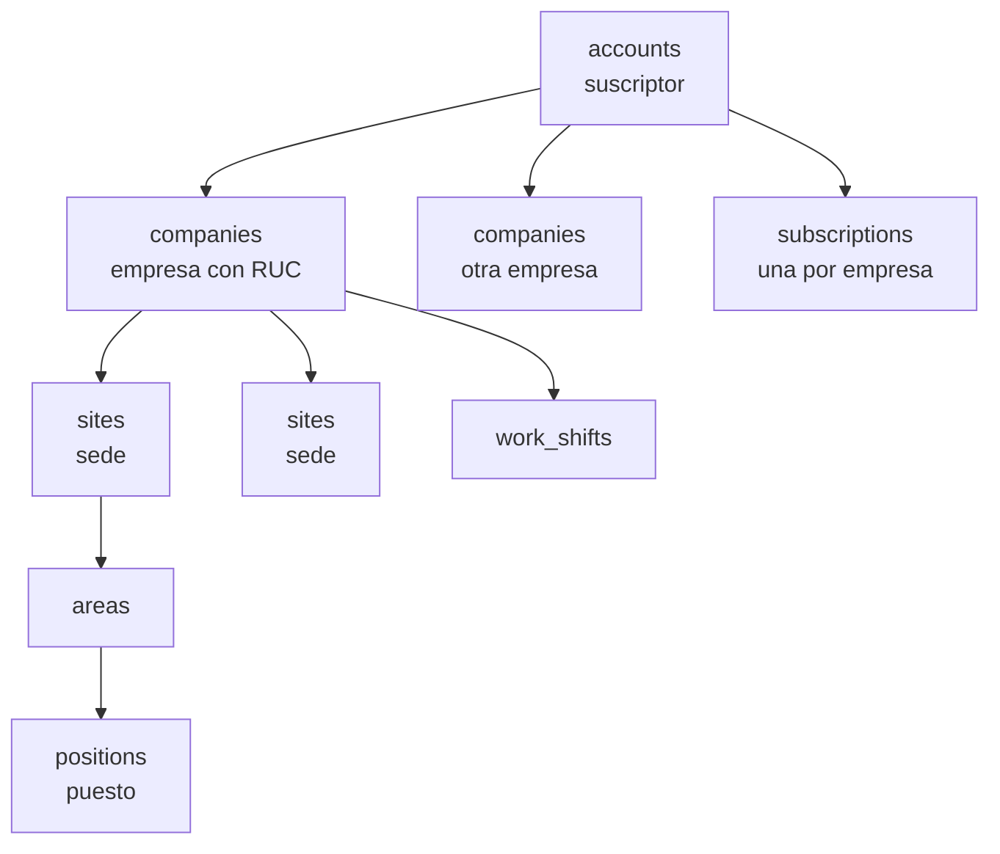
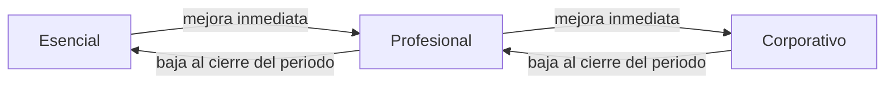
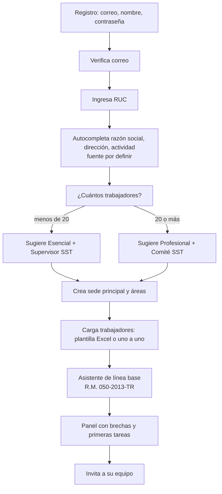

# 03 · Multiempresa, planes y suscripción

Módulos involucrados: TEN, USR, SUS, CON, AUD. Precios: **por definir** en todo este documento.

## 1. Jerarquía



| Nivel | Tabla | Qué es | Regla |
|---|---|---|---|
| Cuenta | `accounts` | Quien contrata y paga | Tiene uno o más administradores de cuenta |
| Empresa | `companies` | Empleador con RUC | RUC único por cuenta. Unidad de aislamiento (`company_id`) |
| Sede | `sites` | Local, obra, planta, tienda | Pertenece a una empresa |
| Área | `areas` | Unidad organizativa | Pertenece a una sede |
| Puesto | `positions` | Cargo con riesgos (IPERC, EPP, EMO) | Pertenece a la empresa; se asigna a áreas |
| Turno | `work_shifts` | Horarios de trabajo | Usado en horas-hombre y asistencia |

Casos:
- **Empresa directa:** una cuenta, una empresa (a veces varias del mismo grupo económico).
- **Consultora:** una cuenta (plan Consultora) con muchas empresas cliente.
- **Grupo empresarial:** una cuenta con varias empresas, cada una con su RUC y su suscripción.

## 2. Aislamiento con RLS

- Toda tabla de negocio tiene `company_id NOT NULL`.
- `ALTER TABLE ... ENABLE ROW LEVEL SECURITY` y `FORCE ROW LEVEL SECURITY`.
- Política tipo:

```sql
CREATE POLICY rls_iperc_rows_company ON iperc_rows
  USING (company_id = NULLIF(current_setting('app.company_id', true), '')::uuid)
  WITH CHECK (company_id = NULLIF(current_setting('app.company_id', true), '')::uuid);
```

- La API fija `SET LOCAL app.company_id` al inicio de cada transacción (ver `01-arquitectura.md` §4).
- Si `app.company_id` no está fijado, `current_setting(..., true)` devuelve vacío, `NULLIF` lo convierte en NULL, la condición no se cumple y la consulta no devuelve nada (forma usada en `database/schema_main.sql`). Nunca usar un valor por defecto permisivo.
- El rol de base de datos de la aplicación **no** es dueño de las tablas y **no** tiene `BYPASSRLS`.
- FK compuestas `(company_id, id)` entre tablas de empresa: imposible enlazar filas de dos empresas.
- Tablas globales sin `company_id`: catálogos de normas (`legal_norms`), peligros base, `agent_types`, `sector_packs`, `plans`, `addons`, `iso_standards`, parámetros legales. Lectura para todos, escritura solo del dueño de la plataforma.
- Tablas de cuenta (`accounts`, `subscriptions`, `invoices`, `white_label_settings`) usan `app.account_id`.
- Base médica: misma regla con su propio `company_id` y RLS. Las referencias a `worker_id` se validan en la aplicación (no hay FK entre bases).
- Vistas consolidadas (panel consultora, panel del dueño) no desactivan RLS: iteran por empresa con su contexto o usan funciones `SECURITY DEFINER` acotadas, revisadas y probadas, que devuelven solo agregados.

## 3. Membresías y alcances

- Un `user` es una persona con un correo. Puede pertenecer a varias empresas.
- `memberships`: (usuario, empresa, rol). Un usuario tiene un rol por empresa.
- `membership_scopes`: limita la membresía a sedes o áreas. Sin alcances = toda la empresa.
- Al iniciar sesión, si tiene varias empresas, elige una (selector en la cabecera). El cambio de empresa recarga permisos y feature flags.
- El trabajador se vincula a `workers` por `user_id` cuando activa su acceso (DNI + código o enlace de invitación).
- Membresías temporales (`expires_at`): auditor externo y soporte de plataforma. El scheduler las vence.

| Ejemplo | Membresías |
|---|---|
| Jefe SST de una empresa | 1 × `sst_manager` |
| Consultor | N × `consultant`, una por empresa asignada (`consultant_assignments`) |
| Jefe de área de planta Lurín | 1 × `area_lead` con alcance sede Lurín, área Producción |
| Trabajador que también es miembro del comité | 1 × `committee_member` (incluye permisos de trabajador sobre lo suyo) |

## 4. Consultoras (módulo CON)

- La consultora es **una cuenta** con plan Consultora (`K`).
- Agrega empresas cliente de dos formas:
  1. **Crea** la empresa dentro de su cuenta (el cliente no tiene cuenta propia).
  2. **Invita** a una empresa que ya tiene cuenta propia (`client_invitations`). El cliente acepta y otorga acceso; puede revocarlo.
- Cada empresa cliente tiene **su propio plan** (Esencial, Profesional o Corporativo) y sus complementos.
- El cobro de la consultora es por empresa gestionada (monto por definir). Quién paga el plan de cada cliente se define en la suscripción: la consultora o el cliente.
- `consultant_assignments`: qué consultor atiende qué empresa.
- **Panel multi-cliente:** semáforo de cumplimiento por empresa, vencimientos próximos, tareas pendientes, accidentes recientes. Solo agregados; el detalle se ve entrando a la empresa.
- **Marca blanca** (`white_label_settings`): logo, colores primarios, nombre comercial, dominio propio opcional (subdominio por defecto), remitente de correo con dominio verificado. Los PDF y el fotocheck salen con la marca de la consultora. El pie «Con tecnología EscudoSST» es configurable por el dueño de la plataforma.
- Al terminar la relación: los datos son de la empresa cliente. La consultora pierde acceso; la empresa puede pasar a cuenta propia sin perder datos.

## 5. Planes acumulativos

| Plan | Incluye | Módulos propios |
|---|---|---|
| Esencial (E) | E | TEN, USR, TRB, DOC, NOT, DSH, AUD, LBA, POL, PLA, PAS, PCA, COM, IPC, INS, ACT, EPP, CAP, ACC, ACR, EST, REG (22) |
| Profesional (P) | E + P | FIR, MRL, RIS, MAP, MAG, CH5, ATS, EQE, SIM, AUL, FOT, EMO, VTA, INV, AUI, SCT, SUN (+17 = 39) |
| Corporativo (C) | E + P + C | PRE, PSI, PET, PTR, OBS, VMD, DES, VUL, RVD, CTR, ING, API (+12 = 51) |

Límites por plan (valores por definir, configurables en `plans`): trabajadores, sedes, usuarios de gestión, almacenamiento, solicitudes IA (si tiene IAA), puntos de reporte QR.

## 6. Complementos

| Código | Complemento | Fase | En V1 |
|---|---|---|---|
| OFF | App móvil offline | 3 | Sí |
| IAA | Asistente IA | 3 | Sí |
| PSE | Paquetes sectoriales | 3 | Sí |
| MOC | Gestión del cambio | 5 | No |
| ISO | Sistema integrado ISO | 5 | No |
| AMB | Medio ambiente (SSOMA) | 5 | No |
| HOM | Homologación de proveedores | 5 | No |

Son 7 complementos. Se contratan con cualquier plan (`subscription_addons`). PSE se contrata por sector (uno o varios paquetes). El aula virtual (AUL) dejó de ser complemento: es parte del plan Profesional (ver 7.1).

## 7. Feature flags

- `feature_flags` por empresa se calculan desde: plan + complementos + excepciones manuales del dueño (pruebas, pilotos).
- Resultado por módulo: `enabled`, `read_only`, `locked` o `disabled_by_company` (solo AUL y VTA, ver 7.1).
- Se cachean en Redis por empresa y se invalidan al cambiar la suscripción.
- El backend los aplica en el middleware `FeatureGate`. El frontend los usa solo para mostrar; nunca son la única barrera.
- Las dependencias entre módulos se respetan: si un módulo usa datos de otro que no está en el plan, muestra solo lo disponible (por ejemplo, SUN sin EMO no incluye aptitud y lo indica como «no contratado»).

### 7.1 Módulos activables por empresa: AUL y VTA

El aula virtual (AUL) y la venta de cursos (VTA) están incluidos en el plan Profesional, pero **cada empresa decide si los usa**. La decisión es del administrador de cuenta, por empresa (pantalla «Módulos opcionales por empresa» en [M-SUS](modulos/M-SUS.md)).

| Caso | AUL | VTA | Uso típico |
|---|---|---|---|
| Empresa que no usa aula | Desactivado | Desactivado | Capacita solo de forma presencial en CAP (sesiones, asistencia, certificados, matriz por cargo) |
| Empresa que capacita solo a su personal (caso interno) | Activo | Desactivado | Cursos del aula para trabajadores propios y de contratistas; sin pasarela, sin catálogo público, sin participantes externos |
| Instituto o consultora que vende cursos | Activo | Activo | Además del caso interno: catálogo público, pasarela, cupos para empresas compradoras, participantes externos, comprobantes |

Reglas:

- El flag efectivo es `enabled` solo si el plan (o una excepción del dueño) incluye el módulo **y** la empresa lo tiene activado (`company_enabled`). Si el plan lo incluye y la empresa lo desactivó, el modo es `disabled_by_company`: el módulo no aparece en el menú y no se muestra la invitación a mejorar el plan.
- Valores al crear una empresa con plan que los incluye: AUL activo; **VTA desactivado por defecto**.
- VTA solo se activa si AUL está activo en la misma empresa; AUL no se desactiva mientras VTA esté activo.
- Desactivar no borra datos: cursos, matrículas, pedidos, comprobantes y participantes quedan en solo lectura para el administrador; los certificados emitidos siguen verificables y las matrículas pagadas conservan su acceso hasta su vencimiento.
- Si la empresa baja a un plan que no incluye AUL o VTA, se aplica la regla general (solo lectura); la activación por empresa se conserva para cuando vuelva a subir.
- Cada activación o desactivación queda en `audit_logs` con usuario y motivo.
- En una cuenta Consultora, cada empresa cliente decide sus activaciones; la consultora que vende cursos lo hace desde su propia empresa con VTA activo y sus clientes le compran cupos.

## 8. Subir y bajar de plan



| Acción | Efecto |
|---|---|
| Subir de plan | Inmediato. Se prorratea el cobro (regla por definir). Los módulos nuevos aparecen habilitados. Se sugiere un recorrido guiado |
| Agregar complemento | Inmediato |
| Bajar de plan | Al cierre del periodo pagado. Los módulos que salen quedan en **solo lectura**. Nada se borra. Las alertas de esos módulos se pausan |
| Quitar complemento | Igual que bajar: solo lectura. OFF: los dispositivos deben sincronizar antes; se avisa a los usuarios |
| Exceder un límite | No se bloquea lo existente. Se impide crear más (p. ej. trabajadores) y se invita a mejorar |
| Suscripción vencida | Periodo de gracia (parámetro). Luego la empresa entera queda en solo lectura. Exportación siempre disponible |
| Cancelación | Solo lectura y exportación durante un periodo de retención (parámetro). Luego borrado según `10-seguridad-y-privacidad.md` |

Regla: el **cumplimiento legal del cliente no depende de pagar**. Siempre puede descargar sus registros.

## 9. Prueba gratuita

- Duración: parámetro (por definir).
- Plan de prueba: Profesional completo, sin complementos (IAA con cupo reducido si se habilita). VTA queda desactivado durante la prueba salvo que el dueño lo habilite para un piloto (decisión abierta, ver `13`).
- Sin tarjeta para empezar (decisión abierta, ver `13`).
- Datos reales desde el primer día; al contratar, se conservan.
- Si no contrata: solo lectura y luego borrado según retención. Se avisa por correo antes.
- Una prueba por RUC.

## 10. Onboarding autoservicio



1. **Registro con RUC.** Valida formato y dígito verificador. La consulta de datos al padrón SUNAT depende de la fuente elegida (decisión abierta). Si no hay fuente, el usuario completa los datos.
2. **Carga de trabajadores.** Plantilla Excel descargable (columnas compatibles con lo que la empresa saca de su planilla o T-Registro). Flujo de carga masiva con validación por fila (ver máquina de estados en `06`). Mínimo para avanzar: un trabajador.
3. **Asistente de línea base.** Preguntas en lenguaje simple agrupadas por los lineamientos de la R.M. 050-2013-TR. Genera `baseline_assessments` con puntaje y `baseline_gaps`. Cada brecha propone una acción y enlaza al módulo que la resuelve.
4. **Primeras tareas.** Lista de inicio: política SST, IPERC del primer puesto, elección del comité o designación del supervisor, plan anual.
5. **Paquete sectorial.** Si la empresa tiene PSE, ofrece cargar plantillas del sector.

Una consultora hace el mismo flujo por cada empresa cliente desde su panel.

## 11. Panel del dueño del SaaS (SUS, rol `platform_owner`)

| Sección | Contenido |
|---|---|
| Cuentas y empresas | Lista, plan, estado, fecha de alta, trabajadores, uso. Sin acceso a datos de negocio |
| Suscripciones | Alta, cambio de plan, complementos, excepciones de flags, periodo de gracia |
| Facturación | Facturas, pagos, estado, reintentos. Integración con pasarela y facturación electrónica por definir |
| Planes y complementos | Configuración de `plans`, `plan_modules`, `addons`, límites. Precios «Por definir» hasta que el dueño los cargue |
| Catálogos globales | Normas, peligros base, parámetros legales con vigencia, paquetes sectoriales, plantillas |
| Métricas | Altas, pruebas, conversión, bajas, uso por módulo (agregado) |
| Soporte | Solicitudes de acceso de soporte; accesos activos y su registro |
| Salud | Estado de colas, jobs fallidos, respaldos, envíos de correo y WhatsApp |

**Acceso de soporte:** el administrador de cuenta autoriza (o el soporte lo solicita y el cliente aprueba). Se crea una membresía temporal con vencimiento, solo lectura por defecto, sin acceso a datos médicos. Todo queda en `audit_logs` y se avisa al administrador de cuenta.
