# 06 · Máquinas de estado

Reglas comunes:
- Cada entidad con estado tiene una clase `<Entidad>StateMachine` en el backend. Ningún controlador cambia `status` directamente.
- Una transición no permitida responde `409 invalid_transition`.
- Toda transición escribe en `audit_logs` (estado anterior, nuevo, usuario, motivo).
- Estados en BD en inglés `snake_case`; la etiqueta en pantalla, en español.
- Los plazos que disparan transiciones automáticas (vencimientos, caducidades) son **parámetros**; el scheduler los evalúa en America/Lima.
- «Sistema» = scheduler o worker.

Índice:

| # | Máquina | Módulo | Tabla |
|---|---|---|---|
| 1 | Documento versionado | DOC, POL, RIS, PET | `document_versions` (y equivalentes) |
| 2 | Versión de IPERC | IPC | `iperc_versions` |
| 3 | PASST | PAS | `annual_programs` |
| 4 | Actividad del PASST | PAS | `program_activities` |
| 5 | Elección del comité | COM | `elections` |
| 6 | Acuerdo del comité | COM | `meeting_agreements` |
| 7 | Inspección | INS | `inspections` |
| 8 | Hallazgo | INS, AUI | `findings`, `audit_findings` |
| 9 | Acción correctiva | ACR | `corrective_actions` |
| 10 | Evento SST | ACC | `sst_events` |
| 11 | Investigación | INV | `investigations` |
| 12 | PETAR | PTR | `work_permits` |
| 13 | Credencial / fotocheck | FOT | `credentials` |
| 14 | EMO | EMO | `medical_exam_orders` |
| 15 | Acreditación de contratista | CTR | `contractor_accreditations` |
| 16 | Expediente SUNAFIL | SUN | `inspection_dossiers` |
| 17 | Link compartido | SUN | `dossier_share_links` |
| 18 | Lote de sincronización | OFF | `sync_batches` |
| 19 | Sugerencia IA | IAA | `ai_suggestions` |
| 20 | Suscripción | SUS | `subscriptions` |
| 21 | Factura | SUS | `invoices` |
| 22 | Invitación de consultora | CON | `client_invitations` |
| 23 | Carga masiva | TRB | `bulk_imports` |
| 24 | Reporte de acto/condición | ACT | `substandard_reports` |
| 25 | Certificado de capacitación | CAP | `training_certificates` |
| 26 | Matrícula del aula | AUL | `course_enrollments` |
| 27 | Recomendación de curso | AUL | `course_recommendations` |
| 28 | Pedido de venta de cursos | VTA | `orders` |
| 29 | Transacción de pago | VTA | `payment_transactions` |
| 30 | Hoja de reclamación | WEB | `consumer_complaints` |
| 31 | Página del sitio | WEB | `site_pages` |
| 32 | Versión de documento legal | WEB | `legal_document_versions` |
| 33 | Solicitud de demo, contacto o cotización | WEB | `demo_requests` |
| 34 | Testimonio | WEB | `site_testimonials` |
| 35 | Lead comercial | WEB | `marketing_leads` |
| 36 | Solicitud de partner | WEB | `partner_applications` |
| 37 | Referido | WEB | `referrals` |
| 38 | Suscriptor del boletín y de avisos de estado | WEB | `newsletter_subscribers` |
| 39 | Incidente del estado del servicio | WEB | `status_incidents` |
| 40 | Caso de éxito | WEB | `success_stories` |
| 41 | Cuestionario del autodiagnóstico | WEB | `assessment_questionnaires` |
| 42 | Reunión de demo | WEB | `demo_meetings` |
| 43 | Envío al CRM | WEB | `crm_sync_events` |
| 44 | Intención del chatbot | WEB | `chatbot_intents` |
| 45 | Campaña | WEB | `campaigns` |
| 46 | Webinar | WEB | `webinars` |
| 47 | Inscripción a webinar | WEB | `webinar_registrations` |

---

## 1. Documento versionado

Aplica a `document_versions`, `sst_policies`, `risst_versions`, `procedure_versions`.

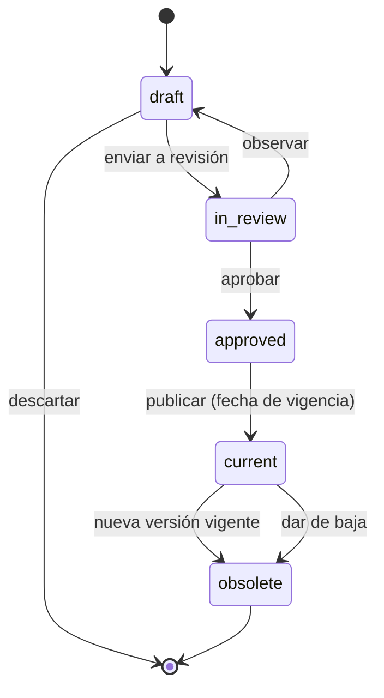

| Desde | Hacia | Evento | Quién | Condición / efecto |
|---|---|---|---|---|
| draft | in_review | Enviar | Autor (G) | Archivo o contenido completo |
| in_review | draft | Observar | Revisor (A) | Comentario obligatorio |
| in_review | approved | Aprobar | Aprobador (A) | Aprobador ≠ autor. Firma (FIR) si el tipo lo exige. Política: gerencia. RISST: comité |
| approved | current | Publicar | A o sistema en `effective_on` | La versión vigente anterior pasa a `obsolete`. Si requiere cargo, crea `document_acknowledgements` pendientes y notifica |
| current | obsolete | Reemplazo o baja | A / sistema | Se conserva para consulta histórica |
| draft | — | Descartar | Autor | Borrado lógico |

Una sola versión `current` por documento.

## 2. Versión de IPERC

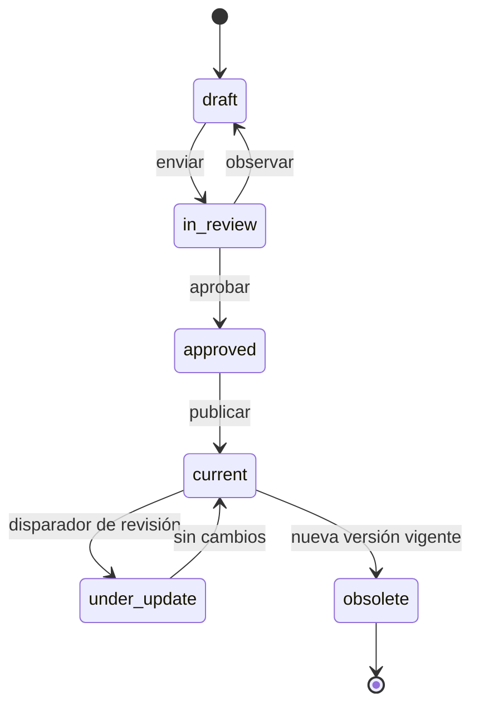

| Desde | Hacia | Evento | Quién | Condición / efecto |
|---|---|---|---|---|
| draft | in_review | Enviar | JS, JA, CO | Todas las filas con riesgo inicial, controles y riesgo residual. Participación de trabajadores registrada |
| in_review | draft | Observar | JS, CM | Comentario por fila |
| in_review | approved | Aprobar | JS (A) | Aprobador ≠ elaborador |
| approved | current | Publicar | JS | Anterior → `obsolete`. Actualiza mapa de riesgos y requisitos de EPP/capacitación vinculados |
| current | under_update | Disparador | Sistema / JS | Accidente en el puesto, cambio de proceso (MOC), periodicidad de revisión (parámetro), nueva norma |
| under_update | current | Confirmar sin cambios | JS | Registra revisión |
| current | obsolete | Nueva versión vigente | Sistema | — |

Las sugerencias de IA entran como `ai_suggestions`; nunca crean filas directas.

## 3. PASST

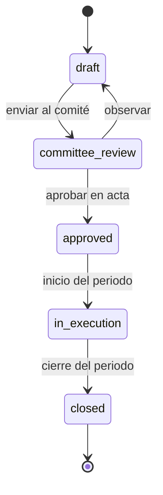

| Desde | Hacia | Evento | Quién | Condición / efecto |
|---|---|---|---|---|
| draft | committee_review | Enviar | JS, SS, CO | Al menos una actividad por objetivo |
| committee_review | draft | Observar | CM | — |
| committee_review | approved | Aprobar | CM (A) | Enlace a acta de reunión (`committee_meetings`). Con Supervisor SST: aprueba el supervisor y el empleador |
| approved | in_execution | Inicio de periodo | Sistema | Activa alertas de actividades |
| in_execution | closed | Cierre | JS / sistema | Calcula % de cumplimiento final. Insumo para la revisión por la dirección |

Modificar un programa aprobado crea una nueva versión que repite el ciclo.

## 4. Actividad del PASST

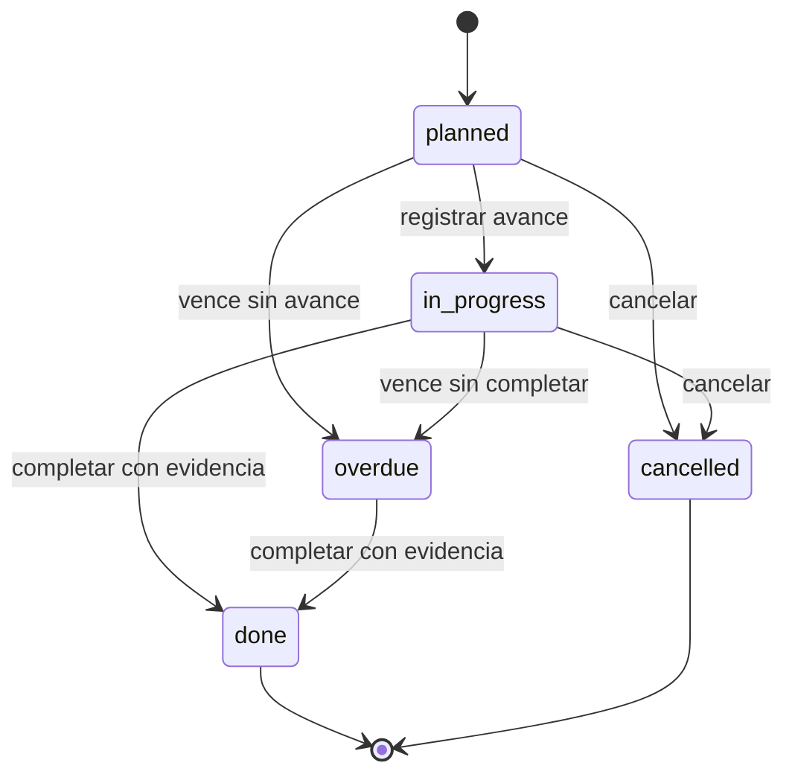

| Desde | Hacia | Evento | Quién | Condición / efecto |
|---|---|---|---|---|
| planned | in_progress | Avance | Responsable | `activity_executions` con % |
| planned / in_progress | overdue | Vence | Sistema | Alerta al responsable y JS |
| in_progress / overdue | done | Completar | Responsable | Evidencia obligatoria |
| planned / in_progress | cancelled | Cancelar | JS | Motivo obligatorio; cuenta en el indicador de cumplimiento |

## 5. Elección del comité

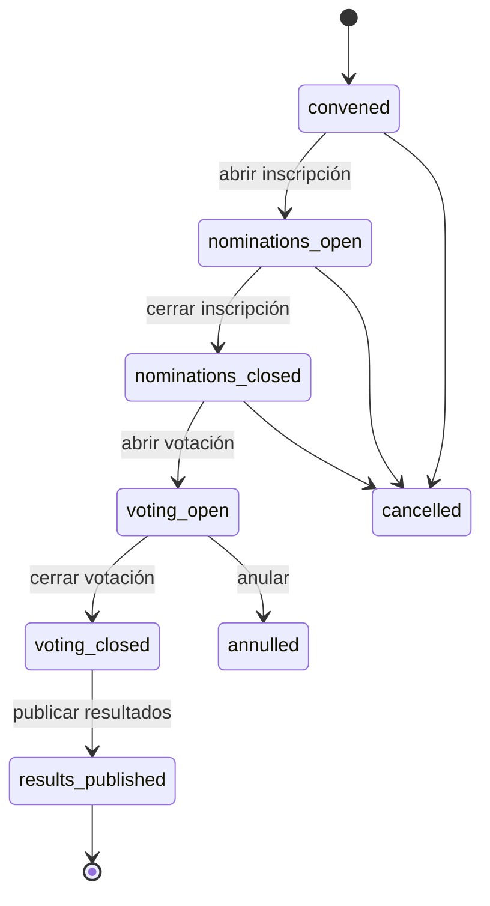

| Desde | Hacia | Evento | Quién | Condición / efecto |
|---|---|---|---|---|
| convened | nominations_open | Abrir | JS, SS (junta electoral) | Convocatoria publicada y notificada a trabajadores |
| nominations_open | nominations_closed | Cerrar | Sistema / JS | Fecha de cierre configurada |
| nominations_closed | voting_open | Abrir votación | Junta electoral | Candidatos validados; padrón congelado |
| voting_open | voting_closed | Cerrar | Sistema / junta | `election_ballots` inalterable; un voto por trabajador; voto secreto |
| voting_closed | results_published | Publicar | Junta | Calcula titulares y suplentes; crea `committee_members` con vigencia (parámetro) |
| varios | cancelled | Cancelar | JS | Motivo |
| voting_open | annulled | Anular | JS + acta | Motivo; los votos se conservan, sin efecto |

Si no hay candidatos suficientes, se registra y se permite nueva convocatoria.

## 6. Acuerdo del comité

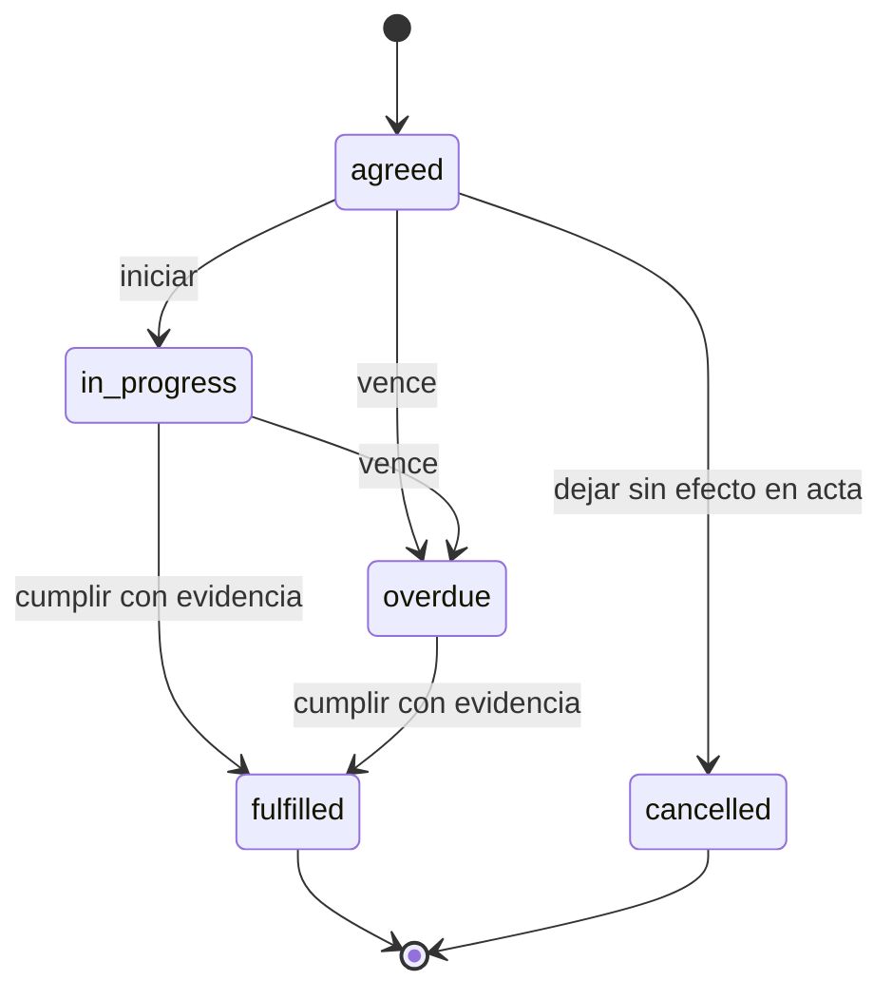

| Desde | Hacia | Evento | Quién | Condición / efecto |
|---|---|---|---|---|
| agreed | in_progress | Iniciar | Responsable | — |
| agreed / in_progress | overdue | Vence | Sistema | Aparece en la siguiente reunión |
| in_progress / overdue | fulfilled | Cumplir | Responsable | Evidencia; el comité lo da por cumplido en la siguiente acta |
| agreed | cancelled | Dejar sin efecto | CM | Referencia al acta |

## 7. Inspección

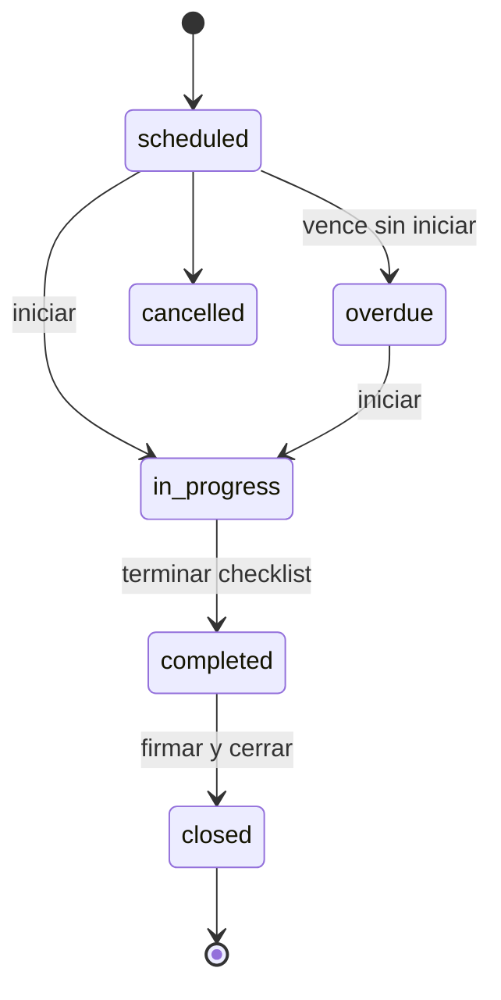

| Desde | Hacia | Evento | Quién | Condición / efecto |
|---|---|---|---|---|
| scheduled | in_progress | Iniciar | Inspector (JA, SS, CM, JS) | Puede ser offline |
| in_progress | completed | Terminar | Inspector | Todas las preguntas respondidas; cada «no cumple» genera `findings` |
| completed | closed | Cerrar | Inspector + responsable del área | Firmas (FIR). Alimenta el registro de inspecciones internas |
| scheduled | overdue | Vence | Sistema | Alerta |
| scheduled | cancelled | Cancelar | JS | Motivo |

## 8. Hallazgo

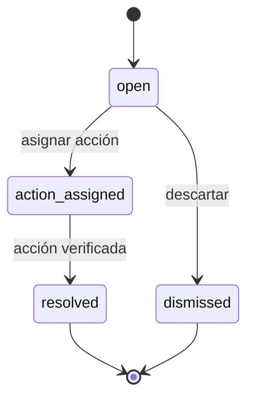

| Desde | Hacia | Evento | Quién | Condición / efecto |
|---|---|---|---|---|
| open | action_assigned | Asignar | JS, JA | Crea `corrective_actions` vinculada |
| open | dismissed | Descartar | JS | Motivo; queda trazado |
| action_assigned | resolved | Acción verificada | Sistema | Todas las acciones vinculadas en `verified` |

## 9. Acción correctiva

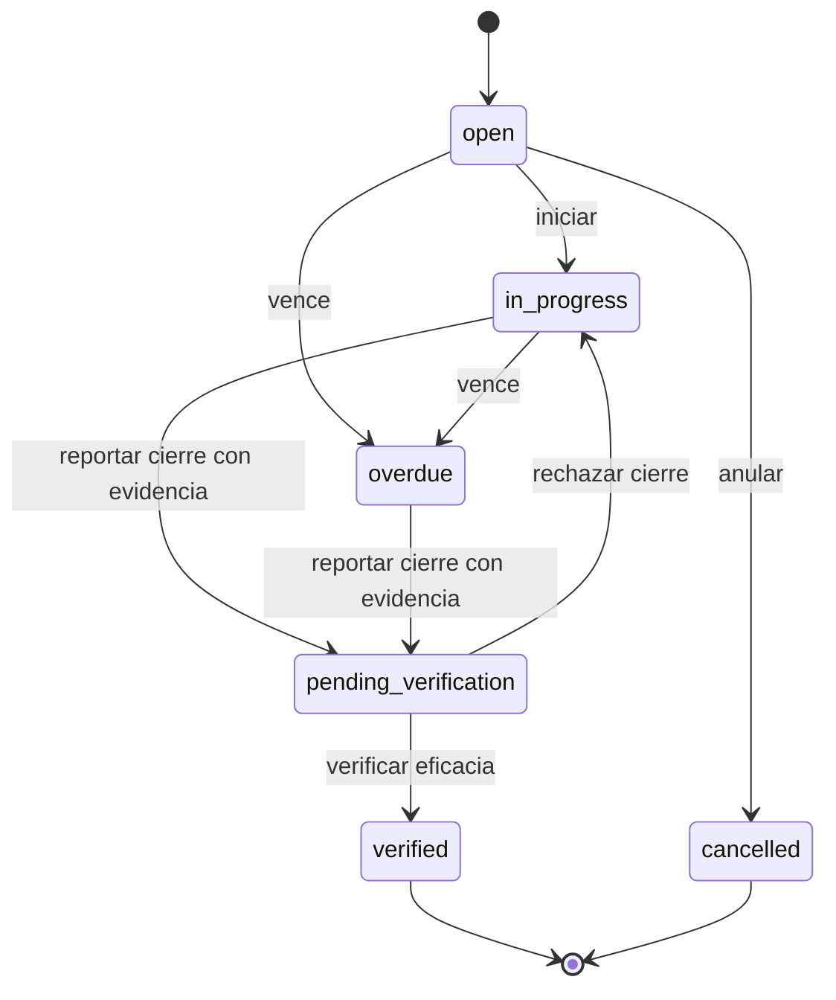

| Desde | Hacia | Evento | Quién | Condición / efecto |
|---|---|---|---|---|
| open | in_progress | Iniciar | Responsable | — |
| open / in_progress | overdue | Vence | Sistema | Escalamiento al jefe del responsable y JS |
| in_progress / overdue | pending_verification | Reportar cierre | Responsable | `action_evidences` obligatoria |
| pending_verification | in_progress | Rechazar | Verificador | Motivo |
| pending_verification | verified | Verificar | Verificador ≠ responsable | Cierra el origen (hallazgo, investigación, acuerdo, auditoría) si todas sus acciones están verificadas |
| open | cancelled | Anular | JS | Motivo |

Origen polimórfico: inspección, acto/condición, investigación, auditoría, acuerdo, línea base, revisión por la dirección.

## 10. Evento SST (accidente, incidente, enfermedad)

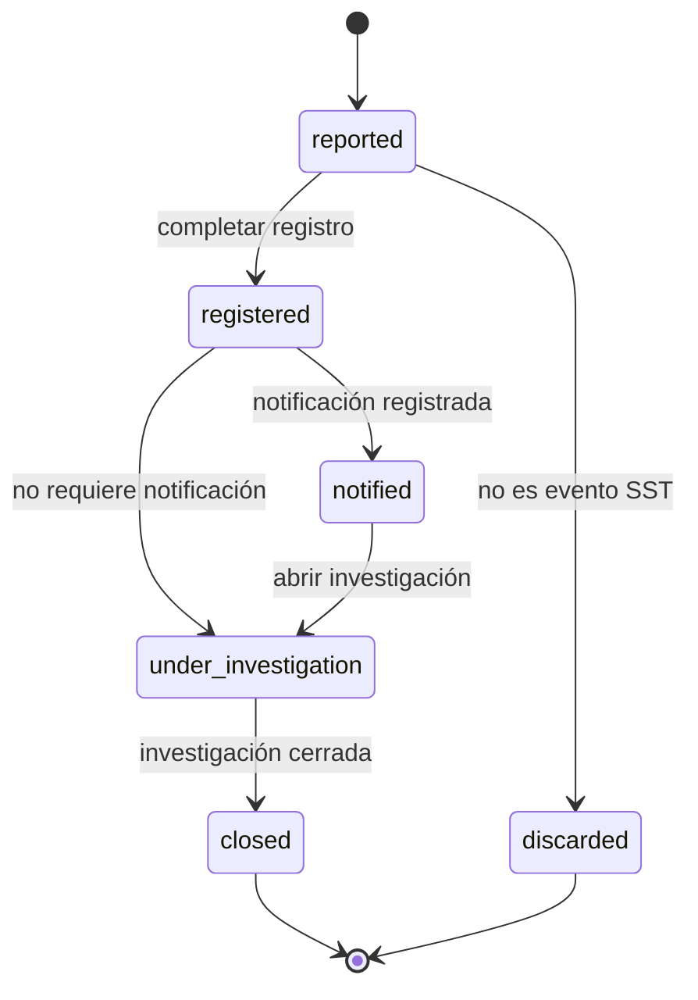

| Desde | Hacia | Evento | Quién | Condición / efecto |
|---|---|---|---|---|
| reported | registered | Completar | JS, SS, JA | Tipo, gravedad, personas (`event_people`), lugar. Calcula plazo de notificación (parámetro por tipo) y alerta |
| registered | notified | Registrar notificación | JS | `event_notifications` con número/constancia del MTPE o EsSalud. El producto no envía la notificación oficial |
| registered | under_investigation | Pasar | JS | Solo tipos que no requieren notificación (parámetro) |
| notified | under_investigation | Abrir investigación | JS | Crea `investigations` |
| under_investigation | closed | Cerrar | Sistema | Investigación cerrada. Actualiza estadísticas y registro |
| reported | discarded | Descartar | JS | Motivo; trazado |

Si el plazo de notificación vence sin `notified`, se marca `notification_overdue = true` (alerta roja), sin cambiar el estado.

## 11. Investigación

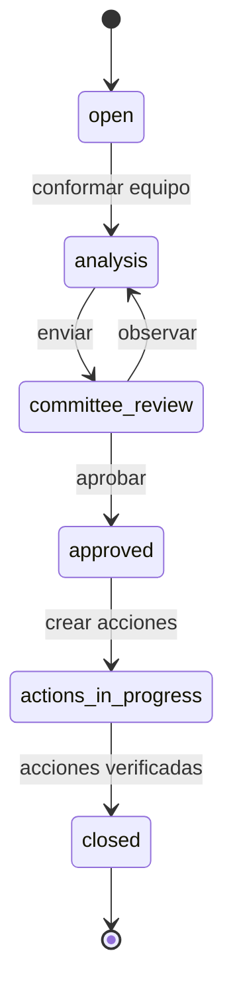

| Desde | Hacia | Evento | Quién | Condición / efecto |
|---|---|---|---|---|
| open | analysis | Conformar equipo | JS | `investigation_team` incluye representante del comité (parámetro) |
| analysis | committee_review | Enviar | JS, JA | Método (árbol de causas o SCAT), causas inmediatas y básicas en `investigation_causes` |
| committee_review | analysis | Observar | CM | — |
| committee_review | approved | Aprobar | CM / JS (A) | — |
| approved | actions_in_progress | Crear acciones | JS | Al menos una acción correctiva |
| actions_in_progress | closed | Verificadas | Sistema | Cierra el evento SST |

## 12. PETAR

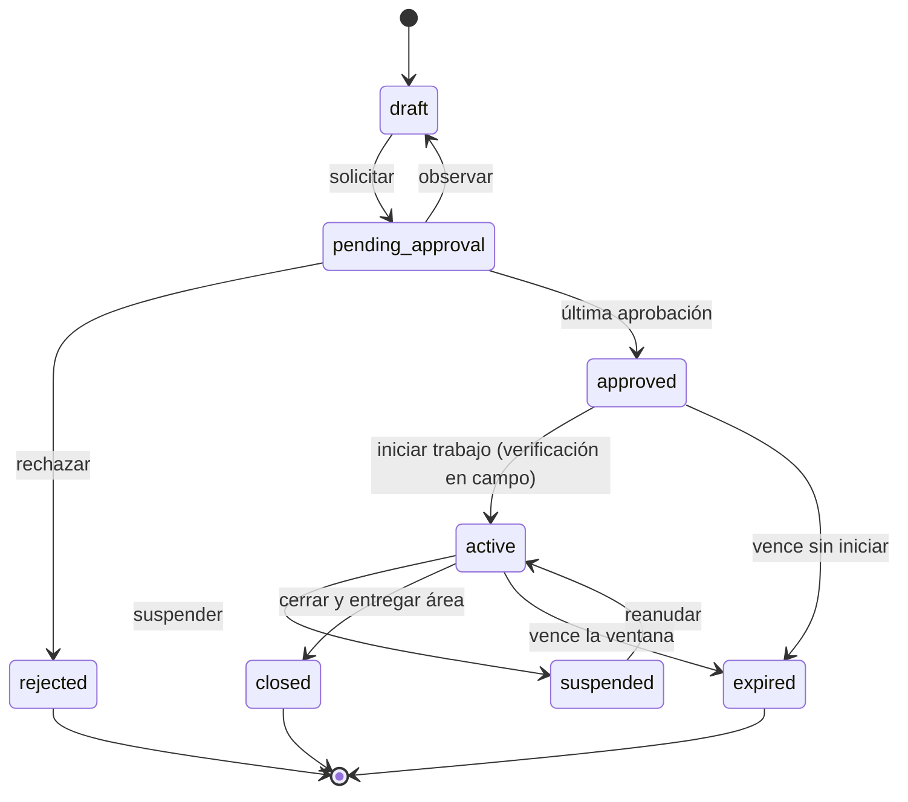

| Desde | Hacia | Evento | Quién | Condición / efecto |
|---|---|---|---|---|
| draft | pending_approval | Solicitar | Ejecutor / JA | Checklist del tipo (`permit_checks`), ATS vinculado, trabajadores con fotocheck habilitado y aptitud vigente |
| pending_approval | approved | Aprobar | Cada aprobador en orden (`permit_approvals`) | Ningún aprobador es ejecutor. Firma en cada paso |
| pending_approval | draft / rejected | Observar / rechazar | Aprobador | Motivo |
| approved | active | Iniciar | Supervisor en campo | Verificación de condiciones en sitio; puede ser offline |
| active | suspended | Suspender | Cualquier aprobador, SS | Motivo (condición cambió, emergencia) |
| active | closed | Cerrar | Ejecutor + supervisor | Área entregada en orden; firmas |
| approved / active | expired | Vence | Sistema | Ventana de validez (parámetro por tipo) |

## 13. Credencial / fotocheck

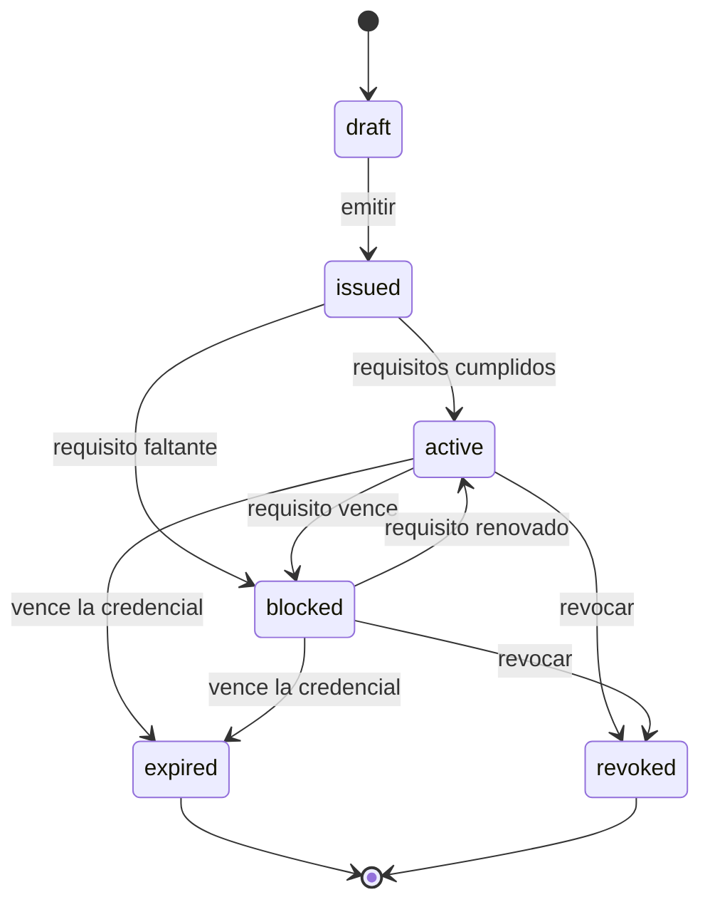

| Desde | Hacia | Evento | Quién | Condición / efecto |
|---|---|---|---|---|
| draft | issued | Emitir | JS (A), RH | Genera token QR y PDF imprimible |
| issued | active / blocked | Evaluar | Sistema | `credential_requirements`: capacitaciones, EMO apto vigente, SCTR, inducción |
| active | blocked | Requisito vence | Sistema (diario y por evento) | Verificación pública muestra «NO HABILITADO» y el requisito |
| blocked | active | Requisito renovado | Sistema | — |
| active / blocked | expired | Vence | Sistema | — |
| active / blocked | revoked | Revocar | JS | Motivo; token inválido; cese del trabajador lo dispara |

Estado calculado, no editable a mano salvo `revoked`.

## 14. EMO (orden de examen)

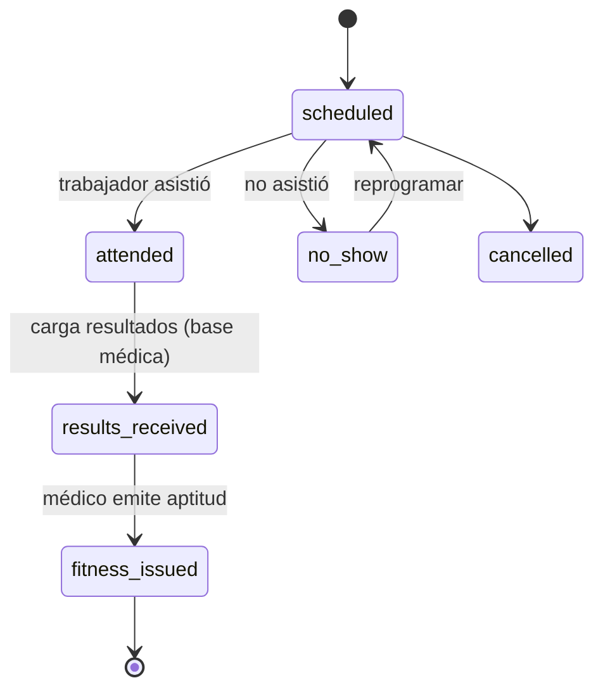

| Desde | Hacia | Evento | Quién | Condición / efecto |
|---|---|---|---|---|
| scheduled | attended | Registrar asistencia | PE, MO | Tipo: preocupacional, periódico, de retiro (y otros como parámetro) |
| scheduled | no_show | No asistió | PE | Alerta a RH |
| attended | results_received | Cargar resultados | PE, MO | Archivos en bucket médico; `medical_exams` en base médica |
| results_received | fitness_issued | Emitir aptitud | MO | Escribe `fitness_status` en base principal (solo estado + vigencia + restricción laboral). Programa el próximo periódico (parámetro) |
| scheduled | cancelled | Cancelar | PE | Motivo |

`fitness_status` tiene su propio ciclo: `pending → fit | fit_with_restrictions | unfit → expired` (por vigencia).

## 15. Acreditación de contratista

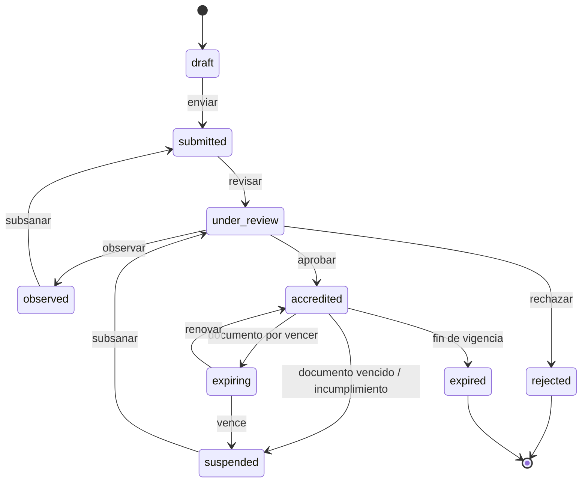

| Desde | Hacia | Evento | Quién | Condición / efecto |
|---|---|---|---|---|
| draft | submitted | Enviar | CT | Todos los `contractor_requirements` con documento |
| submitted | under_review | Revisar | JS | — |
| under_review | observed | Observar | JS | Por documento |
| under_review | accredited | Aprobar | JS (A) | Habilita ingreso (ING) y fotocheck de sus trabajadores |
| under_review | rejected | Rechazar | JS | Motivo |
| accredited | expiring / suspended | Vencimientos | Sistema | Avisos a CT y JS; suspendido bloquea ingreso |
| accredited | expired | Fin de vigencia | Sistema | — |

## 16. Expediente SUNAFIL

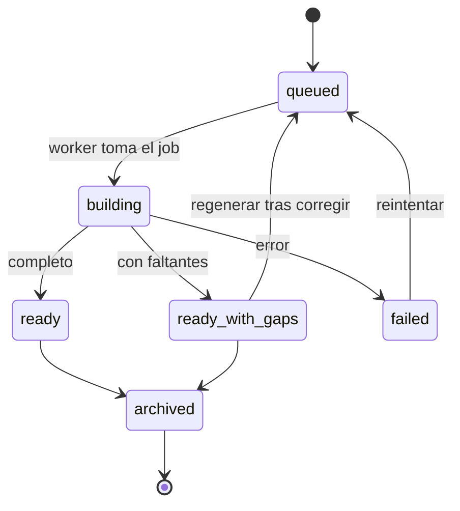

| Desde | Hacia | Evento | Quién | Condición / efecto |
|---|---|---|---|---|
| queued | building | Tomar job | Sistema | — |
| building | ready / ready_with_gaps | Terminar | Sistema | `dossier_items` con estado por ítem; PDF y ZIP en B2; notificación |
| building | failed | Error | Sistema | Reintentos automáticos (parámetro); luego alerta |
| failed / ready_with_gaps | queued | Reintentar / regenerar | JS | — |
| ready* | archived | Archivar | JS / sistema | El contenido es una foto a la fecha de generación |

## 17. Link compartido

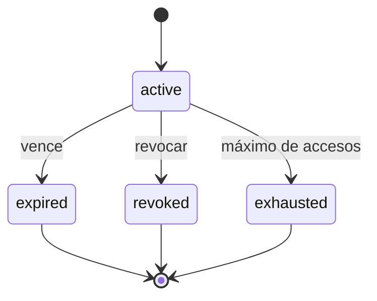

| Desde | Hacia | Evento | Quién | Condición / efecto |
|---|---|---|---|---|
| (crear) | active | Crear | JS | Vencimiento obligatorio; código de acceso opcional; solo lectura |
| active | expired | Vence | Sistema | — |
| active | revoked | Revocar | JS | Efecto inmediato |
| active | exhausted | Tope de accesos | Sistema | Si se configuró |

Cada acceso queda registrado (IP, hora, archivo).

## 18. Lote de sincronización

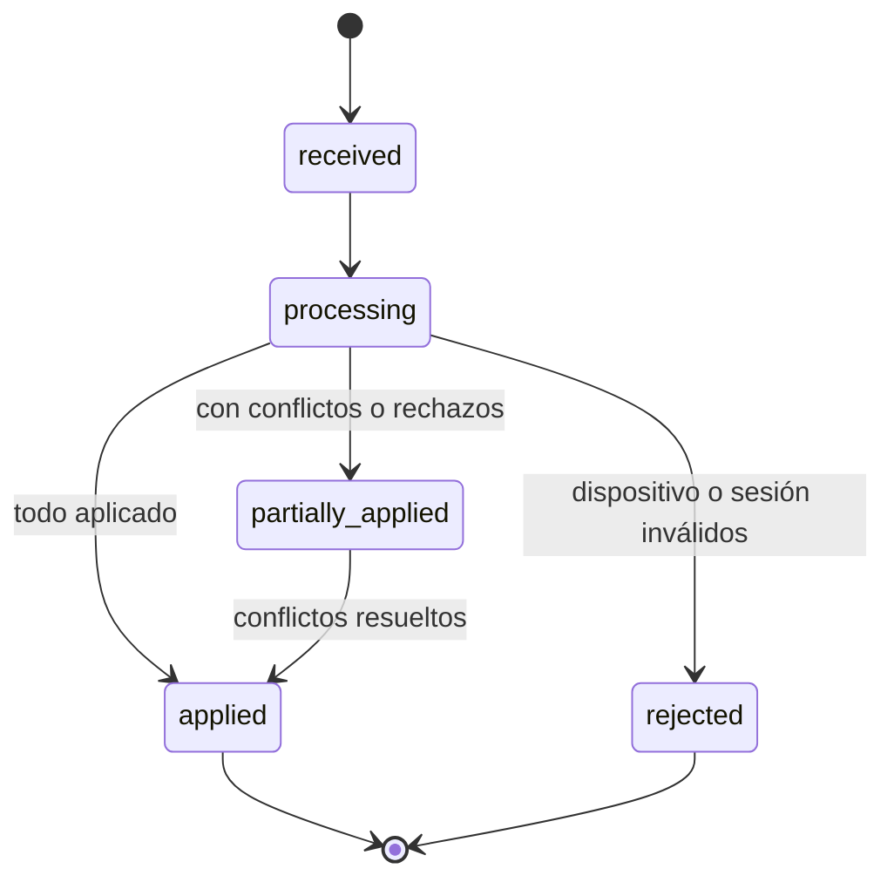

| Desde | Hacia | Evento | Quién | Condición / efecto |
|---|---|---|---|---|
| received | processing | Procesar | Sistema | Valida dispositivo (`devices`), sesión, permisos y plan |
| processing | applied | Terminar | Sistema | Resultado por operación |
| processing | partially_applied | Terminar | Sistema | `sync_conflicts` abiertos |
| processing | rejected | Invalidar | Sistema | Dispositivo revocado o sesión vencida |
| partially_applied | applied | Resolver | JS, JA | Cada conflicto: conservar servidor, aplicar dispositivo o fusionar |

## 19. Sugerencia IA

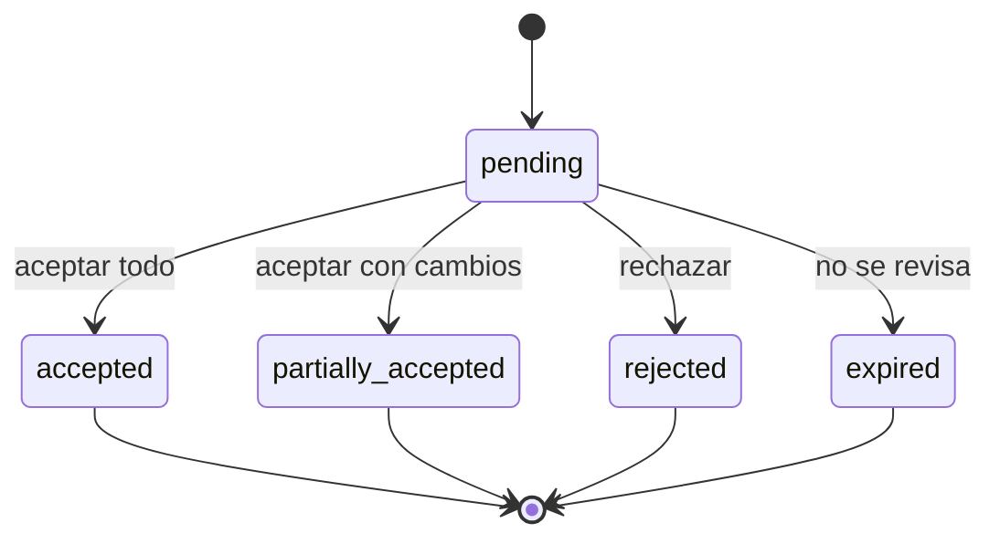

| Desde | Hacia | Evento | Quién | Condición / efecto |
|---|---|---|---|---|
| pending | accepted / partially_accepted | Aplicar | Usuario con G en el módulo destino | La aplicación crea los registros a nombre de la persona, marcados `ai_assisted = true` |
| pending | rejected | Rechazar | Usuario | Motivo opcional (mejora de prompts) |
| pending | expired | Caduca | Sistema | Parámetro |

## 20. Suscripción

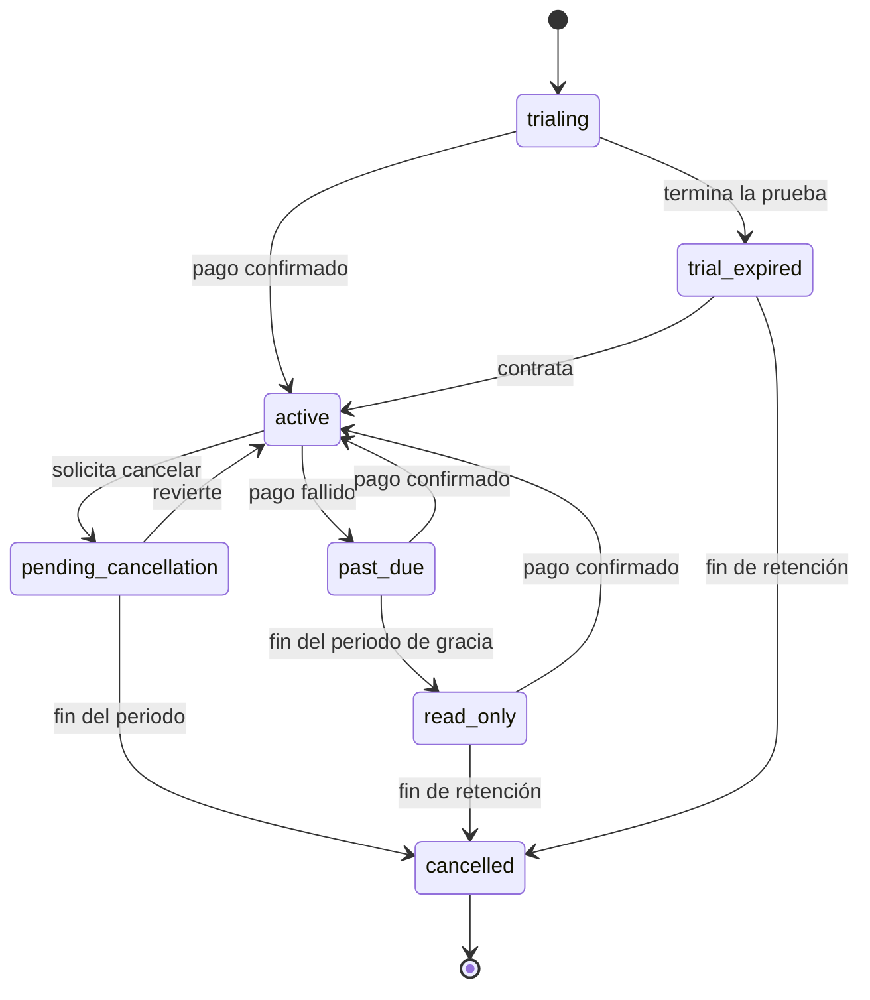

| Desde | Hacia | Evento | Quién | Condición / efecto |
|---|---|---|---|---|
| trialing | active | Pago | Sistema / PO | Flags según plan contratado |
| trialing | trial_expired | Fin de prueba | Sistema | Solo lectura |
| active | past_due | Pago fallido | Sistema | Avisos al AC |
| past_due | read_only | Fin de gracia | Sistema | Toda la empresa en solo lectura; exportación disponible |
| active | pending_cancellation | Cancelar | AC | Sigue activa hasta fin de periodo |
| * | cancelled | Fin | Sistema | Inicia retención y luego borrado (ver `10`) |

Cambio de plan no es un estado: es un evento sobre `active` (ver `03` §8).

## 21. Factura

```mermaid
stateDiagram-v2
    [*] --> draft
    draft --> issued: emitir
    issued --> paid: pago confirmado
    issued --> overdue: vence
    overdue --> paid: pago confirmado
    issued --> voided: anular (nota de crédito)
    overdue --> voided: anular (nota de crédito)
    paid --> refunded: devolver
    paid --> [*]
    voided --> [*]
    refunded --> [*]
```

| Desde | Hacia | Evento | Quién | Condición / efecto |
|---|---|---|---|---|
| draft | issued | Emitir | Sistema / PO | Comprobante electrónico vía proveedor por definir |
| issued / overdue | paid | Pago | Sistema (webhook de pasarela) / PO | `payments` |
| issued | overdue | Vence | Sistema | Pasa la suscripción a `past_due` |
| issued / overdue | voided | Anular | PO | Nota de crédito |
| paid | refunded | Devolver | PO | Nota de crédito y reembolso |

## 22. Invitación de consultora

```mermaid
stateDiagram-v2
    [*] --> sent
    sent --> accepted: cliente acepta
    sent --> declined: cliente rechaza
    sent --> expired: vence
    sent --> cancelled: consultora cancela
    accepted --> revoked: cliente revoca acceso
    accepted --> [*]
    declined --> [*]
    expired --> [*]
    cancelled --> [*]
    revoked --> [*]
```

| Desde | Hacia | Evento | Quién | Condición / efecto |
|---|---|---|---|---|
| (crear) | sent | Invitar | AC/CO de la consultora | Correo al AC del cliente con enlace de un solo uso |
| sent | accepted | Aceptar | AC del cliente | Crea `consultant_assignments` y membresías |
| sent | declined / expired / cancelled | — | Cliente / sistema / consultora | — |
| accepted | revoked | Revocar | AC del cliente | Membresías de la consultora desactivadas al instante |

## 23. Carga masiva

```mermaid
stateDiagram-v2
    [*] --> uploaded
    uploaded --> validating
    validating --> validated: sin errores
    validating --> validated_with_errors: con errores por fila
    validating --> failed: archivo ilegible
    validated --> importing: confirmar
    validated_with_errors --> importing: importar solo filas válidas
    validated_with_errors --> uploaded: subir corregido
    importing --> completed
    importing --> failed
    completed --> [*]
    failed --> [*]
```

| Desde | Hacia | Evento | Quién | Condición / efecto |
|---|---|---|---|---|
| uploaded | validating | Procesar | Sistema | Plantilla conocida; columnas obligatorias |
| validating | validated(_with_errors) | Terminar | Sistema | `bulk_import_rows` con estado y mensaje por fila (DNI, duplicados, puesto inexistente) |
| validated* | importing | Confirmar | RH, JS | Vista previa revisada; crear/actualizar según clave DNI |
| importing | completed | Terminar | Sistema | Resumen: creados, actualizados, omitidos |
| * | failed | Error | Sistema | Sin cambios parciales si falla (transacción por bloque) |

## 24. Reporte de acto/condición

```mermaid
stateDiagram-v2
    [*] --> received
    received --> triaged: clasificar
    received --> rejected: no procede / duplicado
    triaged --> action_assigned: crear acción
    triaged --> closed: corregido en el momento
    action_assigned --> closed: acción verificada
    closed --> [*]
    rejected --> [*]
```

| Desde | Hacia | Evento | Quién | Condición / efecto |
|---|---|---|---|---|
| received | triaged | Clasificar | JA, JS | Tipo (acto/condición), riesgo, área |
| received | rejected | Rechazar | JA, JS | Motivo; el reportante identificado recibe aviso |
| triaged | action_assigned | Crear acción | JA, JS | `corrective_actions` |
| triaged | closed | Corregido | JA | Evidencia de corrección inmediata |
| action_assigned | closed | Verificada | Sistema | — |

El reportante (si no es anónimo) puede consultar el estado con su código de seguimiento.

## 25. Certificado de capacitación

```mermaid
stateDiagram-v2
    [*] --> pending_validation: aprobado (plantilla con validación)
    [*] --> valid: aprobado (plantilla sin validación)
    pending_validation --> valid: validar
    pending_validation --> voided: anular
    valid --> expiring: entra en aviso de vencimiento
    expiring --> expired: pasa expires_on
    valid --> voided: anular
    expiring --> voided: anular
    expired --> [*]
    voided --> [*]
```

| Desde | Hacia | Evento | Quién | Condición / efecto |
|---|---|---|---|---|
| — | pending_validation / valid | Aprobación de sesión o curso del aula | Sistema | Código único con prefijo, token QR (hash), PDF con la plantilla |
| pending_validation | valid | Validar (individual o lote) | JS | Recién se puede descargar y verificar como válido |
| valid | expiring | Aviso de vencimiento | Sistema | `training_expiry_notice_days`; dispara recomendación de recapacitación (AUL) |
| expiring | expired | Vence | Sistema | Deja de cumplir la matriz por cargo y el requisito del fotocheck |
| pending_validation / valid / expiring | voided | Anular | JS; Sistema por reembolso en VTA | Motivo obligatorio; PDF con leyenda «ANULADO»; reevalúa matriz y fotocheck |

La reemisión por error de datos crea un certificado nuevo con `replaces_certificate_id`; el anulado no se edita ni se borra. La verificación pública responde con el estado actual.

## 26. Matrícula del aula

```mermaid
stateDiagram-v2
    [*] --> enrolled
    enrolled --> in_progress: primer latido de actividad
    in_progress --> completed: obligatorios + nota + permanencia
    in_progress --> failed: intentos agotados sin aprobar
    enrolled --> expired: pasa access_until
    in_progress --> expired: pasa access_until
    enrolled --> cancelled: baja o reembolso
    in_progress --> cancelled: baja o reembolso
    failed --> in_progress: reinicio de intentos autorizado
    completed --> [*]
    expired --> [*]
    cancelled --> [*]
```

| Desde | Hacia | Evento | Quién | Condición / efecto |
|---|---|---|---|---|
| — | enrolled | Matricular | JS, RH, CP (si tiene permiso), Sistema (matriz, compra o cupo de VTA) | Si el curso exige compromiso de culminación, el contenido se abre solo al aceptarlo |
| enrolled | in_progress | Primer latido válido | Sistema | — |
| in_progress | completed | Completar | Sistema | Actividades obligatorias completadas, nota final ≥ `passing_score` y `active_seconds_total` ≥ `min_active_minutes`; crea asistencia y certificado en CAP (idempotente) |
| in_progress | failed | Intentos agotados | Sistema | — |
| failed | in_progress | Reiniciar intentos | JS, CP con permiso | Queda en `audit_logs` |
| enrolled / in_progress | expired | Vence el acceso | Sistema | — |
| enrolled / in_progress | cancelled | Baja o reembolso | JS; Sistema (VTA) | Un cupo de VTA se libera solo si no se inició |

## 27. Recomendación de curso

```mermaid
stateDiagram-v2
    [*] --> suggested: regla, manual o IA
    suggested --> approved: aprobar (si requiere)
    suggested --> sent: publicar/enviar (sin aprobación)
    approved --> sent: publicar/enviar
    sent --> viewed: el destinatario la ve
    viewed --> clicked: abre el curso
    clicked --> converted: se matricula o compra
    viewed --> converted: se matricula o compra
    suggested --> dismissed: descartar
    sent --> dismissed: «No me interesa»
    viewed --> dismissed: «No me interesa»
    sent --> expired: pasa expires_at
    viewed --> expired: pasa expires_at
    converted --> [*]
    dismissed --> [*]
    expired --> [*]
```

| Desde | Hacia | Evento | Quién | Condición / efecto |
|---|---|---|---|---|
| — | suggested | Crear | Sistema (reglas), JS, CP, RH (manual), IAA (sugerencia) | Exclusiones: aprobado vigente, matriculado, comprado; `dedupe_key`; nunca datos médicos |
| suggested | approved | Aprobar | JS | Obligatorio para sugerencias de IA y reglas con aprobación |
| suggested / approved | sent | Publicar y enviar | Sistema | Portal siempre; correo/WhatsApp solo con consentimiento (externos) y dentro del límite de envíos |
| sent / viewed / clicked | converted | Matrícula o compra del curso | Sistema | Dentro de `recommendation_attribution_days`; se atribuye a una sola recomendación |
| suggested / sent / viewed | dismissed | Descartar | Destinatario, JS | No se vuelve a crear durante el periodo de espera |
| sent / viewed | expired | Caduca | Sistema | — |

## 28. Pedido de venta de cursos

```mermaid
stateDiagram-v2
    [*] --> draft: carrito
    draft --> pending_payment: confirmar (reserva aforo)
    pending_payment --> paid: pago confirmado (webhook o conciliación)
    pending_payment --> failed: pago rechazado
    failed --> pending_payment: reintentar
    pending_payment --> expired: pasa expires_at
    pending_payment --> cancelled: cancelar
    paid --> fulfilled: matrículas o cupos creados
    fulfilled --> partially_refunded: reembolso parcial
    fulfilled --> refunded: reembolso total
    partially_refunded --> refunded: reembolso del resto
    expired --> [*]
    cancelled --> [*]
    refunded --> [*]
```

| Desde | Hacia | Evento | Quién | Condición / efecto |
|---|---|---|---|---|
| draft | pending_payment | Confirmar | PX | Precio vigente congelado; cupón validado en el servidor; aforo reservado hasta `expires_at` (`order_payment_ttl_minutes`) |
| pending_payment | paid | Pago confirmado | Sistema (webhook firmado o conciliación) | Nunca por la sola redirección del navegador; cuenta el uso del cupón |
| — | paid | Matrícula manual | JS | Pago fuera de la pasarela con medio, referencia y evidencia; canal manual |
| paid | fulfilled | Crear matrículas o cupos | Sistema | Idempotente por `order_item_id`; emite comprobante |
| pending_payment | expired / cancelled | Vence o se cancela | Sistema, PX | Libera el aforo |
| fulfilled | partially_refunded / refunded | Reembolso confirmado | JS; Sistema | Nota de crédito; cancela matrícula y anula certificado según la política |

## 29. Transacción de pago

```mermaid
stateDiagram-v2
    [*] --> created
    created --> pending: cargo enviado con token
    pending --> succeeded: evento de pago confirmado
    pending --> failed: evento de pago rechazado
    succeeded --> partially_refunded: reembolso parcial
    succeeded --> refunded: reembolso total
    partially_refunded --> refunded: reembolso del resto
    failed --> [*]
    refunded --> [*]
```

| Desde | Hacia | Evento | Quién | Condición / efecto |
|---|---|---|---|---|
| created | pending | Crear cargo | Sistema | Con el token de un solo uso de la pasarela e `idempotency_key`; nunca datos de tarjeta |
| pending | succeeded / failed | Webhook o consulta | Sistema | Firma verificada; evento ya en la restricción única por (pasarela, id externo) de `payment_transactions` se ignora; los estados no retroceden |
| succeeded | partially_refunded / refunded | Reembolso | Sistema | Se registra como transacción de reembolso vinculada; el total reembolsado no supera lo cobrado |

Un evento que llevaría a un estado anterior (p. ej. `pending` después de `succeeded`) se registra y no se aplica.

## 30. Hoja de reclamación

Libro de Reclamaciones virtual de EscudoSST como proveedor (no el de las empresas clientes que venden cursos en VTA). Plazos como parámetros con vigencia `to_confirm` (referencia a confirmar con abogado: respuesta en `complaint_response_days` = 15 días hábiles, prórroga justificada `complaint_extension_days`, conservación `complaint_retention_years` = 5 años).

```mermaid
stateDiagram-v2
    [*] --> registered: consumidor envía la hoja
    registered --> in_review: se asigna o se abre
    in_review --> extended: prórroga justificada (una vez)
    registered --> answered: respuesta enviada
    in_review --> answered: respuesta enviada
    extended --> answered: respuesta enviada
    answered --> closed: cierre
    closed --> [*]
```

| Desde | Hacia | Evento | Quién | Condición / efecto |
|---|---|---|---|---|
| — | registered | Enviar hoja | Visitante (público) | Código correlativo único, fecha y hora en America/Lima, `provider_snapshot_json` desde `site_settings`; `due_at` en días hábiles con `complaint_response_days` y calendario de feriados; constancia al consumidor y al responsable; evento `registered` y `acknowledged_sent` |
| registered | in_review | Abrir o asignar | PO, PS | Evento `assigned` |
| in_review | extended | Registrar prórroga | PO | Solo antes de `due_at`, una sola vez, motivo obligatorio; fija `extended_due_at`; aviso al consumidor; evento `extended` |
| registered / in_review / extended | answered | Enviar respuesta | PO | Texto y adjunto opcional; correo al consumidor con enlace de seguimiento; eventos `answered` y `answer_sent` |
| answered | closed | Cerrar | PO | `retention_until` ya calculado con `complaint_retention_years` |

Reglas: ninguna transición borra ni edita los datos originales de la hoja; `complaint_events` es inalterable (solo INSERT). El vencimiento sin respuesta no es un estado: el semáforo de la bandeja lo marca en rojo y se alerta al dueño. Una hoja nunca vuelve a `registered`. Exportarla para Indecopi agrega el evento `reported` sin cambiar el estado.

## 31. Página del sitio

```mermaid
stateDiagram-v2
    [*] --> draft
    draft --> in_review: enviar a revisión
    in_review --> draft: devolver
    in_review --> scheduled: programar
    in_review --> published: publicar
    draft --> published: publicar (dueño)
    scheduled --> published: llega published_at
    published --> draft: nueva versión en edición (la publicada sigue en línea)
    published --> archived: retirar
    archived --> [*]
```

| Desde | Hacia | Evento | Quién | Condición / efecto |
|---|---|---|---|---|
| draft / in_review | published / scheduled | Publicar o programar | PO | Exige slug único, título y descripción SEO; invalida la caché de la ruta, del sitemap y de los listados |
| scheduled | published | Llega `published_at` | Sistema | Igual que publicar |
| published | draft | Editar | PO | Se trabaja en una nueva versión; la versión publicada sigue en línea hasta volver a publicar |
| published | archived | Retirar | PO | Exige redirección 301 a otra URL o respuesta 410; sale del sitemap |

Cambiar el slug de una página publicada crea automáticamente una redirección 301 en `site_redirects`. El blog vive en WordPress, aparte, con su propio flujo editorial.

## 32. Versión de documento legal

```mermaid
stateDiagram-v2
    [*] --> draft
    draft --> approved: aprobar (revisado por abogado o aviso explícito)
    approved --> scheduled: publicar con fecha de vigencia futura
    approved --> effective: publicar con vigencia inmediata
    scheduled --> effective: llega effective_at
    effective --> superseded: entra en vigencia otra versión
    superseded --> [*]
```

| Desde | Hacia | Evento | Quién | Condición / efecto |
|---|---|---|---|---|
| draft | approved | Aprobar | PO | Marca `reviewed_by_lawyer` o confirmación explícita de que no fue revisada; `content_hash` del texto |
| approved | scheduled / effective | Publicar | PO | Indica si exige re-aceptación; aviso a los usuarios `legal_notice_days` antes (parámetro) |
| scheduled | effective | Llega `effective_at` | Sistema | La versión vigente anterior pasa a `superseded`; solo una `effective` por documento |
| effective | superseded | Nueva versión vigente | Sistema | Las aceptaciones anteriores se conservan; si exige re-aceptación, el siguiente inicio de sesión muestra el modal bloqueante |

Una versión publicada no se edita: cualquier cambio es una nueva versión. Cada aceptación se inserta en `legal_acceptances` (inalterable).

## 33. Solicitud de demo, contacto o cotización

```mermaid
stateDiagram-v2
    [*] --> new
    new --> contacted
    new --> spam
    contacted --> demo_scheduled
    demo_scheduled --> demo_done
    demo_done --> won
    demo_done --> lost
    contacted --> lost
    won --> [*]
    lost --> [*]
    spam --> [*]
```

| Desde | Hacia | Evento | Quién | Condición / efecto |
|---|---|---|---|---|
| — | new | Enviar formulario | Visitante (público) | Captcha y límite de uso; privacidad aceptada con su versión; consentimiento comercial opcional y desmarcado; aviso al dueño |
| new | contacted / spam | Primer contacto o descarte | PO, PS | Responsable asignado por PO; nota obligatoria |
| contacted | demo_scheduled → demo_done | Agendar y realizar | PO, PS | Notas de seguimiento |
| demo_done / contacted | won / lost | Resultado | PO, PS | `won` exige enlazar `account_id` (registro autoservicio o alta por el dueño); `spam` se excluye de reportes |

## 34. Testimonio

```mermaid
stateDiagram-v2
    [*] --> draft
    draft --> pending_approval: enviar con consentimiento
    pending_approval --> approved: aprobar
    pending_approval --> rejected: rechazar
    approved --> published: publicar en páginas
    published --> withdrawn: retiro del consentimiento o decisión del dueño
    rejected --> [*]
    withdrawn --> [*]
```

| Desde | Hacia | Evento | Quién | Condición / efecto |
|---|---|---|---|---|
| draft | pending_approval | Enviar | PO, PS, AC | Exige consentimiento adjunto de la persona (y de la empresa si se usa su nombre o logo), salvo `is_example` |
| pending_approval | approved / rejected | Revisar | PO | Solo el dueño; queda en `audit_logs` |
| approved | published | Publicar | PO | En las páginas elegidas; los `is_example` llevan el rótulo «ejemplo» |
| published | withdrawn | Retirar | PO; Sistema al registrar el retiro del consentimiento | Se despublica de inmediato y se invalida la caché de las páginas |

## 35. Lead comercial

```mermaid
stateDiagram-v2
    [*] --> new
    new --> contacted: primer contacto
    contacted --> qualified: calificar
    qualified --> converted: enlazar cuenta
    new --> discarded
    contacted --> discarded
    qualified --> discarded
    converted --> [*]
    discarded --> [*]
```

| Desde | Hacia | Evento | Quién | Condición / efecto |
|---|---|---|---|---|
| — | new | Enviar un formulario de captación o una solicitud de demo | Visitante (público) | Captcha, límite por IP e `Idempotency-Key`; si el correo ya existe no se crea otro lead: se suma la interacción y se conserva el primer `source` y UTM; consentimiento comercial separado con fecha |
| new | contacted | Registrar el primer contacto | PO, PS (asignados) | Asignación previa por PO (`web.marketing_leads.assign`); nota obligatoria |
| contacted | qualified | Calificar | PO, PS (asignados) | Datos mínimos de empresa (tamaño, sector) |
| qualified | converted | Convertir | PO, PS (asignados); Sistema al registrarse la cuenta con el mismo correo o por demo `won` | Exige `account_id`; si hay referido, actualiza `referrals` |
| new / contacted / qualified | discarded | Descartar | PO, PS (asignados) | Motivo obligatorio; excluido de listas comerciales |
| cualquiera salvo converted | (anonimizado) | Conservación vencida | Sistema | Al cumplir `web.lead_retention_months` sin interacción: borra datos personales sin cambiar el estado; también a pedido ARCO por PO |

## 36. Solicitud de partner

```mermaid
stateDiagram-v2
    [*] --> pending
    pending --> approved: aprobar
    pending --> rejected: rechazar
    approved --> [*]
    rejected --> [*]
```

| Desde | Hacia | Evento | Quién | Condición / efecto |
|---|---|---|---|---|
| — | pending | Enviar la solicitud desde `/partners` | Visitante (público) | Crea o actualiza el lead (`partner`); RUC validado; acuse por correo |
| pending | approved | Aprobar | PO (`web.partner_applications.approve`) | Genera `referral_codes` único y activo con `reward_rule_json` vacío («por definir»); correo al partner con el código |
| pending | rejected | Rechazar | PO | Nota obligatoria; correo al solicitante |

## 37. Referido

```mermaid
stateDiagram-v2
    [*] --> registered
    registered --> trial: inicia prueba
    trial --> customer: contrata
    registered --> cancelled
    trial --> cancelled
    customer --> cancelled
    customer --> [*]
    cancelled --> [*]
```

| Desde | Hacia | Evento | Quién | Condición / efecto |
|---|---|---|---|---|
| — | registered | Registro autoservicio o lead con código o enlace `?ref=` | Sistema | Solo el primer código válido y activo; no se crea si el RUC de la cuenta coincide con el del partner |
| registered | trial | Inicio de la prueba | Sistema (evento de SUS) | Aviso al partner |
| trial | customer | Primera contratación pagada | Sistema (evento de SUS) | Fija `converted_at`; registra el derecho a la recompensa según la regla (sin cálculo ni pago automático) |
| registered / trial / customer | cancelled | Cancelación de la cuenta o anulación por el dueño | Sistema; PO | Motivo; aviso al partner |

## 38. Suscriptor del boletín y de avisos de estado

```mermaid
stateDiagram-v2
    [*] --> pending
    pending --> confirmed: abre el enlace vigente
    confirmed --> unsubscribed: baja con un clic
    unsubscribed --> pending: nueva suscripción
    pending --> [*]: depuración al vencer el token
```

| Desde | Hacia | Evento | Quién | Condición / efecto |
|---|---|---|---|---|
| — | pending | Suscribirse en `/boletin` o en `/estado` | Visitante (público) | Captcha, límite por IP, `Idempotency-Key`; guarda solo el hash del token de confirmación; correo de confirmación |
| pending | confirmed | Confirmar | Visitante (enlace del correo) | Token vigente según `newsletter_confirm_token_validity` y de un solo uso; fija `confirmed_at` |
| confirmed | unsubscribed | Darse de baja | Visitante (enlace de cualquier envío o encabezado `List-Unsubscribe`) | Sin iniciar sesión; efecto inmediato; fija `unsubscribed_at` |
| unsubscribed | pending | Volver a suscribirse | Visitante | Exige nueva doble confirmación |
| pending | (depurado) | Token vencido | Sistema | Se elimina el registro no confirmado |

## 39. Incidente del estado del servicio

```mermaid
stateDiagram-v2
    [*] --> investigating
    investigating --> identified
    identified --> monitoring
    investigating --> monitoring
    monitoring --> resolved
    identified --> resolved
    resolved --> [*]
```

| Desde | Hacia | Evento | Quién | Condición / efecto |
|---|---|---|---|---|
| — | investigating | Registrar incidente o mantenimiento | PO, PS | Impacto y componentes afectados; no es visible hasta publicarlo (`web.status_incidents.publish`, solo PO) |
| investigating / identified / monitoring | siguiente estado | Agregar una actualización | PO, PS (publica PO) | Cada cambio inserta `status_incident_updates` (inalterable) y actualiza `current_status` de los componentes; aviso a los suscriptores de `service_status` |
| monitoring / identified | resolved | Resolver | PO | Fija `resolved_at`; los componentes vuelven a `operational` si no tienen otro incidente abierto |

## 40. Caso de éxito

```mermaid
stateDiagram-v2
    [*] --> draft
    draft --> approved: aprobar con autorización
    approved --> published: publicar
    published --> hidden: retiro del consentimiento u ocultar
    hidden --> published: volver a publicar
```

| Desde | Hacia | Evento | Quién | Condición / efecto |
|---|---|---|---|---|
| — | draft | Cargar el caso | PO, PS | Sector, reto, solución, resultados, cita y logo |
| draft | approved | Aprobar | PO (`web.success_stories.approve`) | Exige `consent_file_id` (autorización escrita del cliente), salvo `is_example`; fija `approved_by` y `approved_at` |
| approved | published | Publicar | PO | Los `is_example` llevan el rótulo «Ejemplo»; invalida la caché de `/casos` |
| published | hidden | Ocultar | PO; Sistema al registrar el retiro del consentimiento | Efecto inmediato |
| hidden | published | Volver a publicar | PO | Solo si el consentimiento sigue vigente |

## 41. Cuestionario del autodiagnóstico

```mermaid
stateDiagram-v2
    [*] --> draft
    draft --> published: publicar
    published --> archived: se publica otra versión
    archived --> [*]
```

| Desde | Hacia | Evento | Quién | Condición / efecto |
|---|---|---|---|---|
| — | draft | Crear versión (nueva o copia de la vigente) | PO | Secciones, preguntas, pesos y referencias legales editables; `to_validate` marcado por defecto |
| draft | published | Publicar | PO (`web.assessment_questionnaires.publish`) | Al menos una pregunta por sección; la versión `published` anterior pasa a `archived`; con `to_validate` la página muestra «a validar por especialista SST» |
| published | archived | Publicar otra versión | Sistema | Las respuestas ya recibidas conservan su versión; una versión publicada no se edita |

## 42. Reunión de demo

```mermaid
stateDiagram-v2
    [*] --> proposed
    proposed --> confirmed: confirmar
    confirmed --> rescheduled: reprogramar
    rescheduled --> confirmed: confirmar nuevo horario
    confirmed --> completed: registrar resultado
    confirmed --> no_show: no asistió
    proposed --> cancelled: cancelar
    confirmed --> cancelled: cancelar
    rescheduled --> cancelled: cancelar
```

| Desde | Hacia | Evento | Quién | Condición / efecto |
|---|---|---|---|---|
| — | proposed | Reservar en la agenda pública o proponer desde una solicitud | Visitante (`POST /public/demo/book`); PO | Horario libre según disponibilidad, bloqueos, margen, aviso mínimo y días hacia adelante; captcha e `Idempotency-Key`; se guarda `manage_token_hash` |
| proposed | confirmed | Confirmar | PO; anfitrión asignado (`web.demo_meetings.confirm`); Sistema si la agenda autoconfirma | Exige anfitrión (`web.demo_meetings.assign` solo PO); crea el evento en el calendario y el enlace de reunión; fija `confirmed_at`; envía .ics y enlace de gestión |
| confirmed | rescheduled | Reprogramar | Visitante con su enlace; PO; anfitrión | Libera el horario anterior y ocupa uno libre; actualiza el evento externo; avisa a ambos |
| rescheduled | confirmed | Confirmar el nuevo horario | Sistema | Reinicia los recordatorios |
| confirmed | completed | Registrar resultado | Anfitrión; PO | Exige `outcome`; si es `converted`, enlaza la cuenta; envío al CRM |
| confirmed | no_show | Marcar no asistió | Anfitrión; PO | Solo después de la hora de fin |
| proposed / confirmed / rescheduled | cancelled | Cancelar | Visitante con su enlace; PO; anfitrión | `cancel_reason` opcional del visitante, obligatorio del panel; el token deja de servir; libera el horario |

La grabación exige `recording_consent = true` (P-65).

## 43. Envío al CRM

```mermaid
stateDiagram-v2
    [*] --> pending
    pending --> sent: respuesta 2xx
    pending --> failed: error o tiempo agotado
    failed --> pending: reintento programado o manual
    failed --> skipped: descartar con motivo
    sent --> [*]
    skipped --> [*]
```

| Desde | Hacia | Evento | Quién | Condición / efecto |
|---|---|---|---|---|
| — | pending | Cambio en una entidad habilitada | Sistema | Solo `marketing_lead`, `demo_request`, `demo_meeting`, `partner_application`, `newsletter_subscriber`; **nunca reclamos**; `idempotency_key` única |
| pending | sent | Respuesta exitosa | Sistema | Fija `external_id`, `response_code` y `last_sync_at` de la conexión |
| pending | failed | Error, tiempo agotado o firma rechazada | Sistema | Suma `attempts`, guarda `last_error` y `next_attempt_at` con espera creciente |
| failed | pending | Reintento | Sistema (antes del máximo de intentos); PO (`web.crm_connections.manage`) manual | Reutiliza la misma `idempotency_key`; al agotar los intentos se alerta al dueño |
| failed | skipped | Descartar | PO | Motivo obligatorio; final |

## 44. Intención del chatbot

```mermaid
stateDiagram-v2
    [*] --> draft
    draft --> published: publicar
    published --> draft: editar
    published --> archived: archivar
    draft --> archived: archivar
```

| Desde | Hacia | Evento | Quién | Condición / efecto |
|---|---|---|---|---|
| — | draft | Crear intención | PO, PS | Frases de activación y respuesta; CTA opcional; puede vincular una pregunta frecuente o un artículo de ayuda |
| draft | published | Publicar | PO (`web.chatbot_intents.publish`) | Respuesta no vacía; texto validado contra `content_blocked_terms`; aparece en el widget |
| published | draft | Editar | PO, PS | Deja de mostrarse hasta volver a publicarse |
| draft / published | archived | Archivar | PO | No se muestra; las conversaciones que la usaron conservan la referencia |

## 45. Campaña

```mermaid
stateDiagram-v2
    [*] --> draft
    draft --> active: publicar
    active --> paused: pausar
    paused --> active: reanudar
    active --> finished: fin de vigencia
    paused --> finished: terminar
    finished --> [*]
```

| Desde | Hacia | Evento | Quién | Condición / efecto |
|---|---|---|---|---|
| — | draft | Crear campaña | PO | Canal, UTM, formulario, vigencia, objetivo y landing `campaign` (`noindex` por defecto) |
| draft | active | Publicar | PO (`web.campaigns.publish`) | Landing publicada; dentro de `starts_on`–`ends_on`; `GET /public/campaigns/{slug}` la sirve |
| active | paused | Pausar | PO | La landing deja de servirse |
| paused | active | Reanudar | PO | Dentro de la vigencia |
| active / paused | finished | Fin de vigencia o terminar | Sistema al pasar `ends_on`; PO | Final; las métricas se conservan |

## 46. Webinar

```mermaid
stateDiagram-v2
    [*] --> draft
    draft --> published: publicar
    published --> live: hora de inicio
    live --> finished: terminar
    draft --> cancelled: cancelar
    published --> cancelled: cancelar
```

| Desde | Hacia | Evento | Quién | Condición / efecto |
|---|---|---|---|---|
| — | draft | Crear webinar | PO, PS | Ponente, fecha y hora de Lima, duración, proveedor, cupo y portada |
| draft | published | Publicar | PO (`web.webinars.publish`) | Abre la inscripción; aviso de grabación visible si se grabará |
| published | live | Llega `starts_at` | Sistema | Cierra la inscripción |
| live | finished | Terminar | Sistema o PO | Se marca la asistencia; la grabación solo se publica con `recording_public` y aviso previo |
| draft / published | cancelled | Cancelar | PO | Avisa a los inscritos y cancela sus inscripciones |

## 47. Inscripción a webinar

```mermaid
stateDiagram-v2
    [*] --> registered
    registered --> attended: asistió
    registered --> no_show: no asistió
    registered --> cancelled: cancelar
```

| Desde | Hacia | Evento | Quién | Condición / efecto |
|---|---|---|---|---|
| — | registered | Inscribirse | Visitante (`POST /public/webinars/{slug}/register`) | Webinar `published` con cupo; privacidad obligatoria; una por persona y webinar; crea o actualiza el lead (`webinar`); token de gestión en hash |
| registered | attended / no_show | Registrar asistencia | PO, PS; Sistema si el proveedor informa asistencia | Después del webinar |
| registered | cancelled | Cancelar | Visitante con su enlace; Sistema al cancelar el webinar | El token deja de servir; libera el cupo |
