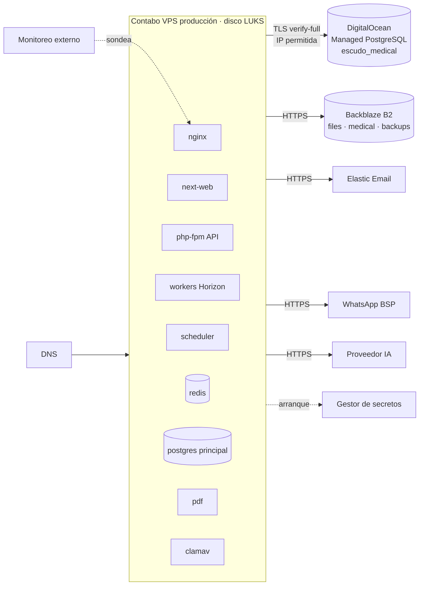

# 15 · Infraestructura y despliegue

Decisiones obligatorias en `spec/contexto.md`. Sin AWS por ahora. Costos y dimensionamiento: los define el área de desarrollo.

## 1. Mapa de infraestructura

## 2. Contabo (VPS)

### 2.1 Sistema base
- Linux LTS mínimo, actualizaciones de seguridad automáticas.
- Volumen de datos cifrado con **LUKS**. Desbloqueo al arranque con llave obtenida de forma remota (no guardada en el mismo servidor); procedimiento documentado de desbloqueo manual.
- Firewall: entrada solo 80/443 públicos y SSH desde IP de administración. Todo lo demás cerrado.
- SSH solo con llave, sin root, con MFA o bastión.
- Docker y Docker Compose; contenedores sin root, sistema de archivos de solo lectura donde se pueda.

### 2.2 Docker Compose (producción)

| Servicio | Imagen | Red | Volúmenes | Notas |
|---|---|---|---|---|
| `nginx` | nginx estable | pública + interna | certificados | TLS, HSTS, límites de uso básicos, tamaño máximo de cuerpo, cabeceras de seguridad |
| `web` | Next.js 15 (build propio) | interna | — | `output: standalone` |
| `api` | PHP 8.4 FPM + extensiones (pgsql, redis, intl, gd/imagick, sodium) | interna | — | Opcache con precarga |
| `worker` | misma imagen que `api` | interna | — | Horizon; colas: `default`, `notifications`, `pdf`, `imports`, `sync`, `ai`, `medical` (separada) |
| `scheduler` | misma imagen que `api` | interna | — | `schedule:work`, zona America/Lima |
| `redis` | Redis 7 | interna | datos (LUKS) | Contraseña; persistencia AOF |
| `postgres` | PostgreSQL 17 | interna | datos (LUKS) | `escudo_main`. Sin puerto expuesto. WAL archivado a B2 |
| `pdf` | Gotenberg (Chromium) | interna sin salida a internet | — | Solo recibe HTML; sin acceso a bases |
| `clamav` | ClamAV | interna | firmas | Escaneo de archivos (DA-12) |

- Imágenes fijadas por digest. Construidas en CI y publicadas en un registro privado.
- Variables sensibles inyectadas desde el gestor de secretos al arrancar (DA-08).
- Límites de memoria y CPU por servicio.

### 2.3 PostgreSQL principal
- Roles: `escudo_owner` (dueño de tablas, solo migraciones), `escudo_app` (aplicación, sin BYPASSRLS), `escudo_readonly` (reportes internos, con RLS), `escudo_backup`.
- `pg_stat_statements` activo. Parámetros ajustados al tamaño del VPS.
- El esquema carga en PostgreSQL 16 y 17 (probado en CI).

## 3. DigitalOcean Managed PostgreSQL (base médica)

- Clúster dedicado para `escudo_medical`. Cifrado en reposo del proveedor.
- Trusted Sources: solo IP de los servidores de la aplicación del entorno.
- TLS obligatorio (`verify-full`).
- Usuarios: `escudo_med_owner` (migraciones), `escudo_med_app` (aplicación).
- Pool de conexiones del proveedor en modo transacción.
- Respaldos automáticos del proveedor + volcado lógico propio cifrado a B2 (llave distinta).
- Región: DA-11.
- Entorno de pruebas con su propio clúster pequeño; desarrollo usa un contenedor PostgreSQL local separado.

## 4. Backblaze B2

| Bucket | Contenido | Configuración |
|---|---|---|
| `escudosst-prod-files` | Evidencias, fotos, PDF, firmas | Privado, SSE-B2, CORS solo para el dominio de la app |
| `escudosst-prod-medical` | Archivos médicos | Privado, SSE-B2, llave de aplicación exclusiva |
| `escudosst-prod-backups` | Respaldos cifrados y WAL | Privado, SSE-B2, bloqueo de objetos (inmutable) con retención |

Equivalentes `-staging-` para pruebas. Desarrollo usa MinIO local.

## 5. Elastic Email y DNS

- Subdominio de envío con SPF, DKIM y DMARC (`p=quarantine` y luego `p=reject`).
- Webhook de eventos (entregas, rebotes, quejas) hacia la API.
- Cuenta separada o subcuenta para pruebas.

### DNS (dominio en DA-05)

| Registro | Uso |
|---|---|
| `app.<dominio>` | Aplicación web y PWA |
| `api.<dominio>` | API (o ruta `/api` en el mismo host; preferir mismo host para cookies) |
| `v.<dominio>` | Verificación pública de fotocheck (URL corta para el QR) |
| `r.<dominio>` | Reporte público por QR |
| `notificaciones.<dominio>` | Remitente de correo |
| `*.<dominio>` | Subdominios de marca blanca de consultoras |
| `staging.<dominio>` | Entorno de pruebas (protegido) |
| CAA | Limita la emisión de certificados |

Dominios propios de consultoras: el cliente crea un CNAME; la plataforma emite el certificado.

## 6. TLS

- Let's Encrypt con renovación automática (certbot o ACME en nginx). Comodín por DNS-01 para subdominios de marca blanca.
- TLS 1.2 y 1.3; cifrados modernos; HSTS con `includeSubDomains` tras validar.
- Conexiones salientes verifican certificados.

## 7. Entornos

| Entorno | Dónde | Datos | Proveedores | Despliegue |
|---|---|---|---|---|
| Desarrollo | Máquina local con Docker Compose (`compose.dev.yml`) | Seeders ficticios | MinIO, Mailpit, PostgreSQL médico local, WhatsApp e IA `fake` | Manual |
| Pruebas (staging) | VPS Contabo separado | Seeders ficticios; nunca datos reales | B2 staging, Elastic Email subcuenta, DO clúster de pruebas, BSP en modo prueba, IA real con cupo | Automático al fusionar en `develop` |
| Producción | VPS Contabo de producción | Reales | Producción | Manual aprobado desde `main` (etiqueta de versión) |

Producción y pruebas no comparten credenciales, buckets ni bases.

## 8. CI/CD

```mermaid
flowchart LR
    PR[Pull request] --> L[Lint + análisis estático]
    L --> U[Unitarias + integración<br/>PG 16 y 17]
    U --> R[RLS + aislamiento]
    R --> C[Contrato OpenAPI]
    C --> S[Seguridad: audit, gitleaks, escaneo de imagen]
    S --> V[make verify]
    V --> H[Revisión humana]
    H --> D[Fusión a develop]
    D --> B[Build de imágenes]
    B --> ST[Despliegue a pruebas]
    ST --> E[E2E + axe]
    E --> M[Fusión a main + etiqueta]
    M --> AP[Aprobación manual]
    AP --> PROD[Despliegue a producción]
```

Despliegue:
1. Construir imágenes en CI y publicarlas con la etiqueta de versión.
2. Respaldo previo de la base principal.
3. `docker compose pull`.
4. Migraciones (`main` y `medical`) con el rol dueño; deben ser compatibles con la versión anterior (cambios en dos pasos).
5. Reinicio ordenado: workers (terminan jobs en curso), api, web, scheduler.
6. Verificación de salud (`/health` y prueba de humo).
7. Reversión: volver a la etiqueta anterior; las migraciones no destructivas lo permiten.

Herramienta CI: GitHub Actions (o equivalente). Secretos de CI separados por entorno.

## 9. Respaldos y restauración

| Qué | Cómo | Frecuencia |
|---|---|---|
| Base principal | Respaldo base (`pg_basebackup`) + archivado continuo de WAL (pgBackRest o WAL-G) cifrado a B2 | Base diaria + WAL continuo |
| Base principal (lógico) | `pg_dump` cifrado | Diario |
| Base médica | Respaldos del proveedor + `pg_dump` propio cifrado con llave médica | Diario |
| Redis | No crítico (colas se reconstruyen); snapshot | Diario |
| B2 files/medical | Versionado de objetos + réplica a otro bucket/región (por definir) | Continuo |
| Configuración | Repositorio de infraestructura (sin secretos) | En cada cambio |

Retención por parámetro. Bloqueo de objetos para que un atacante no pueda borrarlos.

**Restauración probada:**
- Periódicamente se restaura en un servidor aislado: base principal a un punto en el tiempo, base médica, muestra de archivos.
- Se verifica: arranque de la app, conteo de filas por tabla, RLS activo, lectura de archivos.
- Se registra resultado y duración en un acta (documento interno). Sin restauración probada en el ciclo vigente no se publica una versión (ver `12` §9).
- Procedimiento escrito de recuperación ante desastre: nuevo VPS, desbloqueo LUKS, restauración, cambio de DNS.

## 10. Monitoreo

| Qué | Herramienta (DA-16) | Alerta |
|---|---|---|
| Disponibilidad de `app`, `v`, `r`, `api` | Monitor externo | Caída |
| Errores de aplicación | Sentry (sin datos personales; filtros de PII) | Nuevos errores, picos |
| Colas | Horizon + métricas | Jobs fallidos, colas atrasadas |
| Recursos del servidor | Agente de métricas | CPU, memoria, disco, inodos |
| PostgreSQL | Métricas y `pg_stat_statements` | Conexiones, consultas lentas, replicación de WAL |
| Base médica | Panel del proveedor | Conexiones, almacenamiento |
| Respaldos | Job que verifica el último respaldo | Respaldo ausente o fallido |
| Certificados | Monitor | Por vencer |
| Correo | Webhooks de Elastic Email | Tasa de rebotes |
| Seguridad | Registro de accesos sensibles, intentos fallidos | Patrones anómalos |

Página de estado pública para clientes (opcional).

## 11. Escalamiento

Orden previsto cuando crezca la carga:
1. Ajuste vertical del VPS de Contabo.
2. Separar PostgreSQL principal en su propio VPS (red privada, LUKS) y Redis en otro.
3. Varios nodos de aplicación (`api`, `web`) detrás de nginx/balanceador; sesiones y caché en Redis (ya preparado).
4. Workers en nodos dedicados; colas separadas por tipo (ya separadas).
5. Réplica de lectura de PostgreSQL para reportes y dashboard.
6. CDN para archivos estáticos del frontend.
7. Migración de proveedores cambiando la implementación de las interfaces (`FileStorage`, `MailChannel`).

La aplicación es sin estado en disco local: todo archivo va a B2 y toda sesión a Redis. Esto permite escalar horizontalmente sin cambios de código.
