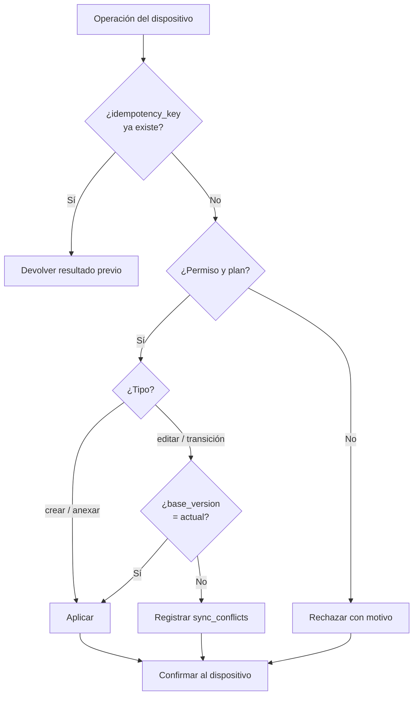

# 16 · Offline y sincronización

Módulo OFF (complemento, fase 3). Tablas: `devices`, `sync_batches`, `sync_conflicts`. Sin OFF la PWA funciona solo en línea (se instala igual y guarda borradores locales del formulario abierto).

## 1. PWA

- Misma base Next.js; grupo de rutas `(worker)` para trabajador y campo.
- Instalable (manifest, iconos, pantalla de inicio). Sin tiendas de aplicaciones (DA-20).
- Service worker (Workbox o Serwist):
  - Precaché del shell de la app y de las pantallas offline.
  - Caché de catálogos de la empresa (trabajadores del alcance, puestos, plantillas, tipos de EPP, peligros).
  - Nunca cachea respuestas de la API médica ni datos de otros trabajadores fuera del alcance.
- Indicador visible: «En línea», «Sin conexión», «Sincronizando (N)», «N pendientes», «Conflictos».

## 2. Qué funciona offline

| Módulo | Operaciones offline | Requiere en línea |
|---|---|---|
| INS Inspecciones | Ejecutar inspección programada o nueva desde plantilla; respuestas, fotos, hallazgos, firma | Crear plantillas; cerrar acciones |
| ATS | Llenar ATS completo con pasos, participantes y firmas | — |
| CH5 Charlas | Registrar charla y asistencia con firma | — |
| ACT Actos y condiciones | Reportar con foto y ubicación | Clasificar, asignar acciones |
| PTR PETAR en campo | Verificación de condiciones, inicio, suspensión, cierre, firmas en campo | **Solicitud y aprobación** de la cadena (se hacen en línea) |
| EPP Entrega | Registrar entrega con firma del trabajador; descuento de stock local | Ajustes de inventario |
| Asistencia | Capacitaciones (CAP) y simulacros (SIM): marcar asistencia y firma | Emitir constancias |
| FOT | Mostrar el propio fotocheck (QR en caché); escáner del supervisor con última copia conocida de estados del alcance, marcada con su fecha | Verificación pública siempre en línea |

**Nunca offline:** datos médicos, aprobaciones de documentos, elección del comité (votación), modo SUNAFIL, administración.

## 3. Almacenamiento local (IndexedDB)

Librería: Dexie (o equivalente). Base por usuario y empresa: `escudo_<user_id>_<company_id>`.

| Almacén | Contenido |
|---|---|
| `catalogs` | Datos de referencia con versión y fecha de descarga |
| `records` | Registros creados o editados localmente (estado local) |
| `outbox` | Cola de operaciones pendientes |
| `files` | Fotos y firmas pendientes (Blob) con metadatos |
| `sync_state` | Último lote, cursores, versión de catálogos |

Límites: cuota del navegador; la app pide almacenamiento persistente (`navigator.storage.persist()`) y avisa si queda poco espacio. Fotos se comprimen en el dispositivo antes de guardarse.

## 4. Cola de operaciones

Cada operación en `outbox`:

```json
{
  "idempotency_key": "01J...uuidv7",
  "op": "create",
  "entity": "inspection_answers",
  "entity_id": "01J...uuidv7",
  "base_version": null,
  "payload": { "...": "..." },
  "files": ["01J...file"],
  "created_at_device": "2026-03-15T08:30:00-05:00",
  "depends_on": ["01J...idem-de-la-inspeccion"]
}
```

- Los ids se generan en el dispositivo (UUID v7): el registro existe con su id definitivo antes de sincronizar.
- Orden: FIFO respetando `depends_on` (primero la inspección, luego sus respuestas).
- Envío en lotes (`POST /api/v1/sync/batches`) de tamaño acotado (parámetro).
- Reintentos con espera creciente. Background Sync cuando el navegador lo soporta; si no, al abrir la app o recuperar señal.

## 5. Idempotencia

- `idempotency_key` único por operación y empresa en el servidor.
- Si llega una clave ya procesada: se devuelve el resultado guardado (`idempotency_replay`), sin aplicar de nuevo.
- El dispositivo borra la operación de `outbox` solo al recibir confirmación (aplicada, repetida o conflicto registrado).
- Firmas offline: el hash se calcula en el dispositivo y el servidor lo recalcula; si no coincide, la firma se rechaza y se pide repetirla.

## 6. Resolución de conflictos

Cada registro editable tiene `version` (entero) en el servidor. El dispositivo envía `base_version`.

| Caso | Regla |
|---|---|
| Creación | Sin conflicto (id nuevo). Solo falla si viola una regla de negocio |
| Registro solo-anexar (respuestas, asistencias, firmas, entregas, reportes) | Siempre se agrega. Duplicados lógicos (misma persona en la misma charla) se marcan para revisión |
| Edición con `base_version` = versión actual | Se aplica |
| Edición con `base_version` < versión actual | **Conflicto**: no se pisa. Se guarda en `sync_conflicts` con ambas versiones |
| Transición de estado inválida (p. ej. PETAR ya suspendido en servidor) | Conflicto con motivo `invalid_transition` |
| Registro borrado en el servidor | Conflicto con motivo `deleted_on_server` |
| Permiso o plan retirado | Operación rechazada con motivo; se conserva en el dispositivo para exportar |

Resolución: el usuario (o JS/JA) ve el conflicto y elige: conservar servidor, aplicar dispositivo o combinar campo a campo. Todo queda en `audit_logs`. Los conflictos no resueltos impiden cerrar el registro.



## 7. Fotos pendientes

1. La foto se guarda en `files` (IndexedDB) con id, hash y vínculo al registro.
2. Al sincronizar el registro, el servidor responde con URLs firmadas de subida por archivo pendiente.
3. El dispositivo sube a B2 directamente; luego confirma (`POST /files/{id}/confirm`).
4. Hasta confirmar, el registro en el servidor muestra «Evidencia pendiente de subir».
5. Reintento y reanudación; si la URL vence, pide otra.
6. El archivo local se borra solo tras confirmación.
7. Fotos con ubicación y hora del dispositivo como metadatos; EXIF restante se elimina en el servidor.

## 8. Seguridad del dispositivo

- **Registro de dispositivo** (`devices`): al activar OFF, el dispositivo se registra con nombre, usuario, empresa, fecha. El JS o AC lo ve y puede revocarlo.
- **Revocación:** el siguiente contacto con el servidor rechaza los lotes y ordena borrar la base local. Si el dispositivo se pierde, la sesión se invalida en el servidor.
- **Cifrado local:** los registros y archivos en IndexedDB se cifran con una llave derivada del PIN del usuario (WebCrypto, AES-GCM). La llave no se guarda en claro. Sin PIN no se lee la base local.
- **Bloqueo:** PIN al abrir la app tras inactividad (parámetro).
- **Datos mínimos:** solo los catálogos del alcance del usuario. Nunca datos médicos (solo `fitness_status` para validar participantes de PETAR, como habilitado/no habilitado).
- **Caducidad:** si el dispositivo no sincroniza en un periodo (parámetro), exige conexión antes de seguir capturando.
- **Cierre de sesión:** pregunta si hay pendientes; no borra pendientes sin confirmación explícita y advertencia.
- **Dispositivos compartidos** (tablet de obra): perfil por usuario con PIN propio; la base local es por usuario.

## 9. Pruebas

Ver `12-pruebas-y-calidad.md` §6.
