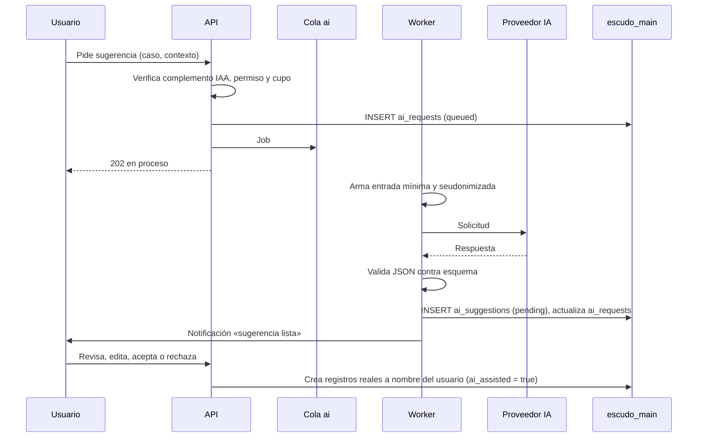

# 17 · Asistente IA

Módulo IAA (complemento, fase 3). Tablas: `ai_requests`, `ai_suggestions`. Proveedor: por definir (DA-03), detrás de la interfaz `AiProvider`.

Principio: **la IA solo sugiere. Una persona decide y aplica.**

## 1. Casos de uso en V1

| # | Caso | Dónde | Entrada enviada al proveedor | Salida (JSON validado) |
|---|---|---|---|---|
| IA-01 | IPERC sugerido por puesto | IPC, editor de matriz | Puesto, tareas, sector/CIIU, sede tipo, equipos y sustancias declarados, criterios de evaluación de la empresa, catálogo de peligros base | Filas propuestas: tarea, peligro, riesgo, evaluación inicial, controles por jerarquía, riesgo residual, EPP sugerido |
| IA-02 | Investigación guiada | INV | Descripción del evento sin nombres (personas como «Trabajador A»), tipo, lugar, tarea, condiciones, testimonios resumidos y seudonimizados | Preguntas de seguimiento, árbol de causas o clasificación SCAT propuesta, causas inmediatas y básicas, acciones correctivas sugeridas |
| IA-03 | Lectura de documentos de contratistas | CTR | Imagen/PDF del documento (SCTR, constancias, certificados), tipo esperado | Campos extraídos: tipo, número, entidad emisora, fechas de vigencia, nombres y documento listados; nivel de confianza por campo |
| IA-04 | Redacción de actas | COM, reuniones | Agenda, notas tomadas por el secretario, asistentes por cargo (sin datos personales extra), acuerdos dictados | Borrador de acta en formato de la empresa y lista de acuerdos estructurados (responsable por cargo, fecha propuesta) |

Casos posteriores (no V1): resúmenes para revisión por la dirección, sugerencia de preguntas de inspección por sector, clasificación automática de reportes de actos/condiciones.

## 2. Flujo

## 3. Reglas obligatorias

### 3.1 Aprobación humana
- Ninguna sugerencia crea, modifica ni aprueba registros por sí sola.
- Toda sugerencia se guarda en `ai_suggestions` con estado `pending` (máquina de estados en `06` §19).
- La persona puede aceptar todo, aceptar parte y editar, o rechazar.
- Los registros creados desde una sugerencia llevan `ai_assisted = true` y `ai_suggestion_id`, y siguen su propio flujo de aprobación (un IPERC sugerido igual pasa por revisión y aprobación).
- La interfaz marca claramente lo sugerido: «Sugerido por IA. Revisa antes de aceptar.».
- IA-03: los campos extraídos se muestran junto al documento para comparación; la acreditación siempre la aprueba una persona.

### 3.2 Datos que nunca se envían
- **Datos médicos** de ningún tipo: diagnósticos, resultados de EMO, notas clínicas, descansos, vulnerabilidad, ni siquiera `fitness_status` asociado a una persona.
- Número de documento, celular, correo, dirección, fecha de nacimiento de trabajadores.
- Nombres de personas, salvo IA-03 (el documento los contiene por naturaleza; se envía solo el documento necesario y la respuesta se guarda sin el texto completo).
- Datos de otras empresas.
- Secretos, tokens, URLs firmadas.

### 3.3 Minimización y seudonimización
- El worker arma la entrada desde una lista blanca de campos por caso (no se serializan modelos completos).
- Personas como «Trabajador A», «Supervisor B»; el mapeo queda solo en el servidor y se reemplaza al mostrar la sugerencia.
- Texto libre del usuario pasa por un filtro que detecta y enmascara DNI, teléfonos y correos antes de enviar.
- La regla se prueba: pruebas automáticas verifican que la carga enviada a `AiProvider` no contiene campos prohibidos.

### 3.4 Registro de solicitudes (`ai_requests`)
Por cada solicitud: `company_id`, `user_id`, caso, módulo y registro de origen, proveedor y modelo, versión del prompt, tokens de entrada y salida, duración, estado, hash de la entrada, error si hubo.
- No se guarda el texto completo de entrada cuando contiene datos de personas (IA-02, IA-03, IA-04); se guarda el hash y la lista de campos enviados.
- La respuesta estructurada se guarda en `ai_suggestions`.
- Visible para el AC y JS (uso y quién pidió qué); base para el cupo.

### 3.5 Límites por plan
- IAA es complemento: sin él, los botones de IA aparecen bloqueados (ver `07` §3.7).
- Cupo por empresa y periodo (parámetro por plan; valores por definir con DA-01). Contador visible en SCR-IAA-03.
- Límite por usuario y por minuto para evitar abuso.
- Al agotar el cupo: aviso y bloqueo hasta el siguiente periodo o ampliación.
- Tamaño máximo de documentos en IA-03.

### 3.6 Proveedor
- Contrato que garantice: no entrenar con los datos, retención mínima o nula, ubicación de procesamiento declarada (flujo transfronterizo, ver `10` §1.3).
- Llamadas solo desde workers, con tiempo de espera y reintentos acotados.
- Prompts versionados en el repositorio (`backend/app/Modules/IAA/Prompts/`), con pruebas de regresión sobre casos ficticios.
- Respuestas que no validan contra el esquema se descartan y se registran como error.
- Instrucciones del sistema: responder en español de Perú, citar la normativa solo como referencia general, no inventar normas, indicar incertidumbre.
- Entrada del usuario tratada como datos, nunca como instrucciones (protección contra inyección de prompts, en especial en IA-03 con documentos externos).

## 4. Calidad

- Conjunto de casos de evaluación ficticios por caso de uso (puestos típicos de los sectores de entrada; accidentes tipo; documentos de contratistas de muestra; actas).
- Métricas de uso: tasa de aceptación, aceptación parcial y rechazo por caso (de `ai_suggestions`). Sirven para mejorar prompts.
- Revisión por un especialista SST de las salidas de IA-01 e IA-02 antes de la salida a producción.
- Aviso permanente en la interfaz: la IA puede equivocarse; la responsabilidad del SG-SST es de la empresa.
