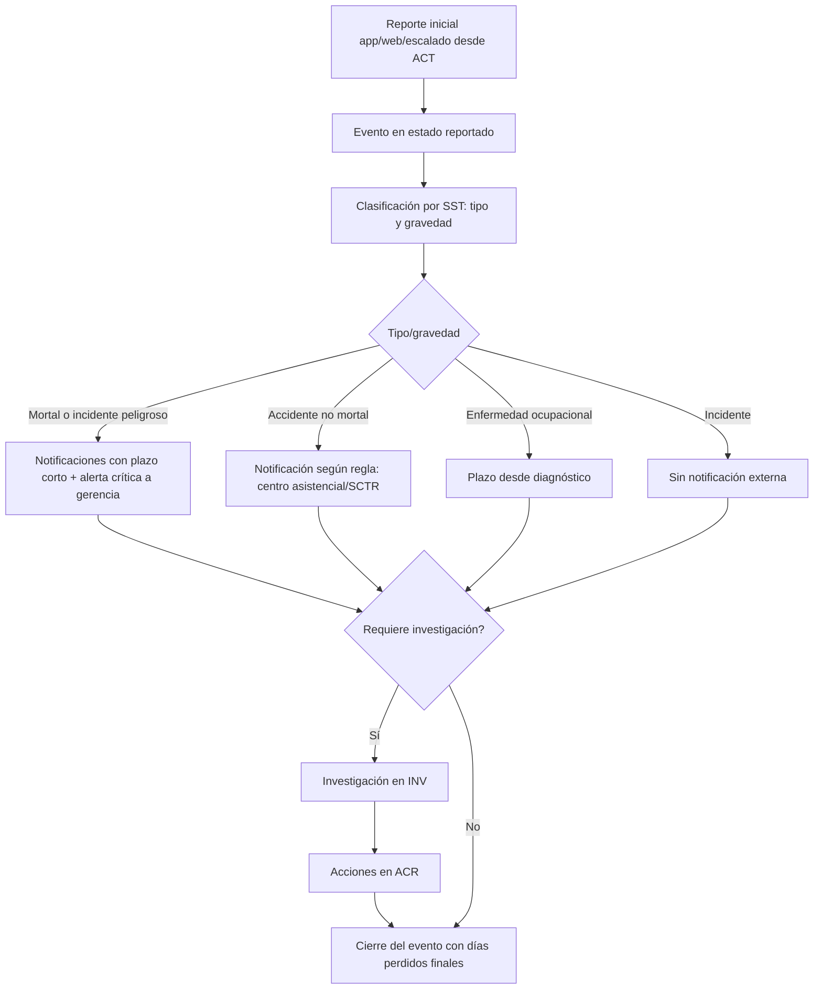

# M-ACC · 6.1 Accidentes, incidentes y enfermedades

## 1. Encabezado

| Campo | Valor |
|---|---|
| Código | `ACC` |
| Número | 6.1 |
| Nombre | Accidentes, incidentes y enfermedades |
| Grupo | 6. Eventos y mejora continua |
| Plan | E · Esencial |
| Fase | 1 · Plan Esencial |
| Origen | Ley |
| Resuelve | Registro y notificación en plazo |
| Tablas del catálogo | `sst_events`, `event_people`, `event_notifications` |
| Dependencias | [TRB](M-TRB.md) (Trabajadores y legajo), [TEN](M-TEN.md) (Empresas, sedes y áreas), [NOT](M-NOT.md) (Alertas y notificaciones), [INV](M-INV.md) (Investigación de causas), [ACR](M-ACR.md) (Acciones correctivas), [IPC](M-IPC.md) (Matriz IPERC) |
| Prefijo de permisos | `acc.<tabla>.<acción>` |

## 2. Objetivo y problema que resuelve

**Objetivo.** Registrar accidentes de trabajo (leves, incapacitantes, mortales), incidentes peligrosos, incidentes y enfermedades ocupacionales con sus personas involucradas, controlar los plazos de notificación al MTPE y a la entidad de salud, y alimentar investigación, estadísticas y registros obligatorios.

**Problema que resuelve.** Los accidentes se notifican tarde o no se notifican, lo que es una infracción grave; los datos se registran incompletos y las estadísticas no cuadran. El registro de accidentes, incidentes y enfermedades es el primero de los obligatorios.

## 3. Base normativa

- Ley 29783, art. 82: obligación de notificar accidentes mortales, incidentes peligrosos y enfermedades ocupacionales.
- D.S. 005-2012-TR, art. 110: plazos de notificación (accidente mortal e incidente peligroso: plazo corto desde ocurrido; accidente no mortal: por el centro médico asistencial; enfermedad ocupacional: plazo desde el diagnóstico). Plazos como parámetros `notify_deadline_*` con vigencia, **a confirmar por especialista SST/legal**.
- D.S. 005-2012-TR, Glosario: definiciones de accidente leve, incapacitante (total temporal, parcial permanente, total permanente) y mortal; incidente peligroso.
- D.S. 005-2012-TR, art. 33 literal a: registro de accidentes de trabajo, enfermedades ocupacionales, incidentes peligrosos y otros incidentes (formatos R.M. 050-2013-TR).
- Sistema Informático de Notificación de Accidentes de Trabajo, Incidentes Peligrosos y Enfermedades Ocupacionales del MTPE (SAT/formularios vigentes; a confirmar canal).

> Todo valor legal citado (plazos, periodicidades, umbrales, factores) se implementa como parámetro con vigencia y queda «a confirmar por especialista SST/legal»; nunca como constante en código.

## 4. Roles y permisos

| Rol | Qué hace en el módulo | Permisos |
|---|---|---|
| Jefe SST / Responsable del SG-SST (`sst_manager`) | Registra y clasifica eventos, controla notificaciones, cierra | `acc.sst_events.create`, `acc.sst_events.update`, `acc.sst_events.close`, `acc.event_people.create`, `acc.event_notifications.create`, `acc.event_notifications.update` |
| Supervisor SST (`sst_supervisor`) | Registra eventos de su sede y la notificación inicial | `acc.sst_events.create`, `acc.event_people.create` |
| Jefe de área / línea (`area_lead`) | Reporta el evento inicial desde el lugar | `acc.sst_events.create` |
| Miembro del Comité SST (`committee_member`) | Consulta eventos y participa en su análisis | `acc.sst_events.view` |
| Médico ocupacional (`occupational_doctor`) | Registra diagnóstico de enfermedad ocupacional (detalle en base médica) | `acc.sst_events.update` |
| Gerencia (`management`) | Recibe alertas de eventos graves y consulta | `acc.sst_events.view` |
| Trabajador (`worker`) | Reporta un evento desde la app | `acc.sst_events.create` |
| Auditor externo (`external_auditor`) | Consulta el registro del periodo | `acc.sst_events.view` |

Roles no listados no tienen acceso al módulo. Los permisos se acotan además por `membership_scopes` (sede/área) y por el plan contratado (feature flag del módulo).

## 5. Tablas

| Tabla | Base | Propósito | Campos clave |
|---|---|---|---|
| `sst_events` | principal | Evento | company_id, code, event_type (accidente, incidente peligroso, incidente, enfermedad ocupacional), severity (leve, incapacitante temporal, parcial permanente, total permanente, mortal), occurred_at, reported_at, site_id, area_id, location_text, latitude, longitude, description, activity_at_time, iperc_row_id, immediate_actions, photo_file_ids, contractor_id, lost_days_total, status, requires_investigation, substandard_report_id |
| `event_people` | principal | Persona afectada o testigo | event_id, worker_id, contractor_worker_id, external_name, role (afectado, testigo, responsable), injury_type, body_part, injury_agent, lost_days, medical_center, is_own_staff (propio/intermediado/contratista) |
| `event_notifications` | principal | Notificación obligatoria y su plazo | event_id, recipient (MTPE, centro asistencial, aseguradora SCTR, empresa principal), rule_code, deadline_at, notified_at, channel, reference_number, evidence_file_id, status (pendiente, en plazo, fuera de plazo, no aplica), responsible_user_id |

Todas las tablas de empresa llevan las columnas estándar (`id` UUID v7, `company_id`, `created_at`, `updated_at`, `created_by`, `updated_by`, `deleted_at`) salvo las inalterables, y quedan bajo RLS por `app.company_id`.

## 6. Pantallas

| ID | Pantalla | Propósito | Elementos principales |
|---|---|---|---|
| SCR-ACC-01 | Reportar evento (móvil) | Registro inicial rápido | Tipo con íconos; fecha/hora (por defecto ahora); lugar con GPS; afectados por DNI o fotocheck; descripción; fotos; acciones inmediatas |
| SCR-ACC-02 | Eventos | Lista | Código, tipo, gravedad, fecha, sede, estado; semáforo de notificación (en plazo, por vencer, vencida) |
| SCR-ACC-03 | Ficha del evento | Detalle completo | Datos, personas, días perdidos, fila IPERC, notificaciones con cuenta regresiva, investigación vinculada, acciones |
| SCR-ACC-04 | Notificaciones obligatorias | Control de plazos | Para cada destinatario: plazo calculado, cuenta regresiva, registrar notificación con número de constancia y evidencia |
| SCR-ACC-05 | Clasificación | Revisión SST | Confirmar tipo y gravedad con definiciones del reglamento a la vista |
| SCR-ACC-06 | Registro (vista de libro) | Vista consolidada | Eventos del periodo con columnas del formato R.M. 050-2013-TR |

## 7. Flujos principales

## 8. Reglas de negocio

- **RN-ACC-01.** Las reglas de notificación (destinatario, tipo de evento, gravedad, plazo, inicio del cómputo: ocurrencia o diagnóstico, horas o días hábiles) son parámetros versionados con vigencia y marcados `to_confirm`; nunca constantes.
- **RN-ACC-02.** `deadline_at` se calcula al clasificar el evento con la regla vigente en la fecha de ocurrencia, en zona America/Lima y con el calendario de feriados nacionales cuando la regla usa días hábiles.
- **RN-ACC-03.** Una notificación registrada después de `deadline_at` queda «fuera de plazo» y no puede cambiarse a «en plazo».
- **RN-ACC-04.** Todo accidente mortal o incidente peligroso dispara alerta crítica inmediata al Jefe SST, gerencia y comité, ignorando horas de silencio.
- **RN-ACC-05.** Todo accidente incapacitante o mortal, e incidente peligroso, exige investigación (`requires_investigation = true`); el evento no se cierra sin investigación cerrada.
- **RN-ACC-06.** Cada evento con afectados requiere al menos una persona con rol afectado; para accidentes, tipo de lesión, parte del cuerpo y agente.
- **RN-ACC-07.** `lost_days_total` = suma de días perdidos de afectados (alimentados por [DES](M-DES.md) cuando existe); se usa en [EST](M-EST.md) y se congela al cerrar el mes estadístico, con ajustes posteriores registrados.
- **RN-ACC-08.** Un evento vinculado a una fila IPERC marca esa matriz como «requiere revisión».
- **RN-ACC-09.** Los eventos de trabajadores de contratistas se registran con `contractor_id` y se reportan en las estadísticas según el parámetro `include_contractors_in_stats`.
- **RN-ACC-10.** No se registran diagnósticos en `sst_events`; las enfermedades ocupacionales guardan el diagnóstico en la base médica ([EMO](M-EMO.md)/[VMD](M-VMD.md)) y aquí solo el tipo.
- **RN-ACC-11.** El código del evento es correlativo por empresa y año.

## 9. Estados y transiciones

| Entidad | Estados | Transiciones |
|---|---|---|
| sst_events | reported → classified → under_investigation → actions_in_progress → closed; reported → discarded (no es evento SST, con motivo) | |
| event_notifications | pending → notified_on_time / notified_late; pending → overdue → notified_late; pending → not_applicable | `overdue` automático al pasar `deadline_at` |

## 10. Notificaciones y alertas

| Evento | Destinatario | Canal | Anticipación / momento (parámetro) |
|---|---|---|---|
| Accidente mortal o incidente peligroso registrado | Jefe SST, gerencia, comité | App, WhatsApp, correo | Inmediato (prioridad crítica) |
| Notificación obligatoria por vencer | Responsable, Jefe SST | App, WhatsApp | `notify_warning_hours` antes de `deadline_at` (parámetro) |
| Notificación vencida | Jefe SST, gerencia | App, correo | Al vencer |
| Evento sin clasificar | Jefe SST | App | `event_triage_hours` después del reporte |

Los envíos se hacen mediante el módulo [NOT](M-NOT.md); cada regla es configurable por empresa y respeta las preferencias del usuario.

## 11. Reportes y exportaciones

- Registro de accidentes de trabajo, de incidentes peligrosos e incidentes, y de enfermedades ocupacionales (formatos referenciales R.M. 050-2013-TR) en [REG](M-REG.md).
- Constancias de notificación por evento.
- Eventos por tipo, gravedad, sede, parte del cuerpo y agente.
- Aporte al expediente [SUN](M-SUN.md): eventos del trabajador o periodo con notificación, investigación y acciones.

## 12. Integración con otros módulos

**Consume:**

- [TRB](M-TRB.md), [TEN](M-TEN.md), [IPC](M-IPC.md), [ACT](M-ACT.md) (escalados), [DES](M-DES.md) (días perdidos), [CTR](M-CTR.md).

**Produce:**

- Eventos para [INV](M-INV.md), [EST](M-EST.md), [REG](M-REG.md), [SUN](M-SUN.md); revisión de [IPC](M-IPC.md); acciones en [ACR](M-ACR.md).

## 13. Criterios de aceptación clave

1. **Dado** un incidente peligroso registrado con regla vigente de plazo X horas (parámetro), **cuando** se clasifica, **entonces** `deadline_at` = ocurrencia + X horas en America/Lima y empieza la cuenta regresiva.
2. **Dado** una notificación registrada una hora después de `deadline_at`, **cuando** se guarda, **entonces** queda «fuera de plazo» de forma permanente.
3. **Dado** un accidente mortal a las 02:00, **cuando** se registra, **entonces** gerencia y Jefe SST reciben alerta inmediata por WhatsApp.
4. **Dado** un accidente incapacitante con investigación abierta, **cuando** se intenta cerrar el evento, **entonces** se bloquea.
5. **Dado** un evento vinculado a una fila IPERC, **cuando** se guarda, **entonces** la matriz pasa a «requiere revisión».
6. **Dado** una regla de plazo modificada con nueva vigencia, **cuando** se clasifica un evento ocurrido antes del cambio, **entonces** se usa la regla vigente en la fecha de ocurrencia.

## 14. Fuera de alcance y preguntas abiertas

**Fuera de alcance:**

- Envío automático al sistema del MTPE (se registra la notificación hecha; integración evaluable).

**Preguntas abiertas:**

- Plazos exactos vigentes de notificación por tipo y si se computan en horas o días hábiles: **a confirmar por especialista legal**.
- ¿Los eventos de contratistas se notifican por la empresa principal o por el contratista en cada caso?
