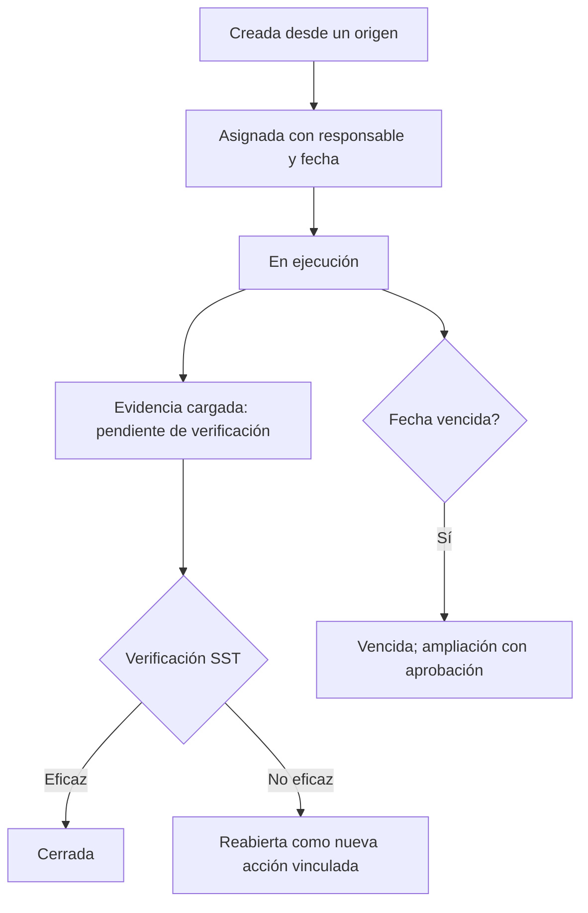

# M-ACR · 6.3 Acciones correctivas

## 1. Encabezado

| Campo | Valor |
|---|---|
| Código | `ACR` |
| Número | 6.3 |
| Nombre | Acciones correctivas |
| Grupo | 6. Eventos y mejora continua |
| Plan | E · Esencial |
| Fase | 1 · Plan Esencial |
| Origen | Ley |
| Resuelve | Responsables, plazos y evidencia de cierre |
| Tablas del catálogo | `corrective_actions`, `action_evidences` |
| Dependencias | [TRB](M-TRB.md) (Trabajadores y legajo), [NOT](M-NOT.md) (Alertas y notificaciones), [DOC](M-DOC.md) (Gestión documental) |
| Prefijo de permisos | `acr.<tabla>.<acción>` |

## 2. Objetivo y problema que resuelve

**Objetivo.** Gestionar en un solo lugar las acciones correctivas y preventivas de todo origen (inspecciones, eventos, investigaciones, auditorías, línea base, reportes, monitoreo, acuerdos), con responsable, fecha, evidencia de cierre y verificación de eficacia.

**Problema que resuelve.** Las observaciones se acumulan en distintos Excel y nadie sabe cuántas siguen abiertas; SUNAFIL pide evidencia de que se corrigieron.

## 3. Base normativa

- Ley 29783, art. 41 y D.S. 005-2012-TR, art. 88–89: acciones correctivas y preventivas, mejora continua.
- ISO 45001, cláusula 10.2 (incidentes, no conformidades y acción correctiva).

> Todo valor legal citado (plazos, periodicidades, umbrales, factores) se implementa como parámetro con vigencia y queda «a confirmar por especialista SST/legal»; nunca como constante en código.

## 4. Roles y permisos

| Rol | Qué hace en el módulo | Permisos |
|---|---|---|
| Jefe SST / Responsable del SG-SST (`sst_manager`) | Crea, asigna, verifica eficacia y cierra cualquier acción | `acr.corrective_actions.create`, `acr.corrective_actions.update`, `acr.corrective_actions.verify`, `acr.action_evidences.view` |
| Jefe de área / línea (`area_lead`) | Ejecuta acciones asignadas y carga evidencia | `acr.corrective_actions.update`, `acr.action_evidences.create` |
| Supervisor SST (`sst_supervisor`) | Crea y da seguimiento en su sede | `acr.corrective_actions.create`, `acr.corrective_actions.update` |
| Miembro del Comité SST (`committee_member`) | Consulta y hace seguimiento | `acr.corrective_actions.view` |
| Gerencia (`management`) | Consulta acciones y aprueba ampliaciones | `acr.corrective_actions.view`, `acr.corrective_actions.approve` |
| Trabajador (`worker`) | Ejecuta acciones asignadas a él | `acr.action_evidences.create` |

Roles no listados no tienen acceso al módulo. Los permisos se acotan además por `membership_scopes` (sede/área) y por el plan contratado (feature flag del módulo).

## 5. Tablas

| Tabla | Base | Propósito | Campos clave |
|---|---|---|---|
| `corrective_actions` | principal | Acción | company_id, code, origin_type (inspección, evento, investigación, auditoría, línea base, reporte, monitoreo, acuerdo, IPERC, simulacro, otro), origin_id, action_type (correctiva, preventiva, mejora), hierarchy_level, description, site_id, area_id, responsible_worker_id, due_date, original_due_date, extension_count, status, closed_at, verified_by, verified_at, effectiveness (eficaz/no eficaz), reopened_from_id |
| `action_evidences` | principal | Evidencia de ejecución | action_id, description, file_ids, submitted_by, submitted_at |

Todas las tablas de empresa llevan las columnas estándar (`id` UUID v7, `company_id`, `created_at`, `updated_at`, `created_by`, `updated_by`, `deleted_at`) salvo las inalterables, y quedan bajo RLS por `app.company_id`.

## 6. Pantallas

| ID | Pantalla | Propósito | Elementos principales |
|---|---|---|---|
| SCR-ACR-01 | Acciones | Bandeja central | Filtros por origen, sede, responsable, estado; semáforo (en plazo, por vencer, vencida); acciones masivas |
| SCR-ACR-02 | Ficha de la acción | Detalle | Origen con enlace; responsable; fechas; historial de ampliaciones; evidencias; verificación |
| SCR-ACR-03 | Mis acciones (móvil) | Pendientes del responsable | Tarjetas con fecha; botón «Subir evidencia» con cámara |
| SCR-ACR-04 | Verificación de eficacia | Revisión SST | Evidencias; decisión eficaz/no eficaz con comentario |

## 7. Flujos principales

## 8. Reglas de negocio

- **RN-ACR-01.** Toda acción tiene un origen trazable a un registro de la misma empresa, salvo origen «otro» con descripción.
- **RN-ACR-02.** Responsable y fecha meta son obligatorios; la fecha meta no puede ser anterior a la fecha de creación.
- **RN-ACR-03.** Una acción solo pasa a «pendiente de verificación» con al menos una evidencia.
- **RN-ACR-04.** Solo SST (o quien la empresa defina) verifica; el responsable no verifica su propia acción.
- **RN-ACR-05.** Una acción «no eficaz» se cierra como tal y genera una nueva acción vinculada (`reopened_from_id`).
- **RN-ACR-06.** Ampliar la fecha conserva `original_due_date`, incrementa `extension_count` y, tras `max_extensions_without_approval`, requiere aprobación de gerencia.
- **RN-ACR-07.** Una acción no cerrada al pasar `due_date` pasa a «vencida» automáticamente.
- **RN-ACR-08.** El cierre de acciones actualiza el estado del origen (hallazgo, brecha, causa, acuerdo).
- **RN-ACR-09.** Las evidencias no se eliminan una vez verificada la acción.

## 9. Estados y transiciones

| Entidad | Estados | Transiciones |
|---|---|---|
| corrective_actions | open → in_progress → pending_verification → closed_effective / closed_not_effective; open/in_progress → overdue → in_progress (ampliación) ; open → cancelled (con motivo) | |

## 10. Notificaciones y alertas

| Evento | Destinatario | Canal | Anticipación / momento (parámetro) |
|---|---|---|---|
| Acción asignada | Responsable | App, WhatsApp | Inmediato |
| Acción por vencer | Responsable | App, WhatsApp | `action_due_notice_days` antes |
| Acción vencida | Responsable, jefe del área, Jefe SST | App, correo | Al vencer y cada `overdue_repeat_days` |
| Evidencia cargada | Verificador | App | Inmediato |

Los envíos se hacen mediante el módulo [NOT](M-NOT.md); cada regla es configurable por empresa y respeta las preferencias del usuario.

## 11. Reportes y exportaciones

- Acciones por origen, estado, sede y responsable; % de cierre en plazo; antigüedad de abiertas.
- Aporte al expediente [SUN](M-SUN.md): evidencia de corrección de observaciones; aporte a los registros de accidentes, inspecciones y auditorías en [REG](M-REG.md) (columna de medidas correctivas).

## 12. Integración con otros módulos

**Consume:**

- Orígenes: [INS](M-INS.md), [ACC](M-ACC.md), [INV](M-INV.md), [AUI](M-AUI.md), [LBA](M-LBA.md), [ACT](M-ACT.md), [MAG](M-MAG.md), [COM](M-COM.md), [IPC](M-IPC.md), [SIM](M-SIM.md).

**Produce:**

- Estado de cierre a los orígenes; KPI en [DSH](M-DSH.md) y [RVD](M-RVD.md).

## 13. Criterios de aceptación clave

1. **Dado** una acción sin evidencia, **cuando** el responsable intenta enviar a verificación, **entonces** se bloquea.
2. **Dado** el responsable es también Jefe SST, **cuando** intenta verificar su propia acción, **entonces** se impide.
3. **Dado** una acción «no eficaz», **cuando** se verifica, **entonces** se crea una nueva acción vinculada.
4. **Dado** una acción con `extension_count` en el máximo, **cuando** se pide otra ampliación, **entonces** requiere aprobación de gerencia.
5. **Dado** la acción de un hallazgo de inspección, **cuando** se cierra eficaz, **entonces** el hallazgo queda cerrado.

## 14. Fuera de alcance y preguntas abiertas

**Fuera de alcance:**

- Gestión de proyectos complejos con subtareas.

**Preguntas abiertas:**

- ¿El verificador puede ser el jefe del área en vez de SST?
