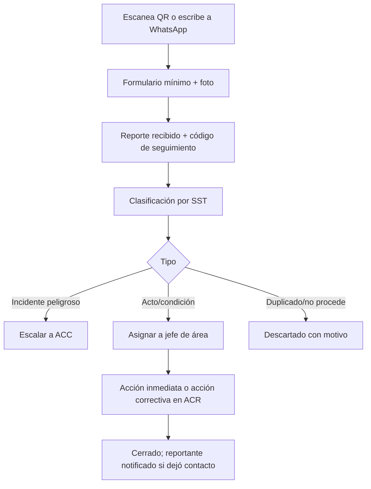

# M-ACT · 4.2 Actos y condiciones subestándar

## 1. Encabezado

| Campo | Valor |
|---|---|
| Código | `ACT` |
| Número | 4.2 |
| Nombre | Actos y condiciones subestándar |
| Grupo | 4. Operación en campo |
| Plan | E · Esencial |
| Fase | 1 · Plan Esencial |
| Origen | Mercado |
| Resuelve | Reporte por QR o WhatsApp |
| Tablas del catálogo | `report_points`, `substandard_reports` |
| Dependencias | [TEN](M-TEN.md) (Empresas, sedes y áreas), [ACR](M-ACR.md) (Acciones correctivas), [NOT](M-NOT.md) (Alertas y notificaciones) |
| Prefijo de permisos | `act.<tabla>.<acción>` |

## 2. Objetivo y problema que resuelve

**Objetivo.** Permitir que cualquier persona reporte actos y condiciones subestándar escaneando un QR en planta o escribiendo por WhatsApp, sin instalar app ni iniciar sesión, y gestionar esos reportes hasta su cierre.

**Problema que resuelve.** Los trabajadores no reportan porque el formato es engorroso, temen represalias o no tienen usuario; la empresa pierde la información preventiva más barata. Un canal simple y anónimo multiplica los reportes.

## 3. Base normativa

- Ley 29783, art. 27 y 40: participación de los trabajadores; art. 79 literal c: derecho a comunicar riesgos sin represalias.
- D.S. 005-2012-TR, art. 33 literal a: los incidentes y condiciones peligrosas forman parte del registro de incidentes (cuando corresponde, se escala a [ACC](M-ACC.md)).
- Ley 29733: minimización de datos; el reportante puede ser anónimo; las fotos pueden contener rostros.

> Todo valor legal citado (plazos, periodicidades, umbrales, factores) se implementa como parámetro con vigencia y queda «a confirmar por especialista SST/legal»; nunca como constante en código.

## 4. Roles y permisos

| Rol | Qué hace en el módulo | Permisos |
|---|---|---|
| Jefe SST / Responsable del SG-SST (`sst_manager`) | Crea puntos QR, clasifica y asigna reportes | `act.report_points.create`, `act.report_points.update`, `act.substandard_reports.update` |
| Supervisor SST (`sst_supervisor`) | Clasifica y gestiona reportes de su sede | `act.substandard_reports.update` |
| Jefe de área / línea (`area_lead`) | Atiende reportes de su área | `act.substandard_reports.update` |
| Trabajador (`worker`) | Reporta con o sin sesión; ve sus reportes y su estado | `act.substandard_reports.create`, `act.substandard_reports.view` |
| Miembro del Comité SST (`committee_member`) | Consulta reportes y tendencias | `act.substandard_reports.view` |

Roles no listados no tienen acceso al módulo. Los permisos se acotan además por `membership_scopes` (sede/área) y por el plan contratado (feature flag del módulo).

## 5. Tablas

| Tabla | Base | Propósito | Campos clave |
|---|---|---|---|
| `report_points` | principal | Punto QR físico | company_id, site_id, area_id, code, label, public_token (rotable), is_active, scans_count |
| `substandard_reports` | principal | Reporte | company_id, site_id, area_id, report_point_id, channel (qr_web, whatsapp, app, web), report_type (acto, condición, sugerencia), description, photo_file_ids, reporter_worker_id (opcional), is_anonymous, reporter_phone_hash, latitude, longitude, classification (peligro, nivel), status, assigned_to, corrective_action_id, escalated_event_id, public_tracking_code |

Todas las tablas de empresa llevan las columnas estándar (`id` UUID v7, `company_id`, `created_at`, `updated_at`, `created_by`, `updated_by`, `deleted_at`) salvo las inalterables, y quedan bajo RLS por `app.company_id`.

## 6. Pantallas

| ID | Pantalla | Propósito | Elementos principales |
|---|---|---|---|
| SCR-ACT-01 | Puntos QR | Generar e imprimir | Lista por sede/área; impresión de etiquetas con QR; rotación del token |
| SCR-ACT-02 | Formulario público (QR) | Reportar sin sesión | Página ligera: tipo (acto/condición) con íconos, descripción, foto, anónimo sí/no, nombre/teléfono opcional; código de seguimiento |
| SCR-ACT-03 | Conversación WhatsApp | Reportar por chat | Flujo guiado: tipo, área (lista), descripción, foto; respuesta con código de seguimiento |
| SCR-ACT-04 | Bandeja de reportes | Gestión | Lista con canal, área, tipo, foto, antigüedad; clasificar; asignar; convertir en acción o escalar a incidente |
| SCR-ACT-05 | Seguimiento público | Estado por código | Muestra solo estado (recibido, en atención, cerrado) sin datos de otros |
| SCR-ACT-06 | Mis reportes (app) | Historial del trabajador | Reportes propios con estado |

## 7. Flujos principales

## 8. Reglas de negocio

- **RN-ACT-01.** El endpoint público solo acepta reportes asociados a un `public_token` activo del punto QR; tiene límite de uso por IP y por token (`public_report_rate_limit`) y captcha invisible tras umbral.
- **RN-ACT-02.** El formulario público no muestra datos de la empresa más allá del nombre comercial, sede y área del punto.
- **RN-ACT-03.** Si el reportante elige anónimo, no se guardan nombre, teléfono ni IP completa; para WhatsApp se guarda solo un hash del número para evitar abuso.
- **RN-ACT-04.** Las fotos se procesan para eliminar metadatos EXIF antes de almacenarse.
- **RN-ACT-05.** Todo reporte recibe clasificación en `report_triage_hours` (parámetro); si no, se alerta al Jefe SST.
- **RN-ACT-06.** Un reporte clasificado como incidente peligroso debe escalarse a [ACC](M-ACC.md), donde corren los plazos de notificación.
- **RN-ACT-07.** Los reportes no se borran; se descartan con motivo visible en la bandeja.
- **RN-ACT-08.** Se prohíbe registrar sanciones al reportante a partir del reporte (principio de no represalia); el campo de reportante solo es visible para el rol SST.
- **RN-ACT-09.** El código de seguimiento público no revela contenido del reporte, solo el estado.

## 9. Estados y transiciones

| Entidad | Estados | Transiciones |
|---|---|---|
| substandard_reports | received → triaged → assigned → in_action → closed; triaged → escalated; received → discarded | |

## 10. Notificaciones y alertas

| Evento | Destinatario | Canal | Anticipación / momento (parámetro) |
|---|---|---|---|
| Reporte nuevo en mi sede | Supervisor/Jefe SST | App, WhatsApp | Inmediato |
| Reporte sin clasificar | Jefe SST | App | Tras `report_triage_hours` |
| Reporte cerrado | Reportante con contacto | WhatsApp, app | Al cerrar |

Los envíos se hacen mediante el módulo [NOT](M-NOT.md); cada regla es configurable por empresa y respeta las preferencias del usuario.

## 11. Reportes y exportaciones

- Reportes por área, tipo, canal y tiempo de atención; ranking de condiciones recurrentes.
- Aporte al registro de incidentes ([REG](M-REG.md)) cuando se escala, y evidencia de participación de trabajadores en [SUN](M-SUN.md).

## 12. Integración con otros módulos

**Consume:**

- [TEN](M-TEN.md); canal WhatsApp de [NOT](M-NOT.md) (interfaz `MessagingChannel`).

**Produce:**

- Acciones en [ACR](M-ACR.md); eventos en [ACC](M-ACC.md); KPI de participación en [DSH](M-DSH.md).

## 13. Criterios de aceptación clave

1. **Dado** un QR con token rotado, **cuando** se envía el formulario con el token anterior, **entonces** se rechaza.
2. **Dado** un reporte anónimo por QR, **cuando** se guarda, **entonces** no se almacenan nombre, teléfono ni IP completa.
3. **Dado** una foto con coordenadas EXIF, **cuando** se sube, **entonces** se almacena sin metadatos.
4. **Dado** un código de seguimiento, **cuando** se consulta en la página pública, **entonces** solo se ve el estado.
5. **Dado** un reporte clasificado como incidente peligroso, **cuando** se escala, **entonces** se crea el evento en ACC y empiezan sus plazos.
6. **Dado** más reportes por IP que el límite, **cuando** se envía otro, **entonces** se responde con error de límite.

## 14. Fuera de alcance y preguntas abiertas

**Fuera de alcance:**

- Gestión de denuncias de hostigamiento (canal distinto, otra normativa).

**Preguntas abiertas:**

- ¿Qué BSP de WhatsApp y número por empresa o compartido?
