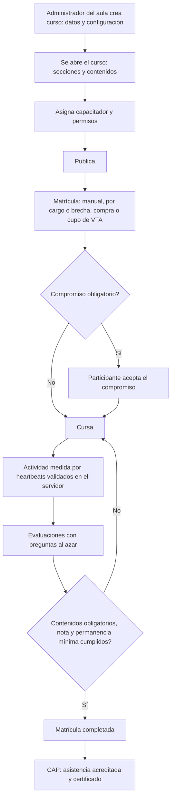

# M-AUL · 5.2 Aula virtual SST

## 1. Encabezado

| Campo | Valor |
|---|---|
| Código | `AUL` |
| Número | 5.2 |
| Nombre | Aula virtual SST |
| Grupo | 5. Personas y salud ocupacional |
| Plan | P · Profesional |
| Fase | 2 · Plan Profesional |
| Origen | Mercado |
| Resuelve | Portal propio de cursos: contenidos, bancos de preguntas, evaluaciones, capacitadores, tiempo de permanencia y recomendación de cursos; Moodle por API opcional |
| Tablas del catálogo | `courses`, `course_sections`, `course_lessons`, `course_enrollments`, `quiz_attempts`, `question_banks`, `questions`, `grading_scales`, `trainer_permissions`, `trainer_availability`, `learning_activity_sessions`, `completion_commitments`, `lms_connections`, `recommendation_rules`, `course_recommendations` |
| Dependencias | [CAP](M-CAP.md) (Capacitaciones e inducciones), [TRB](M-TRB.md) (Trabajadores y legajo), [TEN](M-TEN.md) (Empresas, sedes y áreas), [SUS](M-SUS.md) (Suscripciones y facturación), [NOT](M-NOT.md) (Alertas y notificaciones), [DOC](M-DOC.md) (Gestión documental), [INS](M-INS.md) (Inspecciones), [ACC](M-ACC.md) (Accidentes, incidentes y enfermedades) |
| Prefijo de permisos | `aul.<tabla>.<acción>` |

## 2. Objetivo y problema que resuelve

**Objetivo.** Dar a cada empresa del plan Profesional un portal propio de cursos dentro de EscudoSST, sin depender de otra plataforma: cursos organizados en secciones con contenidos (texto, video alojado en Vimeo, documento, enlace y evaluación), participantes, calificaciones con escala propia del curso, evaluaciones desde bancos de preguntas, capacitadores con permisos configurables, compromiso de culminación y tiempo de permanencia real por actividad, convirtiendo cada curso completado en asistencia y certificado en [CAP](M-CAP.md). Incluye la **recomendación de cursos** a trabajadores, participantes externos y empresas compradoras, por reglas automáticas, de forma manual o (con el complemento [IAA](M-IAA.md)) por sugerencia de IA aprobada por una persona, con medición de conversión. La conexión con Moodle por API es opcional para el cliente que prefiera seguir con su Moodle.

**Problema que resuelve.** Las empresas con turnos rotativos o sedes dispersas no pueden reunir a todos para capacitaciones presenciales, y las aulas genéricas no prueban cuánto tiempo estudió realmente cada trabajador, no se enlazan con la matriz por cargo ni con el registro obligatorio, y obligan a pagar y mantener otra plataforma. Además, institutos y consultoras SST necesitan un aula con evaluaciones serias y certificados verificables para capacitar a su personal o a terceros. Los clientes piden además que el sistema recomiende el curso siguiente: la recapacitación antes de que venza un certificado, lo que falta para el cargo o lo que complementa un curso aprobado.

## 3. Base normativa

- D.S. 005-2012-TR, art. 27–29: modalidades de capacitación (presencial o virtual), en horario de trabajo y sin costo para el trabajador.
- Ley 29783, art. 35 literal b y art. 49 literal g: capacitación al ingreso, durante el desempeño y ante cambios.
- Ley 29733 y D.S. 016-2024-JUS: los envíos de recomendaciones por correo o WhatsApp a participantes externos con fines comerciales requieren consentimiento previo, separado y revocable; a trabajadores, las recomendaciones de capacitación obligatoria son comunicación laboral, y las demás respetan sus preferencias de notificación.
- Ley 29733 y D.S. 016-2024-JUS: el registro de actividad para medir permanencia es un tratamiento de datos personales; finalidad informada (acreditar horas de capacitación), sin seguimiento fuera del aula.
- La acreditación de horas virtuales por permanencia es un criterio de producto; si una norma sectorial exige otro mecanismo, se parametriza (a confirmar por especialista SST).

> Todo valor legal citado (plazos, periodicidades, umbrales, factores) se implementa como parámetro con vigencia y queda «a confirmar por especialista SST/legal»; nunca como constante en código.

## 4. Roles y permisos

| Rol | Qué hace en el módulo | Permisos |
|---|---|---|
| Administrador de cuenta (`account_admin`) | Activa o desactiva el aula para la empresa; configura la cuenta de Vimeo y la conexión opcional con Moodle | `aul.lms_connections.create`, `aul.lms_connections.update`, `aul.trainer_permissions.update` |
| Jefe SST / Responsable del SG-SST (`sst_manager`) | Administrador del aula: crea y publica cursos, secciones y contenidos, bancos de preguntas, escalas; asigna capacitadores y sus permisos; matricula | `aul.courses.create`, `aul.courses.update`, `aul.courses.publish`, `aul.course_sections.create`, `aul.course_lessons.create`, `aul.course_lessons.update`, `aul.question_banks.create`, `aul.questions.create`, `aul.questions.import`, `aul.grading_scales.update`, `aul.trainer_permissions.update`, `aul.course_enrollments.create`, `aul.course_enrollments.update`, `aul.learning_activity_sessions.view`, `aul.recommendation_rules.create`, `aul.recommendation_rules.update`, `aul.course_recommendations.create`, `aul.course_recommendations.approve`, `aul.course_recommendations.view` |
| Capacitador (`trainer`) | Gestiona los cursos que se le asignan según sus permisos: por defecto sube materiales y no matricula; califica, ve avance y permanencia; registra su disponibilidad | `aul.course_lessons.create`, `aul.course_lessons.update`, `aul.questions.create`, `aul.quiz_attempts.grade`, `aul.course_enrollments.view`, `aul.learning_activity_sessions.view`, `aul.trainer_availability.create`, `aul.trainer_availability.update`, `aul.course_recommendations.create` |
| Recursos Humanos (`hr`) | Matricula a nuevos ingresos y por brecha de la matriz por cargo; recomienda cursos a cargos y áreas | `aul.course_enrollments.create`, `aul.courses.view`, `aul.course_recommendations.create` |
| Jefe de área / línea (`area_lead`) | Consulta avance y permanencia de su personal | `aul.course_enrollments.view` |
| Gerencia (`management`) | Consulta indicadores del aula y la conversión de recomendaciones | `aul.course_enrollments.view`, `aul.course_recommendations.view` |
| Trabajador (`worker`) | Cursa en la PWA o en el navegador, acepta el compromiso de culminación, rinde evaluaciones y ve o descarta sus «Recomendados para ti» | `aul.course_enrollments.view`, `aul.completion_commitments.create`, `aul.quiz_attempts.create`, `aul.course_recommendations.view`, `aul.course_recommendations.dismiss` |
| Participante externo (`external_learner`) | Cursa los cursos comprados o asignados por cupo en su portal; ve o descarta sus recomendaciones | `aul.course_enrollments.view`, `aul.completion_commitments.create`, `aul.quiz_attempts.create`, `aul.course_recommendations.view`, `aul.course_recommendations.dismiss` |
| Administrador de contratista (`contractor_admin`) | Consulta el avance de los trabajadores de su contratista matriculados por la empresa | `aul.course_enrollments.view` |

Roles no listados no tienen acceso al módulo. Los permisos se acotan además por `membership_scopes` (sede/área) y por el plan contratado (feature flag del módulo).

## 5. Tablas

| Tabla | Base | Propósito | Campos clave |
|---|---|---|---|
| `courses` | principal | Curso del aula | company_id, code, title, summary, description, cover_file_id, category, training_id (tema de [CAP](M-CAP.md) que acredita), source (internal, moodle), lms_connection_id, external_course_id, hours (horas que acredita), min_active_time_pct (permanencia mínima), grading_scale_id, passing_score, max_attempts, sequential (recorrido secuencial), completion_commitment, commitment_text, certificate_template_id, public_verification_enabled, related_course_ids (complementarios), next_course_id (siguiente curso de la ruta), modality (manual, por cargo, por venta), starts_on, ends_on, access_days_after_enrollment, version, previous_version_id, status |
| `course_sections` | principal | Sección o unidad del curso | course_id, title, description, sort_order, is_required, unlock_rule (siempre, al completar la anterior, desde fecha) |
| `course_lessons` | principal | Contenido o actividad dentro de una sección | course_id, section_id, lesson_type (text, video, document, link, evaluation), title, content_html (texto), video_provider (vimeo), video_external_id, video_duration_seconds, min_video_pct, file_id (documento en B2), external_url (enlace), evaluation_config (jsonb: bancos, número de preguntas, al azar, mezclar opciones, tiempo límite, intentos, peso, mostrar retroalimentación), weight, min_active_seconds, is_required, sort_order, status |
| `course_enrollments` | principal | Matrícula de un participante en un curso | course_id, worker_id, contractor_worker_id, external_learner_id, enrolled_by, source (manual, matriz por cargo, compra, cupo corporativo, Moodle), order_item_id ([VTA](M-VTA.md)), license_assignment_id ([VTA](M-VTA.md)), enrolled_at, access_until, due_on, started_at, completed_at, progress_pct, active_seconds_total, final_score, final_score_label, certificate_id, external_enrollment_id, last_synced_at, status |
| `quiz_attempts` | principal | Intento de evaluación o nota importada | enrollment_id, lesson_id, source (internal, moodle), attempt_number, question_ids (sorteo del intento), answers (jsonb), started_at, submitted_at, time_limit_seconds, score_raw, score_pct, score_scaled, passed, graded_by (evaluación práctica), external_attempt_id |
| `question_banks` | principal | Banco de preguntas | company_id, course_id (nulo en banco general reutilizable), name, category, description, status |
| `questions` | principal | Pregunta de un banco | question_bank_id, question_type (opción única, opción múltiple, verdadero/falso, respuesta corta), statement, options (jsonb con la opción u opciones correctas), feedback, difficulty, tags, points, import_batch_ref, version, status |
| `grading_scales` | principal | Escala de calificación | company_id, code, name, scale_type (numérica, letras), min_value, max_value, passing_value, bands (jsonb: rangos de porcentaje a letra, p. ej. AD/A/B/C o A/B/C/D), decimals, is_default |
| `trainer_permissions` | principal | Permisos del capacitador | company_id, trainer_user_id (nulo = valores por defecto de la empresa), course_id (nulo = todos sus cursos), can_upload_content, can_edit_evaluations, can_manage_questions, can_enroll, can_grade, can_view_reports, can_message_participants, updated_by |
| `trainer_availability` | principal | Disponibilidad del capacitador | company_id, trainer_user_id, weekday, start_time, end_time, modality (presencial, virtual), site_id, valid_from, valid_to, notes |
| `learning_activity_sessions` | principal | Registro de actividad real del participante | enrollment_id, lesson_id, client_session_id, started_at, last_heartbeat_at, ended_at, active_seconds, video_seconds_watched, interaction_count, heartbeat_count, end_reason (inactividad, cierre, completado, sesión reemplazada), device_type |
| `completion_commitments` | principal | Compromiso de culminación | enrollment_id, commitment_text_version, accepted_at, target_date, was_mandatory, reminder_opt_in, ip_hash |
| `recommendation_rules` | principal | Regla automática de recomendación | company_id, name, rule_type (brecha de la matriz por cargo, certificado por vencer, siguiente curso de la ruta, complementario del curso aprobado, hallazgo de inspección o accidente del área, perfil similar de compra), audience (trabajadores, participantes externos, empresas compradoras), course_ids, parameters (jsonb: cargos, áreas, sedes, temas, tipos de hallazgo; nunca datos médicos), lead_days_param (anticipación para recapacitación), channels (portal, correo, WhatsApp, catálogo público), message_template, max_sends_per_person (límite de envíos por persona y periodo), priority, requires_approval, last_run_at, is_active |
| `course_recommendations` | principal | Recomendación concreta a una persona, cargo, área o empresa compradora | company_id, course_id, course_offer_id ([VTA](M-VTA.md), si se recomienda comprar), target_scope (trabajador, participante externo, empresa compradora, cargo, área), worker_id, external_learner_id, buyer_company_ruc, target_position_id, target_area_id, source (regla, manual, IA), rule_id, ai_suggestion_id ([IAA](M-IAA.md)), reason_code, reason_text (motivo visible: «Tu certificado de trabajo en altura vence pronto»), message, recommended_by, approved_by, approved_at, channels_sent, sent_at, viewed_at, clicked_at, converted_at, conversion_type (matrícula, compra), converted_enrollment_id, converted_order_id, dismissed_at, dismiss_reason, expires_at, dedupe_key, status |
| `lms_connections` | principal | Conexión opcional con Moodle | company_id, provider (moodle), name, base_url (https), credentials_secret_ref (referencia al secreto, nunca la credencial), sso_enabled, settings, status, last_sync_at, last_sync_status, last_error |

Todas las tablas de empresa llevan las columnas estándar (`id` UUID v7, `company_id`, `created_at`, `updated_at`, `created_by`, `updated_by`, `deleted_at`) salvo las inalterables, y quedan bajo RLS por `app.company_id`.

## 6. Pantallas

| ID | Pantalla | Propósito | Elementos principales |
|---|---|---|---|
| SCR-AUL-01 | Panel del aula | Indicadores | Cursos activos, matriculados, avance promedio, aprobados vs desaprobados, horas acreditadas, permanencia promedio por curso, área y cargo; cursos por vencer sin completar |
| SCR-AUL-02 | Cursos | Catálogo interno | Lista con estado, capacitador, matriculados, avance, aprobación; filtros por categoría, estado y capacitador; «Nuevo curso» solo para el administrador del aula |
| SCR-AUL-03 | Nuevo curso | Datos y configuración | Título, tema de CAP que acredita, horas, escala, nota mínima, intentos, recorrido secuencial, compromiso de culminación, permanencia mínima, plantilla de certificado, verificación pública; al guardar se abre el curso |
| SCR-AUL-04 | Curso · Contenido | Secciones y actividades | Secciones arrastrables; agregar texto, video (Vimeo), documento, enlace o evaluación; obligatoria sí/no; vista previa como participante |
| SCR-AUL-05 | Curso · Participantes | Matriculados | Lista con avance, permanencia, nota, estado y compromiso; matricular manual, por cargo o por brecha de la matriz, importar Excel; acciones extender acceso, reiniciar intentos, dar de baja |
| SCR-AUL-06 | Curso · Calificaciones | Libro de notas | Participantes × evaluaciones con nota en la escala del curso, nota final ponderada, aprobado/desaprobado; calificación de evaluaciones prácticas; exportar |
| SCR-AUL-07 | Curso · Evaluaciones | Configuración de evaluaciones | Por evaluación: bancos de origen, número de preguntas, al azar, mezclar opciones, tiempo límite, intentos, peso, retroalimentación; estadística por pregunta |
| SCR-AUL-08 | Curso · Configuración | Ajustes del curso | Escala, nota mínima, secuencial, compromiso, permanencia mínima, capacitador asignado y sus permisos para este curso, fechas y acceso, versión |
| SCR-AUL-09 | Banco de preguntas | Bancos generales y por curso | Bancos con número de preguntas por tipo y dificultad; editor de pregunta; importación desde plantilla Excel con reporte de errores por fila |
| SCR-AUL-10 | Escalas de calificación | Configuración | Escalas 0-20, 0-10, 0-100 y por letras (AD/A/B/C, A/B/C/D) con rangos; escala por defecto de la empresa |
| SCR-AUL-11 | Capacitadores | Gestión | Capacitadores con cursos asignados, permisos por defecto y por curso, disponibilidad semanal; activar o desactivar |
| SCR-AUL-12 | Mi disponibilidad (capacitador) | Horario | Calendario semanal con franjas por modalidad y sede; vigencia |
| SCR-AUL-13 | Mis cursos (capacitador) | Trabajo diario | Cursos asignados con pendientes de calificación, participantes rezagados y mensajes |
| SCR-AUL-14 | Tiempo de permanencia | Reporte | Tiempo activo por participante, curso, actividad y día; video visto; sesiones cerradas por inactividad; parámetros de medición |
| SCR-AUL-15 | Reglas de recomendación | Configuración | Reglas por tipo (brecha por cargo, por vencer, ruta, complementario, hallazgo o accidente, perfil similar) con audiencia, cursos, anticipación, canales, límite de envíos, requiere aprobación sí/no; vista previa de a quiénes alcanzaría; activar o pausar |
| SCR-AUL-16 | Recomendar curso | Recomendación manual | Elegir curso u oferta, destinatarios (persona, cargo, área o empresa compradora), mensaje, canales; aviso de quienes ya lo aprobaron o compraron y de quienes no tienen consentimiento |
| SCR-AUL-17 | Bandeja de recomendaciones por aprobar | Aprobación humana | Recomendaciones de reglas con aprobación y sugerencias de IA ([IAA](M-IAA.md)) con motivo; aprobar, editar mensaje o descartar, individual o en lote |
| SCR-AUL-18 | Conversión de recomendaciones | Reporte | Embudo sugerida → enviada → vista → clic → matriculado o comprado; por fuente, regla, curso, canal, área y empresa compradora; descartes y motivos |
| SCR-AUL-19 | Conexión con Moodle (opcional) | Integración | URL, credencial guardada como secreto, probar conexión, mapear cursos de Moodle con temas de CAP, historial de sincronización |
| SCR-AUL-20 | Mis cursos (app del trabajador y portal del participante externo) | Cursar | Cursos con avance, vencimiento y certificado; botón «Continuar»; aviso de compromiso pendiente; bloque «Recomendados para ti» |
| SCR-AUL-21 | Recomendados para ti (app del trabajador y portal del participante externo) | Recomendaciones personales | Tarjetas de curso con el motivo visible, botón «Matricularme» (trabajador, si el curso permite automatrícula) o «Ver curso y comprar» (participante externo), «No me interesa» con motivo opcional |
| SCR-AUL-22 | Reproductor del curso | Recorrido | Índice de secciones con bloqueo secuencial, contenido a pantalla completa, indicador de permanencia acumulada, botón de evaluación; funciona en celular |
| SCR-AUL-23 | Rendir evaluación | Intento | Preguntas sorteadas, temporizador si aplica, guardado automático de respuestas, envío y resultado según configuración |

## 7. Flujos principales

**Crear y publicar un curso**
1. Solo el administrador del aula (Jefe SST con permiso) crea el curso con datos y configuración; al guardar se abre la página del curso.
2. Dentro del curso se trabaja todo: contenido (secciones y actividades), participantes, calificaciones, evaluaciones y configuración.
3. Los videos se suben a la cuenta de Vimeo configurada y el curso guarda solo el identificador del video; los documentos van a B2.
4. Al publicar se valida que haya al menos una actividad obligatoria, que las evaluaciones tengan preguntas suficientes en sus bancos y que exista el tema de CAP que acredita.

**Medición de permanencia**
1. El reproductor envía un latido (`heartbeat`) cada `aul_heartbeat_seconds` mientras hay interacción (desplazamiento, clic, teclado, reproducción de video) y la pestaña está visible.
2. El servidor acumula como tiempo activo solo el intervalo entre latidos válidos, con tope por latido; si pasan `aul_idle_minutes` sin interacción, la sesión de actividad se cierra por inactividad.
3. En video se cuentan los segundos realmente reproducidos según los eventos del reproductor de Vimeo; adelantar no suma.

**Matrícula por la matriz de capacitación por cargo**
1. Desde el cumplimiento de la matriz en [CAP](M-CAP.md), RR.HH. o SST elige «Matricular en el aula» para los trabajadores con brecha cuyo tema tiene curso vinculado.
2. Se crean las matrículas con `due_on` según el plazo del requisito.

**Recomendación de cursos**
1. Un job diario evalúa las reglas activas (y por eventos: certificado por vencer, curso aprobado, hallazgo de [INS](M-INS.md) o accidente de [ACC](M-ACC.md) en el área) y crea recomendaciones `suggested` con un motivo legible.
2. Las reglas que exigen aprobación y las sugerencias de IA del complemento [IAA](M-IAA.md) pasan a la bandeja; una persona las aprueba, edita o descarta.
3. Las aprobadas (o las de reglas sin aprobación) se publican en «Recomendados para ti» y, según canal y consentimiento, se envían por correo o WhatsApp vía [NOT](M-NOT.md) respetando el límite de envíos.
4. El Jefe SST, el capacitador o RR.HH. también recomiendan manualmente a una persona, cargo, área o empresa compradora, con mensaje.
5. Se registra vista, clic, matrícula o compra (desde [VTA](M-VTA.md)) y descarte, para el reporte de conversión.

**Moodle (opcional)**
1. El administrador de cuenta registra la conexión; la credencial se guarda como referencia a secreto.
2. Los cursos de Moodle se mapean a temas de CAP; las matrículas, notas y finalizaciones se sincronizan por la interfaz `LmsProvider`.

## 8. Reglas de negocio

- **RN-AUL-01.** Solo el administrador del aula crea, publica, archiva y versiona cursos; el capacitador nunca crea cursos.
- **RN-AUL-02.** Los permisos del capacitador se resuelven en este orden: permiso específico del curso, permiso del capacitador, valores por defecto de la empresa. Por defecto: puede subir y editar contenidos, gestionar preguntas de sus cursos y calificar; no puede matricular ni dar de baja.
- **RN-AUL-03.** Un capacitador solo ve los cursos que tiene asignados y los participantes de esos cursos.
- **RN-AUL-04.** Los tipos de contenido son texto, video, documento, enlace y evaluación; cada uno define cuándo queda completado: texto con `min_active_seconds` de permanencia, video con `min_video_pct` reproducido, documento al abrirlo y cumplir `min_active_seconds`, enlace al abrirlo, evaluación al aprobarla (o al rendirla si no es calificada).
- **RN-AUL-05.** Con recorrido secuencial (`sequential`), una actividad obligatoria se desbloquea solo al completar la anterior; las secciones respetan su `unlock_rule`.
- **RN-AUL-06.** Los videos se alojan en Vimeo con privacidad restringida al dominio de EscudoSST (o al dominio de marca blanca); la base guarda solo `video_external_id`, nunca el archivo.
- **RN-AUL-07.** El tiempo de permanencia es tiempo activo real: se suma solo entre latidos válidos con interacción y pestaña visible; cada latido aporta como máximo `aul_heartbeat_seconds`; tras `aul_idle_minutes` sin interacción deja de contar.
- **RN-AUL-08.** Un participante solo acumula permanencia en una sesión de actividad a la vez: abrir otra pestaña o dispositivo cierra la anterior con `end_reason = sesión reemplazada`.
- **RN-AUL-09.** Los latidos se validan en el servidor (matrícula activa, actividad desbloqueada, secuencia y marca de tiempo coherentes); los latidos rechazados no suman y se cuentan para detectar automatización.
- **RN-AUL-10.** Una matrícula se completa cuando están completadas todas las actividades obligatorias, la nota final ≥ `passing_score` en la escala del curso y `active_seconds_total` ≥ `min_active_time_pct`; si falta permanencia, el participante ve cuánto le falta.
- **RN-AUL-11.** La nota final es el promedio ponderado (`weight`) de las evaluaciones del curso, calculada en porcentaje y convertida a la escala del curso; en escalas por letras se usa el rango (`bands`) que contiene el porcentaje.
- **RN-AUL-12.** Cada curso usa una sola escala de calificación; cambiarla con calificaciones registradas exige crear nueva versión del curso.
- **RN-AUL-13.** Las preguntas de una evaluación se sortean desde los bancos configurados (generales o del curso) en el número indicado; con «mezclar opciones» se altera el orden por intento. Las preguntas sorteadas quedan guardadas en el intento para revisión.
- **RN-AUL-14.** La importación de preguntas desde Excel usa la plantilla oficial; las filas con errores no se importan y se informan con fila y motivo; nada se importa a medias dentro de una fila.
- **RN-AUL-15.** Un intento enviado no se modifica; con tiempo límite, al agotarse se envía con las respuestas guardadas; no se permite iniciar un intento si se agotó `max_attempts` (el administrador o el capacitador con permiso puede reiniciar intentos, con registro en `audit_logs`).
- **RN-AUL-16.** Si el curso exige compromiso de culminación (`completion_commitment`), el contenido no se abre hasta aceptarlo; si no lo exige, el participante puede asumirlo voluntariamente. La aceptación guarda la versión del texto y la fecha.
- **RN-AUL-17.** Un curso publicado con matriculados no cambia preguntas calificadas, escala ni nota mínima: se crea una nueva versión y las matrículas en curso terminan en la versión con la que empezaron.
- **RN-AUL-18.** Al completar una matrícula se crea en [CAP](M-CAP.md) la asistencia `source = aula` del tema vinculado con las horas del curso y los minutos activos, y el certificado con la plantilla del curso; la operación es idempotente por matrícula.
- **RN-AUL-19.** La disponibilidad del capacitador es informativa para programar sesiones y tutorías; no se permiten franjas superpuestas del mismo capacitador.
- **RN-AUL-20.** Un participante externo solo existe si [VTA](M-VTA.md) está activo en la empresa; con VTA desactivado el aula matricula solo a trabajadores propios y de contratistas.
- **RN-AUL-21.** El módulo se puede desactivar por empresa aunque el plan lo incluya ([SUS](M-SUS.md)); desactivado, los cursos y el historial quedan en solo lectura para el administrador y los certificados emitidos siguen verificables. No se puede desactivar el aula mientras [VTA](M-VTA.md) esté activo.
- **RN-AUL-22.** La conexión con Moodle es opcional y usa la interfaz `LmsProvider` (listar cursos, matricular, leer avance y notas, inicio de sesión único si la instalación lo permite); la credencial se guarda como referencia a un secreto, nunca en claro.
- **RN-AUL-23.** Una sincronización repetida con Moodle no duplica asistencias ni certificados: se usa `external_enrollment_id` y `external_attempt_id` como claves de idempotencia.
- **RN-AUL-24.** Las reglas de recomendación son de seis tipos: brecha de la matriz por cargo, certificado por vencer (recapacitación con `lead_days_param` de anticipación), siguiente curso de una ruta (`next_course_id`), complementario del curso aprobado (`related_course_ids`), curso ligado a hallazgos de inspección ([INS](M-INS.md)) o accidentes ([ACC](M-ACC.md)) del área del destinatario, y perfil similar de compra (cursos comprados por participantes o empresas compradoras con el mismo cargo declarado, rubro o curso previo).
- **RN-AUL-25.** Nunca se recomienda un curso que el destinatario ya aprobó con certificado vigente, en el que ya está matriculado o que ya compró; la excepción es la recapacitación de un certificado que vence o venció.
- **RN-AUL-26.** Una misma recomendación no se repite: `dedupe_key` (destinatario + curso + motivo) impide crear otra mientras haya una activa o descartada dentro de `recommendation_dismiss_cooldown_days`.
- **RN-AUL-27.** Ninguna regla ni recomendación usa datos médicos ni aptitud médica (ni `fitness_status`, ni descansos, ni vigilancia médica); los filtros admitidos son cargo, área, sede, temas, certificados, matrículas, compras, hallazgos de inspección y accidentes sin datos de salud del afectado.
- **RN-AUL-28.** Los envíos por correo o WhatsApp respetan el límite `max_sends_per_person` por persona y periodo (y el límite global `recommendation_max_messages_per_period` de la empresa); al superarlo la recomendación solo se muestra en el portal.
- **RN-AUL-29.** A participantes externos y representantes de empresas compradoras solo se envían recomendaciones por correo o WhatsApp si tienen `marketing_consent` vigente en [VTA](M-VTA.md); sin consentimiento solo se ven dentro de su portal o en el catálogo público al iniciar sesión. Cada mensaje incluye cómo darse de baja.
- **RN-AUL-30.** A trabajadores, la recomendación de un curso exigido por su cargo o de una recapacitación se notifica como comunicación de capacitación; las demás respetan sus preferencias de notificación.
- **RN-AUL-31.** Las sugerencias de IA (complemento [IAA](M-IAA.md)) nunca se envían ni se muestran sin aprobación de una persona; nacen como `ai_suggestions` pendientes y, al aprobarse, se crea la recomendación con `source = IA` y `approved_by`.
- **RN-AUL-32.** Una recomendación muestra siempre su motivo legible al destinatario; nunca revela datos de otras personas (en «perfil similar» solo se dice «Participantes con tu perfil también tomaron…»).
- **RN-AUL-33.** La conversión se atribuye a la recomendación si la matrícula o la compra del mismo curso ocurre dentro de `recommendation_attribution_days` después del clic o la vista; se atribuye a una sola recomendación (la más reciente).
- **RN-AUL-34.** Recomendar a un cargo, un área o una empresa compradora genera una recomendación por persona alcanzada al momento del envío (o una para el representante, en empresas compradoras), cada una con su propio seguimiento.
- **RN-AUL-35.** El capacitador solo recomienda cursos que tiene asignados; la recomendación manual queda con `recommended_by` en la bitácora.
- **RN-AUL-36.** A Moodle y a Vimeo solo se envían los datos necesarios (nombre, documento, correo y cargo a Moodle; nada personal a Vimeo); nunca datos médicos.

## 9. Estados y transiciones

| Entidad | Estados | Transiciones |
|---|---|---|
| courses | draft → published → closed → archived; published → draft (solo sin matriculados) | Publicar exige contenido y bancos suficientes; una nueva versión archiva la anterior al terminar sus matrículas |
| course_enrollments | enrolled → in_progress → completed / failed; enrolled / in_progress → expired; cualquiera salvo completed → cancelled | `in_progress` al primer latido; `failed` al agotar intentos sin aprobar; `expired` al pasar `access_until`; `cancelled` por baja o reembolso en VTA |
| quiz_attempts | started → submitted → graded | `graded` inmediato en preguntas cerradas; manual en evaluaciones prácticas |
| learning_activity_sessions | open → closed | Cierre por inactividad, cierre del reproductor, actividad completada o sesión reemplazada |
| recommendation_rules | draft → active ↔ paused → archived | |
| course_recommendations | suggested → approved → sent → viewed → clicked → converted; suggested / approved / sent / viewed / clicked → dismissed / expired | `approved` se salta en reglas sin aprobación; `sent` también cuando solo se publica en el portal; `converted` al matricularse o comprar; `expired` al pasar `expires_at` |
| lms_connections | draft → active → error → disabled | `error` tras `lms_sync_failure_threshold` fallas seguidas |

## 10. Notificaciones y alertas

| Evento | Destinatario | Canal | Anticipación / momento (parámetro) |
|---|---|---|---|
| Matrícula en un curso | Participante | App, correo, WhatsApp | Al matricular |
| Compromiso de culminación pendiente | Participante | App, correo | Al matricular y `aul_commitment_reminder_days` después |
| Recordatorio por compromiso asumido | Participante con `reminder_opt_in` | Correo, app | Según `target_date` del compromiso |
| Curso por vencer sin completar | Participante, jefe del área | App, correo | `course_due_notice_days` antes de `due_on` o `access_until` |
| Evaluación práctica por calificar | Capacitador | App | Al enviar el participante |
| Participante rezagado | Capacitador, Jefe SST | App | Sin actividad durante `aul_inactive_learner_days` |
| Curso completado | Participante, capacitador | App, correo | Al completar |
| Curso recomendado | Destinatario (con consentimiento y dentro del límite de envíos) | App, correo, WhatsApp | Al aprobarse o según la regla |
| Recomendaciones por aprobar | Jefe SST | App | Al acumularse; resumen diario |
| Falla de sincronización con Moodle | Jefe SST, Administrador de cuenta | Correo, app | Al fallar `lms_sync_failure_threshold` veces seguidas |

Los envíos se hacen mediante el módulo [NOT](M-NOT.md); cada regla es configurable por empresa y respeta las preferencias del usuario.

## 11. Reportes y exportaciones

- Avance por participante, curso, área y cargo.
- Tiempo de permanencia: tiempo activo, video visto y acumulado por participante, actividad y día; permanencia promedio por cargo.
- Aprobados vs desaprobados por curso, área y cargo; estadística de dificultad por pregunta.
- Libro de calificaciones por curso (Excel).
- Conversión de recomendaciones: embudo por fuente (regla, manual, IA), regla, curso, canal, área y empresa compradora; tasa de matrícula o compra; descartes.
- Alimenta el registro de capacitación en [REG](M-REG.md) y los indicadores de [CAP](M-CAP.md) y [DSH](M-DSH.md).

## 12. Integración con otros módulos

**Consume:**

- [TRB](M-TRB.md) y [TEN](M-TEN.md): trabajadores, cargos, áreas.
- [CAP](M-CAP.md): temas, matriz por cargo y plantillas de certificado.
- [SUS](M-SUS.md): activación del módulo por empresa.
- [VTA](M-VTA.md): matrículas por compra y por cupo, participantes externos.
- [INS](M-INS.md) y [ACC](M-ACC.md): hallazgos y accidentes por área (sin datos de salud) para reglas de recomendación; [IAA](M-IAA.md): sugerencias de IA pendientes de aprobación.
- [DOC](M-DOC.md): documentos del curso; Vimeo (videos) y Moodle (opcional) detrás de interfaces.

**Produce:**

- Asistencias acreditadas y certificados en [CAP](M-CAP.md); cumplimiento de la matriz y requisitos de [FOT](M-FOT.md).
- Disponibilidad de capacitadores para programar sesiones en [CAP](M-CAP.md).
- Accesos y avance para el portal del participante de [VTA](M-VTA.md); recomendaciones para el catálogo público y campañas de [VTA](M-VTA.md); conversión de recomendaciones para [DSH](M-DSH.md).

## 13. Criterios de aceptación clave

1. **Dado** un video con `min_video_pct` 90 reproducido al 50 % en un curso secuencial, **cuando** el participante intenta abrir la siguiente actividad, **entonces** sigue bloqueada.
2. **Dado** un participante con la pestaña abierta y sin interacción, **cuando** pasa `aul_idle_minutes`, **entonces** la sesión de actividad se cierra por inactividad y ese tiempo no suma permanencia.
3. **Dado** un participante con el curso abierto en dos dispositivos, **cuando** envía latidos desde ambos, **entonces** solo una sesión acumula tiempo y la otra queda «sesión reemplazada».
4. **Dado** un curso con escala AD/A/B/C y nota mínima A, **cuando** el participante obtiene un porcentaje dentro del rango B, **entonces** la matrícula no se completa y la nota se muestra como B.
5. **Dado** una evaluación configurada con 10 preguntas al azar de un banco de 40, **cuando** dos participantes inician su intento, **entonces** reciben conjuntos sorteados distintos y cada intento guarda sus preguntas.
6. **Dado** un Excel de preguntas con 3 filas inválidas, **cuando** se importa, **entonces** se crean solo las filas válidas y se informa cada fila rechazada con su motivo.
7. **Dado** un capacitador con permisos por defecto, **cuando** intenta matricular a un participante, **entonces** la acción se rechaza.
8. **Dado** un curso con compromiso obligatorio, **cuando** el participante no lo acepta, **entonces** no puede abrir ningún contenido.
9. **Dado** una matrícula con contenidos completos y nota aprobatoria, **cuando** se completa, **entonces** se crea en CAP una sola asistencia acreditada y un certificado aunque el evento se procese dos veces.
10. **Dado** una empresa con VTA activo, **cuando** el administrador intenta desactivar el aula, **entonces** se rechaza indicando que primero debe desactivar VTA.
11. **Dado** un trabajador con certificado de trabajo en altura que vence dentro de la anticipación de la regla de recapacitación, **cuando** corre el job diario, **entonces** recibe una recomendación del curso de recapacitación con el motivo visible y no recibe otra igual al día siguiente.
12. **Dado** un participante que ya aprobó un curso con certificado vigente, **cuando** se evalúa una regla de perfil similar que lo incluye, **entonces** no se le recomienda ese curso.
13. **Dado** un participante externo sin consentimiento de publicidad, **cuando** una regla lo alcanza con canal correo, **entonces** la recomendación solo aparece en su portal y no se envía correo.
14. **Dado** una persona que alcanzó `max_sends_per_person` envíos del periodo, **cuando** se crea otra recomendación, **entonces** se publica en el portal sin enviar correo ni WhatsApp.
15. **Dado** una sugerencia de IA, **cuando** nadie la aprueba, **entonces** no aparece en «Recomendados para ti» ni se envía.
16. **Dado** una recomendación con clic, **cuando** el participante compra el curso dentro de `recommendation_attribution_days`, **entonces** la recomendación queda «convertida» con el pedido vinculado.
17. **Dado** una conexión con Moodle, **cuando** se repite la sincronización de un curso aprobado, **entonces** el certificado en CAP aparece una sola vez.

## 14. Fuera de alcance y preguntas abiertas

**Fuera de alcance:**

- Clases en vivo por videoconferencia dentro del aula (las sesiones en vivo se registran en [CAP](M-CAP.md) con su enlace).
- Paquetes SCORM y xAPI.
- Foros y chat en tiempo real entre participantes.
- Catálogo de cursos producidos por EscudoSST para todas las empresas (no forma parte de esta decisión).

**Preguntas abiertas:**

- ¿La cuenta de Vimeo es una cuenta propia de EscudoSST compartida por empresas o cada empresa usa su propia cuenta? (decisión abierta).
- ¿Valores por defecto de `aul_heartbeat_seconds` y `aul_idle_minutes`? Los define el dueño del producto; son configuración, no ley.
- ¿Los valores por defecto del límite de envíos y del periodo de atribución de conversión los define cada empresa o el dueño del producto?
- ¿Se requiere tutoría con reserva de horario del capacitador además de su disponibilidad informativa?
