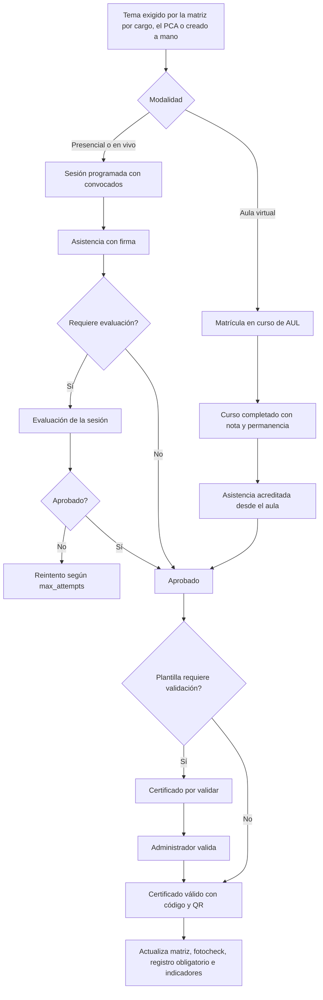

# M-CAP · 5.1 Capacitaciones e inducciones

## 1. Encabezado

| Campo | Valor |
|---|---|
| Código | `CAP` |
| Número | 5.1 |
| Nombre | Capacitaciones e inducciones |
| Grupo | 5. Personas y salud ocupacional |
| Plan | E · Esencial |
| Fase | 1 · Plan Esencial |
| Origen | Ley |
| Resuelve | Asistencia, evaluaciones y constancias |
| Tablas del catálogo | `trainings`, `training_sessions`, `training_attendances`, `training_evaluations`, `training_certificates`, `certificate_templates`, `certificate_verifications`, `position_training_requirements` |
| Dependencias | [TRB](M-TRB.md) (Trabajadores y legajo), [TEN](M-TEN.md) (Empresas, sedes y áreas), [PCA](M-PCA.md) (Programa anual de capacitación), [FIR](M-FIR.md) (Firma electrónica de registros), [DOC](M-DOC.md) (Gestión documental), [NOT](M-NOT.md) (Alertas y notificaciones) |
| Prefijo de permisos | `cap.<tabla>.<acción>` |

## 2. Objetivo y problema que resuelve

**Objetivo.** Gestionar inducciones, capacitaciones, entrenamientos y sus sesiones con asistencia firmada, evaluaciones con nota mínima, la matriz de capacitación por cargo con control de vencimientos, y certificados con plantilla, validación del administrador, anulación y verificación pública por código, alimentando el registro obligatorio, los requisitos del fotocheck y los indicadores de capacitación. Es el destino común de toda capacitación, sea presencial o dictada en el aula virtual ([AUL](M-AUL.md)).

**Problema que resuelve.** Las listas de asistencia en papel y las constancias en Word no prueban horas, evaluación ni vigencia; ante SUNAFIL no se puede demostrar que cada trabajador recibió la inducción y las capacitaciones obligatorias de su puesto. Los certificados se falsifican o se reutilizan porque nadie puede verificarlos, y sin una matriz por cargo nadie sabe quién tiene capacitaciones vencidas hasta que ocurre un accidente o llega una inspección.

## 3. Base normativa

- Ley 29783, art. 35 literal b y art. 49 literal g: capacitación al ingreso, durante el desempeño y ante cambios, en horario de trabajo y sin costo para el trabajador.
- D.S. 005-2012-TR, art. 27–29: mínimo anual de capacitaciones (parámetro `min_trainings_per_year`), contenido y modalidades (presencial o virtual); capacitación del comité.
- D.S. 005-2012-TR, art. 33 literal g: registro de inducción, capacitación, entrenamiento y simulacros de emergencia (formato referencial R.M. 050-2013-TR).
- Vigencia de capacitaciones específicas (altura, espacio confinado, caliente, eléctrico, etc.): parámetro por tema `validity_months`, a confirmar por especialista SST; normas sectoriales (D.S. 024-2016-EM en minería, G.050 en construcción) pueden exigir horas y vigencias propias.
- Ley 29733 y D.S. 016-2024-JUS: la verificación pública del certificado expone solo datos mínimos del titular (nombre, curso, fecha, horas, estado); el documento de identidad nunca se muestra completo.

> Todo valor legal citado (plazos, periodicidades, umbrales, factores) se implementa como parámetro con vigencia y queda «a confirmar por especialista SST/legal»; nunca como constante en código.

## 4. Roles y permisos

| Rol | Qué hace en el módulo | Permisos |
|---|---|---|
| Jefe SST / Responsable del SG-SST (`sst_manager`) | Administra capacitaciones, sesiones, matriz por cargo, plantillas; valida y anula certificados; activa la verificación pública | `cap.trainings.create`, `cap.trainings.update`, `cap.training_sessions.create`, `cap.training_sessions.update`, `cap.training_attendances.approve`, `cap.training_certificates.create`, `cap.training_certificates.approve`, `cap.training_certificates.void`, `cap.certificate_templates.create`, `cap.certificate_templates.update`, `cap.position_training_requirements.update`, `cap.certificate_verifications.view` |
| Administrador de cuenta (`account_admin`) | Activa la verificación pública por código para la empresa y define el prefijo de numeración | `cap.certificate_templates.update`, `cap.certificate_verifications.view` |
| Capacitador (`trainer`) | Dicta sesiones presenciales asignadas, registra asistencia y notas; no valida ni anula certificados | `cap.training_sessions.view`, `cap.training_attendances.create`, `cap.training_evaluations.create` |
| Supervisor SST (`sst_supervisor`) | Dicta y registra sesiones | `cap.training_sessions.create`, `cap.training_attendances.create`, `cap.training_evaluations.create` |
| Jefe de área / línea (`area_lead`) | Registra asistencia de su área y consulta la matriz de su personal | `cap.training_attendances.create`, `cap.position_training_requirements.view` |
| Recursos Humanos (`hr`) | Programa inducciones de nuevos ingresos y mantiene la matriz por cargo junto con SST | `cap.training_sessions.create`, `cap.trainings.view`, `cap.position_training_requirements.update` |
| Gerencia (`management`) | Consulta indicadores y reportes de capacitación | `cap.trainings.view`, `cap.training_certificates.view` |
| Trabajador (`worker`) | Ve sus capacitaciones y su brecha por cargo, rinde evaluaciones, descarga certificados | `cap.training_evaluations.create`, `cap.training_certificates.view` |
| Participante externo (`external_learner`) | Descarga los certificados de los cursos que aprobó en el aula | `cap.training_certificates.view` |
| Miembro del Comité SST (`committee_member`) | Consulta cumplimiento de capacitación | `cap.trainings.view`, `cap.position_training_requirements.view` |
| Auditor externo (`external_auditor`) | Consulta registros y certificados del periodo autorizado | `cap.training_attendances.view`, `cap.training_certificates.view` |

Roles no listados no tienen acceso al módulo. Los permisos se acotan además por `membership_scopes` (sede/área) y por el plan contratado (feature flag del módulo).

## 5. Tablas

| Tabla | Base | Propósito | Campos clave |
|---|---|---|---|
| `trainings` | principal | Tema o capacitación (unidad de cumplimiento) | company_id, code, title, training_type (inducción general, inducción específica, capacitación, entrenamiento, sensibilización, simulacro), topic_category, program_item_id (PCA), legal_basis, min_hours, validity_months, requires_evaluation, passing_score, max_attempts, instructor_type (interno/externo), is_mandatory, certificate_template_id, delivery (presencial, aula virtual, mixta), course_id (curso de [AUL](M-AUL.md) que cumple el tema), status |
| `training_sessions` | principal | Sesión presencial o virtual en vivo dictada | training_id, site_id, starts_at, ends_at, hours, modality (presencial/virtual en vivo/mixta), trainer_user_id (rol Capacitador), instructor_name (externo), instructor_worker_id, location_or_link, materials_file_ids, photo_file_ids, capacity, status, offline_idempotency_key |
| `training_attendances` | principal | Asistencia o acreditación de horas | session_id (nulo si viene del aula), course_enrollment_id (si viene de [AUL](M-AUL.md)), training_id, worker_id, contractor_worker_id, external_learner_id, source (presencial, aula, importación), attended, attended_hours, active_minutes (permanencia real del aula), signature_id, status (presente/ausente/tardanza/acreditada), approved_by |
| `training_evaluations` | principal | Evaluación de una sesión presencial | session_id, worker_id, evaluation_type (escrita, práctica, en línea), score, grading_scale_code, passed, attempt, answers_file_id, evaluated_by, evaluated_at |
| `training_certificates` | principal | Certificado o constancia emitida | company_id, training_id, session_id, course_enrollment_id, worker_id, contractor_worker_id, external_learner_id (exactamente uno: trabajador, trabajador de contratista o participante externo), certificate_template_id, certificate_code (código público único, p. ej. `<prefijo>-<año>-<correlativo>`), issued_on, expires_on, hours, score, score_label (según escala), verification_code, pdf_file_id, public_verification_enabled, validated_by, validated_at, voided_by, voided_at, void_reason, replaces_certificate_id, status |
| `certificate_templates` | principal | Plantilla del certificado | company_id, name, orientation, background_file_id, logo_file_id, body_template (texto con variables: participante, documento enmascarado, curso, horas, nota, fecha, vigencia, código, QR), signatories (nombre, cargo, firma digitalizada como archivo), code_prefix, requires_validation, show_score, show_qr, is_default, status |
| `certificate_verifications` | principal | Consulta de verificación de un certificado (solo inserción) | certificate_id (nulo si el código no existe), queried_code, verified_at, channel (público por código, QR, interno), result (válido, vencido, anulado, no encontrado, no verificable), ip_hash, user_agent_hash |
| `position_training_requirements` | principal | Matriz de capacitación por cargo | company_id, position_id, training_id, requirement_level (mandatory/suggested), course_id, requirement_moment (al ingreso, antes de iniciar tareas, periódica, ante cambio), due_within_days_param (plazo desde el ingreso o desde el vencimiento, parámetro), validity_months_override, applies_to_sites, source (manual, PCA, IPERC, paquete sectorial), effective_from, effective_to, status |

Todas las tablas de empresa llevan las columnas estándar (`id` UUID v7, `company_id`, `created_at`, `updated_at`, `created_by`, `updated_by`, `deleted_at`) salvo las inalterables, y quedan bajo RLS por `app.company_id`.

## 6. Pantallas

| ID | Pantalla | Propósito | Elementos principales |
|---|---|---|---|
| SCR-CAP-01 | Panel de capacitación | Indicadores | KPI: cumplimiento de la matriz por cargo, horas-hombre, aprobados vs desaprobados, certificados emitidos y anulados, vencidos y por vencer; gráficos por área, cargo y sede; acceso a reportes |
| SCR-CAP-02 | Capacitaciones | Catálogo y programación | Lista de temas con modalidad (presencial / aula / mixta), próximas sesiones, curso del aula vinculado, % de cumplimiento del público objetivo |
| SCR-CAP-03 | Ficha de capacitación | Detalle del tema | Datos, vigencia, nota mínima, plantilla de certificado, cargos que la exigen (desde la matriz), sesiones, curso vinculado, participantes y su estado |
| SCR-CAP-04 | Programar sesión | Sesión presencial o en vivo | Fecha, horas, capacitador (con su disponibilidad del aula), modalidad, aforo, convocados por cargo/área/brecha de la matriz o manual, verificación de cruces de horario |
| SCR-CAP-05 | Registrar asistencia (móvil) | Firma en sesión | Lista de convocados; marcar presente; firma asistida; agregar no convocados; funciona sin señal con el complemento OFF |
| SCR-CAP-06 | Evaluación de sesión | Notas | Carga de notas por participante o evaluación en línea; nota mínima; escala de calificación |
| SCR-CAP-07 | Matriz de capacitación por cargo | Configuración | Cargos × temas obligatorios con momento (ingreso, periódica, ante cambio), plazo y vigencia; importación desde Excel; propuesta desde IPERC y PCA |
| SCR-CAP-08 | Cumplimiento de la matriz | Brechas | Trabajadores × temas exigidos por su cargo con semáforo (vigente, por vencer, vencido, faltante); filtros por sede, área, cargo; acción «Convocar» o «Matricular en el aula» |
| SCR-CAP-09 | Control de vencimientos | Seguimiento | Certificados por vencer y vencidos por tema, área y cargo; programación masiva de reentrenamiento; «Recomendar recapacitación» en el aula y estado de la recomendación |
| SCR-CAP-10 | Certificados | Emisión y validación | Bandeja «Por validar» con lote; emitidos, vencidos y anulados; acciones validar, anular con motivo, reemitir, descargar PDF |
| SCR-CAP-11 | Plantillas de certificado | Diseño | Editor con vista previa, variables, firmantes, prefijo del código, QR, mostrar nota sí/no, requiere validación sí/no |
| SCR-CAP-12 | Verificación pública de certificado | Consulta sin sesión | Página por empresa con campo «Código del certificado» y lectura de QR; resultado válido / vencido / anulado / no encontrado con nombre, curso, horas, fecha y empresa emisora; sin documento completo |
| SCR-CAP-13 | Configuración de verificación | Parámetros | Activar verificación pública para la empresa, cursos y temas verificables, texto de la página, límite de consultas |
| SCR-CAP-14 | Reportes de capacitación | Exportación | Avance, permanencia (desde el aula), aprobados vs desaprobados, horas-hombre, cumplimiento por área y cargo, certificados; Excel y PDF |
| SCR-CAP-15 | Mis capacitaciones (app del trabajador) | Historial | Capacitaciones con certificado descargable y vencimientos; brecha de su cargo; inducción pendiente destacada; acceso a sus cursos del aula |

## 7. Flujos principales

**Inducción de nuevo ingreso**
1. Al dar de alta un trabajador ([TRB](M-TRB.md)), la matriz de su cargo genera pendientes (inducción general, inducción específica del puesto y temas «al ingreso»), con fecha límite según `due_within_days_param`.
2. RR.HH. o SST lo convoca a la próxima sesión o lo matricula en el curso del aula vinculado; hasta aprobar los temas bloqueantes, su fotocheck no se activa ([FOT](M-FOT.md)).

**Cambio de cargo**
1. Al cambiar el puesto del trabajador, se recalcula su brecha contra la matriz del nuevo cargo; los temas ya vigentes se conservan y los nuevos quedan como faltantes con su plazo.

**Recapacitación por vencimiento**
1. Las reglas de recomendación de [AUL](M-AUL.md) de tipo «certificado por vencer» leen `expires_on` y la matriz por cargo, y recomiendan al trabajador (y a su jefe) el curso de recapacitación antes del vencimiento.
2. Desde el control de vencimientos se puede además recomendar manualmente o convocar a una sesión presencial.

**Validación, anulación y verificación del certificado**
1. Si la plantilla exige validación, el certificado nace «por validar»; el administrador (Jefe SST) lo valida individualmente o en lote y queda «válido».
2. Un certificado válido puede anularse con motivo obligatorio (error de datos, fraude, curso anulado, reembolso en [VTA](M-VTA.md)); si fue por error de datos se reemite uno nuevo que referencia al anulado.
3. Cualquier persona consulta el código o escanea el QR en la página pública de la empresa; la consulta se registra y muestra el estado actual.

## 8. Reglas de negocio

- **RN-CAP-01.** Una asistencia presencial cuenta solo si tiene firma del participante y `attended_hours` ≥ `min_attendance_pct` de las horas de la sesión (parámetro).
- **RN-CAP-02.** Si la capacitación requiere evaluación, se aprueba solo con nota ≥ `passing_score` en la escala del tema o del curso; hay hasta `max_attempts` intentos.
- **RN-CAP-03.** `expires_on` = fecha de aprobación + `validity_months` del tema (o el `validity_months_override` de la matriz para ese cargo, si existe); si el tema no vence, queda nulo.
- **RN-CAP-04.** Un curso del aula completado ([AUL](M-AUL.md)) crea una asistencia `source = aula` con las horas acreditadas por permanencia real (`active_minutes`), nunca con el tiempo de ventana abierta; las horas del certificado son las del curso solo si la permanencia alcanza el mínimo del curso.
- **RN-CAP-05.** La matriz por cargo define qué temas exige cada puesto; el cumplimiento de un trabajador es vigente si tiene un certificado válido no vencido del tema, por vencer si vence dentro de `training_expiry_notice_days`, vencido si pasó `expires_on` y faltante si nunca lo tuvo o venció su plazo de ingreso.
- **RN-CAP-06.** Un cambio en la matriz no borra historial: se versiona con `effective_from`/`effective_to` y el cumplimiento se recalcula para la fecha consultada.
- **RN-CAP-07.** El certificado tiene un `certificate_code` único por empresa con prefijo configurable y correlativo anual, más un token de verificación para el QR guardado solo como hash.
- **RN-CAP-08.** Si la plantilla tiene `requires_validation`, el certificado no se puede descargar ni verificar como válido hasta que el administrador lo valide; la validación queda en `audit_logs` con usuario y fecha.
- **RN-CAP-09.** Anular un certificado exige motivo; el certificado anulado no se borra, su PDF se marca con la leyenda «ANULADO» y la verificación pública responde «anulado» con la fecha de anulación.
- **RN-CAP-10.** Un certificado anulado deja de cumplir la matriz y el requisito del fotocheck en el mismo momento; se reevalúa la credencial del titular.
- **RN-CAP-11.** La reemisión por error de datos crea un certificado nuevo con `replaces_certificate_id`; nunca se edita el texto de un certificado ya validado.
- **RN-CAP-12.** La verificación pública está desactivada por defecto; se activa por empresa y además por tema o curso (`public_verification_enabled`). Un certificado no verificable responde «no verificable públicamente» sin revelar datos.
- **RN-CAP-13.** La página pública muestra solo nombre del titular, curso o tema, horas, fecha de emisión, vigencia, estado y empresa emisora; el documento de identidad aparece enmascarado o no aparece (pregunta abierta) y nunca hay datos de salud.
- **RN-CAP-14.** El endpoint público de verificación tiene límite por IP (`certificate_verify_rate_limit`), responde igual a códigos inexistentes y a no verificables, y registra cada consulta en `certificate_verifications`; los códigos no son enumerables (correlativo más sufijo aleatorio).
- **RN-CAP-15.** Los certificados pueden emitirse a trabajadores, a trabajadores de contratistas y a participantes externos de [VTA](M-VTA.md); los de participantes externos no cuentan en la matriz ni en los indicadores legales de la empresa.
- **RN-CAP-16.** Un trabajador no puede estar convocado a dos sesiones que se solapen en horario; si el capacitador asignado no tiene disponibilidad registrada en ese horario, se advierte sin bloquear.
- **RN-CAP-17.** Las sesiones se registran en horario de trabajo; si la empresa marca una sesión fuera de horario, se registra con advertencia (art. 27 del reglamento, a confirmar).
- **RN-CAP-18.** La inducción específica del puesto es obligatoria antes de que el trabajador ejecute tareas: su ausencia bloquea el fotocheck ([FOT](M-FOT.md)).
- **RN-CAP-19.** Una sesión cerrada con asistencias aprobadas es inmutable; correcciones mediante anulación con motivo.
- **RN-CAP-20.** Las sesiones registradas offline se sincronizan por `offline_idempotency_key`.
- **RN-CAP-21.** El cumplimiento anual por trabajador se calcula contra `min_trainings_per_year` y contra los temas de la matriz de su cargo.
- **RN-CAP-22.** Los vencimientos de certificados y las brechas de la matriz alimentan las reglas de recomendación de [AUL](M-AUL.md) (recapacitación y cursos faltantes del cargo); CAP no envía recomendaciones por su cuenta, solo publica los eventos.
- **RN-CAP-23.** Las horas-hombre de capacitación suman horas de sesiones presenciales con asistencia válida y horas acreditadas por el aula; se informan separadas por modalidad.

## 9. Estados y transiciones

| Entidad | Estados | Transiciones |
|---|---|---|
| training_sessions | scheduled → held → closed; scheduled → cancelled | `closed` vuelve inmutables las asistencias |
| training_certificates | pending_validation → valid → expiring → expired; pending_validation / valid / expiring → voided | `pending_validation` solo si la plantilla exige validación; `expiring` según `training_expiry_notice_days`; `voided` manual con motivo o automático por reembolso en VTA |
| position_training_requirements | draft → active → retired | `retired` al fijar `effective_to`; el historial se conserva |
| Cumplimiento por trabajador y tema (calculado) | missing → valid → expiring → expired → valid | Se recalcula al aprobar, al vencer, al anular un certificado y al cambiar de cargo |

## 10. Notificaciones y alertas

| Evento | Destinatario | Canal | Anticipación / momento (parámetro) |
|---|---|---|---|
| Convocatoria a sesión | Trabajadores convocados, sus jefes y el capacitador | App, WhatsApp, correo | `session_notice_days` antes |
| Capacitación por vencer | Trabajador, jefe del área, Jefe SST | App, WhatsApp | `training_expiry_notice_days` antes de `expires_on` |
| Capacitación vencida exigida por el cargo | Trabajador, jefe del área, Jefe SST | App, correo | Al vencer |
| Trabajador nuevo sin inducción | Jefe SST, RR.HH. | App | `induction_grace_days` después del ingreso |
| Certificados por validar | Jefe SST | App, correo | Al acumularse; resumen diario |
| Certificado emitido o validado | Titular (trabajador o participante externo) | Correo, app | Al quedar válido |
| Certificado anulado | Titular, Jefe SST | Correo | Inmediato |
| Evaluación desaprobada | Participante, capacitador | App | Al registrar |

Los envíos se hacen mediante el módulo [NOT](M-NOT.md); cada regla es configurable por empresa y respeta las preferencias del usuario.

## 11. Reportes y exportaciones

- Registro de inducción, capacitación, entrenamiento y simulacros (formato referencial R.M. 050-2013-TR) en [REG](M-REG.md), incluida la modalidad virtual.
- Cumplimiento de la matriz por cargo, área y sede; trabajadores con brechas y vencidos.
- Reportes de avance, tiempo de permanencia (desde [AUL](M-AUL.md)), aprobados vs desaprobados, horas-hombre por modalidad, certificados emitidos, validados y anulados; Excel y PDF.
- Certificados PDF con código y QR de verificación; historial de verificaciones públicas.
- Aporte al expediente [SUN](M-SUN.md): capacitaciones del trabajador en el periodo con firmas, evaluaciones y certificados.

## 12. Integración con otros módulos

**Consume:**

- [PCA](M-PCA.md): temas obligatorios del programa; [TRB](M-TRB.md): trabajadores y cambios de cargo; [TEN](M-TEN.md): puestos; [FIR](M-FIR.md): firmas; [DOC](M-DOC.md): plantillas y materiales.
- [AUL](M-AUL.md): cursos completados con nota, horas y permanencia; disponibilidad del capacitador.
- [VTA](M-VTA.md): reembolsos que anulan certificados de participantes externos.

**Produce:**

- Eventos de vencimiento y brechas para las recomendaciones de [AUL](M-AUL.md).
- Vigencias y cumplimiento de la matriz para [FOT](M-FOT.md), [PTR](M-PTR.md), [ATS](M-ATS.md), [EPP](M-EPP.md); ejecución de [PCA](M-PCA.md) y [PAS](M-PAS.md); KPI en [DSH](M-DSH.md); registro en [REG](M-REG.md).

## 13. Criterios de aceptación clave

1. **Dado** una sesión de 4 horas y `min_attendance_pct` 80 %, **cuando** un trabajador asistió 3 horas, **entonces** su asistencia no cuenta como aprobada.
2. **Dado** una capacitación con `passing_score` 14 en escala 0-20, **cuando** el trabajador obtiene 12, **entonces** no se emite certificado y queda pendiente de reintento.
3. **Dado** trabajo en altura con `validity_months` 12 aprobado el 2026-02-01, **cuando** se emite el certificado, **entonces** `expires_on` = 2027-02-01.
4. **Dado** el cargo «Operario de mantenimiento» exige trabajo en altura en la matriz, **cuando** un trabajador pasa a ese cargo sin ese tema, **entonces** su cumplimiento muestra «faltante» con la fecha límite y su fotocheck de altura queda no habilitado.
5. **Dado** una plantilla con `requires_validation`, **cuando** se aprueba el curso, **entonces** el certificado queda «por validar», no se descarga y la verificación pública no lo muestra como válido.
6. **Dado** un certificado válido, **cuando** el Jefe SST lo anula con motivo, **entonces** la verificación pública responde «anulado», el PDF lleva la leyenda «ANULADO» y el requisito del fotocheck deja de cumplirse.
7. **Dado** la verificación pública activa y un curso verificable, **cuando** alguien ingresa el código del certificado sin sesión, **entonces** ve nombre, curso, horas, fecha, vigencia, estado y empresa emisora, sin documento completo ni datos de salud.
8. **Dado** un código inexistente y otro de un curso no verificable, **cuando** se consultan, **entonces** ambas respuestas son idénticas y ambas consultas quedan en `certificate_verifications`.
9. **Dado** un curso del aula completado con 50 minutos de permanencia real y mínimo de 60, **cuando** se procesa la finalización, **entonces** no se acreditan horas ni se emite certificado y el participante ve cuánto le falta.
10. **Dado** un trabajador nuevo sin inducción específica, **cuando** se consulta su fotocheck, **entonces** está «no habilitado» indicando la inducción faltante.

## 14. Fuera de alcance y preguntas abiertas

**Fuera de alcance:**

- Construcción y dictado de cursos en línea (contenido, bancos de preguntas, permanencia): se gestionan en [AUL](M-AUL.md).
- Venta de cursos, cobros y comprobantes: se gestionan en [VTA](M-VTA.md).
- Firma digital con certificado de firma acreditado en el certificado PDF (se usa firma digitalizada de la plantilla; la firma acreditada se evaluará con [FIR](M-FIR.md)).

**Preguntas abiertas:**

- ¿La verificación pública debe mostrar el documento de identidad enmascarado (p. ej. últimos dígitos) o no mostrarlo? A validar con el oficial de datos personales.
- ¿Qué temas tienen vigencia legal definida y cuáles exigen horas mínimas por norma sectorial? A confirmar por especialista SST.
- ¿El certificado emitido por una consultora a nombre de su cliente lleva la marca de la consultora ([CON](M-CON.md)) o la de la empresa cliente?
