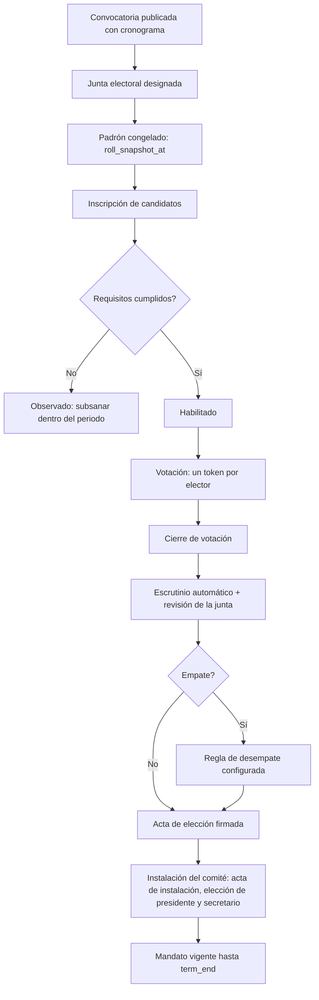

# M-COM · 2.8 Comité o Supervisor SST

## 1. Encabezado

| Campo | Valor |
|---|---|
| Código | `COM` |
| Número | 2.8 |
| Nombre | Comité o Supervisor SST |
| Grupo | 2. Planificación del sistema de gestión |
| Plan | E · Esencial |
| Fase | 1 · Plan Esencial |
| Origen | Ley |
| Resuelve | Elección electrónica, actas y acuerdos |
| Tablas del catálogo | `committees`, `committee_members`, `elections`, `election_candidates`, `election_ballots`, `committee_meetings`, `meeting_agreements` |
| Dependencias | [TRB](M-TRB.md) (Trabajadores y legajo), [FIR](M-FIR.md) (Firma electrónica de registros), [DOC](M-DOC.md) (Gestión documental), [NOT](M-NOT.md) (Alertas y notificaciones) |
| Prefijo de permisos | `com.<tabla>.<acción>` |

## 2. Objetivo y problema que resuelve

**Objetivo.** Gestionar el Comité SST paritario o el Supervisor SST: elección electrónica de representantes de los trabajadores, designación de los del empleador, instalación, sesiones con actas, acuerdos con seguimiento y vigencia del mandato.

**Problema que resuelve.** La elección del comité se hace en papel sin garantías de voto secreto ni padrón, las actas se pierden y los acuerdos no tienen seguimiento. SUNAFIL revisa la conformación, el acta de instalación, el libro de actas y las sesiones mensuales.

## 3. Base normativa

- Ley 29783, art. 29–31: comité paritario con 20 o más trabajadores; supervisor con menos; representantes de trabajadores elegidos por votación secreta y directa; el sindicato mayoritario convoca si existe.
- D.S. 005-2012-TR, art. 38–73: número de miembros (mínimo 4, máximo 12; parámetro), requisitos de candidatos, proceso electoral, junta electoral, instalación, mandato (parámetro `committee_term_years`, valor de referencia 2), reuniones ordinarias mensuales, quórum, libro de actas.
- D.S. 005-2012-TR, art. 42: funciones del comité (aprobar RISST, programa, plan, investigar accidentes, inspecciones).
- R.M. 245-2021-EF/TR u otras guías sobre elecciones electrónicas (vigencia y aplicabilidad a confirmar).

> Todo valor legal citado (plazos, periodicidades, umbrales, factores) se implementa como parámetro con vigencia y queda «a confirmar por especialista SST/legal»; nunca como constante en código.

## 4. Roles y permisos

| Rol | Qué hace en el módulo | Permisos |
|---|---|---|
| Jefe SST / Responsable del SG-SST (`sst_manager`) | Convoca el proceso electoral, gestiona el comité, programa sesiones | `com.committees.create`, `com.committees.update`, `com.elections.create`, `com.elections.update`, `com.committee_meetings.create` |
| Miembro del Comité SST (`committee_member`) | Participa en sesiones, firma actas, registra y sigue acuerdos | `com.committee_meetings.update`, `com.meeting_agreements.create`, `com.meeting_agreements.update` |
| Gerencia (`management`) | Designa a los representantes del empleador | `com.committee_members.create` |
| Trabajador (`worker`) | Postula como candidato y vota una sola vez | `com.election_candidates.create`, `com.election_ballots.create` |
| Recursos Humanos (`hr`) | Valida el padrón electoral | `com.elections.view` |
| Supervisor SST (`sst_supervisor`) | Registra sus actividades y acuerdos cuando la empresa tiene supervisor | `com.committee_meetings.create`, `com.meeting_agreements.create` |

Roles no listados no tienen acceso al módulo. Los permisos se acotan además por `membership_scopes` (sede/área) y por el plan contratado (feature flag del módulo).

## 5. Tablas

| Tabla | Base | Propósito | Campos clave |
|---|---|---|---|
| `committees` | principal | Comité o supervisor de un periodo | company_id, kind (committee/supervisor/subcommittee), site_id, term_start, term_end, members_count, status, installation_meeting_id, book_number |
| `committee_members` | principal | Integrantes | committee_id, worker_id, side (empleador/trabajadores), role (presidente, secretario, miembro, suplente, observador sindical), source (designado/elegido), election_id, start_date, end_date |
| `elections` | principal | Proceso electoral de representantes | company_id, committee_id, call_published_at, electoral_board (jsonb), seats, alternates, roll_snapshot_at, candidacy_start, candidacy_end, voting_start, voting_end, status, minutes_document_id |
| `election_candidates` | principal | Candidatos inscritos | election_id, worker_id, list_name, statement, requirements_check (jsonb), status (inscrito/observado/habilitado/rechazado), votes_count |
| `election_ballots` | principal | Voto emitido (inalterable, anónimo) | election_id, ballot_token_hash, candidate_id (o nulo = blanco), is_null, cast_at, channel; sin worker_id |
| `committee_meetings` | principal | Sesión ordinaria o extraordinaria | committee_id, meeting_type, scheduled_at, held_at, place_or_link, attendees (jsonb), quorum_reached, agenda, minutes_text, minutes_document_id, status |
| `meeting_agreements` | principal | Acuerdo con seguimiento | meeting_id, code, description, responsible_worker_id, due_date, status, corrective_action_id, closed_evidence_file_id |

Todas las tablas de empresa llevan las columnas estándar (`id` UUID v7, `company_id`, `created_at`, `updated_at`, `created_by`, `updated_by`, `deleted_at`) salvo las inalterables, y quedan bajo RLS por `app.company_id`.

## 6. Pantallas

| ID | Pantalla | Propósito | Elementos principales |
|---|---|---|---|
| SCR-COM-01 | Comité vigente | Resumen | Integrantes por lado y cargo, vigencia del mandato con semáforo, próxima sesión, acuerdos abiertos |
| SCR-COM-02 | Proceso electoral | Asistente del proceso | Pasos: convocatoria → junta electoral → padrón → candidaturas → votación → escrutinio → acta; estado de cada paso |
| SCR-COM-03 | Padrón electoral | Validar electores | Trabajadores habilitados al corte; exclusión de personal de dirección y confianza con motivo |
| SCR-COM-04 | Candidaturas | Inscripción y revisión | Requisitos por candidato (edad mínima, capacitación SST, trabajador en planilla); habilitar/observar |
| SCR-COM-05 | Votar (app del trabajador) | Emitir voto secreto | Lista de candidatos con foto; voto en blanco; confirmación; comprobante sin indicar el voto |
| SCR-COM-06 | Escrutinio | Resultados | Conteo por candidato, blancos, nulos, participación; desempate según regla configurada; generar acta |
| SCR-COM-07 | Sesiones | Calendario y actas | Lista de sesiones; crear sesión; tomar asistencia; agenda; redactar acta; firma de asistentes |
| SCR-COM-08 | Acuerdos | Seguimiento | Tabla de acuerdos con responsable, fecha y estado; vínculo a acción correctiva |

## 7. Flujos principales

**Elección de representantes de los trabajadores**

**Sesión mensual**
1. El secretario programa la sesión y envía la agenda.
2. Se registra asistencia; el sistema calcula quórum.
3. Se redacta el acta con acuerdos (responsable y fecha meta).
4. Los asistentes firman el acta; queda en el libro de actas electrónico numerado.

## 8. Reglas de negocio

- **RN-COM-01.** El número de miembros titulares es par y está entre el mínimo y máximo parametrizados según trabajadores activos (D.S. 005-2012-TR art. 43; a confirmar), mitad por cada lado.
- **RN-COM-02.** El padrón se congela en `roll_snapshot_at`; solo votan trabajadores activos en el padrón y no excluidos (personal de dirección y confianza).
- **RN-COM-03.** Cada elector recibe un token de voto de un solo uso; la emisión del voto marca el token como usado en una tabla separada y el voto se guarda en `election_ballots` sin `worker_id`, garantizando secreto y voto único.
- **RN-COM-04.** No se puede votar fuera de la ventana `voting_start`–`voting_end`; resultados solo visibles tras el cierre.
- **RN-COM-05.** Un candidato debe cumplir los requisitos parametrizados (edad mínima, ser trabajador de la empresa, capacitación en SST o compromiso de recibirla); la junta puede observar y el candidato subsanar dentro del periodo de inscripción.
- **RN-COM-06.** Resultan elegidos los candidatos con más votos hasta cubrir titulares y luego suplentes; los empates se resuelven por la regla configurada (antigüedad o sorteo registrado).
- **RN-COM-07.** El mandato vence en `term_end` = instalación + `committee_term_years`; se alerta con anticipación para iniciar el nuevo proceso.
- **RN-COM-08.** Una sesión solo es válida con quórum (mitad más uno de los miembros, parámetro); sin quórum el acta registra «sin quórum» y no se adoptan acuerdos.
- **RN-COM-09.** Las actas firmadas son inmutables y se numeran correlativamente en el libro de actas.
- **RN-COM-10.** En empresas con `sst_model = supervisor`, se elige un Supervisor SST con el mismo mecanismo electoral de un solo puesto.

## 9. Estados y transiciones

| Entidad | Estados | Transiciones |
|---|---|---|
| elections | draft → called → candidacy_open → candidacy_closed → voting_open → voting_closed → counted → certified; cualquier estado → annulled | `annulled` por la junta con motivo |
| committees | forming → installed → active → expired | `expired` automático en `term_end` |
| committee_meetings | scheduled → held → minutes_signed; scheduled → cancelled | |
| meeting_agreements | open → in_progress → done / overdue | |

## 10. Notificaciones y alertas

| Evento | Destinatario | Canal | Anticipación / momento (parámetro) |
|---|---|---|---|
| Convocatoria a elecciones | Todos los trabajadores del padrón | App, WhatsApp, correo | Al publicar |
| Apertura de votación y recordatorio | Electores que no votaron | App, WhatsApp | Al abrir y `vote_reminder_hours` antes del cierre |
| Mandato del comité por vencer | Jefe SST, comité | App, correo | `term_notice_days` antes de `term_end` |
| Sesión programada | Miembros del comité | App, correo | `meeting_notice_days` antes |
| Sesión mensual no registrada | Jefe SST, presidente | App | Al terminar el mes sin sesión |
| Acuerdo por vencer o vencido | Responsable | App, WhatsApp | `agreement_due_notice_days` antes y al vencer |

Los envíos se hacen mediante el módulo [NOT](M-NOT.md); cada regla es configurable por empresa y respeta las preferencias del usuario.

## 11. Reportes y exportaciones

- Acta de convocatoria, acta de elección, acta de instalación (PDF con firmas).
- Libro de actas electrónico con numeración correlativa.
- Seguimiento de acuerdos.
- Aporte al expediente [SUN](M-SUN.md): conformación, actas y sesiones del periodo; informe anual del comité para [RVD](M-RVD.md).

## 12. Integración con otros módulos

**Consume:**

- [TRB](M-TRB.md): padrón y datos de candidatos; [CAP](M-CAP.md): capacitación de miembros; [FIR](M-FIR.md): firmas.

**Produce:**

- Acuerdos aprobatorios usados por [PLA](M-PLA.md), [PAS](M-PAS.md), [PCA](M-PCA.md), [RIS](M-RIS.md); miembros para investigaciones ([INV](M-INV.md)) e inspecciones ([INS](M-INS.md)).

## 13. Criterios de aceptación clave

1. **Dado** un elector que ya votó, **cuando** intenta votar de nuevo con su enlace, **entonces** el sistema rechaza el token usado.
2. **Dado** la tabla `election_ballots`, **cuando** se consulta un voto, **entonces** no existe columna que vincule el voto con el trabajador.
3. **Dado** una votación abierta, **cuando** un usuario pide resultados, **entonces** no se muestran hasta el cierre.
4. **Dado** un comité de 6 miembros con 3 asistentes, **cuando** se registra la sesión, **entonces** se marca «sin quórum» y no se pueden registrar acuerdos.
5. **Dado** un comité con `term_end` dentro de `term_notice_days`, **cuando** corre el job diario, **entonces** el Jefe SST recibe la alerta para convocar elecciones.
6. **Dado** dos candidatos empatados en el último puesto con regla «antigüedad», **cuando** se hace el escrutinio, **entonces** resulta elegido el de mayor antigüedad y el acta lo indica.

## 14. Fuera de alcance y preguntas abiertas

**Fuera de alcance:**

- Elecciones sindicales u otras distintas al comité SST.

**Preguntas abiertas:**

- ¿La votación electrónica requiere además un canal presencial con cédula para trabajadores sin dispositivo? (se propone kiosco asistido).
- ¿Qué regla de desempate prefieren los clientes por defecto?
