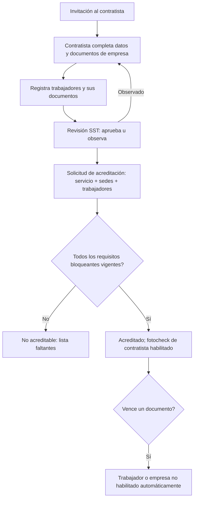

# M-CTR · 7.1 Acreditación de contratistas

## 1. Encabezado

| Campo | Valor |
|---|---|
| Código | `CTR` |
| Número | 7.1 |
| Nombre | Acreditación de contratistas |
| Grupo | 7. Contratistas y terceros |
| Plan | C · Corporativo |
| Fase | 4 · Plan Corporativo |
| Origen | Mercado |
| Resuelve | Documentos, vigencias y aprobación |
| Tablas del catálogo | `contractors`, `contractor_workers`, `contractor_requirements`, `contractor_documents`, `contractor_accreditations` |
| Dependencias | [TRB](M-TRB.md) (Trabajadores y legajo), [DOC](M-DOC.md) (Gestión documental), [SCT](M-SCT.md) (Control de SCTR), [CAP](M-CAP.md) (Capacitaciones e inducciones), [EMO](M-EMO.md) (EMOs y aptitud), [FOT](M-FOT.md) (Fotocheck SST con QR) |
| Prefijo de permisos | `ctr.<tabla>.<acción>` |

## 2. Objetivo y problema que resuelve

**Objetivo.** Acreditar a empresas contratistas y a sus trabajadores mediante un portal donde suben documentos exigidos (empresa y trabajador), con revisión, vigencias y aprobación, para que solo personal acreditado ingrese y trabaje.

**Problema que resuelve.** La empresa principal responde solidariamente por la seguridad de los contratistas; hoy recibe carpetas por correo, no controla vencimientos y los contratistas ingresan con SCTR vencido.

## 3. Base normativa

- Ley 29783, art. 68: la empresa principal garantiza el cumplimiento SST de contratistas, subcontratistas e intermediadores; responsabilidad solidaria.
- D.S. 005-2012-TR, art. 77 y Ley 29783, art. 68 literal c: verificación de la contratación del SCTR.
- D.S. 003-98-SA: SCTR para actividades de riesgo.
- Ley 29245 y D.S. 006-2008-TR (tercerización) en lo aplicable (a confirmar).

> Todo valor legal citado (plazos, periodicidades, umbrales, factores) se implementa como parámetro con vigencia y queda «a confirmar por especialista SST/legal»; nunca como constante en código.

## 4. Roles y permisos

| Rol | Qué hace en el módulo | Permisos |
|---|---|---|
| Jefe SST / Responsable del SG-SST (`sst_manager`) | Define requisitos, revisa documentos y aprueba acreditaciones | `ctr.contractor_requirements.create`, `ctr.contractor_requirements.update`, `ctr.contractor_documents.approve`, `ctr.contractor_accreditations.approve` |
| Administrador de contratista (`contractor_admin`) | Registra su empresa y trabajadores, sube documentos, solicita acreditación | `ctr.contractors.update`, `ctr.contractor_workers.create`, `ctr.contractor_workers.update`, `ctr.contractor_documents.create`, `ctr.contractor_accreditations.create` |
| Jefe de área / línea (`area_lead`) | Solicita contratistas para un servicio y consulta su estado | `ctr.contractors.view`, `ctr.contractor_accreditations.view` |
| Supervisor SST (`sst_supervisor`) | Revisa documentos | `ctr.contractor_documents.approve` |

Roles no listados no tienen acceso al módulo. Los permisos se acotan además por `membership_scopes` (sede/área) y por el plan contratado (feature flag del módulo).

## 5. Tablas

| Tabla | Base | Propósito | Campos clave |
|---|---|---|---|
| `contractors` | principal | Empresa contratista | company_id (principal), ruc, legal_name, contact_name, contact_email, service_description, risk_level, status, invited_at |
| `contractor_workers` | principal | Trabajador del contratista | contractor_id, company_id, document_type, document_number, full_name, position_name, photo_file_id, status, credential_id |
| `contractor_requirements` | principal | Requisito exigido | company_id, level (empresa/trabajador), requirement_type (SCTR salud, SCTR pensión, EMO apto, inducción del principal, capacitación, IPERC del servicio, PETS, plan de seguridad, póliza, ficha RUC, otro), applies_to_risk_levels, requires_expiry, is_blocking |
| `contractor_documents` | principal | Documento cargado | contractor_id, contractor_worker_id, requirement_id, file_id, issued_on, expires_on, status (pendiente, aprobado, observado, vencido), reviewer_user_id, review_comment |
| `contractor_accreditations` | principal | Acreditación de un servicio | contractor_id, company_id, service, site_ids, start_date, end_date, worker_ids, status, approved_by, approved_at |

Todas las tablas de empresa llevan las columnas estándar (`id` UUID v7, `company_id`, `created_at`, `updated_at`, `created_by`, `updated_by`, `deleted_at`) salvo las inalterables, y quedan bajo RLS por `app.company_id`.

## 6. Pantallas

| ID | Pantalla | Propósito | Elementos principales |
|---|---|---|---|
| SCR-CTR-01 | Contratistas | Lista | RUC, razón social, estado, % de documentos aprobados, trabajadores acreditados |
| SCR-CTR-02 | Invitar contratista | Alta | RUC, contacto, nivel de riesgo; envío de invitación al portal |
| SCR-CTR-03 | Requisitos | Configuración | Requisitos por nivel (empresa/trabajador) y riesgo |
| SCR-CTR-04 | Portal del contratista | Autogestión | Requisitos con estado; carga de documentos; alta de trabajadores (individual o Excel); solicitud de acreditación |
| SCR-CTR-05 | Revisión de documentos | Bandeja | Documentos pendientes con visor; aprobar/observar con comentario |
| SCR-CTR-06 | Acreditación | Aprobación | Servicio, sedes, fechas, trabajadores; validación automática de requisitos |

## 7. Flujos principales

## 8. Reglas de negocio

- **RN-CTR-01.** Un contratista se identifica por RUC (validado) y es único por empresa principal.
- **RN-CTR-02.** Un trabajador del contratista solo puede acreditarse si la empresa contratista tiene todos sus requisitos bloqueantes aprobados y vigentes, y él tiene los suyos.
- **RN-CTR-03.** Al vencer `expires_on` de un documento bloqueante, el documento pasa a «vencido» y el trabajador/empresa queda no habilitado; su fotocheck de contratista se reevalúa.
- **RN-CTR-04.** El contratista no ve datos de la empresa principal más allá de requisitos, sus propios trabajadores y documentos.
- **RN-CTR-05.** Los documentos médicos del trabajador contratista se limitan a la constancia de aptitud (sin diagnóstico); no se aceptan informes clínicos en el portal.
- **RN-CTR-06.** La acreditación tiene vigencia (`start_date`–`end_date`) y alcance por sedes; fuera de ellas no habilita ingreso.
- **RN-CTR-07.** Un documento aprobado no se edita; se reemplaza por uno nuevo.
- **RN-CTR-08.** El SCTR de trabajadores contratistas se registra y valida mediante [SCT](M-SCT.md).

## 9. Estados y transiciones

| Entidad | Estados | Transiciones |
|---|---|---|
| contractors | invited → onboarding → active → suspended; active → inactive | |
| contractor_accreditations | requested → approved → expired; requested → rejected; approved → suspended | `suspended` si un requisito bloqueante vence |

## 10. Notificaciones y alertas

| Evento | Destinatario | Canal | Anticipación / momento (parámetro) |
|---|---|---|---|
| Documento por vencer | Administrador del contratista, Jefe SST | Correo, app | `contractor_doc_notice_days` antes |
| Documento observado | Administrador del contratista | Correo | Inmediato |
| Acreditación aprobada o suspendida | Administrador del contratista, jefe de área solicitante | Correo, app | Inmediato |

Los envíos se hacen mediante el módulo [NOT](M-NOT.md); cada regla es configurable por empresa y respeta las preferencias del usuario.

## 11. Reportes y exportaciones

- Estado de acreditación por contratista y trabajador; documentos vencidos.
- Aporte al expediente [SUN](M-SUN.md): evidencia de verificación de contratistas (art. 68).

## 12. Integración con otros módulos

**Consume:**

- [SCT](M-SCT.md), [CAP](M-CAP.md) (inducción del principal), [FOT](M-FOT.md), [DOC](M-DOC.md).

**Produce:**

- Personal habilitado para [ING](M-ING.md) y [PTR](M-PTR.md); eventos con contratista en [ACC](M-ACC.md).

## 13. Criterios de aceptación clave

1. **Dado** un trabajador contratista con SCTR vencido, **cuando** se solicita su acreditación, **entonces** no es acreditable y se lista el faltante.
2. **Dado** un documento bloqueante que vence hoy, **cuando** corre el job, **entonces** el trabajador queda no habilitado y se notifica.
3. **Dado** un administrador de contratista, **cuando** intenta ver trabajadores propios del principal, **entonces** no tiene acceso.
4. **Dado** un informe médico clínico, **cuando** se intenta subir como requisito EMO, **entonces** solo se acepta constancia de aptitud.
5. **Dado** una acreditación para la sede Lima, **cuando** el trabajador intenta ingresar a Arequipa, **entonces** no habilitado.

## 14. Fuera de alcance y preguntas abiertas

**Fuera de alcance:**

- Evaluación comercial del contratista (ver [HOM](M-HOM.md)).

**Preguntas abiertas:**

- ¿Requisitos por defecto según nivel de riesgo?
