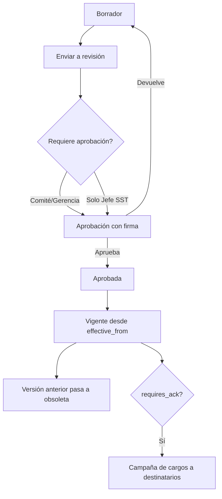

# M-DOC · 1.4 Gestión documental

## 1. Encabezado

| Campo | Valor |
|---|---|
| Código | `DOC` |
| Número | 1.4 |
| Nombre | Gestión documental |
| Grupo | 1. Núcleo de la plataforma |
| Plan | E · Esencial |
| Fase | 0 · Cimientos |
| Origen | Ley |
| Resuelve | Versiones, vigencias y cargos de entrega |
| Tablas del catálogo | `document_categories`, `documents`, `document_versions`, `document_acknowledgements` |
| Dependencias | [TEN](M-TEN.md) (Empresas, sedes y áreas), [USR](M-USR.md) (Usuarios, roles y permisos), [AUD](M-AUD.md) (Bitácora de auditoría) |
| Prefijo de permisos | `doc.<tabla>.<acción>` |

## 2. Objetivo y problema que resuelve

**Objetivo.** Centralizar los documentos del SG-SST con versiones, vigencias, aprobación y cargos de entrega/lectura firmados. Todo módulo que genere o requiera documentos usa este servicio.

**Problema que resuelve.** Las empresas mantienen versiones contradictorias de procedimientos y políticas en carpetas compartidas, no saben cuál está vigente y no pueden probar que el trabajador recibió un documento. SUNAFIL exige evidencias de difusión con cargo.

## 3. Base normativa

- D.S. 005-2012-TR, art. 32: documentación del SG-SST (política, RISST, IPERC, mapa de riesgos, planificación, programa) y su conservación.
- D.S. 005-2012-TR, art. 35: la información debe estar actualizada y a disposición de los trabajadores.
- Ley 29783, art. 35: entrega de copia del RISST y difusión de la información de riesgos.
- Periodos de conservación de registros (art. 35 del reglamento; parámetro `retention_years` por categoría, a confirmar).

> Todo valor legal citado (plazos, periodicidades, umbrales, factores) se implementa como parámetro con vigencia y queda «a confirmar por especialista SST/legal»; nunca como constante en código.

## 4. Roles y permisos

| Rol | Qué hace en el módulo | Permisos |
|---|---|---|
| Jefe SST / Responsable del SG-SST (`sst_manager`) | Crea categorías y documentos, sube versiones, aprueba, publica y pide cargos | `doc.document_categories.create`, `doc.documents.create`, `doc.documents.update`, `doc.document_versions.create`, `doc.document_versions.approve`, `doc.document_acknowledgements.view` |
| Supervisor SST (`sst_supervisor`) | Crea documentos y versiones en borrador | `doc.documents.create`, `doc.document_versions.create` |
| Miembro del Comité SST (`committee_member`) | Revisa y aprueba documentos que requieren aprobación del comité | `doc.document_versions.approve`, `doc.documents.view` |
| Gerencia (`management`) | Aprueba documentos marcados para gerencia | `doc.document_versions.approve` |
| Jefe de área / línea (`area_lead`) | Consulta documentos vigentes y el avance de cargos de su área | `doc.documents.view`, `doc.document_acknowledgements.view` |
| Trabajador (`worker`) | Lee documentos asignados y firma el cargo de recepción/lectura | `doc.documents.view`, `doc.document_acknowledgements.create` |
| Auditor externo (`external_auditor`) | Consulta documentos vigentes y su historial | `doc.documents.view`, `doc.document_versions.view` |

Roles no listados no tienen acceso al módulo. Los permisos se acotan además por `membership_scopes` (sede/área) y por el plan contratado (feature flag del módulo).

## 5. Tablas

| Tabla | Base | Propósito | Campos clave |
|---|---|---|---|
| `document_categories` | principal | Tipología con reglas por defecto | company_id (nulo en globales), code, name, requires_approval_by (sst/committee/management), default_validity_months, retention_years, requires_ack |
| `documents` | principal | Documento lógico | company_id, category_id, code, title, owner_user_id, scope (empresa/sede/área/puesto), current_version_id, status, next_review_date |
| `document_versions` | principal | Versión inmutable aprobada | document_id, version_label, file_id, sha256, change_summary, status, submitted_by, approved_by, approved_at, effective_from, effective_to |
| `document_acknowledgements` | principal | Cargo de entrega/lectura (inalterable) | company_id, document_version_id, worker_id, method (firma app, firma física escaneada, QR), signature_id, acknowledged_at, ip, device |

Todas las tablas de empresa llevan las columnas estándar (`id` UUID v7, `company_id`, `created_at`, `updated_at`, `created_by`, `updated_by`, `deleted_at`) salvo las inalterables, y quedan bajo RLS por `app.company_id`.

## 6. Pantallas

| ID | Pantalla | Propósito | Elementos principales |
|---|---|---|---|
| SCR-DOC-01 | Biblioteca documental | Explorar documentos vigentes | Árbol por categoría; búsqueda; semáforo de vigencia; filtro por sede/puesto |
| SCR-DOC-02 | Ficha del documento | Versiones y estado | Línea de tiempo de versiones con aprobaciones; visor PDF; botón nueva versión; cargos recibidos vs. esperados |
| SCR-DOC-03 | Subir versión | Cargar archivo y resumen de cambios | Archivo (PDF, DOCX, imagen), resumen de cambios obligatorio, vigencia, destinatarios del cargo |
| SCR-DOC-04 | Bandeja de aprobación | Aprobar o devolver | Lista de versiones en revisión con comparación de resumen; aprobar con firma ([FIR](M-FIR.md)) o devolver con comentario |
| SCR-DOC-05 | Campaña de cargos | Solicitar lectura a un grupo | Selección por sede/área/puesto; avance con barra; recordatorios; lista de pendientes |
| SCR-DOC-06 | Mis documentos (app del trabajador) | Leer y firmar cargo | Tarjetas por documento pendiente; visor; botón grande «Leí y recibí» con firma |

## 7. Flujos principales

**Ciclo de una versión**

## 8. Reglas de negocio

- **RN-DOC-01.** Una versión aprobada es inmutable: archivo, hash SHA-256 y metadatos no se modifican; cualquier cambio crea una versión nueva.
- **RN-DOC-02.** Solo puede haber una versión vigente por documento; al entrar en vigor una nueva, la anterior pasa a `obsolete` con `effective_to`.
- **RN-DOC-03.** El aprobador debe tener el rol exigido por `requires_approval_by` de la categoría; nadie aprueba su propia versión.
- **RN-DOC-04.** La próxima revisión (`next_review_date`) se calcula con `default_validity_months` de la categoría; si vence sin revisión, el documento pasa a «revisión vencida» (ámbar) sin dejar de estar vigente.
- **RN-DOC-05.** El cargo (`document_acknowledgements`) se vincula a una versión específica; una nueva versión exige nuevo cargo si la categoría tiene `requires_ack`.
- **RN-DOC-06.** Un cargo no se edita ni elimina; un error se corrige con un nuevo cargo y anotación en bitácora.
- **RN-DOC-07.** Los archivos se guardan en B2 con cifrado del lado del servidor y se sirven por URL firmada de corta duración (`signed_url_ttl`); se aceptan solo los tipos MIME de la lista blanca y tamaño máximo parametrizado.
- **RN-DOC-08.** Los documentos obsoletos se conservan durante `retention_years` de su categoría; no se permite borrado físico antes.

## 9. Estados y transiciones

| Entidad | Estados | Transiciones |
|---|---|---|
| document_versions | draft → in_review → approved → effective → obsolete; in_review → draft (devuelta) | `effective` en `effective_from`; `obsolete` al entrar la siguiente |
| documents | active ↔ review_overdue; active → archived | `review_overdue` automático; `archived` manual con motivo |

## 10. Notificaciones y alertas

| Evento | Destinatario | Canal | Anticipación / momento (parámetro) |
|---|---|---|---|
| Versión enviada a revisión | Aprobadores según categoría | App, correo | Inmediato |
| Documento pendiente de cargo | Trabajador | App, WhatsApp | Al publicar; recordatorio cada `ack_reminder_days` |
| Revisión del documento por vencer | Responsable del documento | App, correo | `doc_review_notice_days` antes |
| Campaña de cargos con avance bajo | Jefe SST | App | Al llegar a `ack_campaign_check_days` con avance menor a `ack_min_pct` |

Los envíos se hacen mediante el módulo [NOT](M-NOT.md); cada regla es configurable por empresa y respeta las preferencias del usuario.

## 11. Reportes y exportaciones

- Lista maestra de documentos (código, versión vigente, vigencia, responsable) exportable.
- Constancias de cargo por documento o por trabajador (evidencia de difusión para el expediente [SUN](M-SUN.md)).
- Historial de versiones con aprobadores.

## 12. Integración con otros módulos

**Consume:**

- [FIR](M-FIR.md): firma de aprobaciones y cargos.
- [TRB](M-TRB.md): destinatarios por puesto/área.

**Produce:**

- Servicio de archivos y versiones usado por [POL](M-POL.md), [RIS](M-RIS.md), [PET](M-PET.md), [IPC](M-IPC.md), [MAP](M-MAP.md) y otros.
- Cargos que alimentan el legajo en [TRB](M-TRB.md) y el expediente en [SUN](M-SUN.md).

## 13. Criterios de aceptación clave

1. **Dado** un documento con versión 2 vigente, **cuando** se aprueba la versión 3 con vigencia hoy, **entonces** la versión 2 pasa a obsoleta y la 3 queda vigente.
2. **Dado** una categoría que exige aprobación del comité, **cuando** el Jefe SST intenta aprobar, **entonces** el sistema no lo permite y muestra quién debe aprobar.
3. **Dado** un trabajador que firmó la versión 2, **cuando** se publica la versión 3 con cargo obligatorio, **entonces** el trabajador vuelve a tener el documento pendiente.
4. **Dado** un archivo .exe, **cuando** se intenta subir, **entonces** se rechaza por tipo no permitido.
5. **Dado** una URL firmada generada, **cuando** pasa el tiempo `signed_url_ttl`, **entonces** la URL deja de funcionar.

## 14. Fuera de alcance y preguntas abiertas

**Fuera de alcance:**

- Edición colaborativa en línea de documentos (se trabaja con archivos).
- Comparación de contenido entre versiones (solo resumen de cambios).

**Preguntas abiertas:**

- ¿Se requiere marca de agua «Copia no controlada» en las descargas?
- ¿Qué categorías globales iniciales se precargan (lista a validar por especialista SST)?
