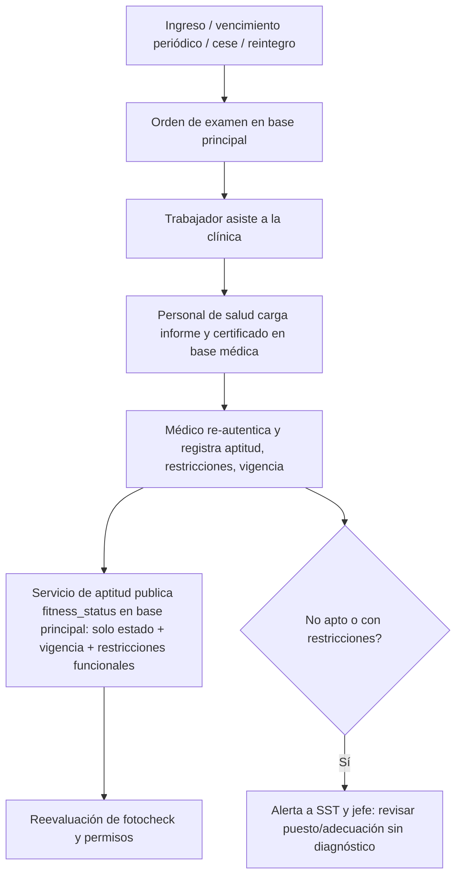

# M-EMO · 5.4 EMOs y aptitud

## 1. Encabezado

| Campo | Valor |
|---|---|
| Código | `EMO` |
| Número | 5.4 |
| Nombre | EMOs y aptitud |
| Grupo | 5. Personas y salud ocupacional |
| Plan | P · Profesional |
| Fase | 2 · Plan Profesional |
| Origen | Ley |
| Resuelve | Programación, vigencias y restricciones |
| Tablas del catálogo | `medical_exam_orders`, `medical_exams` (base médica), `medical_exam_files` (base médica), `fitness_status` |
| Dependencias | [TRB](M-TRB.md) (Trabajadores y legajo), [TEN](M-TEN.md) (Empresas, sedes y áreas), [IPC](M-IPC.md) (Matriz IPERC), [USR](M-USR.md) (Usuarios, roles y permisos), [AUD](M-AUD.md) (Bitácora de auditoría) |
| Prefijo de permisos | `emo.<tabla>.<acción>` |

## 2. Objetivo y problema que resuelve

**Objetivo.** Programar y controlar los exámenes médicos ocupacionales (preocupacional, periódico, de retiro y otros) por protocolo de puesto, registrar su resultado en la base médica separada y publicar en la base principal solo el estado de aptitud y su vigencia, con acceso médico reforzado.

**Problema que resuelve.** Las empresas no controlan la vigencia de los EMO ni las restricciones; RR.HH. y jefes ven certificados con diagnósticos, violando la confidencialidad. El registro de exámenes médicos es obligatorio y SUNAFIL sanciona su ausencia.

## 3. Base normativa

- Ley 29783, art. 49 literal d: exámenes médicos antes, durante y al término de la relación laboral (modificada por Ley 30222: el de salida a solicitud del empleador o trabajador; a confirmar alcance).
- D.S. 005-2012-TR, art. 101–102 (modificado por D.S. 016-2016-TR y D.S. 020-2019-TR u otros; vigencia a confirmar): periodicidad de exámenes (parámetro `emo_periodicity_months` por puesto/riesgo), costo a cargo del empleador.
- R.M. 312-2011/MINSA (protocolos de exámenes médicos ocupacionales y guías de diagnóstico) y sus modificatorias (a confirmar vigencia).
- Ley 29783, art. 71 literal d y art. 103: confidencialidad; el empleador solo conoce la aptitud, no el diagnóstico (salvo consentimiento).
- D.S. 005-2012-TR, art. 33 literal b: registro de exámenes médicos ocupacionales.
- Ley 29733 y D.S. 016-2024-JUS: datos de salud son sensibles; consentimiento, medidas de seguridad reforzadas y flujo transfronterizo comunicado a la ANPD.

> Todo valor legal citado (plazos, periodicidades, umbrales, factores) se implementa como parámetro con vigencia y queda «a confirmar por especialista SST/legal»; nunca como constante en código.

## 4. Roles y permisos

| Rol | Qué hace en el módulo | Permisos |
|---|---|---|
| Médico ocupacional (`occupational_doctor`) | Define protocolos, registra resultados y aptitud, ve historia y archivos médicos con re-autenticación | `emo.medical_exam_orders.create`, `emo.medical_exams.create`, `emo.medical_exams.view`, `emo.medical_exam_files.create`, `emo.medical_exam_files.view`, `emo.fitness_status.update` |
| Personal de salud (`health_staff`) | Agenda órdenes, registra asistencia y carga archivos; sin ver diagnósticos si su alcance es limitado | `emo.medical_exam_orders.create`, `emo.medical_exam_orders.update`, `emo.medical_exam_files.create` |
| Recursos Humanos (`hr`) | Ve el estado de aptitud y vigencia; solicita EMO preocupacional y de retiro | `emo.fitness_status.view`, `emo.medical_exam_orders.create` |
| Jefe SST / Responsable del SG-SST (`sst_manager`) | Ve estado de aptitud y cumplimiento agregado | `emo.fitness_status.view`, `emo.medical_exam_orders.view` |
| Jefe de área / línea (`area_lead`) | Ve aptitud y restricciones operativas (descripción funcional, no diagnóstico) de su personal | `emo.fitness_status.view` |
| Trabajador (`worker`) | Ve sus órdenes, su aptitud y sus propios resultados (con re-autenticación) | `emo.medical_exam_orders.view`, `emo.medical_exams.view`, `emo.fitness_status.view` |

Roles no listados no tienen acceso al módulo. Los permisos se acotan además por `membership_scopes` (sede/área) y por el plan contratado (feature flag del módulo).

## 5. Tablas

| Tabla | Base | Propósito | Campos clave |
|---|---|---|---|
| `medical_exam_orders` | principal | Orden de examen (base principal, sin datos clínicos) | company_id, worker_id, exam_type (preocupacional, periódico, retiro, reubicación, reintegro, por exposición), protocol_code, clinic_name (proveedor IPRESS/centro), scheduled_on, due_on, status, created_by, reason |
| `medical_exams` | médica | Resultado del examen (base médica) | company_id, worker_id, order_id, exam_type, performed_on, provider_name, provider_ruc, doctor_name, doctor_cmp, findings (cifrado), diagnoses (CIE-10, cifrado), restrictions_clinical (cifrado), recommendations (cifrado), fitness_result, valid_until, consent_id |
| `medical_exam_files` | médica | Archivos del examen (base médica; objeto en bucket médico separado) | company_id, exam_id, file_kind (informe, certificado de aptitud, audiometría, espirometría, rayos X, laboratorio), b2_object_key, sha256, uploaded_by |
| `fitness_status` | principal | Estado de aptitud no sensible (base principal) | company_id, worker_id, status (apto, apto con restricciones, no apto, pendiente), valid_from, valid_until, functional_restrictions (texto operativo sin diagnóstico, p. ej. «No levantar más de 15 kg»), source_exam_ref (UUID sin FK entre bases), updated_by |

Todas las tablas de empresa llevan las columnas estándar (`id` UUID v7, `company_id`, `created_at`, `updated_at`, `created_by`, `updated_by`, `deleted_at`) salvo las inalterables, y quedan bajo RLS por `app.company_id`.

## 6. Pantallas

| ID | Pantalla | Propósito | Elementos principales |
|---|---|---|---|
| SCR-EMO-01 | Programación de EMO | Calendario y pendientes | Trabajadores con EMO por vencer/vencido/pendiente; generación masiva de órdenes periódicas; filtros por sede/puesto (sin datos clínicos) |
| SCR-EMO-02 | Orden de examen | Crear/agendar | Tipo, protocolo del puesto (exámenes incluidos), clínica, fecha; envío de la orden al trabajador |
| SCR-EMO-03 | Registro de resultado (médico) | Captura clínica | Exige re-autenticación; hallazgos, diagnósticos CIE-10, restricciones clínicas, recomendaciones, aptitud, vigencia; carga de archivos; aviso de datos sensibles |
| SCR-EMO-04 | Aptitud del trabajador | Vista no médica | Estado con semáforo, vigencia y restricciones funcionales; sin diagnósticos; visible para RR.HH., SST y jefes |
| SCR-EMO-05 | Historia de EMO (médico) | Historial clínico ocupacional | Línea de tiempo de exámenes con archivos; cada apertura registrada en `sensitive_access_logs` |
| SCR-EMO-06 | Protocolos por puesto | Configuración médica | Exámenes por puesto y exposición (derivados de IPERC/MAG), periodicidad |
| SCR-EMO-07 | Mis exámenes (app del trabajador) | Mis órdenes y resultados | Próxima cita; estado de aptitud; ver mis resultados con re-autenticación y descarga del informe |

## 7. Flujos principales

**Acceso a dato médico**
1. Usuario con rol médico abre un examen.
2. Se exige re-autenticación (contraseña + segundo factor) si no hay una vigente para el propósito, y un motivo.
3. Se registra en `sensitive_access_logs` y luego se consulta la base médica por una conexión separada.

## 8. Reglas de negocio

- **RN-EMO-01.** `medical_exams` y `medical_exam_files` residen solo en `escudo_medical` (DigitalOcean); ningún diagnóstico, hallazgo ni restricción clínica se copia a la base principal, logs, colas, correos, WhatsApp ni IA.
- **RN-EMO-02.** `fitness_status` en la base principal contiene solo estado, vigencia y restricciones funcionales redactadas sin diagnóstico; lo escribe exclusivamente el servicio de aptitud a partir de un examen registrado por un médico.
- **RN-EMO-03.** Toda lectura de `medical_exams` o descarga de `medical_exam_files` exige re-autenticación vigente (`reauth_ttl_minutes`) y registro previo en `sensitive_access_logs`; si el registro falla, se deniega.
- **RN-EMO-04.** Solo `occupational_doctor` registra aptitud; `health_staff` puede cargar archivos y agendar, pero no ver diagnósticos salvo permiso explícito de su alcance.
- **RN-EMO-05.** `valid_until` del EMO periódico = fecha del examen + `emo_periodicity_months` del protocolo del puesto (parámetro con vigencia, a confirmar); el médico puede fijar una vigencia menor.
- **RN-EMO-06.** Un trabajador sin EMO preocupacional con aptitud registrada tiene `fitness_status = pendiente` y su fotocheck no se habilita si el tipo lo exige.
- **RN-EMO-07.** Al vencer `valid_until` sin nuevo examen, `fitness_status` pasa a «pendiente» (vencido) y se reevalúan fotocheck y permisos.
- **RN-EMO-08.** El EMO de retiro se genera como orden al registrarse el cese cuando `emo_on_termination` está activo; su realización depende de la normativa vigente (a confirmar).
- **RN-EMO-09.** Los archivos médicos se almacenan en el bucket B2 médico separado, con cifrado del lado del servidor y URL firmada de vida `medical_signed_url_ttl`.
- **RN-EMO-10.** El trabajador puede ver y descargar sus propios resultados con re-autenticación; el acceso también queda registrado.
- **RN-EMO-11.** Las referencias entre bases son por `worker_id` y `source_exam_ref` sin FK; la aplicación valida existencia y `company_id`.

## 9. Estados y transiciones

| Entidad | Estados | Transiciones |
|---|---|---|
| medical_exam_orders | created → scheduled → attended → result_registered → closed; scheduled → no_show → scheduled; created → cancelled | |
| fitness_status | pending → fit / fit_with_restrictions / unfit → expired(pending) | `expired` automático al pasar `valid_until` |

## 10. Notificaciones y alertas

| Evento | Destinatario | Canal | Anticipación / momento (parámetro) |
|---|---|---|---|
| EMO periódico por vencer | Trabajador, personal de salud | App, WhatsApp (sin datos clínicos) | `emo_due_notice_days` antes de `valid_until` |
| Orden de examen agendada | Trabajador | App, WhatsApp, correo | Al agendar y `emo_appointment_reminder_days` antes |
| Resultado «no apto» o «con restricciones» | Jefe SST, jefe del área, RR.HH. (solo estado y restricción funcional) | App | Inmediato |
| Inasistencia a cita | Personal de salud, jefe del área | App | Al marcar no asistió |

Los envíos se hacen mediante el módulo [NOT](M-NOT.md); cada regla es configurable por empresa y respeta las preferencias del usuario.

## 11. Reportes y exportaciones

- Registro de exámenes médicos ocupacionales (formato referencial R.M. 050-2013-TR) generado sin diagnósticos individuales para usuarios no médicos; versión completa solo para el médico.
- Cumplimiento de EMO por sede/puesto; aptitud agregada; trabajadores con restricciones funcionales.
- Aporte al expediente [SUN](M-SUN.md): constancia de aptitud y vigencia del trabajador en el periodo (certificado de aptitud sin diagnóstico; el informe clínico solo si el médico lo autoriza con registro).

## 12. Integración con otros módulos

**Consume:**

- [TRB](M-TRB.md): ingreso, cese, puesto; [IPC](M-IPC.md) y [MAG](M-MAG.md): exposiciones para protocolos; [USR](M-USR.md): re-autenticación.

**Produce:**

- `fitness_status` para [FOT](M-FOT.md), [PTR](M-PTR.md), [VUL](M-VUL.md), [DSH](M-DSH.md) (agregado) y [SUN](M-SUN.md); casos para [VMD](M-VMD.md).

## 13. Criterios de aceptación clave

1. **Dado** un usuario con rol `hr`, **cuando** consulta la ficha de un trabajador con EMO registrado, **entonces** ve «Apto con restricciones · vigente hasta 2027-05-10 · No levantar más de 15 kg» y ningún diagnóstico.
2. **Dado** un médico sin re-autenticación vigente, **cuando** abre el resultado, **entonces** se exige re-autenticación y motivo, y el acceso queda en `sensitive_access_logs`.
3. **Dado** se inspecciona la base principal, **cuando** se buscan columnas de diagnóstico o CIE-10, **entonces** no existen.
4. **Dado** un EMO con `valid_until` 2026-11-01, **cuando** llega 2026-11-02 sin examen nuevo, **entonces** `fitness_status` pasa a pendiente (vencido) y el fotocheck se reevalúa.
5. **Dado** la notificación de EMO por vencer, **cuando** se genera el mensaje de WhatsApp, **entonces** no contiene diagnóstico, resultado ni restricciones.
6. **Dado** un trabajador, **cuando** abre sus propios resultados en la app, **entonces** se pide re-autenticación y puede descargar su informe.

## 14. Fuera de alcance y preguntas abiertas

**Fuera de alcance:**

- Historia clínica integral fuera de la salud ocupacional.
- Integración con sistemas de clínicas (se evaluará en [API](M-API.md)).

**Preguntas abiertas:**

- ¿El registro de EMO exigido por SUNAFIL requiere el diagnóstico o solo la aptitud? A confirmar por especialista legal/médico.
- ¿Qué texto de consentimiento informado se usará para el tratamiento de datos de salud?
