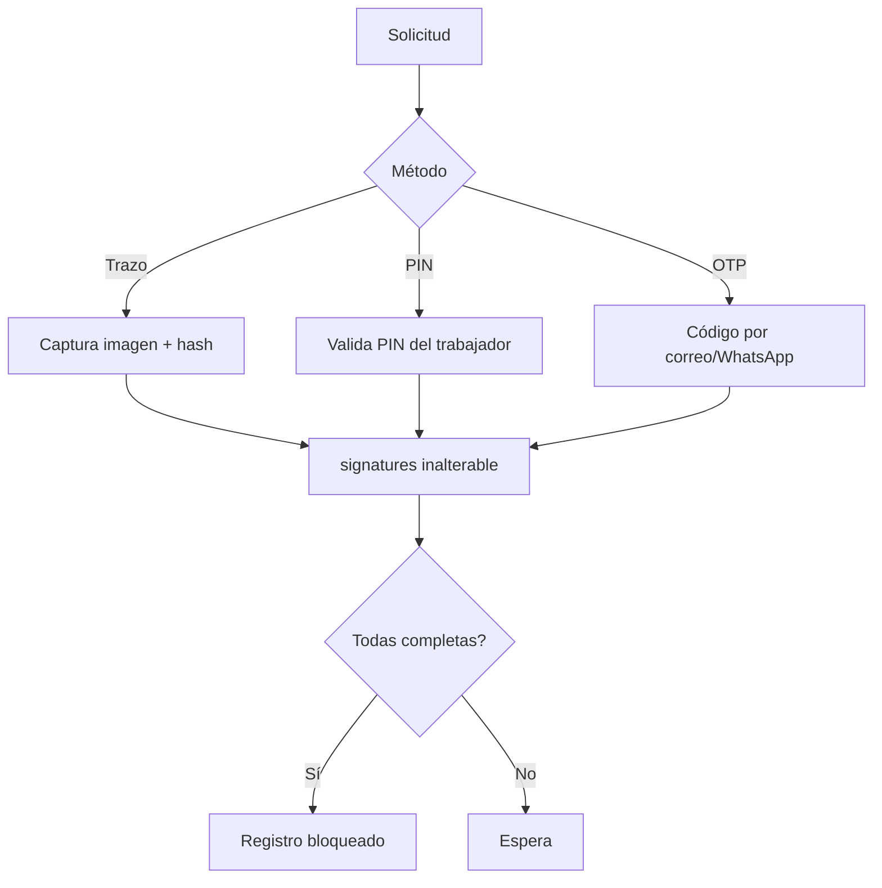

# M-FIR · 1.7 Firma electrónica de registros

## 1. Encabezado

| Campo | Valor |
|---|---|
| Código | `FIR` |
| Número | 1.7 |
| Nombre | Firma electrónica de registros |
| Grupo | 1. Núcleo de la plataforma |
| Plan | P · Profesional |
| Fase | 0 · Cimientos |
| Origen | Mercado |
| Resuelve | Firma de trabajadores y responsables |
| Tablas del catálogo | `signature_requests`, `signatures` |
| Dependencias | [USR](M-USR.md) (Usuarios, roles y permisos), [TRB](M-TRB.md) (Trabajadores y legajo), [AUD](M-AUD.md) (Bitácora de auditoría) |
| Prefijo de permisos | `fir.<tabla>.<acción>` |

## 2. Objetivo y problema que resuelve

**Objetivo.** Proveer firma electrónica simple de registros SST (cargos, asistencias, entregas de EPP, actas, aprobaciones) por trabajadores y responsables, con evidencia técnica que permita demostrar autoría e integridad.

**Problema que resuelve.** Las firmas en papel se pierden, se escanean mal y no prueban la fecha; firmar en campo exige imprimir. SUNAFIL acepta registros electrónicos siempre que se pueda acreditar quién firmó y que el contenido no fue alterado.

## 3. Base normativa

- Ley 27269 (Ley de Firmas y Certificados Digitales) y su reglamento D.S. 052-2008-PCM: firma electrónica simple; validez según acuerdo de las partes (alcance a confirmar por especialista legal).
- D.S. 005-2012-TR, art. 33 y R.M. 050-2013-TR: los registros pueden llevarse en medios electrónicos y deben contener firma del responsable.
- Ley 29733: la imagen de firma manuscrita y datos biométricos simples son datos personales; finalidad limitada.

> Todo valor legal citado (plazos, periodicidades, umbrales, factores) se implementa como parámetro con vigencia y queda «a confirmar por especialista SST/legal»; nunca como constante en código.

## 4. Roles y permisos

| Rol | Qué hace en el módulo | Permisos |
|---|---|---|
| Jefe SST / Responsable del SG-SST (`sst_manager`) | Configura métodos de firma y solicita firmas | `fir.signature_requests.create`, `fir.signature_requests.view`, `fir.signatures.view` |
| Jefe de área / línea (`area_lead`) | Solicita firmas de asistentes en campo y firma como responsable | `fir.signature_requests.create`, `fir.signatures.create` |
| Miembro del Comité SST (`committee_member`) | Firma actas y aprobaciones | `fir.signatures.create` |
| Gerencia (`management`) | Firma aprobaciones (política, programa) | `fir.signatures.create` |
| Trabajador (`worker`) | Firma lo que se le solicita | `fir.signatures.create`, `fir.signature_requests.view` |
| Auditor externo (`external_auditor`) | Verifica firmas de registros del periodo | `fir.signatures.view` |

Roles no listados no tienen acceso al módulo. Los permisos se acotan además por `membership_scopes` (sede/área) y por el plan contratado (feature flag del módulo).

## 5. Tablas

| Tabla | Base | Propósito | Campos clave |
|---|---|---|---|
| `signature_requests` | principal | Solicitud de firma sobre un registro | company_id, subject_type, subject_id, document_hash, signer_user_id, signer_worker_id, role_in_document (asistente, responsable, aprobador), method_allowed, status, expires_at, requested_by |
| `signatures` | principal | Evidencia de firma (inalterable) | company_id, signature_request_id, signer_user_id, signer_worker_id, method (trazo, PIN, OTP, firma en sitio asistida), stroke_file_id, document_hash, otp_channel, ip, user_agent, geo_lat, geo_lng, device_id, signed_at, offline_captured_at |

Todas las tablas de empresa llevan las columnas estándar (`id` UUID v7, `company_id`, `created_at`, `updated_at`, `created_by`, `updated_by`, `deleted_at`) salvo las inalterables, y quedan bajo RLS por `app.company_id`.

## 6. Pantallas

| ID | Pantalla | Propósito | Elementos principales |
|---|---|---|---|
| SCR-FIR-01 | Firmar (app del trabajador) | Firmar un registro | Resumen legible de lo que firma; recuadro de trazo grande o PIN; checkbox «He leído»; botón «Firmar» |
| SCR-FIR-02 | Firma asistida en campo | Varios trabajadores firman en un dispositivo | Lista de asistentes; cada uno ingresa su DNI + PIN o trazo; el responsable confirma |
| SCR-FIR-03 | Solicitudes de firma | Seguimiento | Tabla por registro con firmantes pendientes/firmados; reenviar |
| SCR-FIR-04 | Verificación de firma | Comprobar integridad | Hash del documento actual vs. firmado; datos de evidencia; resultado «Íntegro / Alterado» |

## 7. Flujos principales

1. Un módulo crea el registro y llama a `FirmaService.request()` con los firmantes y su rol.
2. Se calcula el hash SHA-256 de la representación canónica del registro y se crea `signature_requests`.
3. El firmante recibe notificación; abre el resumen y firma con el método permitido (trazo, PIN o OTP por correo/WhatsApp).
4. Se crea `signatures` con evidencia técnica; si todas las firmas requeridas están completas, el registro origen pasa a «firmado» y queda bloqueado.
5. En modo offline ([OFF](M-OFF.md)) la firma se captura con `offline_captured_at` y el hash local; al sincronizar se valida que el hash coincida.

## 8. Reglas de negocio

- **RN-FIR-01.** `signatures` es inalterable (solo INSERT); una firma errónea se anula con una nueva fila de anulación vinculada y motivo, nunca borrando.
- **RN-FIR-02.** El hash firmado se calcula sobre una representación canónica (JSON ordenado + hashes de archivos adjuntos); si el registro cambia después, la verificación muestra «Alterado».
- **RN-FIR-03.** Un registro con todas sus firmas completas queda bloqueado para edición; para corregir se crea una versión o anexo según el módulo.
- **RN-FIR-04.** El PIN del trabajador es de `pin_length` dígitos, se guarda con hash y se bloquea tras `max_pin_attempts` errores.
- **RN-FIR-05.** En firma asistida, cada trabajador se identifica individualmente (DNI + PIN o trazo); el responsable que asiste queda registrado como testigo.
- **RN-FIR-06.** Una solicitud vence en `signature_request_ttl_days`; vencida no se puede firmar y debe reemitirse.
- **RN-FIR-07.** Las firmas capturadas offline se aceptan si `offline_captured_at` no excede `offline_signature_max_age` respecto a la sincronización.
- **RN-FIR-08.** El método mínimo por tipo de registro es configurable (p. ej. aprobaciones de política exigen OTP; asistencia de charla permite trazo).

## 9. Estados y transiciones

| Entidad | Estados | Transiciones |
|---|---|---|
| signature_requests | pending → signed; pending → expired; pending → cancelled; signed → voided | `voided` solo mediante fila de anulación con motivo |

## 10. Notificaciones y alertas

| Evento | Destinatario | Canal | Anticipación / momento (parámetro) |
|---|---|---|---|
| Firma solicitada | Firmante | App, WhatsApp, correo | Al solicitar; recordatorio `signature_reminder_days` |
| Solicitud por vencer | Solicitante | App | `signature_expiry_notice_days` antes |
| Registro completamente firmado | Solicitante | App | Al completar |

Los envíos se hacen mediante el módulo [NOT](M-NOT.md); cada regla es configurable por empresa y respeta las preferencias del usuario.

## 11. Reportes y exportaciones

- Constancia de firma (PDF) con hash, fecha/hora America/Lima, método y evidencia; se anexa a cada registro exportado en [REG](M-REG.md).
- Reporte de firmas pendientes por módulo y responsable.

## 12. Integración con otros módulos

**Consume:**

- [USR](M-USR.md) y [TRB](M-TRB.md): identidades de firmantes.
- [OFF](M-OFF.md): firmas capturadas sin conexión.

**Produce:**

- Servicio de firma para DOC, CAP, CH5, EPP, COM, ATS, PTR, IPC, POL, PAS y demás registros.

## 13. Criterios de aceptación clave

1. **Dado** un registro firmado por tres trabajadores, **cuando** se modifica un campo del registro en base de datos, **entonces** la verificación muestra «Alterado».
2. **Dado** una charla firmada por todos, **cuando** el Jefe de área intenta editar la lista, **entonces** el sistema lo impide.
3. **Dado** un trabajador que falla el PIN `max_pin_attempts` veces, **cuando** intenta otra vez, **entonces** el PIN queda bloqueado y se notifica al supervisor.
4. **Dado** una firma capturada offline, **cuando** se sincroniza con el mismo hash, **entonces** se acepta con `offline_captured_at`.
5. **Dado** un intento de UPDATE sobre `signatures`, **cuando** se ejecuta, **entonces** la base lo rechaza (trigger de inalterabilidad).

## 14. Fuera de alcance y preguntas abiertas

**Fuera de alcance:**

- Firma digital con certificado (Ley 27269, RENIEC); se evaluará como integración posterior.
- Biometría dactilar.

**Preguntas abiertas:**

- ¿Qué registros requieren firma con OTP por exigencia legal o del cliente?
- ¿Se necesita sello de tiempo de un tercero de confianza?
