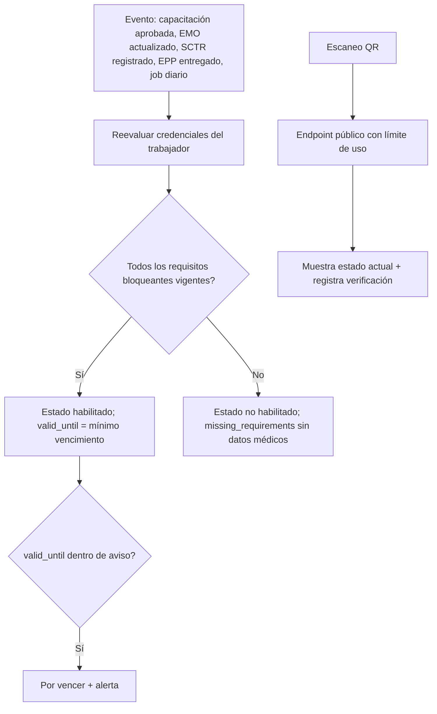

# M-FOT · 5.3 Fotocheck SST con QR

## 1. Encabezado

| Campo | Valor |
|---|---|
| Código | `FOT` |
| Número | 5.3 |
| Nombre | Fotocheck SST con QR |
| Grupo | 5. Personas y salud ocupacional |
| Plan | P · Profesional |
| Fase | 2 · Plan Profesional |
| Origen | Diferenciador |
| Resuelve | Credencial verificable en campo |
| Tablas del catálogo | `credential_types`, `credential_requirements`, `credentials`, `credential_verifications` |
| Dependencias | [TRB](M-TRB.md) (Trabajadores y legajo), [CAP](M-CAP.md) (Capacitaciones e inducciones), [EMO](M-EMO.md) (EMOs y aptitud), [SCT](M-SCT.md) (Control de SCTR), [EPP](M-EPP.md) (EPP) |
| Prefijo de permisos | `fot.<tabla>.<acción>` |

## 2. Objetivo y problema que resuelve

**Objetivo.** Emitir un fotocheck SST digital e imprimible con QR que muestra en campo si el trabajador está habilitado según requisitos configurables por tipo de credencial (capacitaciones vigentes, EMO apto vigente, SCTR, inducción, EPP), con vencimiento automático cuando cualquier requisito vence y verificación pública sin datos médicos.

**Problema que resuelve.** En campo y en portería nadie puede verificar rápidamente si un trabajador tiene inducción, EMO y SCTR vigentes; los fotochecks plásticos siguen «válidos» aunque los requisitos hayan vencido. Es uno de los diferenciadores de EscudoSST.

## 3. Base normativa

- Ley 29783, art. 49 y 50: el empleador garantiza que el trabajador esté capacitado y apto antes de asignarle tareas.
- D.S. 003-98-SA: SCTR obligatorio en actividades de riesgo (requisito configurable).
- Ley 29733 y D.S. 016-2024-JUS: la verificación pública solo muestra datos mínimos; nunca datos de salud (ni siquiera la condición «no apto» como diagnóstico; solo «no habilitado»).

> Todo valor legal citado (plazos, periodicidades, umbrales, factores) se implementa como parámetro con vigencia y queda «a confirmar por especialista SST/legal»; nunca como constante en código.

## 4. Roles y permisos

| Rol | Qué hace en el módulo | Permisos |
|---|---|---|
| Jefe SST / Responsable del SG-SST (`sst_manager`) | Configura tipos y requisitos, emite, revoca, consulta verificaciones | `fot.credential_types.create`, `fot.credential_types.update`, `fot.credential_requirements.update`, `fot.credentials.create`, `fot.credentials.update`, `fot.credential_verifications.view` |
| Recursos Humanos (`hr`) | Emite fotochecks a nuevos ingresos e imprime | `fot.credentials.create` |
| Supervisor SST (`sst_supervisor`) | Verifica en campo con sesión (ve detalle de requisitos faltantes no médicos) | `fot.credentials.view`, `fot.credential_verifications.create` |
| Jefe de área / línea (`area_lead`) | Verifica a su personal | `fot.credentials.view` |
| Trabajador (`worker`) | Ve su fotocheck digital y lo que le falta | `fot.credentials.view` |

Roles no listados no tienen acceso al módulo. Los permisos se acotan además por `membership_scopes` (sede/área) y por el plan contratado (feature flag del módulo).

## 5. Tablas

| Tabla | Base | Propósito | Campos clave |
|---|---|---|---|
| `credential_types` | principal | Tipo de credencial | company_id, code, name (p. ej. «General», «Trabajo en altura», «Contratista»), color, layout, validity_mode (por requisitos / fecha fija), max_validity_days, show_photo, status |
| `credential_requirements` | principal | Requisito del tipo | credential_type_id, requirement_type (capacitación, capacitaciones de la matriz por cargo, inducción general, inducción específica, EMO apto, SCTR salud, SCTR pensión, EPP obligatorio, documento), reference_id (training_id, document_kind…), use_position_matrix (toma los temas obligatorios de `position_training_requirements` del cargo), applies_to_positions, grace_days, is_blocking |
| `credentials` | principal | Fotocheck emitido | company_id, worker_id, credential_type_id, number, public_token (rotable), status, issued_at, valid_until (mínimo de vencimientos de requisitos), last_evaluated_at, missing_requirements (jsonb, sin datos médicos), printed_count, revoked_reason |
| `credential_verifications` | principal | Verificación registrada (inalterable) | credential_id, verified_at, channel (público QR, app autenticada, portería), verifier_user_id, access_point_id, result (habilitado/no habilitado/revocado/no encontrado), ip_hash, latitude, longitude |

Todas las tablas de empresa llevan las columnas estándar (`id` UUID v7, `company_id`, `created_at`, `updated_at`, `created_by`, `updated_by`, `deleted_at`) salvo las inalterables, y quedan bajo RLS por `app.company_id`.

## 6. Pantallas

| ID | Pantalla | Propósito | Elementos principales |
|---|---|---|---|
| SCR-FOT-01 | Tipos de fotocheck | Configuración | Tipos con requisitos: selector de capacitaciones, inducciones, EMO, SCTR, EPP; puestos a los que aplica; bloqueante sí/no |
| SCR-FOT-02 | Fotochecks | Gestión | Trabajadores con estado (habilitado, por vencer, no habilitado, revocado), `valid_until`, requisito que vence primero |
| SCR-FOT-03 | Ficha del fotocheck | Detalle | Vista previa (anverso/reverso) con foto, nombre, puesto, empresa, QR; requisitos con semáforo; historial de verificaciones |
| SCR-FOT-04 | Impresión | Lote | Selección por área/tipo; PDF en tamaño CR80 con marcas de corte |
| SCR-FOT-05 | Mi fotocheck (app del trabajador) | Credencial digital | Fotocheck a pantalla completa con QR dinámico; estado grande verde/rojo; lista «Te falta» (sin términos médicos: «Examen médico pendiente») |
| SCR-FOT-06 | Verificación pública (QR) | Resultado sin sesión | Página ligera con foto, nombre, puesto, empresa, estado «HABILITADO / NO HABILITADO» con color, fecha de consulta; sin DNI completo ni motivos médicos |
| SCR-FOT-07 | Verificación en campo (con sesión) | Detalle para supervisores | Igual que la pública más lista de requisitos faltantes no médicos y botón «Registrar verificación» |

## 7. Flujos principales

**Emisión**
1. RR.HH. o SST elige tipo y trabajador; el sistema evalúa requisitos.
2. Se crea la credencial (aunque no esté habilitada) con número y token.
3. Se imprime; el QR siempre consulta el estado en línea, por lo que el plástico no necesita reimprimirse al renovar requisitos.

## 8. Reglas de negocio

- **RN-FOT-01.** El estado se calcula en tiempo real: habilitado solo si todos los requisitos bloqueantes del tipo, aplicables al puesto del trabajador, están vigentes en la fecha de consulta.
- **RN-FOT-02.** `valid_until` = el menor de los vencimientos de los requisitos vigentes (capacitaciones `valid_until`, `fitness_status.valid_until`, fin de cobertura SCTR, `replace_by` de EPP obligatorio) y de `max_validity_days` si se configura.
- **RN-FOT-03.** Al vencer cualquier requisito bloqueante, la credencial pasa a «no habilitado» automáticamente (job diario + reevaluación por eventos); no requiere acción manual.
- **RN-FOT-04.** El requisito «EMO apto» se evalúa solo con `fitness_status` (apto o apto con restricciones vigente); la credencial y su verificación nunca muestran diagnósticos, restricciones ni la palabra «no apto»; el faltante se describe como «Examen médico ocupacional pendiente».
- **RN-FOT-05.** La página pública muestra únicamente foto (si `show_photo`), nombres, puesto, empresa (nombre comercial), tipo de credencial, estado y fecha/hora de consulta; el DNI nunca se muestra completo.
- **RN-FOT-06.** El endpoint público valida `public_token`, aplica límite por IP (`credential_verify_rate_limit`) y no permite enumerar tokens (tokens aleatorios de alta entropía, respuesta idéntica para inexistentes y revocados).
- **RN-FOT-07.** Toda verificación se registra en `credential_verifications` (inalterable) con canal y resultado.
- **RN-FOT-08.** Al cesar al trabajador ([TRB](M-TRB.md)) la credencial se revoca automáticamente; la rotación del token invalida los QR impresos anteriores.
- **RN-FOT-09.** Un trabajador puede tener varias credenciales de tipos distintos, pero solo una activa por tipo.
- **RN-FOT-10.** Los requisitos de capacitación pueden listarse uno a uno o tomarse de la matriz de capacitación por cargo de [CAP](M-CAP.md) (`use_position_matrix`): cada tema obligatorio y bloqueante del cargo del trabajador se evalúa como requisito, y un cambio en la matriz o de cargo reevalúa la credencial.
- **RN-FOT-11.** Un tema se cumple con un certificado válido de [CAP](M-CAP.md), venga de una sesión presencial o de un curso completado en el aula ([AUL](M-AUL.md)); un certificado por validar o anulado no cumple.
- **RN-FOT-12.** Cuando un requisito de capacitación está por vencer, la recapacitación se recomienda desde las reglas de recomendación de [AUL](M-AUL.md) («certificado por vencer»); el aviso del fotocheck enlaza a esa recomendación si existe.
- **RN-FOT-13.** Los requisitos con `grace_days` permiten estado «habilitado con observación» hasta cumplirse el periodo de gracia (p. ej. nuevo ingreso con inducción específica programada), si la empresa lo configura.

## 9. Estados y transiciones

| Entidad | Estados | Transiciones |
|---|---|---|
| credentials | issued → enabled ↔ not_enabled; enabled → expiring → not_enabled; cualquiera → revoked | Transiciones automáticas por evaluación de requisitos; `revoked` manual o por cese |

## 10. Notificaciones y alertas

| Evento | Destinatario | Canal | Anticipación / momento (parámetro) |
|---|---|---|---|
| Fotocheck por vencer | Trabajador, jefe del área | App, WhatsApp | `credential_expiry_notice_days` antes de `valid_until` |
| Fotocheck pasa a no habilitado | Trabajador, jefe del área, Jefe SST | App, WhatsApp | Inmediato |
| Verificación de un fotocheck no habilitado en portería | Jefe SST | App | Inmediato |

Los envíos se hacen mediante el módulo [NOT](M-NOT.md); cada regla es configurable por empresa y respeta las preferencias del usuario.

## 11. Reportes y exportaciones

- Estado de habilitación por área y tipo; trabajadores no habilitados y requisito faltante.
- Historial de verificaciones por trabajador y punto de acceso.
- Aporte al expediente [SUN](M-SUN.md): estado de requisitos del trabajador a la fecha de corte.

## 12. Integración con otros módulos

**Consume:**

- [CAP](M-CAP.md): vigencias y matriz por cargo; [AUL](M-AUL.md): cursos completados (vía certificados de CAP) y recomendaciones de recapacitación; [EMO](M-EMO.md): `fitness_status`; [SCT](M-SCT.md): coberturas; [EPP](M-EPP.md): entregas; [TRB](M-TRB.md): datos y cese.

**Produce:**

- Estado de habilitación para [ING](M-ING.md), [PTR](M-PTR.md) y [CTR](M-CTR.md); verificaciones para [AUD](M-AUD.md).

## 13. Criterios de aceptación clave

1. **Dado** un trabajador con capacitaciones vigentes y EMO apto que vence el 2026-12-15, **cuando** se evalúa la credencial, **entonces** está habilitada con `valid_until` = 2026-12-15.
2. **Dado** llega el 2026-12-16 sin nuevo EMO, **cuando** corre el job diario, **entonces** la credencial pasa a «no habilitado» y se notifica.
3. **Dado** un trabajador «no apto», **cuando** se escanea su QR público, **entonces** se muestra «NO HABILITADO» sin mencionar aptitud, diagnóstico ni restricciones.
4. **Dado** un token inexistente, **cuando** se consulta la URL pública, **entonces** la respuesta es idéntica a la de una credencial revocada y se registra el intento.
5. **Dado** un trabajador cesado, **cuando** se registra el cese, **entonces** su credencial queda revocada y su QR muestra «NO HABILITADO».
6. **Dado** un supervisor con sesión, **cuando** verifica en campo, **entonces** ve «Falta: Trabajo en altura (vencida el 2026-10-01)» y la verificación queda registrada.

## 14. Fuera de alcance y preguntas abiertas

**Fuera de alcance:**

- Control de acceso físico con torniquetes (se integra vía [ING](M-ING.md) / [API](M-API.md)).
- Impresión en impresoras de tarjetas específicas (se entrega PDF).

**Preguntas abiertas:**

- ¿Se mostrará la foto en la verificación pública por defecto? (consideración de datos personales).
- ¿Se requiere QR dinámico (rotación periódica) en la app para evitar capturas de pantalla?
