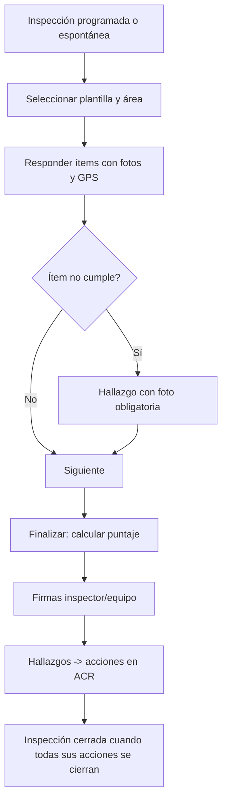

# M-INS · 4.1 Inspecciones

## 1. Encabezado

| Campo | Valor |
|---|---|
| Código | `INS` |
| Número | 4.1 |
| Nombre | Inspecciones |
| Grupo | 4. Operación en campo |
| Plan | E · Esencial |
| Fase | 1 · Plan Esencial |
| Origen | Ley |
| Resuelve | Checklists, fotos y ubicación |
| Tablas del catálogo | `inspection_templates`, `inspection_template_items`, `inspections`, `inspection_answers`, `findings` |
| Dependencias | [TEN](M-TEN.md) (Empresas, sedes y áreas), [ACR](M-ACR.md) (Acciones correctivas), [FIR](M-FIR.md) (Firma electrónica de registros), [DOC](M-DOC.md) (Gestión documental) |
| Prefijo de permisos | `ins.<tabla>.<acción>` |

## 2. Objetivo y problema que resuelve

**Objetivo.** Planificar y ejecutar inspecciones internas de seguridad con plantillas de checklist configurables, fotos geolocalizadas y hallazgos que se convierten en acciones correctivas, desde web o móvil.

**Problema que resuelve.** Las inspecciones se hacen en papel, las fotos quedan en el celular del inspector y los hallazgos no se siguen. El registro de inspecciones internas es uno de los 9 registros obligatorios y SUNAFIL revisa que existan y que se corrijan las observaciones.

## 3. Base normativa

- D.S. 005-2012-TR, art. 33 literal d: registro de inspecciones internas de seguridad y salud en el trabajo.
- D.S. 005-2012-TR, art. 42 literal g: el comité realiza inspecciones periódicas (frecuencia parámetro `committee_inspection_months`, a confirmar).
- R.M. 050-2013-TR: formato referencial del registro de inspecciones internas.

> Todo valor legal citado (plazos, periodicidades, umbrales, factores) se implementa como parámetro con vigencia y queda «a confirmar por especialista SST/legal»; nunca como constante en código.

## 4. Roles y permisos

| Rol | Qué hace en el módulo | Permisos |
|---|---|---|
| Jefe SST / Responsable del SG-SST (`sst_manager`) | Crea plantillas, programa inspecciones, revisa y cierra | `ins.inspection_templates.create`, `ins.inspection_templates.update`, `ins.inspection_template_items.update`, `ins.inspections.create`, `ins.inspections.approve`, `ins.findings.update` |
| Jefe de área / línea (`area_lead`) | Ejecuta inspecciones en su área y registra hallazgos | `ins.inspections.create`, `ins.inspection_answers.create`, `ins.findings.create` |
| Supervisor SST (`sst_supervisor`) | Ejecuta inspecciones en campo | `ins.inspections.create`, `ins.inspection_answers.create`, `ins.findings.create` |
| Miembro del Comité SST (`committee_member`) | Participa en inspecciones del comité y firma | `ins.inspections.create`, `ins.inspection_answers.create` |
| Gerencia (`management`) | Consulta resultados | `ins.inspections.view` |
| Auditor externo (`external_auditor`) | Consulta inspecciones del periodo | `ins.inspections.view` |

Roles no listados no tienen acceso al módulo. Los permisos se acotan además por `membership_scopes` (sede/área) y por el plan contratado (feature flag del módulo).

## 5. Tablas

| Tabla | Base | Propósito | Campos clave |
|---|---|---|---|
| `inspection_templates` | principal | Plantilla de checklist | company_id (nulo en global/paquete), code, name, inspection_type (planeada, no planeada, comité, pre-uso de equipo, orden y limpieza), version, scoring_method, status |
| `inspection_template_items` | principal | Ítem de la plantilla | template_id, section, question, answer_type (cumple/no cumple/NA, numérico, texto, foto obligatoria), weight, is_critical, legal_reference, order |
| `inspections` | principal | Inspección ejecutada | company_id, template_id, template_version, site_id, area_id, inspection_type, scheduled_for, performed_at, inspector_user_id, team (jsonb), latitude, longitude, score_pct, status, signature_request_id, program_activity_id, offline_idempotency_key |
| `inspection_answers` | principal | Respuesta por ítem | inspection_id, template_item_id, answer, numeric_value, comment, photo_file_ids |
| `findings` | principal | Hallazgo | company_id, inspection_id, answer_id, description, finding_type (acto, condición), risk_level, photo_file_ids, responsible_worker_id, due_date, corrective_action_id, status |

Todas las tablas de empresa llevan las columnas estándar (`id` UUID v7, `company_id`, `created_at`, `updated_at`, `created_by`, `updated_by`, `deleted_at`) salvo las inalterables, y quedan bajo RLS por `app.company_id`.

## 6. Pantallas

| ID | Pantalla | Propósito | Elementos principales |
|---|---|---|---|
| SCR-INS-01 | Programa de inspecciones | Calendario | Inspecciones programadas por sede/área y tipo; estado; vinculadas a actividades PASST |
| SCR-INS-02 | Plantillas | Biblioteca | Plantillas propias y del paquete sectorial; editor de secciones e ítems con peso y criticidad; versiones |
| SCR-INS-03 | Ejecutar inspección (móvil) | Captura en campo | Ítems en tarjetas con botones grandes Cumple/No cumple/NA; cámara integrada; ubicación GPS; funciona offline con [OFF](M-OFF.md) |
| SCR-INS-04 | Hallazgos de la inspección | Convertir en acciones | Lista de «no cumple» con foto; asignar responsable, fecha y nivel; crear acción |
| SCR-INS-05 | Resultado | Revisión y firma | Puntaje, hallazgos, firmas del inspector y equipo; PDF |
| SCR-INS-06 | Tablero de inspecciones | Seguimiento | % cumplimiento del programa, puntaje promedio por área, hallazgos abiertos/vencidos |

## 7. Flujos principales

## 8. Reglas de negocio

- **RN-INS-01.** El puntaje = suma de pesos de ítems «cumple» / suma de pesos de ítems aplicables × 100; los «NA» no cuentan.
- **RN-INS-02.** Todo ítem respondido «no cumple» genera un hallazgo, y la foto es obligatoria si el ítem lo indica o si es crítico.
- **RN-INS-03.** Un ítem crítico en «no cumple» marca la inspección como «crítica» y notifica de inmediato al Jefe SST y al jefe del área.
- **RN-INS-04.** La inspección conserva la versión de plantilla usada; editar una plantilla crea una nueva versión sin alterar inspecciones pasadas.
- **RN-INS-05.** Para finalizar deben estar respondidos todos los ítems obligatorios.
- **RN-INS-06.** Una inspección finalizada y firmada no se edita; los hallazgos siguen su ciclo en [ACR](M-ACR.md).
- **RN-INS-07.** La inspección pasa a «cerrada» solo cuando todas las acciones de sus hallazgos están cerradas.
- **RN-INS-08.** Las inspecciones del comité deben incluir al menos un miembro del comité en el equipo.
- **RN-INS-09.** Las inspecciones offline se sincronizan por `offline_idempotency_key` sin duplicarse.

## 9. Estados y transiciones

| Entidad | Estados | Transiciones |
|---|---|---|
| inspections | scheduled → in_progress → completed → signed → closed; scheduled → cancelled / overdue | `overdue` si pasa `scheduled_for` sin ejecutar |
| findings | open → action_assigned → closed | |

## 10. Notificaciones y alertas

| Evento | Destinatario | Canal | Anticipación / momento (parámetro) |
|---|---|---|---|
| Inspección programada próxima | Inspector asignado | App, WhatsApp | `inspection_notice_days` antes |
| Inspección vencida sin ejecutar | Inspector, Jefe SST | App | Al vencer |
| Hallazgo crítico | Jefe SST, jefe del área | App, WhatsApp | Inmediato |

Los envíos se hacen mediante el módulo [NOT](M-NOT.md); cada regla es configurable por empresa y respeta las preferencias del usuario.

## 11. Reportes y exportaciones

- Registro de inspecciones internas (formato referencial R.M. 050-2013-TR) en [REG](M-REG.md).
- Informe PDF de cada inspección con fotos, puntaje y firmas.
- Aporte al expediente [SUN](M-SUN.md): inspecciones del periodo y estado de sus hallazgos.

## 12. Integración con otros módulos

**Consume:**

- [TEN](M-TEN.md), [PSE](M-PSE.md) (plantillas sectoriales), [OFF](M-OFF.md), [FIR](M-FIR.md).

**Produce:**

- Hallazgos y acciones en [ACR](M-ACR.md); ejecución de actividades en [PAS](M-PAS.md); KPI de inspecciones en [DSH](M-DSH.md).

## 13. Criterios de aceptación clave

1. **Dado** una plantilla con 10 ítems de peso 1, 7 cumple, 2 no cumple y 1 NA, **cuando** se finaliza, **entonces** puntaje 77,8 % y 2 hallazgos creados.
2. **Dado** un ítem crítico en «no cumple», **cuando** se guarda, **entonces** se notifica de inmediato al Jefe SST y al jefe del área.
3. **Dado** una inspección realizada offline, **cuando** se sincroniza dos veces, **entonces** existe una sola inspección.
4. **Dado** una inspección firmada, **cuando** se intenta editar una respuesta, **entonces** se rechaza.
5. **Dado** una inspección con acciones abiertas, **cuando** se intenta cerrar, **entonces** permanece «firmada» hasta cerrar las acciones.

## 14. Fuera de alcance y preguntas abiertas

**Fuera de alcance:**

- Inspecciones de calidad de producto.

**Preguntas abiertas:**

- ¿Se requiere geocerca (validar que la inspección se hizo dentro de la sede)?
