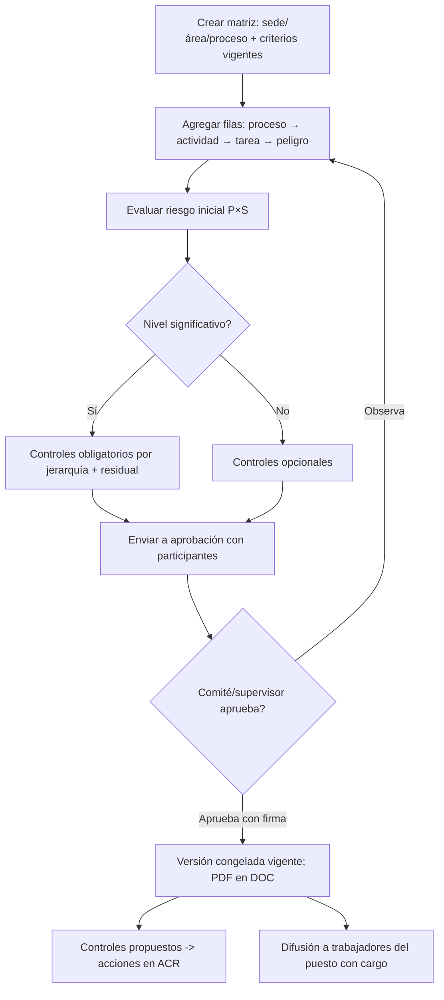

# M-IPC · 3.1 Matriz IPERC

## 1. Encabezado

| Campo | Valor |
|---|---|
| Código | `IPC` |
| Número | 3.1 |
| Nombre | Matriz IPERC |
| Grupo | 3. Gestión de riesgos |
| Plan | E · Esencial |
| Fase | 1 · Plan Esencial |
| Origen | Ley |
| Resuelve | IPERC por puesto y tarea, con versiones |
| Tablas del catálogo | `hazard_catalog`, `risk_criteria`, `iperc_matrices`, `iperc_versions`, `iperc_rows`, `iperc_controls` |
| Dependencias | [TEN](M-TEN.md) (Empresas, sedes y áreas), [DOC](M-DOC.md) (Gestión documental), [FIR](M-FIR.md) (Firma electrónica de registros), [ACR](M-ACR.md) (Acciones correctivas), [CAP](M-CAP.md) (Capacitaciones e inducciones) |
| Prefijo de permisos | `ipc.<tabla>.<acción>` |

## 2. Objetivo y problema que resuelve

**Objetivo.** Construir y mantener la matriz IPERC (identificación de peligros, evaluación de riesgos y determinación de controles) por proceso, actividad, puesto y tarea, con criterios de evaluación configurables, jerarquía de controles, riesgo residual, aprobación firmada y versiones.

**Problema que resuelve.** El IPERC es el documento más observado por SUNAFIL: suele ser un Excel copiado de otra empresa, sin vínculo con los puestos reales, sin controles implementados ni versión aprobada, y no se actualiza tras accidentes o cambios. Los trabajadores no conocen los riesgos de su puesto.

## 3. Base normativa

- Ley 29783, art. 57: evaluación de riesgos por puesto de trabajo, actualizada al menos una vez al año o cuando cambien las condiciones o tras daños a la salud (periodicidad como parámetro `iperc_review_months`).
- D.S. 005-2012-TR, art. 32 literal c y art. 77: IPERC como documento obligatorio; elaboración con participación de los trabajadores.
- D.S. 005-2012-TR, art. 95 y Ley 29783, art. 21: jerarquía de controles (eliminación, sustitución, controles de ingeniería, administrativos, EPP).
- R.M. 050-2013-TR, Anexo 3: guía básica sobre IPERC con la matriz de probabilidad × severidad de referencia (índices de personas expuestas, procedimientos, capacitación, exposición; severidad).
- D.S. 024-2016-EM, Anexo 7 (minería) y G.050 (construcción) como criterios sectoriales alternativos vía [PSE](M-PSE.md).

> Todo valor legal citado (plazos, periodicidades, umbrales, factores) se implementa como parámetro con vigencia y queda «a confirmar por especialista SST/legal»; nunca como constante en código.

## 4. Roles y permisos

| Rol | Qué hace en el módulo | Permisos |
|---|---|---|
| Jefe SST / Responsable del SG-SST (`sst_manager`) | Configura criterios, crea matrices, filas y controles, envía a aprobación, publica versiones | `ipc.risk_criteria.update`, `ipc.iperc_matrices.create`, `ipc.iperc_versions.create`, `ipc.iperc_rows.create`, `ipc.iperc_rows.update`, `ipc.iperc_controls.create`, `ipc.iperc_controls.update` |
| Jefe de área / línea (`area_lead`) | Elabora y propone filas de su área; verifica implementación de controles | `ipc.iperc_rows.create`, `ipc.iperc_rows.update`, `ipc.iperc_controls.update` |
| Miembro del Comité SST (`committee_member`) | Revisa y aprueba la versión | `ipc.iperc_versions.approve`, `ipc.iperc_versions.view` |
| Supervisor SST (`sst_supervisor`) | Elabora y aprueba en empresas sin comité | `ipc.iperc_rows.update`, `ipc.iperc_versions.approve` |
| Consultor SST (`consultant`) | Elabora matrices de la empresa cliente | `ipc.iperc_matrices.create`, `ipc.iperc_rows.create` |
| Trabajador (`worker`) | Participa en la identificación (aporta peligros) y consulta el IPERC de su puesto | `ipc.iperc_rows.view` |
| Dueño de la plataforma (`platform_owner`) | Mantiene el catálogo global de peligros base | `ipc.hazard_catalog.create`, `ipc.hazard_catalog.update` |
| Auditor externo (`external_auditor`) | Consulta versiones aprobadas | `ipc.iperc_versions.view` |

Roles no listados no tienen acceso al módulo. Los permisos se acotan además por `membership_scopes` (sede/área) y por el plan contratado (feature flag del módulo).

## 5. Tablas

| Tabla | Base | Propósito | Campos clave |
|---|---|---|---|
| `hazard_catalog` | principal | Catálogo de peligros (global y propio de la empresa) | company_id (nulo en global), code, hazard_family (mecánico, eléctrico, físico, químico, biológico, ergonómico, psicosocial, locativo, fenómenos naturales), name, typical_risks (array), typical_consequences, sector_tags, pictogram_code |
| `risk_criteria` | principal | Criterios de evaluación configurables | company_id, version, method (rm050, d024_2016_em, custom), probability_factors (jsonb: índices y escalas), severity_scale (jsonb), level_bands (jsonb: rangos → trivial/tolerable/moderado/importante/intolerable o equivalentes), significance_threshold, effective_from, status |
| `iperc_matrices` | principal | Matriz por alcance | company_id, site_id, area_id, process_name, code, title, criteria_id, status, current_version_id, next_review_date |
| `iperc_versions` | principal | Versión aprobada (congelada) | matrix_id, version_number, reason (inicial, revisión anual, accidente, cambio, MOC), snapshot (jsonb), document_version_id, participants (jsonb), submitted_at, approved_by, approved_at, status |
| `iperc_rows` | principal | Fila de la matriz | matrix_id, version_id, process, activity, task, position_ids (array), is_routine, hazard_id, hazard_description, risk_description, consequence, exposed_count, prob_factors (jsonb), probability_index, severity_index, risk_score, risk_level, is_significant, residual_prob_index, residual_severity_index, residual_score, residual_level, legal_requirement_id, order |
| `iperc_controls` | principal | Control por fila | row_id, hierarchy_level (eliminación, sustitución, ingeniería, administrativo, EPP), description, existing_or_proposed, responsible_worker_id, due_date, status, ppe_item_id, procedure_id, training_id, corrective_action_id, verified_at |

Todas las tablas de empresa llevan las columnas estándar (`id` UUID v7, `company_id`, `created_at`, `updated_at`, `created_by`, `updated_by`, `deleted_at`) salvo las inalterables, y quedan bajo RLS por `app.company_id`.

## 6. Pantallas

| ID | Pantalla | Propósito | Elementos principales |
|---|---|---|---|
| SCR-IPC-01 | Matrices IPERC | Lista por sede/área/proceso | Tarjetas con código, versión vigente, fecha de aprobación, próxima revisión con semáforo, # riesgos significativos |
| SCR-IPC-02 | Configurar criterios | Método de evaluación | Selección del método (R.M. 050 por defecto); edición de factores de probabilidad y escala de severidad; bandas de nivel con colores; vista previa de la matriz |
| SCR-IPC-03 | Editor de matriz | Edición tipo hoja | Columnas proceso, actividad, tarea, rutinaria (S/N), puestos, peligro (buscador en catálogo), riesgo, consecuencia; cálculo instantáneo de P × S y nivel con color; columna de controles por jerarquía; riesgo residual; filtros y congelación de columnas |
| SCR-IPC-04 | Detalle de fila | Edición enfocada | Formulario completo; selector de factores de probabilidad; controles con responsable y fecha; vínculos a EPP, PETS, capacitación |
| SCR-IPC-05 | Envío y aprobación | Revisión | Resumen de cambios respecto a la versión anterior (filas nuevas, modificadas, retiradas); participantes; firma de aprobación |
| SCR-IPC-06 | Historial de versiones | Comparación | Línea de tiempo; diff entre versiones |
| SCR-IPC-07 | Mapa de calor | Visual | Matriz P × S con número de riesgos en cada celda, antes y después de controles |
| SCR-IPC-08 | Mi IPERC (app del trabajador) | Riesgos de mi puesto | Lista de tareas con peligro, riesgo, nivel con color y controles que debo aplicar; botón «Lo conozco» con firma |

## 7. Flujos principales

**Elaboración y aprobación**

**Revisión forzada**
1. Un accidente o enfermedad ([ACC](M-ACC.md)) en un puesto/tarea, una gestión del cambio ([MOC](M-MOC.md)) o el vencimiento de `next_review_date` marcan la matriz «requiere revisión».
2. Se abre una nueva versión en borrador copiando la vigente; la vigente sigue válida hasta aprobar la nueva.

## 8. Reglas de negocio

- **RN-IPC-01.** Puntaje inicial = índice de probabilidad × índice de severidad; el índice de probabilidad se calcula con los factores definidos en `risk_criteria` (por defecto R.M. 050: personas expuestas + procedimientos + capacitación + exposición); todo factor y banda es configurable y versionado.
- **RN-IPC-02.** El nivel de riesgo se asigna por las bandas de `risk_criteria`; un riesgo es significativo si su nivel es igual o superior a `significance_threshold`.
- **RN-IPC-03.** Todo riesgo significativo debe tener al menos un control distinto de EPP, o una justificación registrada de por qué no es factible un control de mayor jerarquía.
- **RN-IPC-04.** El riesgo residual se recalcula con los mismos criterios y no puede ser mayor que el inicial; si sigue siendo intolerable, la versión no puede aprobarse.
- **RN-IPC-05.** Cada fila indica si la tarea es rutinaria o no rutinaria y al menos un puesto expuesto activo.
- **RN-IPC-06.** Una versión aprobada se congela (snapshot inmutable); editar crea una nueva versión en borrador; solo una versión vigente por matriz.
- **RN-IPC-07.** La aprobación exige firma del comité (acuerdo de sesión) o del supervisor, y la lista de trabajadores participantes en la elaboración (participación exigida por el reglamento).
- **RN-IPC-08.** `next_review_date` = fecha de aprobación + `iperc_review_months`; al vencer, la matriz pasa a «revisión vencida».
- **RN-IPC-09.** Un accidente o incidente peligroso vinculado a una fila marca la matriz «requiere revisión» automáticamente.
- **RN-IPC-10.** Cada control propuesto con responsable y fecha genera una acción en [ACR](M-ACR.md); un control de EPP se vincula a un ítem de [EPP](M-EPP.md) y alimenta los requisitos de EPP del puesto.
- **RN-IPC-11.** Cambiar los criterios de evaluación no recalcula versiones aprobadas; solo aplica a nuevas versiones.

## 9. Estados y transiciones

| Entidad | Estados | Transiciones |
|---|---|---|
| iperc_versions | draft → in_review → approved → effective → superseded; in_review → draft | `superseded` al aprobarse la siguiente |
| iperc_matrices | active ↔ review_required; active ↔ review_overdue; active → archived | `review_required` por accidente/MOC; `review_overdue` por fecha |
| iperc_controls | proposed → in_progress → implemented → verified; proposed → rejected | `verified` cuando la acción en ACR se verifica |

## 10. Notificaciones y alertas

| Evento | Destinatario | Canal | Anticipación / momento (parámetro) |
|---|---|---|---|
| Versión enviada a aprobación | Comité o supervisor | App, correo | Inmediato |
| Matriz requiere revisión por accidente o cambio | Jefe SST, jefe del área | App, correo | Inmediato |
| Revisión anual por vencer | Jefe SST | App, correo | `iperc_review_notice_days` antes |
| Control propuesto vencido | Responsable del control | App, WhatsApp | Al vencer `due_date` |
| IPERC de mi puesto actualizado | Trabajadores del puesto | App | Al aprobarse |

Los envíos se hacen mediante el módulo [NOT](M-NOT.md); cada regla es configurable por empresa y respeta las preferencias del usuario.

## 11. Reportes y exportaciones

- Matriz IPERC en PDF y Excel con el formato referencial R.M. 050-2013-TR (encabezado de la empresa, criterios, firmas).
- Mapa de calor antes/después de controles.
- Riesgos significativos por sede y puesto; estado de implementación de controles.
- Aporte al expediente [SUN](M-SUN.md): IPERC vigente del puesto del trabajador en el periodo y constancia de difusión.

## 12. Integración con otros módulos

**Consume:**

- [TEN](M-TEN.md): sedes, áreas, puestos; [ACC](M-ACC.md) y [MOC](M-MOC.md): disparadores de revisión; [EPP](M-EPP.md), [PET](M-PET.md), [CAP](M-CAP.md): controles vinculados; [IAA](M-IAA.md): filas sugeridas; [PSE](M-PSE.md): peligros y criterios sectoriales.

**Produce:**

- Riesgos por puesto para [MAP](M-MAP.md), [ATS](M-ATS.md), [PTR](M-PTR.md), [CAP](M-CAP.md) (temas), [EPP](M-EPP.md) (requisitos), [EMO](M-EMO.md) (protocolos por exposición), [MAG](M-MAG.md) (agentes a monitorear); acciones en [ACR](M-ACR.md).

## 13. Criterios de aceptación clave

1. **Dado** criterios R.M. 050 con personas expuestas 2, procedimientos 2, capacitación 2, exposición 3 y severidad 2, **cuando** se evalúa la fila, **entonces** probabilidad = 9, puntaje = 18 y nivel según bandas configuradas.
2. **Dado** una fila con riesgo significativo y solo control de EPP sin justificación, **cuando** se envía a aprobación, **entonces** el sistema lo bloquea.
3. **Dado** un riesgo residual mayor que el inicial, **cuando** se guarda, **entonces** el sistema lo rechaza.
4. **Dado** una versión aprobada, **cuando** el Jefe SST edita una fila, **entonces** se crea una nueva versión en borrador y la vigente no cambia.
5. **Dado** un accidente registrado en la tarea «Corte con amoladora», **cuando** se guarda el evento con la fila vinculada, **entonces** la matriz pasa a «requiere revisión» y se notifica.
6. **Dado** se cambian las bandas de nivel en `risk_criteria`, **cuando** se consulta una versión aprobada anterior, **entonces** sus niveles se muestran como fueron aprobados.

## 14. Fuera de alcance y preguntas abiertas

**Fuera de alcance:**

- Análisis cuantitativo de riesgos (HAZOP, LOPA).
- Evaluación ergonómica detallada (se hace en [PSI](M-PSI.md)).

**Preguntas abiertas:**

- ¿Se ofrece como alternativa la matriz 5×5 de D.S. 024-2016-EM fuera del paquete minero?
- ¿La participación de trabajadores debe acreditarse con firma de cada participante en la versión?
