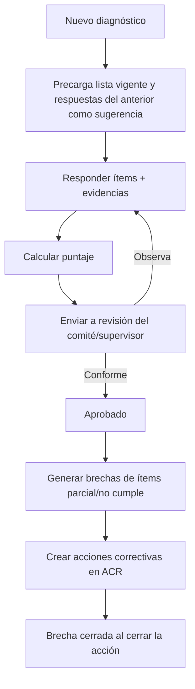

# M-LBA · 2.1 Diagnóstico de línea base

## 1. Encabezado

| Campo | Valor |
|---|---|
| Código | `LBA` |
| Número | 2.1 |
| Nombre | Diagnóstico de línea base |
| Grupo | 2. Planificación del sistema de gestión |
| Plan | E · Esencial |
| Fase | 1 · Plan Esencial |
| Origen | Ley |
| Resuelve | Brechas iniciales y su cierre |
| Tablas del catálogo | `baseline_assessments`, `baseline_items`, `baseline_gaps` |
| Dependencias | [TEN](M-TEN.md) (Empresas, sedes y áreas), [DOC](M-DOC.md) (Gestión documental), [ACR](M-ACR.md) (Acciones correctivas) |
| Prefijo de permisos | `lba.<tabla>.<acción>` |

## 2. Objetivo y problema que resuelve

**Objetivo.** Aplicar el diagnóstico de línea base del SG-SST con la lista de verificación de la R.M. 050-2013-TR (u otras configurables), calcular el nivel de cumplimiento por lineamiento y convertir cada incumplimiento en una brecha con plan de cierre.

**Problema que resuelve.** La mayoría de empresas pequeñas y medianas no sabe por dónde empezar; el diagnóstico inicial se hace en Excel, se archiva y nunca se vuelve a mirar. Sin línea base no hay forma objetiva de priorizar el Plan Anual ni de mostrar avance a gerencia o a SUNAFIL.

## 3. Base normativa

- Ley 29783, art. 37: el empleador realiza una evaluación inicial (línea base) como diagnóstico del estado de la SST.
- D.S. 005-2012-TR, art. 77: contenido de la evaluación inicial de riesgos y línea base; sus resultados se comparan con la legislación vigente y sirven para planificar.
- R.M. 050-2013-TR, Anexo 3: «Lista de verificación de lineamientos del SG-SST» (compromiso, política, planeamiento, implementación, evaluación, acción para la mejora continua).
- Periodicidad de reevaluación: parámetro `baseline_reassessment_months` (a confirmar por especialista SST).

> Todo valor legal citado (plazos, periodicidades, umbrales, factores) se implementa como parámetro con vigencia y queda «a confirmar por especialista SST/legal»; nunca como constante en código.

## 4. Roles y permisos

| Rol | Qué hace en el módulo | Permisos |
|---|---|---|
| Jefe SST / Responsable del SG-SST (`sst_manager`) | Crea el diagnóstico, responde ítems, adjunta evidencias, convierte brechas en acciones | `lba.baseline_assessments.create`, `lba.baseline_assessments.update`, `lba.baseline_items.update`, `lba.baseline_gaps.create`, `lba.baseline_gaps.update` |
| Consultor SST (`consultant`) | Ejecuta el diagnóstico para la empresa cliente | `lba.baseline_assessments.create`, `lba.baseline_items.update`, `lba.baseline_gaps.create` |
| Supervisor SST (`sst_supervisor`) | Responde ítems asignados | `lba.baseline_items.update` |
| Miembro del Comité SST (`committee_member`) | Revisa y da conformidad al diagnóstico | `lba.baseline_assessments.approve`, `lba.baseline_assessments.view` |
| Gerencia (`management`) | Consulta resultados y aprueba el plan de cierre | `lba.baseline_assessments.view`, `lba.baseline_gaps.view` |
| Auditor externo (`external_auditor`) | Consulta diagnósticos del periodo | `lba.baseline_assessments.view` |

Roles no listados no tienen acceso al módulo. Los permisos se acotan además por `membership_scopes` (sede/área) y por el plan contratado (feature flag del módulo).

## 5. Tablas

| Tabla | Base | Propósito | Campos clave |
|---|---|---|---|
| `baseline_assessments` | principal | Diagnóstico de una empresa (o sede) en una fecha | company_id, site_id (opcional), checklist_code (rm050_anexo3 u otra), checklist_version, assessed_on, assessor_user_id, status, score_total, score_by_section (jsonb), approved_by, approved_at, previous_assessment_id |
| `baseline_items` | principal | Respuesta por ítem de la lista | assessment_id, section_code, item_code, question, legal_reference, answer (cumple/parcial/no cumple/no aplica), score, evidence_file_ids, comment |
| `baseline_gaps` | principal | Brecha derivada de un ítem no cumplido | company_id, assessment_id, item_id, description, priority (alta/media/baja), responsible_worker_id, target_date, corrective_action_id, status, closed_at |

Todas las tablas de empresa llevan las columnas estándar (`id` UUID v7, `company_id`, `created_at`, `updated_at`, `created_by`, `updated_by`, `deleted_at`) salvo las inalterables, y quedan bajo RLS por `app.company_id`.

## 6. Pantallas

| ID | Pantalla | Propósito | Elementos principales |
|---|---|---|---|
| SCR-LBA-01 | Diagnósticos | Historial de líneas base | Lista con fecha, alcance, % de cumplimiento, estado; botón «Nuevo diagnóstico»; comparación entre dos diagnósticos |
| SCR-LBA-02 | Ejecutar diagnóstico | Responder la lista de verificación | Navegación por secciones; por ítem: pregunta, referencia legal, respuesta con 4 opciones grandes, comentario, adjuntar evidencia; avance por sección |
| SCR-LBA-03 | Resultado | Puntaje y gráfico | Radar por lineamiento; % global con semáforo; lista de ítems no cumplidos; botón «Generar brechas» |
| SCR-LBA-04 | Brechas | Seguimiento del plan de cierre | Tabla de brechas con prioridad, responsable, fecha meta, acción correctiva vinculada y estado |
| SCR-LBA-05 | Comparativo | Evolución | Dos diagnósticos lado a lado con diferencia por sección |

## 7. Flujos principales

## 8. Reglas de negocio

- **RN-LBA-01.** El puntaje de cada ítem se obtiene de la tabla de valores parametrizada de la lista (por defecto cumple = 1, parcial = 0,5, no cumple = 0; a confirmar); «no aplica» se excluye del denominador.
- **RN-LBA-02.** El porcentaje global es la suma de puntajes sobre los ítems aplicables; también se calcula por sección del Anexo 3.
- **RN-LBA-03.** Un ítem «no aplica» exige comentario justificando por qué.
- **RN-LBA-04.** Un ítem «cumple» exige al menos una evidencia adjunta o un enlace a un registro del sistema si `require_evidence_on_compliance` está activo.
- **RN-LBA-05.** Un diagnóstico aprobado es inmutable; para actualizar se crea un nuevo diagnóstico vinculado (`previous_assessment_id`).
- **RN-LBA-06.** Cada ítem «parcial» o «no cumple» genera como máximo una brecha; las brechas se generan una sola vez por diagnóstico aprobado.
- **RN-LBA-07.** Una brecha solo se cierra cuando su acción correctiva en [ACR](M-ACR.md) está verificada como eficaz.
- **RN-LBA-08.** La lista de verificación está versionada; un diagnóstico conserva la versión con la que se ejecutó aunque la lista cambie.

## 9. Estados y transiciones

| Entidad | Estados | Transiciones |
|---|---|---|
| baseline_assessments | draft → in_review → approved; in_review → draft | Devolución con observaciones |
| baseline_gaps | open → in_progress → closed; open → accepted_risk | `accepted_risk` requiere aprobación de gerencia con motivo |

## 10. Notificaciones y alertas

| Evento | Destinatario | Canal | Anticipación / momento (parámetro) |
|---|---|---|---|
| Diagnóstico enviado a revisión | Comité o Supervisor SST | App, correo | Inmediato |
| Brecha con fecha meta próxima | Responsable | App, WhatsApp | `gap_due_notice_days` antes |
| Reevaluación de línea base pendiente | Jefe SST | App, correo | `baseline_reassessment_notice_days` antes de cumplirse el periodo |

Los envíos se hacen mediante el módulo [NOT](M-NOT.md); cada regla es configurable por empresa y respeta las preferencias del usuario.

## 11. Reportes y exportaciones

- Informe de línea base (PDF) con resultados por lineamiento, brechas y plan de cierre; firmado por el responsable y el comité.
- Exportación Excel del Anexo 3 respondido (formato referencial R.M. 050-2013-TR).
- Aporte al expediente [SUN](M-SUN.md): evidencia de evaluación inicial y su seguimiento.

## 12. Integración con otros módulos

**Consume:**

- [DOC](M-DOC.md): evidencias.
- [TEN](M-TEN.md): empresa y sedes.

**Produce:**

- Brechas y acciones en [ACR](M-ACR.md); insumos para objetivos de [POL](M-POL.md) y actividades de [PLA](M-PLA.md)/[PAS](M-PAS.md); KPI «% cumplimiento línea base» en [DSH](M-DSH.md).

## 13. Criterios de aceptación clave

1. **Dado** un diagnóstico con 10 ítems: 6 cumple, 2 parcial, 1 no cumple y 1 no aplica, **cuando** se calcula el puntaje con valores por defecto, **entonces** el resultado es 7/9 = 77,8 %.
2. **Dado** un ítem marcado «no aplica» sin comentario, **cuando** se intenta guardar, **entonces** el sistema lo exige.
3. **Dado** un diagnóstico aprobado, **cuando** se pulsa «Generar brechas» dos veces, **entonces** solo existen las brechas de la primera generación.
4. **Dado** una brecha con acción correctiva cerrada pero no verificada, **cuando** se consulta, **entonces** la brecha sigue en «en curso».
5. **Dado** una lista de verificación actualizada a v2, **cuando** se abre un diagnóstico aprobado con v1, **entonces** se muestra con las preguntas de v1.

## 14. Fuera de alcance y preguntas abiertas

**Fuera de alcance:**

- Auditoría formal del sistema (se gestiona en [AUI](M-AUI.md)).

**Preguntas abiertas:**

- ¿Se incluirán listas sectoriales (minería, construcción) como alternativa al Anexo 3?
- ¿Valores de puntaje oficiales para «parcial»? A confirmar por especialista SST.
