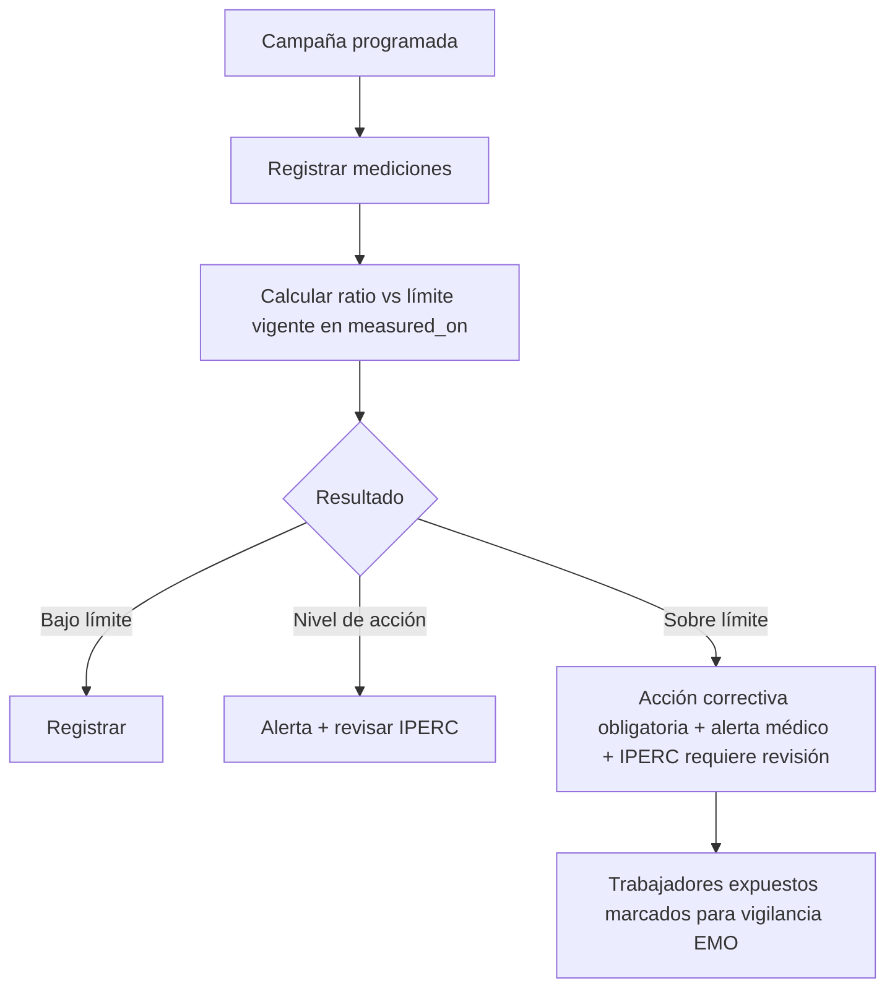

# M-MAG · 3.3 Monitoreo de agentes

## 1. Encabezado

| Campo | Valor |
|---|---|
| Código | `MAG` |
| Número | 3.3 |
| Nombre | Monitoreo de agentes |
| Grupo | 3. Gestión de riesgos |
| Plan | P · Profesional |
| Fase | 2 · Plan Profesional |
| Origen | Ley |
| Resuelve | Mediciones frente a límites permisibles |
| Tablas del catálogo | `agent_types`, `exposure_limits`, `monitoring_points`, `monitoring_campaigns`, `measurements` |
| Dependencias | [IPC](M-IPC.md) (Matriz IPERC), [TEN](M-TEN.md) (Empresas, sedes y áreas), [EMO](M-EMO.md) (EMOs y aptitud), [ACR](M-ACR.md) (Acciones correctivas) |
| Prefijo de permisos | `mag.<tabla>.<acción>` |

## 2. Objetivo y problema que resuelve

**Objetivo.** Programar y registrar el monitoreo de agentes físicos, químicos, biológicos, ergonómicos y psicosociales por punto de medición, comparando cada resultado con su límite permisible vigente, e identificando trabajadores expuestos.

**Problema que resuelve.** Los informes de monitoreo llegan en PDF del laboratorio y se archivan sin comparar con los límites ni actuar; no se sabe qué trabajadores estuvieron expuestos para la vigilancia médica. Es uno de los 9 registros obligatorios.

## 3. Base normativa

- D.S. 005-2012-TR, art. 33 literal c: registro del monitoreo de agentes físicos, químicos, biológicos, psicosociales y factores de riesgo disergonómicos.
- D.S. 015-2005-SA (valores límite permisibles para agentes químicos) y sus actualizaciones (a confirmar vigencia).
- R.M. 375-2008-TR (norma básica de ergonomía); normas de ruido, iluminación y estrés térmico aplicables (a confirmar).
- D.S. 024-2016-EM, Anexo 15 en minería (límites de exposición ocupacional) vía [PSE](M-PSE.md).
- Periodicidad de monitoreo: parámetro por agente (`monitoring_frequency_months`), a confirmar.

> Todo valor legal citado (plazos, periodicidades, umbrales, factores) se implementa como parámetro con vigencia y queda «a confirmar por especialista SST/legal»; nunca como constante en código.

## 4. Roles y permisos

| Rol | Qué hace en el módulo | Permisos |
|---|---|---|
| Jefe SST / Responsable del SG-SST (`sst_manager`) | Define puntos, programa campañas, registra mediciones y aprueba informes | `mag.monitoring_points.create`, `mag.monitoring_campaigns.create`, `mag.measurements.create`, `mag.measurements.approve` |
| Supervisor SST (`sst_supervisor`) | Registra mediciones de campo | `mag.measurements.create` |
| Médico ocupacional (`occupational_doctor`) | Consulta exposiciones para vigilancia médica | `mag.measurements.view` |
| Dueño de la plataforma (`platform_owner`) | Mantiene tipos de agentes y límites globales | `mag.agent_types.update`, `mag.exposure_limits.update` |
| Miembro del Comité SST (`committee_member`) | Consulta resultados | `mag.measurements.view` |
| Auditor externo (`external_auditor`) | Consulta campañas e informes | `mag.monitoring_campaigns.view` |

Roles no listados no tienen acceso al módulo. Los permisos se acotan además por `membership_scopes` (sede/área) y por el plan contratado (feature flag del módulo).

## 5. Tablas

| Tabla | Base | Propósito | Campos clave |
|---|---|---|---|
| `agent_types` | principal | Catálogo de agentes | company_id (nulo en global), category (físico, químico, biológico, ergonómico, psicosocial), code, name, unit, measurement_method |
| `exposure_limits` | principal | Límite permisible vigente | company_id (nulo en global), agent_type_id, limit_type (TWA, STEL, techo, dosis), value, unit, legal_source, effective_from, effective_to, to_confirm |
| `monitoring_points` | principal | Punto o grupo de exposición | company_id, site_id, area_id, code, description, agent_type_ids, position_ids, exposed_worker_count, latitude, longitude |
| `monitoring_campaigns` | principal | Campaña de monitoreo | company_id, year, provider_name, lab_accreditation, starts_on, ends_on, report_file_id, status |
| `measurements` | principal | Resultado por punto y agente | campaign_id, monitoring_point_id, agent_type_id, measured_on, value, unit, exposure_limit_id, ratio_to_limit, result (bajo límite, nivel de acción, sobre límite), exposed_worker_ids, instrument, calibration_cert_file_id |

Todas las tablas de empresa llevan las columnas estándar (`id` UUID v7, `company_id`, `created_at`, `updated_at`, `created_by`, `updated_by`, `deleted_at`) salvo las inalterables, y quedan bajo RLS por `app.company_id`.

## 6. Pantallas

| ID | Pantalla | Propósito | Elementos principales |
|---|---|---|---|
| SCR-MAG-01 | Puntos de monitoreo | Mapa y lista | Puntos por sede con agentes y último resultado (semáforo) |
| SCR-MAG-02 | Campañas | Programación anual | Calendario de campañas; proveedor; informe adjunto |
| SCR-MAG-03 | Registrar mediciones | Carga de resultados | Tabla por punto × agente; cálculo automático del cociente vs. límite; carga masiva desde Excel del laboratorio |
| SCR-MAG-04 | Límites permisibles | Consulta | Límites vigentes por agente con fuente legal y marca «a confirmar» |
| SCR-MAG-05 | Tendencia por punto | Evolución | Gráfico del agente en el tiempo con línea de límite y nivel de acción |

## 7. Flujos principales

## 8. Reglas de negocio

- **RN-MAG-01.** El límite aplicable es el vigente en la fecha de medición (`effective_from` ≤ `measured_on` < `effective_to`); los límites son datos con fuente legal, nunca constantes.
- **RN-MAG-02.** `ratio_to_limit` = valor / límite; «nivel de acción» cuando ratio ≥ `action_level_ratio` (parámetro, p. ej. 0,5 a confirmar) y «sobre límite» cuando ratio > 1.
- **RN-MAG-03.** Toda medición sobre límite genera una acción correctiva obligatoria y marca el IPERC del área como «requiere revisión».
- **RN-MAG-04.** Las unidades de la medición deben coincidir con las del límite o convertirse con una tabla de conversión registrada; si no hay conversión, se rechaza.
- **RN-MAG-05.** Una campaña no se cierra sin el informe del proveedor adjunto y todas las mediciones aprobadas.
- **RN-MAG-06.** Los trabajadores expuestos sobre límite se marcan para vigilancia en [EMO](M-EMO.md) (solo la marca de exposición, no datos médicos).
- **RN-MAG-07.** Cada punto con agente programado y sin medición en `monitoring_frequency_months` aparece como brecha.
- **RN-MAG-08.** Las mediciones aprobadas son inmutables; correcciones mediante nueva medición que anula la anterior con motivo.

## 9. Estados y transiciones

| Entidad | Estados | Transiciones |
|---|---|---|
| monitoring_campaigns | planned → in_progress → results_loaded → closed | |
| measurements | draft → approved → voided | |

## 10. Notificaciones y alertas

| Evento | Destinatario | Canal | Anticipación / momento (parámetro) |
|---|---|---|---|
| Medición sobre límite | Jefe SST, médico ocupacional, jefe del área | App, correo | Inmediato |
| Campaña programada próxima | Jefe SST | App, correo | `monitoring_notice_days` antes |
| Punto sin monitoreo en la periodicidad | Jefe SST | App | Al detectarlo |

Los envíos se hacen mediante el módulo [NOT](M-NOT.md); cada regla es configurable por empresa y respeta las preferencias del usuario.

## 11. Reportes y exportaciones

- Registro de monitoreo de agentes (formato referencial R.M. 050-2013-TR), uno de los 9 registros en [REG](M-REG.md).
- Resultados por punto y agente con tendencia.
- Aporte al expediente [SUN](M-SUN.md): monitoreo del periodo de los agentes del puesto.

## 12. Integración con otros módulos

**Consume:**

- [IPC](M-IPC.md): agentes por puesto; [TEN](M-TEN.md): sedes y puestos.

**Produce:**

- Exposiciones para [EMO](M-EMO.md) y [VMD](M-VMD.md); acciones en [ACR](M-ACR.md); revisión de [IPC](M-IPC.md).

## 13. Criterios de aceptación clave

1. **Dado** ruido medido 88 con límite vigente 85, **cuando** se registra, **entonces** resultado «sobre límite», se crea acción correctiva y el IPERC queda «requiere revisión».
2. **Dado** una medición en una fecha anterior al cambio de límite, **cuando** se evalúa, **entonces** se usa el límite vigente en esa fecha.
3. **Dado** una medición en ppm contra un límite en mg/m³ sin conversión registrada, **cuando** se guarda, **entonces** se rechaza.
4. **Dado** una campaña sin informe adjunto, **cuando** se intenta cerrar, **entonces** se bloquea.
5. **Dado** una medición sobre límite, **cuando** el médico ocupacional consulta, **entonces** ve la lista de trabajadores expuestos.

## 14. Fuera de alcance y preguntas abiertas

**Fuera de alcance:**

- Integración directa con equipos de medición.

**Preguntas abiertas:**

- ¿Qué tabla de límites se precarga y quién valida su vigencia?
