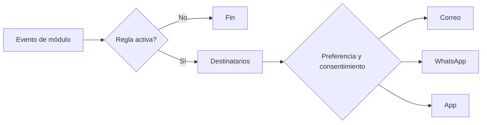

# M-NOT · 1.5 Alertas y notificaciones

## 1. Encabezado

| Campo | Valor |
|---|---|
| Código | `NOT` |
| Número | 1.5 |
| Nombre | Alertas y notificaciones |
| Grupo | 1. Núcleo de la plataforma |
| Plan | E · Esencial |
| Fase | 0 · Cimientos |
| Origen | Mercado |
| Resuelve | Vencimientos por correo, WhatsApp y app |
| Tablas del catálogo | `notification_rules`, `notifications`, `notification_deliveries`, `user_notification_prefs` |
| Dependencias | [USR](M-USR.md) (Usuarios, roles y permisos), [TRB](M-TRB.md) (Trabajadores y legajo) |
| Prefijo de permisos | `not.<tabla>.<acción>` |

## 2. Objetivo y problema que resuelve

**Objetivo.** Motor de reglas de alertas y vencimientos con entrega por correo (Elastic Email), WhatsApp (BSP por definir) y notificación en la app. Todos los módulos publican eventos y este módulo decide a quién, cuándo y por qué canal avisar.

**Problema que resuelve.** Los vencimientos (EMO, capacitaciones, extintores, SCTR) se controlan en Excel y se pasan; el responsable se entera cuando SUNAFIL ya los observa. Los trabajadores de campo no revisan el correo pero sí WhatsApp.

## 3. Base normativa

- Ley 29733 y D.S. 016-2024-JUS: los mensajes no deben incluir datos sensibles; consentimiento para el uso de WhatsApp como canal.
- D.S. 005-2012-TR, art. 82 y siguientes: plazos de notificación de accidentes (este módulo solo alerta; el plazo es parámetro de [ACC](M-ACC.md), a confirmar).
- Políticas de WhatsApp Business (plantillas aprobadas, ventana de conversación) del proveedor BSP.

> Todo valor legal citado (plazos, periodicidades, umbrales, factores) se implementa como parámetro con vigencia y queda «a confirmar por especialista SST/legal»; nunca como constante en código.

## 4. Roles y permisos

| Rol | Qué hace en el módulo | Permisos |
|---|---|---|
| Jefe SST / Responsable del SG-SST (`sst_manager`) | Configura reglas, anticipaciones y destinatarios de su empresa | `not.notification_rules.create`, `not.notification_rules.update`, `not.notifications.view` |
| Administrador de cuenta (`account_admin`) | Activa canales (WhatsApp) para la cuenta | `not.notification_rules.update` |
| Trabajador (`worker`) | Recibe notificaciones y ajusta sus preferencias de canal | `not.notifications.view`, `not.user_notification_prefs.update` |
| Jefe de área / línea (`area_lead`) | Recibe y consulta notificaciones de su ámbito | `not.notifications.view`, `not.user_notification_prefs.update` |
| Dueño de la plataforma (`platform_owner`) | Administra plantillas globales y estado de los proveedores | `not.notification_rules.view`, `not.notification_deliveries.view` |

Roles no listados no tienen acceso al módulo. Los permisos se acotan además por `membership_scopes` (sede/área) y por el plan contratado (feature flag del módulo).

## 5. Tablas

| Tabla | Base | Propósito | Campos clave |
|---|---|---|---|
| `notification_rules` | principal | Regla de alerta por evento | company_id (nulo en globales), event_code, module_code, recipients_spec (roles, responsable, trabajador afectado), channels, lead_days (lista), repeat_every_days, quiet_hours, template_code, is_active |
| `notifications` | principal | Notificación generada | company_id, rule_id, event_code, subject_type, subject_id, recipient_user_id, recipient_worker_id, title, body (sin datos sensibles), link, priority, read_at, due_at |
| `notification_deliveries` | principal | Intento de entrega por canal (inalterable) | notification_id, channel (email/whatsapp/in_app/push), provider, provider_message_id, status (queued/sent/delivered/failed/bounced), error, attempted_at |
| `user_notification_prefs` | principal | Preferencias del usuario | user_id, company_id, channel, event_category, enabled, digest_mode (inmediato/diario) |

Todas las tablas de empresa llevan las columnas estándar (`id` UUID v7, `company_id`, `created_at`, `updated_at`, `created_by`, `updated_by`, `deleted_at`) salvo las inalterables, y quedan bajo RLS por `app.company_id`.

## 6. Pantallas

| ID | Pantalla | Propósito | Elementos principales |
|---|---|---|---|
| SCR-NOT-01 | Reglas de alerta | Configurar por evento | Lista agrupada por módulo; anticipaciones (p. ej. «30, 15, 7 días» como parámetros editables); canales; destinatarios; plantilla |
| SCR-NOT-02 | Centro de notificaciones | Bandeja del usuario | Campana con contador; lista con filtros leídas/no leídas; acceso directo al registro |
| SCR-NOT-03 | Mis preferencias | Elegir canales | Interruptores por categoría y canal; modo resumen diario; número de WhatsApp verificado |
| SCR-NOT-04 | Estado de entregas | Diagnóstico de envíos | Tabla de entregas con estado del proveedor, rebotes y reintentos |
| SCR-NOT-05 | Notificaciones (app del trabajador) | Pendientes del trabajador | Tarjetas grandes con acción directa: firmar, ver capacitación, renovar |

## 7. Flujos principales

**Generación de alertas de vencimiento**
1. Un job diario recorre las fuentes de vencimiento registradas por cada módulo (`expires_at` de EMO, capacitaciones, SCTR, extintores, documentos, etc.).
2. Para cada regla activa evalúa si hoy coincide con algún `lead_days` o si ya está vencido y toca repetición.
3. Crea `notifications` deduplicadas por (regla, objeto, día).
4. Por cada canal habilitado y preferencia del usuario, encola entregas; respeta `quiet_hours`.
5. Registra cada intento en `notification_deliveries`; reintenta con retroceso exponencial hasta `max_retries`.

## 8. Reglas de negocio

- **RN-NOT-01.** Ningún cuerpo de notificación incluye diagnósticos, resultados médicos ni detalles clínicos; para EMO solo se dice «tienes un examen pendiente/por vencer».
- **RN-NOT-02.** No se generan dos notificaciones iguales para la misma regla, objeto y día (clave de deduplicación).
- **RN-NOT-03.** Las anticipaciones (`lead_days`) son parámetros por empresa con valores por defecto globales; ninguna se fija en código.
- **RN-NOT-04.** WhatsApp solo se usa si el trabajador tiene número verificado y consentimiento registrado; las plantillas deben estar aprobadas por el BSP.
- **RN-NOT-05.** Las notificaciones de prioridad crítica (accidente mortal o incidente peligroso) ignoran horas de silencio y el modo resumen.
- **RN-NOT-06.** `notification_deliveries` es inalterable; los cambios de estado del proveedor se registran como filas nuevas.
- **RN-NOT-07.** Si un correo rebota `max_bounces` veces, el canal correo del usuario se marca como inválido y se avisa al administrador.
- **RN-NOT-08.** Toda notificación incluye un enlace profundo al registro, que exige sesión y permiso; el enlace no expone datos por sí mismo.

## 9. Estados y transiciones

| Entidad | Estados | Transiciones |
|---|---|---|
| notifications | pending → sent → read; pending → cancelled | `cancelled` si el objeto se resolvió antes del envío |
| notification_deliveries | queued → sent → delivered / failed / bounced | Cada transición es una fila nueva |

## 10. Notificaciones y alertas

| Evento | Destinatario | Canal | Anticipación / momento (parámetro) |
|---|---|---|---|
| Fallo persistente de un proveedor | Dueño de la plataforma | Correo interno | Tras `provider_failure_threshold` fallos consecutivos |
| Resumen diario de pendientes | Jefe SST, Jefe de área | Correo | Hora configurada (`digest_hour`) |
| Correo inválido de un usuario | Administrador de cuenta | App | Al marcarse inválido |

Los envíos se hacen mediante el módulo [NOT](M-NOT.md); cada regla es configurable por empresa y respeta las preferencias del usuario.

## 11. Reportes y exportaciones

- Reporte de alertas emitidas vs. atendidas por módulo (efectividad de la gestión de vencimientos).
- Constancia de envío de comunicaciones (útil para probar difusión ante SUNAFIL).

## 12. Integración con otros módulos

**Consume:**

- Eventos y fechas de vencimiento publicados por todos los módulos.
- [USR](M-USR.md) y [TRB](M-TRB.md): destinatarios y datos de contacto.

**Produce:**

- Notificaciones en app, correos y WhatsApp; métricas de entrega para [DSH](M-DSH.md).

## 13. Criterios de aceptación clave

1. **Dado** una regla de EMO con anticipaciones 30 y 7, **cuando** un EMO vence en 30 días, **entonces** el trabajador y el personal de salud reciben una sola notificación ese día.
2. **Dado** una notificación de EMO por vencer, **cuando** se arma el cuerpo, **entonces** no contiene diagnóstico ni restricción médica.
3. **Dado** un trabajador sin consentimiento de WhatsApp, **cuando** se genera una alerta, **entonces** se envía solo por app y correo.
4. **Dado** un accidente mortal registrado a las 23:00, **cuando** dentro de horas de silencio, **entonces** la alerta al Jefe SST y gerencia se envía de inmediato.
5. **Dado** Elastic Email devuelve error temporal, **cuando** se reintenta, **entonces** se registran los intentos en `notification_deliveries` hasta `max_retries`.

## 14. Fuera de alcance y preguntas abiertas

**Fuera de alcance:**

- Notificaciones push nativas fuera de la PWA (dependen del navegador).
- Campañas de marketing a los clientes.

**Preguntas abiertas:**

- ¿Qué BSP de WhatsApp se contratará y cuál es su modelo de plantillas?
- ¿Se requiere SMS como canal de respaldo?
