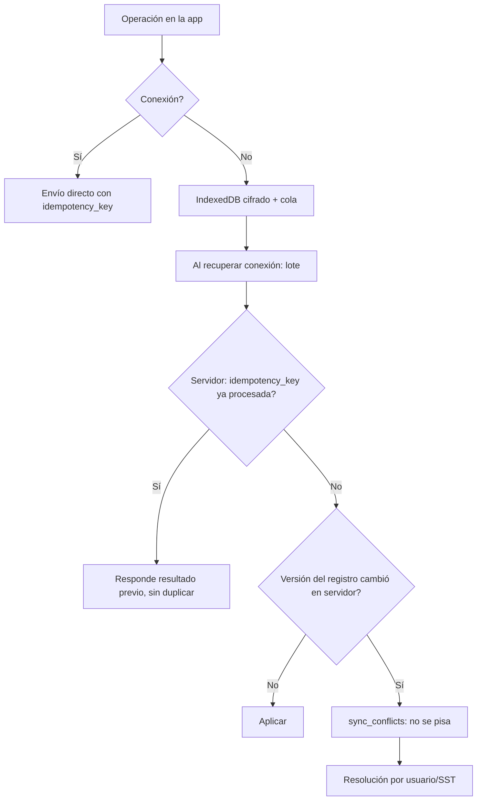

# M-OFF · 8.2 App móvil offline

## 1. Encabezado

| Campo | Valor |
|---|---|
| Código | `OFF` |
| Número | 8.2 |
| Nombre | App móvil offline |
| Grupo | 8. Diferenciadores e integraciones |
| Plan | + · Complemento |
| Fase | 3 · Diferenciadores (cierra la versión 1) |
| Origen | Diferenciador |
| Resuelve | Registro sin señal y sincronización |
| Tablas del catálogo | `devices`, `sync_batches`, `sync_conflicts` |
| Dependencias | [USR](M-USR.md) (Usuarios, roles y permisos), [FIR](M-FIR.md) (Firma electrónica de registros) |
| Prefijo de permisos | `off.<tabla>.<acción>` |

## 2. Objetivo y problema que resuelve

**Objetivo.** Permitir que la PWA registre inspecciones, charlas, ATS, entregas de EPP, reportes, asistencias y verificaciones sin señal, guardando datos y fotos en IndexedDB con cola de sincronización idempotente y resolución explícita de conflictos.

**Problema que resuelve.** Plantas, obras y minas tienen zonas sin cobertura; los supervisores terminan llenando papel y transcribiendo. Sin modo offline la app no se usa en campo.

## 3. Base normativa

- Ley 29733: los datos almacenados en el dispositivo deben protegerse (cifrado local, borrado remoto).
- D.S. 005-2012-TR, art. 33: los registros deben reflejar la fecha real del hecho (se conserva la hora de captura).

> Todo valor legal citado (plazos, periodicidades, umbrales, factores) se implementa como parámetro con vigencia y queda «a confirmar por especialista SST/legal»; nunca como constante en código.

## 4. Roles y permisos

| Rol | Qué hace en el módulo | Permisos |
|---|---|---|
| Supervisor SST (`sst_supervisor`) | Usa la app offline y resuelve conflictos propios | `off.devices.create`, `off.sync_batches.create`, `off.sync_conflicts.update` |
| Jefe de área / línea (`area_lead`) | Usa la app offline | `off.devices.create`, `off.sync_batches.create` |
| Trabajador (`worker`) | Firma y reporta offline cuando la empresa lo habilita | `off.sync_batches.create` |
| Jefe SST / Responsable del SG-SST (`sst_manager`) | Ve dispositivos, revoca, resuelve conflictos | `off.devices.update`, `off.sync_conflicts.update`, `off.sync_batches.view` |

Roles no listados no tienen acceso al módulo. Los permisos se acotan además por `membership_scopes` (sede/área) y por el plan contratado (feature flag del módulo).

## 5. Tablas

| Tabla | Base | Propósito | Campos clave |
|---|---|---|---|
| `devices` | principal | Dispositivo registrado | company_id, user_id, device_label, platform, app_version, registered_at, last_sync_at, status (activo, revocado), wipe_requested_at, local_key_version |
| `sync_batches` | principal | Lote sincronizado | device_id, company_id, received_at, operations_count, accepted_count, rejected_count, conflict_count, status, payload_hash |
| `sync_conflicts` | principal | Conflicto detectado | company_id, batch_id, entity_type, entity_id, idempotency_key, client_version, server_version, client_payload (jsonb), server_payload (jsonb), resolution (servidor gana, cliente gana, fusión manual), resolved_by, resolved_at |

Todas las tablas de empresa llevan las columnas estándar (`id` UUID v7, `company_id`, `created_at`, `updated_at`, `created_by`, `updated_by`, `deleted_at`) salvo las inalterables, y quedan bajo RLS por `app.company_id`.

## 6. Pantallas

| ID | Pantalla | Propósito | Elementos principales |
|---|---|---|---|
| SCR-OFF-01 | Estado de sincronización (app) | Indicador permanente | Ícono con pendientes; última sincronización; botón «Sincronizar ahora» |
| SCR-OFF-02 | Paquete offline | Preparación | Descarga de datos de referencia: trabajadores del ámbito, plantillas, IPERC del área, EPP, fotochecks (estados); tamaño estimado |
| SCR-OFF-03 | Cola local | Detalle | Operaciones pendientes con estado; reintento |
| SCR-OFF-04 | Conflictos | Resolución | Comparación lado a lado; elegir versión o fusionar |
| SCR-OFF-05 | Dispositivos | Administración | Dispositivos por usuario; revocar; solicitar borrado remoto |

## 7. Flujos principales

## 8. Reglas de negocio

- **RN-OFF-01.** Toda operación sincronizable lleva `idempotency_key` (UUID v7 generado en el dispositivo); el servidor garantiza que una misma clave se aplica una sola vez y devuelve el mismo resultado.
- **RN-OFF-02.** Las creaciones offline nunca entran en conflicto; las actualizaciones con versión distinta en el servidor generan `sync_conflicts` y no se aplican automáticamente, salvo reglas de fusión declaradas por entidad (p. ej. agregar asistentes).
- **RN-OFF-03.** Se conservan `captured_at` (hora del dispositivo) y `received_at` (hora del servidor); si la diferencia del reloj del dispositivo excede `clock_skew_tolerance`, se marca la operación para revisión.
- **RN-OFF-04.** Los datos locales se cifran con una llave derivada de la sesión; al revocar el dispositivo o cerrar sesión se borran en la siguiente conexión (borrado remoto).
- **RN-OFF-05.** El paquete offline nunca incluye datos médicos; para aptitud solo el estado del fotocheck.
- **RN-OFF-06.** Las fotos se comprimen según `offline_photo_max_kb` y se suben en segundo plano con reanudación.
- **RN-OFF-07.** Un dispositivo sin sincronizar en `offline_max_days` muestra advertencia y bloquea nuevas capturas hasta sincronizar.
- **RN-OFF-08.** Las validaciones de negocio se ejecutan de nuevo en el servidor; una operación rechazada se devuelve con motivo y queda visible en la cola.
- **RN-OFF-09.** Las firmas offline se aceptan según las reglas de [FIR](M-FIR.md) (`offline_signature_max_age`).

## 9. Estados y transiciones

| Entidad | Estados | Transiciones |
|---|---|---|
| sync_batches | received → processing → completed / completed_with_conflicts / failed | |
| sync_conflicts | open → resolved | |
| devices | active → revoked → wiped | |

## 10. Notificaciones y alertas

| Evento | Destinatario | Canal | Anticipación / momento (parámetro) |
|---|---|---|---|
| Conflicto de sincronización | Usuario del dispositivo, Jefe SST | App | Al detectarlo |
| Dispositivo sin sincronizar | Usuario | App (local) | Tras `offline_warning_days` |

Los envíos se hacen mediante el módulo [NOT](M-NOT.md); cada regla es configurable por empresa y respeta las preferencias del usuario.

## 11. Reportes y exportaciones

- Sincronizaciones por dispositivo; conflictos por tipo; operaciones rechazadas.

## 12. Integración con otros módulos

**Consume:**

- [USR](M-USR.md) (sesión), [FIR](M-FIR.md), módulos con registros sincronizables ([INS](M-INS.md), [CH5](M-CH5.md), [ATS](M-ATS.md), [EPP](M-EPP.md), [ACT](M-ACT.md), [CAP](M-CAP.md), [ACC](M-ACC.md)).

**Produce:**

- Registros sincronizados en esos módulos.

## 13. Criterios de aceptación clave

1. **Dado** una inspección offline enviada dos veces por reintento, **cuando** se procesa, **entonces** existe una sola inspección.
2. **Dado** una acción editada offline y en el servidor, **cuando** se sincroniza, **entonces** se crea un conflicto y ninguna versión se pisa.
3. **Dado** un dispositivo revocado, **cuando** se conecta, **entonces** sus datos locales se borran.
4. **Dado** el paquete offline, **cuando** se inspecciona, **entonces** no contiene datos médicos.
5. **Dado** un reloj del dispositivo adelantado más de la tolerancia, **cuando** se sincroniza, **entonces** la operación queda marcada para revisión.

## 14. Fuera de alcance y preguntas abiertas

**Fuera de alcance:**

- Apps nativas de tiendas (se usa PWA).

**Preguntas abiertas:**

- ¿Límite de almacenamiento local aceptable en dispositivos de gama baja?
