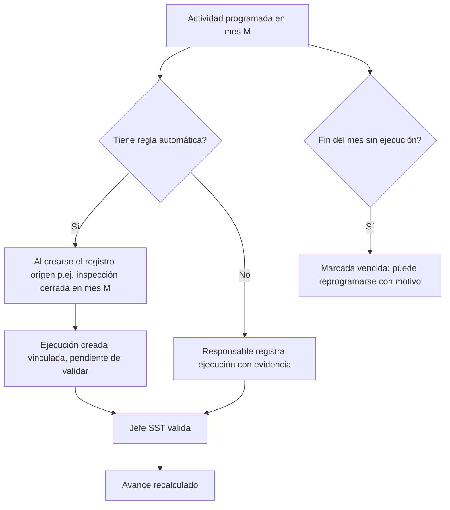

# M-PAS · 2.5 Programa Anual SST (PASST)

## 1. Encabezado

| Campo | Valor |
|---|---|
| Código | `PAS` |
| Número | 2.5 |
| Nombre | Programa Anual SST (PASST) |
| Grupo | 2. Planificación del sistema de gestión |
| Plan | E · Esencial |
| Fase | 1 · Plan Esencial |
| Origen | Ley |
| Resuelve | Actividades, responsables y % de avance |
| Tablas del catálogo | `annual_programs`, `program_activities`, `activity_executions` |
| Dependencias | [PLA](M-PLA.md) (Plan Anual SST), [TEN](M-TEN.md) (Empresas, sedes y áreas), [COM](M-COM.md) (Comité o Supervisor SST), [ACR](M-ACR.md) (Acciones correctivas) |
| Prefijo de permisos | `pas.<tabla>.<acción>` |

## 2. Objetivo y problema que resuelve

**Objetivo.** Gestionar el Programa Anual de SST (PASST): actividades con responsable, cronograma mensual, recursos e indicador, ejecución con evidencias y % de avance real frente a lo programado.

**Problema que resuelve.** El PASST se arma en Excel con cronograma tipo Gantt y nadie actualiza el avance; al final del año no se puede probar qué se ejecutó. SUNAFIL revisa el programa aprobado y su nivel de ejecución.

## 3. Base normativa

- Ley 29783, art. 38 y D.S. 005-2012-TR, art. 32 y 79–80: Programa Anual SST como documento obligatorio con actividades, responsables, cronograma y recursos.
- D.S. 005-2012-TR, art. 42, literal c: aprobación por el Comité SST.
- R.M. 050-2013-TR: formato referencial del Programa Anual.

> Todo valor legal citado (plazos, periodicidades, umbrales, factores) se implementa como parámetro con vigencia y queda «a confirmar por especialista SST/legal»; nunca como constante en código.

## 4. Roles y permisos

| Rol | Qué hace en el módulo | Permisos |
|---|---|---|
| Jefe SST / Responsable del SG-SST (`sst_manager`) | Formula el programa y sus actividades; registra o valida ejecuciones | `pas.annual_programs.create`, `pas.annual_programs.update`, `pas.program_activities.create`, `pas.program_activities.update`, `pas.activity_executions.approve` |
| Jefe de área / línea (`area_lead`) | Registra ejecución de actividades a su cargo con evidencia | `pas.activity_executions.create`, `pas.program_activities.view` |
| Supervisor SST (`sst_supervisor`) | Registra ejecuciones y aprueba programa sin comité | `pas.activity_executions.create`, `pas.annual_programs.approve` |
| Miembro del Comité SST (`committee_member`) | Aprueba el programa y revisa su avance | `pas.annual_programs.approve`, `pas.annual_programs.view` |
| Gerencia (`management`) | Consulta avance | `pas.annual_programs.view` |
| Consultor SST (`consultant`) | Formula y da seguimiento en la empresa cliente | `pas.annual_programs.update`, `pas.program_activities.update` |

Roles no listados no tienen acceso al módulo. Los permisos se acotan además por `membership_scopes` (sede/área) y por el plan contratado (feature flag del módulo).

## 5. Tablas

| Tabla | Base | Propósito | Campos clave |
|---|---|---|---|
| `annual_programs` | principal | Programa del año | company_id, year, version, objective_ids, status, approved_at, committee_meeting_id, document_version_id |
| `program_activities` | principal | Actividad programada | program_id, code, description, objective_id, responsible_worker_id, site_id, planned_months (array de meses 1–12), frequency, resources_description, indicator, source_module (INS, CAP, SIM, EMO, MAG…), auto_execution_rule, status |
| `activity_executions` | principal | Ejecución de una actividad en un mes | activity_id, planned_month, executed_on, status (ejecutada/parcial/no ejecutada/reprogramada), evidence_file_ids, linked_record_type, linked_record_id, comment, validated_by |

Todas las tablas de empresa llevan las columnas estándar (`id` UUID v7, `company_id`, `created_at`, `updated_at`, `created_by`, `updated_by`, `deleted_at`) salvo las inalterables, y quedan bajo RLS por `app.company_id`.

## 6. Pantallas

| ID | Pantalla | Propósito | Elementos principales |
|---|---|---|---|
| SCR-PAS-01 | Programa anual | Cronograma | Tabla actividad × meses con celdas de color (programado, ejecutado, vencido, reprogramado); % de avance global y por objetivo |
| SCR-PAS-02 | Editar actividad | Detalle | Objetivo, responsable, meses, recursos, indicador, módulo origen y regla de ejecución automática |
| SCR-PAS-03 | Registrar ejecución | Evidencia | Fecha, estado, evidencia o vínculo a registro del sistema, comentario |
| SCR-PAS-04 | Mis actividades (móvil del jefe de área) | Pendientes del mes | Lista de actividades del mes con botón «Registrar» |
| SCR-PAS-05 | Avance del programa | Indicadores | % programado vs. ejecutado por mes, por responsable, por objetivo |

## 7. Flujos principales

## 8. Reglas de negocio

- **RN-PAS-01.** El % de avance = actividades-mes ejecutadas (validadas) / actividades-mes programadas hasta la fecha de corte; «parcial» cuenta con el factor parametrizado `partial_execution_weight`.
- **RN-PAS-02.** Una actividad-mes no ejecutada al cerrar el mes pasa a «vencida»; reprogramarla exige motivo y nuevo mes dentro del mismo año, conservando la marca original.
- **RN-PAS-03.** El programa aprobado es inmutable en su estructura; agregar o quitar actividades requiere una nueva versión aprobada por el comité/supervisor.
- **RN-PAS-04.** Toda ejecución debe tener evidencia (archivo) o un registro vinculado de la misma empresa.
- **RN-PAS-05.** Las actividades con `source_module` y `auto_execution_rule` se marcan ejecutadas al crearse el registro origen en el mes programado, quedando pendientes de validación.
- **RN-PAS-06.** Cada actividad está vinculada a un objetivo SST vigente.
- **RN-PAS-07.** La aprobación del programa exige acuerdo de sesión del comité (empresa con comité) o firma del supervisor.
- **RN-PAS-08.** Solo el responsable de la actividad o el Jefe SST registran ejecuciones.

## 9. Estados y transiciones

| Entidad | Estados | Transiciones |
|---|---|---|
| annual_programs | draft → submitted → approved → closed | Nueva versión vuelve a draft |
| activity_executions (por mes) | planned → executed / partial / overdue → rescheduled | `overdue` automático al cerrar el mes |

## 10. Notificaciones y alertas

| Evento | Destinatario | Canal | Anticipación / momento (parámetro) |
|---|---|---|---|
| Actividad del mes por iniciar | Responsable | App, WhatsApp | `activity_notice_days` antes del inicio del mes |
| Actividad vencida | Responsable, Jefe SST | App, correo | Al cerrar el mes |
| Avance mensual del programa | Comité, gerencia | Correo | Día parametrizado del mes siguiente |

Los envíos se hacen mediante el módulo [NOT](M-NOT.md); cada regla es configurable por empresa y respeta las preferencias del usuario.

## 11. Reportes y exportaciones

- Programa Anual SST en PDF (formato referencial R.M. 050-2013-TR) con cronograma.
- Informe de avance mensual y anual (ejecutado vs. programado) para el comité y la revisión por la dirección.
- Aporte al expediente [SUN](M-SUN.md): programa aprobado y evidencias de ejecución.

## 12. Integración con otros módulos

**Consume:**

- [POL](M-POL.md): objetivos; registros de [INS](M-INS.md), [CAP](M-CAP.md), [SIM](M-SIM.md), [EMO](M-EMO.md), [MAG](M-MAG.md) para ejecución automática.

**Produce:**

- KPI «% avance PASST» en [DSH](M-DSH.md); programa vinculado en [PLA](M-PLA.md); acciones por actividades vencidas en [ACR](M-ACR.md) si se configura.

## 13. Criterios de aceptación clave

1. **Dado** 20 actividades-mes programadas hasta octubre y 15 ejecutadas validadas, **cuando** se calcula el avance, **entonces** el resultado es 75 %.
2. **Dado** una actividad «Inspección mensual de almacén» con regla automática, **cuando** se cierra una inspección del almacén en ese mes, **entonces** se crea la ejecución vinculada pendiente de validar.
3. **Dado** una actividad sin ejecución al cerrar el mes, **cuando** corre el cierre, **entonces** queda «vencida» y se notifica al responsable.
4. **Dado** un programa aprobado, **cuando** el Jefe SST intenta eliminar una actividad, **entonces** debe crear una nueva versión.
5. **Dado** una ejecución sin evidencia ni registro vinculado, **cuando** se guarda, **entonces** el sistema lo rechaza.

## 14. Fuera de alcance y preguntas abiertas

**Fuera de alcance:**

- Cronogramas por día u hora (granularidad mensual).

**Preguntas abiertas:**

- ¿Se requiere granularidad semanal para algunos sectores?
