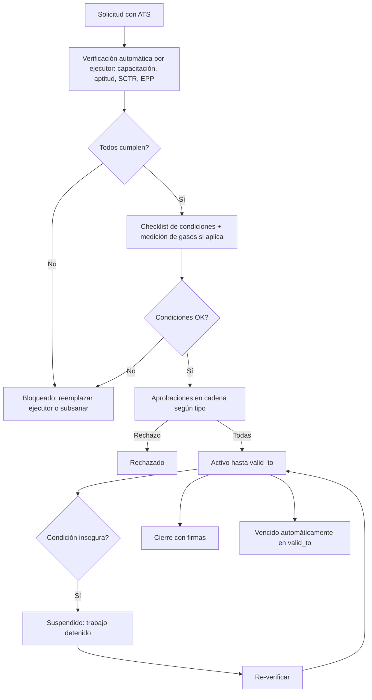

# M-PTR · 4.5 PETAR y permisos de alto riesgo

## 1. Encabezado

| Campo | Valor |
|---|---|
| Código | `PTR` |
| Número | 4.5 |
| Nombre | PETAR y permisos de alto riesgo |
| Grupo | 4. Operación en campo |
| Plan | C · Corporativo |
| Fase | 4 · Plan Corporativo |
| Origen | Mercado (campo) |
| Resuelve | Altura, caliente, espacio confinado, eléctrico |
| Tablas del catálogo | `permit_types`, `work_permits`, `permit_checks`, `permit_approvals` |
| Dependencias | [IPC](M-IPC.md) (Matriz IPERC), [TRB](M-TRB.md) (Trabajadores y legajo), [CAP](M-CAP.md) (Capacitaciones e inducciones), [EMO](M-EMO.md) (EMOs y aptitud), [EPP](M-EPP.md) (EPP), [FIR](M-FIR.md) (Firma electrónica de registros), [ATS](M-ATS.md) (ATS) |
| Prefijo de permisos | `ptr.<tabla>.<acción>` |

## 2. Objetivo y problema que resuelve

**Objetivo.** Emitir y controlar permisos escritos para trabajos de alto riesgo (PETAR): altura, caliente, espacio confinado, eléctrico, izaje, excavación, con requisitos previos verificados, aprobaciones en cadena, suspensión y cierre.

**Problema que resuelve.** Los PETAR en papel se firman sin verificar que el ejecutor está capacitado, apto y con EPP; un permiso suspendido sigue en uso. Los accidentes graves ocurren en estos trabajos.

## 3. Base normativa

- D.S. 005-2012-TR, art. 77 y Ley 29783, art. 21: controles para actividades de alto riesgo.
- D.S. 024-2016-EM, art. 129 y Anexo 18 (PETAR en minería) vía [PSE](M-PSE.md).
- Norma G.050 (construcción) para trabajos en altura y caliente; R.M. 111-2013-MEM/DM (RESESATE) para trabajos eléctricos (aplicabilidad a confirmar).

> Todo valor legal citado (plazos, periodicidades, umbrales, factores) se implementa como parámetro con vigencia y queda «a confirmar por especialista SST/legal»; nunca como constante en código.

## 4. Roles y permisos

| Rol | Qué hace en el módulo | Permisos |
|---|---|---|
| Jefe de área / línea (`area_lead`) | Solicita el permiso, verifica requisitos y firma como supervisor de la tarea | `ptr.work_permits.create`, `ptr.permit_checks.create`, `ptr.permit_approvals.create` |
| Supervisor SST (`sst_supervisor`) | Verifica condiciones y aprueba como SST | `ptr.permit_checks.create`, `ptr.permit_approvals.create`, `ptr.work_permits.suspend` |
| Jefe SST / Responsable del SG-SST (`sst_manager`) | Configura tipos y cadena de aprobación; aprueba | `ptr.permit_types.create`, `ptr.permit_types.update`, `ptr.permit_approvals.create` |
| Gerencia (`management`) | Aprueba permisos que lo requieran (p. ej. espacio confinado) | `ptr.permit_approvals.create` |
| Trabajador (`worker`) | Firma como ejecutor o vigía; puede pedir suspensión | `ptr.work_permits.view`, `ptr.work_permits.suspend` |

Roles no listados no tienen acceso al módulo. Los permisos se acotan además por `membership_scopes` (sede/área) y por el plan contratado (feature flag del módulo).

## 5. Tablas

| Tabla | Base | Propósito | Campos clave |
|---|---|---|---|
| `permit_types` | principal | Tipo de permiso | company_id, code (altura, caliente, confinado, eléctrico, izaje, excavación), name, checklist (jsonb), required_trainings, required_ppe, requires_fitness, requires_sctr, requires_gas_test, approval_chain (jsonb: roles en orden), max_validity_hours |
| `work_permits` | principal | Permiso emitido | company_id, permit_type_id, code, site_id, area_id, location_text, task_description, ats_form_id, valid_from, valid_to, executors (jsonb worker_ids), watcher_worker_id, status, suspended_reason, closed_at, closure_notes |
| `permit_checks` | principal | Verificación de requisitos | work_permit_id, check_type (capacitación, aptitud, SCTR, EPP, checklist de condiciones, medición de gases), worker_id, result (cumple/no cumple), value, checked_by, checked_at, evidence_file_id |
| `permit_approvals` | principal | Aprobación en cadena | work_permit_id, step_order, approver_role, approver_user_id, decision (aprobado/rechazado), signature_id, decided_at, comment |

Todas las tablas de empresa llevan las columnas estándar (`id` UUID v7, `company_id`, `created_at`, `updated_at`, `created_by`, `updated_by`, `deleted_at`) salvo las inalterables, y quedan bajo RLS por `app.company_id`.

## 6. Pantallas

| ID | Pantalla | Propósito | Elementos principales |
|---|---|---|---|
| SCR-PTR-01 | Permisos activos | Tablero | Permisos por estado y tipo con hora de vencimiento; mapa por sede |
| SCR-PTR-02 | Solicitar PETAR | Asistente | Tipo; ubicación; tarea; vínculo al ATS; ejecutores y vigía; vigencia |
| SCR-PTR-03 | Verificación de requisitos | Checklist automático y manual | Por ejecutor: capacitación vigente, aptitud EMO (solo estado), SCTR vigente, EPP entregado; checklist de condiciones; medición de gases (O₂, LEL, CO, H₂S) con rangos |
| SCR-PTR-04 | Aprobaciones | Cadena | Pasos con rol, aprobador, firma y hora |
| SCR-PTR-05 | PETAR en campo (móvil) | Ver y suspender | Estado grande con color; QR del permiso; botón «Suspender» con motivo |
| SCR-PTR-06 | Cierre | Fin del trabajo | Área dejada en orden, observaciones, firmas |

## 7. Flujos principales

## 8. Reglas de negocio

- **RN-PTR-01.** Un PETAR no puede aprobarse si algún ejecutor no tiene las capacitaciones requeridas por el tipo vigentes, aptitud médica «apto» o «apto con restricciones» compatible vigente, SCTR vigente (si se exige) y el EPP requerido entregado y no vencido.
- **RN-PTR-02.** La verificación de aptitud consulta solo `fitness_status` (estado y vigencia), nunca datos médicos.
- **RN-PTR-03.** Para espacio confinado, la medición de gases debe estar dentro de los rangos parametrizados del tipo (O₂, LEL, CO, H₂S; a confirmar) y registrarse antes de aprobar.
- **RN-PTR-04.** Las aprobaciones siguen el orden de `approval_chain`; un aprobador no puede aprobar dos pasos ni ser ejecutor del mismo permiso.
- **RN-PTR-05.** La vigencia no puede exceder `max_validity_hours` del tipo; al llegar `valid_to` el permiso pasa a «vencido» y debe cerrarse o renovarse con nueva verificación.
- **RN-PTR-06.** Cualquier participante (incluido el ejecutor o vigía) puede suspender el permiso por condición insegura; la reactivación exige nueva verificación de condiciones y firma del supervisor SST.
- **RN-PTR-07.** Un permiso activo exige un ATS vinculado y firmado.
- **RN-PTR-08.** El cierre requiere firma del solicitante y del supervisor SST; un permiso cerrado es inmutable.
- **RN-PTR-09.** Un trabajador no puede figurar como ejecutor en dos permisos activos simultáneos que se solapen en horario.

## 9. Estados y transiciones

| Entidad | Estados | Transiciones |
|---|---|---|
| work_permits | requested → checks_passed → pending_approval → active → closed; active ↔ suspended; active → expired; pending_approval → rejected; requested → blocked | |

## 10. Notificaciones y alertas

| Evento | Destinatario | Canal | Anticipación / momento (parámetro) |
|---|---|---|---|
| Aprobación pendiente | Siguiente aprobador | App, WhatsApp | Inmediato |
| Permiso suspendido | Solicitante, supervisor SST, Jefe SST | App, WhatsApp | Inmediato |
| Permiso próximo a vencer | Solicitante | App | `permit_expiry_notice_minutes` antes |
| Permiso vencido sin cierre | Solicitante, supervisor SST | App | Al vencer |

Los envíos se hacen mediante el módulo [NOT](M-NOT.md); cada regla es configurable por empresa y respeta las preferencias del usuario.

## 11. Reportes y exportaciones

- PETAR en PDF con verificaciones, aprobaciones y cierre; estadísticas por tipo, suspensiones y causas.
- Aporte al expediente [SUN](M-SUN.md): permisos del periodo en los que participó el trabajador.

## 12. Integración con otros módulos

**Consume:**

- [CAP](M-CAP.md), [EMO](M-EMO.md) (`fitness_status`), [SCT](M-SCT.md), [EPP](M-EPP.md), [ATS](M-ATS.md), [IPC](M-IPC.md), [FIR](M-FIR.md).

**Produce:**

- Evidencia de control de trabajos de alto riesgo; suspensiones como reportes de condición en [ACT](M-ACT.md) o eventos en [ACC](M-ACC.md).

## 13. Criterios de aceptación clave

1. **Dado** un ejecutor con la capacitación de trabajo en altura vencida, **cuando** se verifica el permiso, **entonces** queda bloqueado indicando el requisito.
2. **Dado** un ejecutor con aptitud «no apto», **cuando** se verifica, **entonces** se bloquea y la pantalla solo muestra «Aptitud no vigente» sin diagnóstico.
3. **Dado** una medición de O₂ fuera de rango en espacio confinado, **cuando** se registra, **entonces** no se puede pasar a aprobación.
4. **Dado** un permiso activo, **cuando** el vigía pulsa «Suspender» con motivo, **entonces** el permiso queda suspendido y se notifica al instante.
5. **Dado** un permiso que alcanza `valid_to`, **cuando** corre el job, **entonces** pasa a vencido.
6. **Dado** un aprobador que es ejecutor del mismo permiso, **cuando** intenta aprobar, **entonces** se rechaza.

## 14. Fuera de alcance y preguntas abiertas

**Fuera de alcance:**

- Bloqueo y etiquetado (LOTO) detallado por punto de energía (posible extensión).

**Preguntas abiertas:**

- ¿Qué cadenas de aprobación por defecto se configuran por tipo?
- ¿Los rangos de gases se toman de D.S. 024-2016-EM para todos los sectores?
