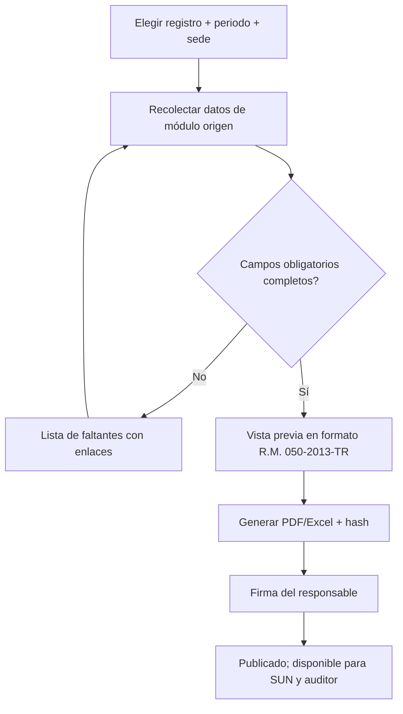

# M-REG · 6.7 Registros obligatorios

## 1. Encabezado

| Campo | Valor |
|---|---|
| Código | `REG` |
| Número | 6.7 |
| Nombre | Registros obligatorios |
| Grupo | 6. Eventos y mejora continua |
| Plan | E · Esencial |
| Fase | 1 · Plan Esencial |
| Origen | Ley |
| Resuelve | Los 9 registros en formato R.M. 050-2013-TR |
| Tablas del catálogo | `register_exports` |
| Dependencias | [ACC](M-ACC.md) (Accidentes, incidentes y enfermedades), [EMO](M-EMO.md) (EMOs y aptitud), [MAG](M-MAG.md) (Monitoreo de agentes), [INS](M-INS.md) (Inspecciones), [EST](M-EST.md) (Estadísticas SST), [EQE](M-EQE.md) (Equipos de emergencia y botiquines), [CAP](M-CAP.md) (Capacitaciones e inducciones), [SIM](M-SIM.md) (Simulacros y brigadas), [AUI](M-AUI.md) (Auditorías), [FIR](M-FIR.md) (Firma electrónica de registros) |
| Prefijo de permisos | `reg.<tabla>.<acción>` |

## 2. Objetivo y problema que resuelve

**Objetivo.** Generar los 9 registros obligatorios del SG-SST en los formatos referenciales de la R.M. 050-2013-TR a partir de los datos de los módulos, por periodo y sede, con firma del responsable y control de versiones de cada exportación.

**Problema que resuelve.** Las empresas mantienen los registros en Excel separados del trabajo real; ante SUNAFIL los registros están incompletos o no cuadran con la realidad. Generarlos desde los datos garantiza coherencia.

## 3. Base normativa

- D.S. 005-2012-TR, art. 33: registros obligatorios (a: accidentes, enfermedades ocupacionales, incidentes peligrosos y otros incidentes; b: exámenes médicos ocupacionales; c: monitoreo de agentes; d: inspecciones internas; e: estadísticas; f: equipos de seguridad o emergencia; g: inducción, capacitación, entrenamiento y simulacros; h: auditorías).
- R.M. 050-2013-TR: formatos referenciales de los registros y contenido mínimo.
- D.S. 005-2012-TR, art. 35: periodos de conservación (parámetro por registro, a confirmar).
- Ley 29783, art. 28: los registros pueden llevarse en medios electrónicos.

> Todo valor legal citado (plazos, periodicidades, umbrales, factores) se implementa como parámetro con vigencia y queda «a confirmar por especialista SST/legal»; nunca como constante en código.

## 4. Roles y permisos

| Rol | Qué hace en el módulo | Permisos |
|---|---|---|
| Jefe SST / Responsable del SG-SST (`sst_manager`) | Genera, firma y publica registros | `reg.register_exports.create`, `reg.register_exports.approve` |
| Supervisor SST (`sst_supervisor`) | Genera registros de su sede | `reg.register_exports.create` |
| Miembro del Comité SST (`committee_member`) | Consulta y firma cuando el formato lo requiere | `reg.register_exports.view` |
| Médico ocupacional (`occupational_doctor`) | Genera la versión completa del registro de EMO | `reg.register_exports.create` |
| Auditor externo (`external_auditor`) | Consulta registros del periodo | `reg.register_exports.view` |

Roles no listados no tienen acceso al módulo. Los permisos se acotan además por `membership_scopes` (sede/área) y por el plan contratado (feature flag del módulo).

## 5. Tablas

| Tabla | Base | Propósito | Campos clave |
|---|---|---|---|
| `register_exports` | principal | Exportación de un registro | company_id, register_code (R1 accidentes, R2 enfermedades ocupacionales, R3 incidentes peligrosos e incidentes, R4 EMO, R5 monitoreo, R6 inspecciones, R7 estadísticas, R8 equipos de seguridad o emergencia, R9 inducción-capacitación-entrenamiento-simulacros, R10 auditorías — agrupados como 9), site_id, period_start, period_end, format_version, generated_at, generated_by, record_count, data_hash, pdf_file_id, xlsx_file_id, signature_request_id, status, is_medical_full_version |

Todas las tablas de empresa llevan las columnas estándar (`id` UUID v7, `company_id`, `created_at`, `updated_at`, `created_by`, `updated_by`, `deleted_at`) salvo las inalterables, y quedan bajo RLS por `app.company_id`.

## 6. Pantallas

| ID | Pantalla | Propósito | Elementos principales |
|---|---|---|---|
| SCR-REG-01 | Registros obligatorios | Panel de los 9 | Tarjetas por registro con último periodo generado, estado de firma y faltantes de datos |
| SCR-REG-02 | Generar registro | Asistente | Registro, sede, periodo; validación de datos faltantes; vista previa |
| SCR-REG-03 | Validación previa | Datos incompletos | Lista de registros origen con campos obligatorios faltantes y enlace para completarlos |
| SCR-REG-04 | Historial | Versiones | Exportaciones con hash, firmas y descarga |

## 7. Flujos principales

## 8. Reglas de negocio

- **RN-REG-01.** Cada registro se genera exclusivamente a partir de los datos del módulo origen; no se permite edición libre del contenido exportado.
- **RN-REG-02.** La generación se bloquea si faltan campos obligatorios del formato; se listan los registros origen a completar.
- **RN-REG-03.** Cada exportación guarda `format_version`, `data_hash` (SHA-256 de los datos canónicos) y conteo; regenerar el mismo periodo crea una nueva versión y marca la anterior como «reemplazada».
- **RN-REG-04.** El registro de EMO para usuarios no médicos se genera sin diagnósticos (solo tipo, fecha, aptitud y vigencia); la versión completa solo la genera el médico con re-autenticación y queda en el bucket médico.
- **RN-REG-05.** Las firmas exigidas por el formato (responsable del registro, y en su caso empleador) se obtienen con [FIR](M-FIR.md).
- **RN-REG-06.** Los formatos son plantillas versionadas; un cambio normativo crea nueva versión sin alterar exportaciones previas.
- **RN-REG-07.** Los registros se conservan según el periodo parametrizado por tipo; no se eliminan antes.
- **RN-REG-08.** El encabezado incluye datos del empleador (razón social, RUC, domicilio, actividad, n.º de trabajadores) desde [TEN](M-TEN.md) al corte del periodo.

## 9. Estados y transiciones

| Entidad | Estados | Transiciones |
|---|---|---|
| register_exports | generated → pending_signature → signed → superseded | |

## 10. Notificaciones y alertas

| Evento | Destinatario | Canal | Anticipación / momento (parámetro) |
|---|---|---|---|
| Registro del periodo sin generar | Jefe SST | App | `register_due_notice_days` después de cerrar el periodo |
| Registro pendiente de firma | Firmante | App | Inmediato |

Los envíos se hacen mediante el módulo [NOT](M-NOT.md); cada regla es configurable por empresa y respeta las preferencias del usuario.

## 11. Reportes y exportaciones

- Los 9 registros en PDF y Excel (formato referencial R.M. 050-2013-TR), por sede o consolidados.
- Índice de registros por periodo para el expediente [SUN](M-SUN.md).

## 12. Integración con otros módulos

**Consume:**

- [ACC](M-ACC.md), [EMO](M-EMO.md), [MAG](M-MAG.md), [INS](M-INS.md), [EST](M-EST.md), [EQE](M-EQE.md), [EPP](M-EPP.md), [CAP](M-CAP.md), [SIM](M-SIM.md), [AUI](M-AUI.md), [TEN](M-TEN.md), [FIR](M-FIR.md).

**Produce:**

- Registros firmados para [SUN](M-SUN.md) y auditores.

## 13. Criterios de aceptación clave

1. **Dado** un accidente sin parte del cuerpo afectada, **cuando** se genera el registro de accidentes, **entonces** se bloquea y se lista el evento a completar.
2. **Dado** el registro de EMO generado por el Jefe SST, **cuando** se abre, **entonces** no contiene diagnósticos.
3. **Dado** un registro ya generado para octubre, **cuando** se regenera, **entonces** la versión anterior queda «reemplazada» con su hash.
4. **Dado** un dato origen modificado después de generar, **cuando** se compara, **entonces** el hash del nuevo registro difiere.
5. **Dado** el formato de inspecciones actualizado, **cuando** se consulta una exportación antigua, **entonces** conserva el formato original.

## 14. Fuera de alcance y preguntas abiertas

**Fuera de alcance:**

- Presentación de registros ante entidades por vía electrónica.

**Preguntas abiertas:**

- ¿El registro de equipos de seguridad incluye entregas de EPP o solo equipos de emergencia? A confirmar por especialista.
