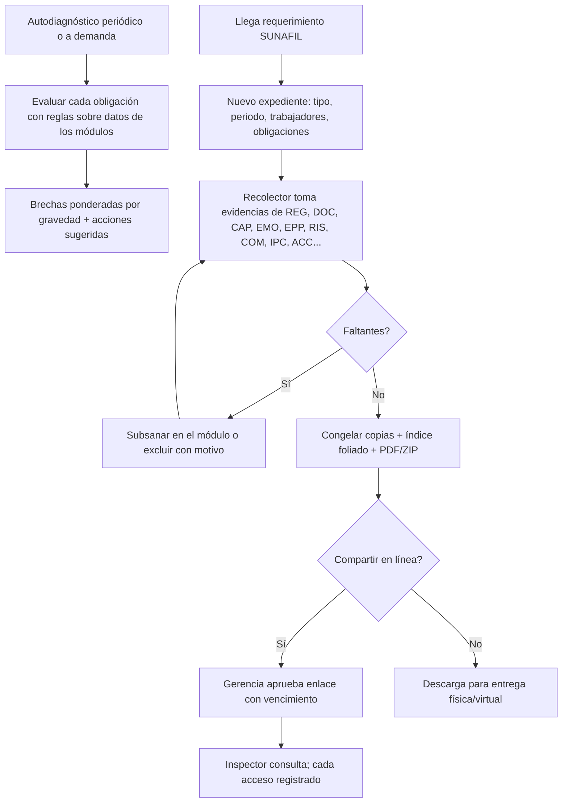

# M-SUN · 8.1 Modo Inspección SUNAFIL

## 1. Encabezado

| Campo | Valor |
|---|---|
| Código | `SUN` |
| Número | 8.1 |
| Nombre | Modo Inspección SUNAFIL |
| Grupo | 8. Diferenciadores e integraciones |
| Plan | P · Profesional |
| Fase | 2 · Plan Profesional |
| Origen | Diferenciador |
| Resuelve | Expediente por trabajador y periodo en minutos |
| Tablas del catálogo | `self_diagnostics`, `inspection_dossiers`, `dossier_items`, `dossier_share_links` |
| Dependencias | [REG](M-REG.md) (Registros obligatorios), [TRB](M-TRB.md) (Trabajadores y legajo), [DOC](M-DOC.md) (Gestión documental), [DSH](M-DSH.md) (Dashboard e indicadores), [MRL](M-MRL.md) (Matriz de requisitos legales), [CAP](M-CAP.md) (Capacitaciones e inducciones), [EMO](M-EMO.md) (EMOs y aptitud), [EPP](M-EPP.md) (EPP), [RIS](M-RIS.md) (RISST), [COM](M-COM.md) (Comité o Supervisor SST), [IPC](M-IPC.md) (Matriz IPERC), [ACC](M-ACC.md) (Accidentes, incidentes y enfermedades) |
| Prefijo de permisos | `sun.<tabla>.<acción>` |

## 2. Objetivo y problema que resuelve

**Objetivo.** Preparar a la empresa para una inspección de SUNAFIL: autodiagnóstico de brechas frente a las obligaciones más sancionadas, armado en minutos del expediente por trabajador, periodo u obligación con índice y evidencias, y un enlace temporal de solo lectura para el inspector.

**Problema que resuelve.** Cuando llega un requerimiento de SUNAFIL, la empresa tiene pocos días para reunir evidencias dispersas (política, IPERC, capacitaciones, EMO, EPP, comité, registros) y suele presentar expedientes incompletos que derivan en multas. Es el diferenciador principal de EscudoSST.

## 3. Base normativa

- Ley 28806 (Ley General de Inspección del Trabajo) y su reglamento D.S. 019-2006-TR: tipificación de infracciones en SST (leves, graves, muy graves) y facultades del inspector (requerimiento de información, comparecencia).
- Ley 29783 y D.S. 005-2012-TR: obligaciones verificables (política, IPERC, mapa, RISST, comité, capacitaciones, EMO, EPP, registros, investigación, notificación).
- Protocolos y criterios de fiscalización en SST publicados por SUNAFIL (lista de obligaciones más sancionadas a mantener por EscudoSST como catálogo; a confirmar por especialista legal).
- Ley 29733: el expediente compartido excluye datos de salud salvo constancias de aptitud; el enlace tiene vencimiento y trazabilidad.

> Todo valor legal citado (plazos, periodicidades, umbrales, factores) se implementa como parámetro con vigencia y queda «a confirmar por especialista SST/legal»; nunca como constante en código.

## 4. Roles y permisos

| Rol | Qué hace en el módulo | Permisos |
|---|---|---|
| Jefe SST / Responsable del SG-SST (`sst_manager`) | Ejecuta autodiagnósticos, arma expedientes, genera y revoca enlaces | `sun.self_diagnostics.create`, `sun.inspection_dossiers.create`, `sun.inspection_dossiers.update`, `sun.dossier_items.create`, `sun.dossier_share_links.create`, `sun.dossier_share_links.revoke` |
| Consultor SST (`consultant`) | Hace lo mismo para la empresa cliente | `sun.self_diagnostics.create`, `sun.inspection_dossiers.create`, `sun.dossier_share_links.create` |
| Gerencia (`management`) | Consulta el autodiagnóstico y aprueba compartir con el inspector | `sun.self_diagnostics.view`, `sun.dossier_share_links.approve` |
| Recursos Humanos (`hr`) | Aporta documentos laborales al expediente | `sun.dossier_items.create` |
| Médico ocupacional (`occupational_doctor`) | Autoriza la inclusión de constancias médicas | `sun.dossier_items.approve` |
| Auditor externo (`external_auditor`) | Consulta autodiagnósticos del periodo | `sun.self_diagnostics.view` |

Roles no listados no tienen acceso al módulo. Los permisos se acotan además por `membership_scopes` (sede/área) y por el plan contratado (feature flag del módulo).

## 5. Tablas

| Tabla | Base | Propósito | Campos clave |
|---|---|---|---|
| `self_diagnostics` | principal | Autodiagnóstico de brechas | company_id, run_at, checklist_version, scope (empresa/sede), results (jsonb por obligación: cumple/parcial/no cumple, evidencias encontradas, faltantes), score_pct, risk_weighted_score, created_by |
| `inspection_dossiers` | principal | Expediente | company_id, code, dossier_type (por trabajador, por periodo, por obligación, por requerimiento), sunafil_order_number, inspector_name, requested_items (jsonb), period_start, period_end, worker_ids, site_ids, status, index_pdf_file_id, bundle_file_id, prepared_by |
| `dossier_items` | principal | Ítem del expediente | dossier_id, obligation_code, title, source_module, source_type, source_id, file_id (copia congelada), page_from, page_to, order, status (incluido, faltante, excluido con motivo), is_medical_certificate, approved_by |
| `dossier_share_links` | principal | Enlace para el inspector | dossier_id, token_hash, expires_at, max_views, views_count, allowed_downloads, created_by, approved_by, revoked_at, last_access_at |

Todas las tablas de empresa llevan las columnas estándar (`id` UUID v7, `company_id`, `created_at`, `updated_at`, `created_by`, `updated_by`, `deleted_at`) salvo las inalterables, y quedan bajo RLS por `app.company_id`.

## 6. Pantallas

| ID | Pantalla | Propósito | Elementos principales |
|---|---|---|---|
| SCR-SUN-01 | Modo Inspección SUNAFIL | Portada del diferenciador | Semáforo general de preparación; top de brechas ponderadas por gravedad de infracción; botón grande «Llegó un requerimiento» |
| SCR-SUN-02 | Autodiagnóstico | Ejecución y resultado | Lista de obligaciones agrupadas (documentos de gestión, comité, capacitación, EMO, EPP, registros, eventos) con estado, evidencia encontrada y acción sugerida con enlace al módulo |
| SCR-SUN-03 | Nuevo expediente | Asistente | Tipo; número de orden de inspección; inspector; periodo; trabajadores; obligaciones requeridas (selección desde catálogo o lectura del requerimiento) |
| SCR-SUN-04 | Armado del expediente | Revisión de ítems | Ítems recolectados automáticamente por obligación y trabajador; faltantes en rojo con enlace para subsanar; reordenar; excluir con motivo |
| SCR-SUN-05 | Índice y paquete | Generación | Índice numerado con folios; PDF consolidado foliado y ZIP por carpetas |
| SCR-SUN-06 | Compartir con el inspector | Enlace temporal | Vencimiento, número máximo de vistas, permitir descarga sí/no; aprobación de gerencia; copiar enlace; revocar |
| SCR-SUN-07 | Vista del inspector (pública con token) | Solo lectura | Índice navegable, visor de documentos, marca de agua con nombre de la empresa, código de expediente y fecha; sin datos médicos |
| SCR-SUN-08 | Historial de expedientes | Seguimiento | Expedientes por estado y fecha; accesos al enlace |

## 7. Flujos principales

**Expediente por trabajador (ejemplo)**
1. Se elige el trabajador y el periodo.
2. Se recolectan: contrato/datos del legajo, inducción y capacitaciones con firmas, IPERC del puesto vigente en el periodo y constancia de difusión, entregas de EPP firmadas, constancia de aptitud EMO (sin diagnóstico), cargo del RISST, SCTR del periodo, charlas y eventos en los que participó.
3. Se arma el índice y se genera el paquete.

## 8. Reglas de negocio

- **RN-SUN-01.** El autodiagnóstico evalúa un catálogo versionado de obligaciones (`obligation_code`), cada una con regla de verificación sobre datos de los módulos, base legal y gravedad de la infracción asociada (leve/grave/muy grave, como dato a confirmar por especialista).
- **RN-SUN-02.** El puntaje ponderado da más peso a las brechas de infracciones muy graves y graves según factores parametrizados `sunafil_weight_*`.
- **RN-SUN-03.** Una obligación de un módulo no contratado se evalúa con evidencias cargadas manualmente en [DOC](M-DOC.md) y se marca «sin módulo»; nunca se considera cumplida por defecto.
- **RN-SUN-04.** El recolector toma solo registros del periodo del expediente y de la misma empresa; para el puesto del trabajador usa la asignación vigente en cada fecha del periodo.
- **RN-SUN-05.** Al generar el paquete, cada ítem se congela como copia con hash; cambios posteriores en el origen no alteran el expediente generado.
- **RN-SUN-06.** El índice numera ítems y folios correlativos; el PDF consolidado lleva folio en cada página.
- **RN-SUN-07.** Las constancias de aptitud se incluyen solo si las aprueba el médico ocupacional; nunca se incluyen informes clínicos ni diagnósticos.
- **RN-SUN-08.** El enlace del inspector usa token aleatorio de alta entropía (solo se guarda su hash), vence en `expires_at` (máximo `share_link_max_days`), admite `max_views` y puede revocarse en cualquier momento.
- **RN-SUN-09.** Crear un enlace requiere aprobación de gerencia (o del rol que la empresa configure); cada acceso se registra con fecha, IP abreviada y documento visto.
- **RN-SUN-10.** La vista del inspector es de solo lectura, con marca de agua y sin acceso a ninguna otra parte del sistema.
- **RN-SUN-11.** Ningún ítem faltante se oculta: el índice muestra los faltantes o exclusiones con su motivo si el usuario decide incluirlos en el índice.

## 9. Estados y transiciones

| Entidad | Estados | Transiciones |
|---|---|---|
| inspection_dossiers | draft → collecting → ready → generated → shared → closed; generated → draft (nueva versión) | |
| dossier_share_links | pending_approval → active → expired / revoked / exhausted | `exhausted` al alcanzar `max_views` |

## 10. Notificaciones y alertas

| Evento | Destinatario | Canal | Anticipación / momento (parámetro) |
|---|---|---|---|
| Brecha muy grave detectada en autodiagnóstico | Jefe SST, gerencia | App, correo | Al ejecutar |
| Autodiagnóstico periódico | Jefe SST | App | Cada `self_diagnostic_days` (parámetro) |
| Enlace pendiente de aprobación | Gerencia | App, correo | Inmediato |
| Inspector accedió al expediente | Jefe SST | App | En cada primer acceso del día |
| Enlace por vencer | Jefe SST | App | `share_link_notice_hours` antes |

Los envíos se hacen mediante el módulo [NOT](M-NOT.md); cada regla es configurable por empresa y respeta las preferencias del usuario.

## 11. Reportes y exportaciones

- Informe de autodiagnóstico SUNAFIL (PDF) con brechas, gravedad y plan sugerido.
- Expediente: índice foliado, PDF consolidado y ZIP por carpetas (por obligación o trabajador).
- Bitácora de accesos del inspector.
- Consume los 9 registros obligatorios de [REG](M-REG.md) y los presenta en el expediente por periodo.

## 12. Integración con otros módulos

**Consume:**

- Datos y documentos de [REG](M-REG.md), [DOC](M-DOC.md), [TRB](M-TRB.md), [POL](M-POL.md), [IPC](M-IPC.md), [MAP](M-MAP.md), [RIS](M-RIS.md), [COM](M-COM.md), [PLA](M-PLA.md), [PAS](M-PAS.md), [CAP](M-CAP.md), [EMO](M-EMO.md) (`fitness_status`), [EPP](M-EPP.md), [SCT](M-SCT.md), [ACC](M-ACC.md), [INV](M-INV.md), [ACR](M-ACR.md), [MRL](M-MRL.md).

**Produce:**

- Brechas como acciones sugeridas en [ACR](M-ACR.md); KPI «preparación SUNAFIL» en [DSH](M-DSH.md) y en el panel de [CON](M-CON.md).

## 13. Criterios de aceptación clave

1. **Dado** una empresa con 50 trabajadores y 3 sin cargo de RISST, **cuando** se ejecuta el autodiagnóstico, **entonces** la obligación de entrega del RISST figura «parcial» con los 3 trabajadores listados.
2. **Dado** un expediente por trabajador de enero a junio, **cuando** se genera, **entonces** incluye el IPERC del puesto que tenía en cada mes y sus capacitaciones del periodo, y el índice tiene folios correlativos.
3. **Dado** un expediente generado, **cuando** luego se modifica una capacitación incluida, **entonces** el expediente conserva la copia congelada original.
4. **Dado** un enlace con `max_views` 20, **cuando** se alcanza la vista 20, **entonces** el enlace queda agotado y la siguiente consulta se rechaza.
5. **Dado** el inspector abre el expediente, **cuando** consulta la constancia de aptitud, **entonces** ve solo aptitud y vigencia, nunca diagnóstico.
6. **Dado** un enlace activo, **cuando** el Jefe SST lo revoca, **entonces** el siguiente acceso muestra «Enlace no disponible» y queda registrado.

## 14. Fuera de alcance y preguntas abiertas

**Fuera de alcance:**

- Representación legal ante SUNAFIL o redacción de descargos.
- Presentación electrónica en la casilla de SUNAFIL.

**Preguntas abiertas:**

- ¿Qué entidad o especialista mantiene el catálogo de obligaciones y la gravedad de infracciones?
- ¿Se permitirá leer el requerimiento de SUNAFIL con [IAA](M-IAA.md) para proponer las obligaciones del expediente?
