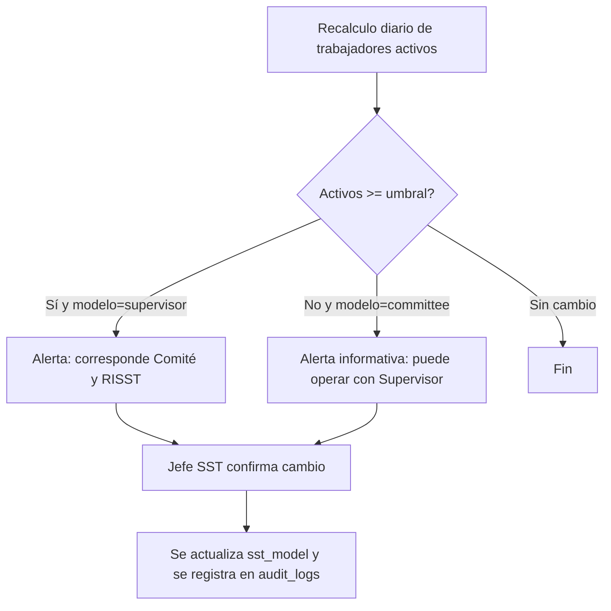

# M-TEN · 1.1 Empresas, sedes y áreas

## 1. Encabezado

| Campo | Valor |
|---|---|
| Código | `TEN` |
| Número | 1.1 |
| Nombre | Empresas, sedes y áreas |
| Grupo | 1. Núcleo de la plataforma |
| Plan | E · Esencial |
| Fase | 0 · Cimientos |
| Origen | Plataforma |
| Resuelve | Estructura de cada empresa cliente |
| Tablas del catálogo | `accounts`, `companies`, `sites`, `areas`, `positions`, `work_shifts` |
| Dependencias | [SUS](M-SUS.md) (Suscripciones y facturación) |
| Prefijo de permisos | `ten.<tabla>.<acción>` |

## 2. Objetivo y problema que resuelve

**Objetivo.** Modelar la estructura organizativa de cada cliente (cuenta → empresa con RUC → sedes → áreas → puestos, más turnos) sobre la que se apoya todo el sistema de gestión. Es la base del aislamiento multiempresa y del cálculo de obligaciones que dependen del tamaño de la empresa (Comité o Supervisor, RISST).

**Problema que resuelve.** Las empresas peruanas manejan su estructura en hojas sueltas y no distinguen qué obligaciones les aplican según su número de trabajadores; las consultoras mezclan datos de varios clientes en el mismo archivo. Sin una estructura única, el IPERC por puesto, el EPP por puesto y los indicadores por sede no son posibles.

## 3. Base normativa

- Ley 29783, art. 29 y D.S. 005-2012-TR, art. 38–39: Comité SST obligatorio con 20 o más trabajadores; Supervisor SST con menos de 20 (umbral como parámetro `committee_threshold`, a confirmar).
- D.S. 005-2012-TR, art. 74: RISST obligatorio con 20 o más trabajadores (mismo umbral parametrizado).
- Ley 29733 y D.S. 016-2024-JUS: la empresa (RUC) es el titular del banco de datos personales; la cuenta del suscriptor actúa como encargado del tratamiento frente a EscudoSST.
- Actividad económica (CIIU) y nivel de riesgo para determinar sector y obligaciones sectoriales (D.S. 024-2016-EM en minería, G.050 en construcción; a confirmar por especialista).

> Todo valor legal citado (plazos, periodicidades, umbrales, factores) se implementa como parámetro con vigencia y queda «a confirmar por especialista SST/legal»; nunca como constante en código.

## 4. Roles y permisos

| Rol | Qué hace en el módulo | Permisos |
|---|---|---|
| Dueño de la plataforma (`platform_owner`) | Crea cuentas al vender una suscripción; no ve datos internos de la empresa | `ten.accounts.create`, `ten.accounts.view`, `ten.accounts.update` |
| Administrador de cuenta (`account_admin`) | Crea empresas de su cuenta dentro del límite del plan, edita datos generales | `ten.accounts.view`, `ten.companies.create`, `ten.companies.update`, `ten.companies.view` |
| Jefe SST / Responsable del SG-SST (`sst_manager`) | Mantiene sedes, áreas, puestos y turnos de su empresa | `ten.sites.create`, `ten.sites.update`, `ten.areas.create`, `ten.areas.update`, `ten.positions.create`, `ten.positions.update`, `ten.work_shifts.create`, `ten.work_shifts.update` |
| Consultor SST (`consultant`) | Mismas acciones que el Jefe SST en las empresas cliente asignadas | `ten.sites.update`, `ten.areas.update`, `ten.positions.update` |
| Recursos Humanos (`hr`) | Mantiene puestos (perfil, nivel) y turnos | `ten.positions.create`, `ten.positions.update`, `ten.work_shifts.update` |
| Gerencia (`management`) | Consulta la estructura | `ten.companies.view`, `ten.sites.view` |
| Jefe de área / línea (`area_lead`) | Consulta la estructura de su ámbito | `ten.areas.view`, `ten.positions.view` |

Roles no listados no tienen acceso al módulo. Los permisos se acotan además por `membership_scopes` (sede/área) y por el plan contratado (feature flag del módulo).

## 5. Tablas

| Tabla | Base | Propósito | Campos clave |
|---|---|---|---|
| `accounts` | principal | Suscriptor (empresa directa o consultora); agrupa empresas | name, account_type (direct/consultancy), tax_id, billing_email, status, white_label_enabled |
| `companies` | principal | Empresa con RUC dentro de la cuenta | account_id, ruc (11 dígitos, único global), legal_name, trade_name, ciiu_code, economic_sector, risk_level, headcount_declared, sst_model (committee/supervisor), timezone, logo_file_id, status |
| `sites` | principal | Sede, planta, obra o tienda | company_id, code, name, address, ubigeo, latitude, longitude, site_type (plant/office/project/store), is_temporary, start_date, end_date, status |
| `areas` | principal | Área o línea dentro de una sede (árbol) | company_id, site_id, parent_area_id, code, name, manager_worker_id, status |
| `positions` | principal | Puesto de trabajo, unidad para IPERC, EPP, EMO y capacitaciones | company_id, area_id, code, name, description, is_critical, requires_emo, emo_periodicity_param, status |
| `work_shifts` | principal | Turnos para horas-hombre y programación | company_id, site_id, name, start_time, end_time, hours_per_day, days_pattern, is_night |

Todas las tablas de empresa llevan las columnas estándar (`id` UUID v7, `company_id`, `created_at`, `updated_at`, `created_by`, `updated_by`, `deleted_at`) salvo las inalterables, y quedan bajo RLS por `app.company_id`.

## 6. Pantallas

| ID | Pantalla | Propósito | Elementos principales |
|---|---|---|---|
| SCR-TEN-01 | Empresas de la cuenta | Listar y crear empresas con validación de RUC | Tabla con RUC, razón social, sector, trabajadores activos, modelo SST (Comité/Supervisor), estado; botón «Nueva empresa»; indicador del límite del plan |
| SCR-TEN-02 | Ficha de empresa | Datos generales y parámetros SST | Formulario con RUC, CIIU, sector, nivel de riesgo, logo; bloque «Modelo SST» calculado con aviso si cambia; bloque «Módulos opcionales» (aula virtual y venta de cursos, gestionados en [SUS](M-SUS.md)); slug del catálogo público si vende cursos; pestañas sedes/áreas/puestos |
| SCR-TEN-03 | Sedes | Gestión de sedes con ubicación | Lista y mapa; ubigeo en cascada; geolocalización en mapa; marca de sede temporal (obra) con fechas |
| SCR-TEN-04 | Árbol organizacional | Áreas y puestos jerárquicos por sede | Árbol arrastrable; panel lateral con puestos del área, trabajadores asignados y conteo; búsqueda |
| SCR-TEN-05 | Ficha de puesto | Puesto como unidad de riesgos | Descripción, puesto crítico, requiere EMO; accesos a su IPERC, EPP requerido y capacitaciones obligatorias; trabajadores asignados |
| SCR-TEN-06 | Turnos | Definición de turnos por sede | Tabla con horario, horas por día, patrón de días y nocturno |
| SCR-TEN-07 | Selector de empresa (cabecera móvil y escritorio) | Cambiar de empresa activa | Lista de memberships del usuario; búsqueda por RUC/nombre; en móvil, hoja inferior con botones grandes |

## 7. Flujos principales

**Alta de empresa**
1. El administrador de cuenta pulsa «Nueva empresa» e ingresa el RUC.
2. El sistema valida formato y dígito verificador del RUC y que no exista en otra cuenta.
3. Se completan razón social, CIIU, sector y trabajadores declarados; el sistema propone `sst_model` según el umbral parametrizado.
4. Se verifica el límite de empresas del plan ([SUS](M-SUS.md)); si se excede, se bloquea con invitación a mejorar.
5. Se crea la empresa con una sede principal y un área «General»; se asigna el creador como `sst_manager` vía membership.

**Cambio de modelo SST**

## 8. Reglas de negocio

- **RN-TEN-01.** El RUC tiene 11 dígitos, empieza por 10, 15, 17 o 20 y supera el dígito verificador módulo 11; es único en toda la plataforma (una empresa no puede existir en dos cuentas).
- **RN-TEN-02.** El número de empresas activas de una cuenta no puede superar el límite del plan vigente en `plan_modules`/`plans`; la cuenta Consultora se limita por empresas gestionadas contratadas.
- **RN-TEN-03.** `sst_model` se propone como `committee` cuando los trabajadores activos (de [TRB](M-TRB.md)) alcanzan `committee_threshold`; el cambio nunca es automático: requiere confirmación del Jefe SST y queda en bitácora.
- **RN-TEN-04.** Toda empresa tiene al menos una sede activa; no se puede inactivar la última sede activa.
- **RN-TEN-05.** No se puede eliminar (ni lógicamente) una sede, área o puesto con trabajadores asignados vigentes, IPERC vigente o registros asociados; solo se inactiva.
- **RN-TEN-06.** El código de sede es único por empresa; el código de área es único por sede; el código de puesto es único por empresa.
- **RN-TEN-07.** Las sedes temporales (`is_temporary`) exigen fecha de inicio; al pasar su fecha de fin quedan en solo lectura y dejan de aparecer en formularios de registro nuevos.
- **RN-TEN-08.** Un área no puede tener como padre a sí misma ni a un descendiente (sin ciclos); profundidad máxima configurable (`max_area_depth`).
- **RN-TEN-09.** Si la empresa vende cursos ([VTA](M-VTA.md)), su catálogo público usa un identificador corto (slug) único en la plataforma, derivado del nombre comercial y editable por el administrador de cuenta.
- **RN-TEN-10.** Todas las consultas de negocio se ejecutan con `app.company_id` fijado a la empresa activa; cambiar de empresa invalida la caché del cliente y recarga permisos.

## 9. Estados y transiciones

| Entidad | Estados | Transiciones |
|---|---|---|
| companies | active → suspended → active; active → archived | `suspended` por impago o decisión del dueño (solo lectura); `archived` al cerrar la cuenta (solo exportación) |
| sites | active ↔ inactive; active → closed (temporales) | `closed` automático al vencer `end_date` si `is_temporary` |
| areas, positions | active ↔ inactive | Inactivar exige que no tengan asignaciones vigentes |

## 10. Notificaciones y alertas

| Evento | Destinatario | Canal | Anticipación / momento (parámetro) |
|---|---|---|---|
| Trabajadores activos alcanzan el umbral de Comité | Jefe SST, administrador de cuenta | App, correo | Al detectarlo en el recálculo diario |
| Sede temporal próxima a cerrar | Jefe SST | App, correo | `site_close_notice_days` antes de `end_date` |
| Límite de empresas del plan al 90 % | Administrador de cuenta | Correo | Al alcanzar el porcentaje parametrizado |

Los envíos se hacen mediante el módulo [NOT](M-NOT.md); cada regla es configurable por empresa y respeta las preferencias del usuario.

## 11. Reportes y exportaciones

- Exportación Excel de la estructura (sedes, áreas, puestos, turnos) con conteo de trabajadores.
- Organigrama SST en PDF por sede para el expediente SUNAFIL ([SUN](M-SUN.md)).
- Ficha de empresa (datos generales, modelo SST, sector) usada como encabezado de los 9 registros obligatorios en [REG](M-REG.md).

## 12. Integración con otros módulos

**Consume:**

- [SUS](M-SUS.md): límite de empresas y feature flags de la suscripción.
- [TRB](M-TRB.md): conteo de trabajadores activos para el modelo SST.

**Produce:**

- Jerarquía `company → site → area → position` usada por todos los módulos para filtros, alcance (`membership_scopes`) e indicadores.
- `positions` como unidad para [IPC](M-IPC.md), [EPP](M-EPP.md), [EMO](M-EMO.md), [CAP](M-CAP.md) y [FOT](M-FOT.md).
- `work_shifts` para horas-hombre en [EST](M-EST.md).

## 13. Criterios de aceptación clave

1. **Dado** una cuenta con el límite de empresas alcanzado, **cuando** el administrador intenta crear otra, **entonces** el sistema muestra el bloqueo con invitación a mejorar el plan y no crea la empresa.
2. **Dado** un RUC con dígito verificador inválido, **cuando** se guarda la empresa, **entonces** se rechaza con el mensaje «RUC inválido» sin llamar a servicios externos.
3. **Dado** una empresa con modelo Supervisor y 19 trabajadores activos, **cuando** se registra el trabajador 20 y corre el recálculo, **entonces** el Jefe SST recibe la alerta y el modelo no cambia hasta que lo confirme.
4. **Dado** un área con trabajadores asignados, **cuando** se intenta inactivar, **entonces** el sistema lo impide e indica cuántos trabajadores debe reasignar.
5. **Dado** un usuario con memberships en dos empresas, **cuando** cambia de empresa activa, **entonces** ninguna consulta devuelve datos de la empresa anterior (prueba de aislamiento RLS).

## 14. Fuera de alcance y preguntas abiertas

**Fuera de alcance:**

- Consulta automática a SUNAT del RUC (se evaluará como integración en [API](M-API.md)).
- Organigrama de RR.HH. completo (jerarquía de jefaturas) más allá de lo necesario para SST.

**Preguntas abiertas:**

- ¿El umbral de Comité se compara con trabajadores propios solamente o incluye destacados/intermediados? A confirmar por especialista legal.
- ¿Se requiere ubigeo INEI obligatorio en sedes para algún reporte oficial?
