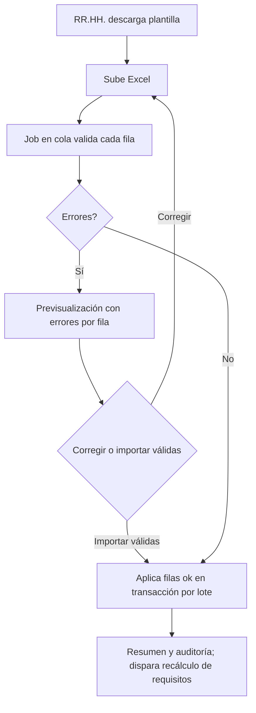

# M-TRB · 1.3 Trabajadores y legajo

## 1. Encabezado

| Campo | Valor |
|---|---|
| Código | `TRB` |
| Número | 1.3 |
| Nombre | Trabajadores y legajo |
| Grupo | 1. Núcleo de la plataforma |
| Plan | E · Esencial |
| Fase | 0 · Cimientos |
| Origen | Mercado |
| Resuelve | Ficha única del trabajador, carga masiva desde Excel |
| Tablas del catálogo | `workers`, `worker_assignments`, `worker_documents`, `bulk_imports`, `bulk_import_rows` |
| Dependencias | [TEN](M-TEN.md) (Empresas, sedes y áreas), [USR](M-USR.md) (Usuarios, roles y permisos), [DOC](M-DOC.md) (Gestión documental) |
| Prefijo de permisos | `trb.<tabla>.<acción>` |

## 2. Objetivo y problema que resuelve

**Objetivo.** Mantener la ficha única de cada trabajador (datos personales mínimos, asignación a sede/área/puesto, legajo SST) y permitir su carga masiva desde Excel. Es la fuente de verdad de personas para capacitaciones, EPP, EMO, fotocheck y expedientes SUNAFIL.

**Problema que resuelve.** Las empresas tienen la planilla en un sistema y la información SST en otro; ante una inspección no pueden mostrar por trabajador su inducción, entrega de EPP, EMO y cargo de RISST. Las altas y bajas no se reflejan y los indicadores salen con datos desactualizados.

## 3. Base normativa

- Ley 29783, art. 49 (obligaciones del empleador sobre información y formación del trabajador) y art. 79 (derechos del trabajador).
- D.S. 005-2012-TR, art. 33: los registros obligatorios se llevan por trabajador; el legajo SST concentra la evidencia.
- Ley 29733 y D.S. 016-2024-JUS: principio de finalidad y proporcionalidad; solo se recaban los datos necesarios para la gestión SST; consentimiento cuando corresponda.
- R.M. 050-2013-TR: datos del trabajador exigidos en los formatos de registros.

> Todo valor legal citado (plazos, periodicidades, umbrales, factores) se implementa como parámetro con vigencia y queda «a confirmar por especialista SST/legal»; nunca como constante en código.

## 4. Roles y permisos

| Rol | Qué hace en el módulo | Permisos |
|---|---|---|
| Recursos Humanos (`hr`) | Crea, actualiza, da de baja y carga masivamente trabajadores | `trb.workers.create`, `trb.workers.update`, `trb.worker_assignments.create`, `trb.worker_assignments.update`, `trb.bulk_imports.create`, `trb.bulk_import_rows.view` |
| Jefe SST / Responsable del SG-SST (`sst_manager`) | Consulta y completa el legajo SST; sube documentos | `trb.workers.view`, `trb.worker_documents.create`, `trb.worker_documents.view` |
| Supervisor SST (`sst_supervisor`) | Consulta trabajadores de su ámbito | `trb.workers.view`, `trb.worker_documents.view` |
| Jefe de área / línea (`area_lead`) | Consulta trabajadores de su área | `trb.workers.view` |
| Trabajador (`worker`) | Ve su propia ficha y su legajo; actualiza teléfono y contacto de emergencia | `trb.workers.view`, `trb.worker_documents.view` |
| Auditor externo (`external_auditor`) | Consulta legajos del periodo autorizado | `trb.workers.view`, `trb.worker_documents.view` |

Roles no listados no tienen acceso al módulo. Los permisos se acotan además por `membership_scopes` (sede/área) y por el plan contratado (feature flag del módulo).

## 5. Tablas

| Tabla | Base | Propósito | Campos clave |
|---|---|---|---|
| `workers` | principal | Ficha única del trabajador | company_id, document_type (DNI/CE/PTP/pasaporte), document_number, first_name, last_name, birth_date, sex, phone_e164 (cifrado), email, address (cifrado), emergency_contact (cifrado), hire_date, termination_date, employment_type (propio/intermediado/practicante), photo_file_id, status |
| `worker_assignments` | principal | Historia de asignación a sede/área/puesto/turno | company_id, worker_id, site_id, area_id, position_id, work_shift_id, start_date, end_date, is_primary |
| `worker_documents` | principal | Legajo SST: documentos y su vigencia | company_id, worker_id, document_kind (dni, contrato, consentimiento datos, cargo, otro), file_id, issued_at, expires_at, source_module, source_id |
| `bulk_imports` | principal | Carga masiva desde Excel | company_id, file_id, template_version, mode (create/upsert/terminate), status, total_rows, ok_rows, error_rows, started_by, finished_at |
| `bulk_import_rows` | principal | Resultado por fila | bulk_import_id, row_number, payload (jsonb), status (ok/error/skipped), errors (jsonb), worker_id |

Todas las tablas de empresa llevan las columnas estándar (`id` UUID v7, `company_id`, `created_at`, `updated_at`, `created_by`, `updated_by`, `deleted_at`) salvo las inalterables, y quedan bajo RLS por `app.company_id`.

## 6. Pantallas

| ID | Pantalla | Propósito | Elementos principales |
|---|---|---|---|
| SCR-TRB-01 | Lista de trabajadores | Búsqueda y filtros | Tabla con documento, nombre, sede, área, puesto, estado, semáforo de cumplimiento (inducción, EMO, EPP, SCTR); filtros combinables; exportar |
| SCR-TRB-02 | Ficha del trabajador | Vista 360° SST | Cabecera con foto y fotocheck; pestañas: datos, asignaciones, capacitaciones, EPP, aptitud (solo estado), SCTR, eventos, documentos; cada pestaña enlaza al módulo origen |
| SCR-TRB-03 | Alta / edición | Formulario del trabajador | Validación de DNI (8 dígitos) o CE; puesto obligatorio; consentimiento de datos; foto con recorte |
| SCR-TRB-04 | Carga masiva | Importar Excel | Descarga de plantilla versionada; carga; previsualización de errores por fila; modo crear/actualizar/cesar; confirmar |
| SCR-TRB-05 | Resultado de importación | Detalle por fila | Contadores, filas con error descargables con la columna de error |
| SCR-TRB-06 | Mi ficha (app del trabajador) | Ver mis datos y legajo | Tarjetas grandes: mi puesto, mis documentos, mis pendientes de firma; editar teléfono y contacto de emergencia |

## 7. Flujos principales

**Carga masiva**

**Cese**
1. RR.HH. registra `termination_date` y motivo.
2. Se cierra la asignación vigente, se suspenden memberships del trabajador y se marca su fotocheck como revocado ([FOT](M-FOT.md)).
3. Se genera la orden de EMO de retiro si el parámetro de la empresa lo indica ([EMO](M-EMO.md)).

## 8. Reglas de negocio

- **RN-TRB-01.** La combinación `(company_id, document_type, document_number)` es única; el DNI tiene 8 dígitos numéricos y el CE entre 9 y 12 caracteres alfanuméricos (validación parametrizable).
- **RN-TRB-02.** Todo trabajador activo tiene exactamente una asignación primaria vigente con sede, área y puesto activos.
- **RN-TRB-03.** Un cambio de puesto cierra la asignación anterior (end_date) y abre una nueva; nunca se sobrescribe la historia, para que el expediente muestre el puesto del periodo inspeccionado.
- **RN-TRB-04.** Al cambiar de puesto se recalculan los requisitos del nuevo puesto (EPP, capacitaciones, EMO, fotocheck) y se generan pendientes.
- **RN-TRB-05.** La carga masiva es idempotente por documento: en modo `upsert` actualiza sin duplicar; las filas con error no se aplican y no bloquean las válidas.
- **RN-TRB-06.** La plantilla de carga lleva versión; un archivo con versión distinta a la vigente se rechaza antes de procesar.
- **RN-TRB-07.** Un trabajador cesado no puede ser seleccionado en registros nuevos (capacitaciones, EPP, charlas), pero conserva todo su historial en solo lectura.
- **RN-TRB-08.** Los campos marcados como cifrados nunca aparecen en logs ni exportaciones generales; solo en la ficha para roles con permiso.
- **RN-TRB-09.** No se almacenan diagnósticos ni datos de salud en `workers` ni `worker_documents`; los documentos médicos van a [EMO](M-EMO.md).

## 9. Estados y transiciones

| Entidad | Estados | Transiciones |
|---|---|---|
| workers | active → on_leave ↔ active; active → terminated | `on_leave` desde [DES](M-DES.md) o RR.HH.; `terminated` con fecha de cese |
| bulk_imports | uploaded → validating → validated → importing → completed / completed_with_errors / failed | Validación y aplicación en cola |

## 10. Notificaciones y alertas

| Evento | Destinatario | Canal | Anticipación / momento (parámetro) |
|---|---|---|---|
| Importación terminada | Usuario que la lanzó | App, correo | Al terminar |
| Documento del legajo por vencer | Jefe SST, RR.HH. | App, correo | `worker_doc_notice_days` antes de `expires_at` |
| Trabajador nuevo con requisitos pendientes | Jefe SST | App | Al dar de alta |

Los envíos se hacen mediante el módulo [NOT](M-NOT.md); cada regla es configurable por empresa y respeta las preferencias del usuario.

## 11. Reportes y exportaciones

- Padrón de trabajadores activos por sede/área/puesto (Excel).
- Legajo SST por trabajador en PDF con índice (insumo directo del expediente por trabajador en [SUN](M-SUN.md)).
- Datos del trabajador para los encabezados de registros obligatorios en [REG](M-REG.md).

## 12. Integración con otros módulos

**Consume:**

- [TEN](M-TEN.md): sedes, áreas, puestos y turnos.
- [DOC](M-DOC.md): almacenamiento de archivos y cargos.
- [DES](M-DES.md): estado de licencia.

**Produce:**

- Personas para todos los módulos operativos; evento `worker.position_changed`, `worker.terminated`, `worker.created`.
- Conteo de activos para [TEN](M-TEN.md) y horas-hombre base para [EST](M-EST.md).

## 13. Criterios de aceptación clave

1. **Dado** un Excel con 200 filas de las que 3 tienen DNI de 7 dígitos, **cuando** se procesa la carga, **entonces** se importan 197 y las 3 quedan en error con el mensaje «DNI debe tener 8 dígitos».
2. **Dado** un trabajador que cambia de puesto, **cuando** se guarda el cambio, **entonces** su historial muestra ambas asignaciones con fechas y se crean los pendientes del nuevo puesto.
3. **Dado** un trabajador cesado, **cuando** un Jefe de área registra una charla, **entonces** el trabajador no aparece en la lista de asistentes.
4. **Dado** el rol `hr`, **cuando** abre la ficha de un trabajador, **entonces** ve el estado de aptitud pero ningún diagnóstico ni archivo médico.
5. **Dado** el mismo Excel cargado dos veces en modo `upsert`, **cuando** termina la segunda carga, **entonces** no hay trabajadores duplicados.

## 14. Fuera de alcance y preguntas abiertas

**Fuera de alcance:**

- Gestión de planilla, remuneraciones o asistencia laboral.
- Sincronización automática con sistemas de planilla (se cubre en [API](M-API.md)).

**Preguntas abiertas:**

- ¿Se registran practicantes y trabajadores intermediados en el mismo padrón o en uno separado para indicadores?
- ¿Qué periodo de conservación del legajo tras el cese fija la empresa (parámetro con base legal a confirmar)?
