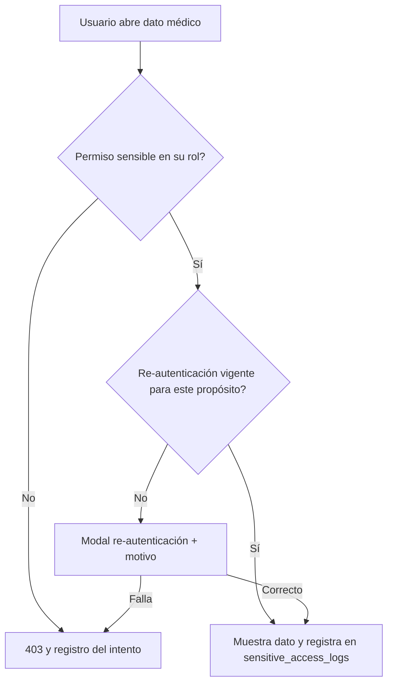

# M-USR · 1.2 Usuarios, roles y permisos

## 1. Encabezado

| Campo | Valor |
|---|---|
| Código | `USR` |
| Número | 1.2 |
| Nombre | Usuarios, roles y permisos |
| Grupo | 1. Núcleo de la plataforma |
| Plan | E · Esencial |
| Fase | 0 · Cimientos |
| Origen | Plataforma |
| Resuelve | Acceso por rol, sede y módulo |
| Tablas del catálogo | `users`, `roles`, `permissions`, `role_permissions`, `memberships`, `membership_scopes`, `sessions_mfa` |
| Dependencias | [TEN](M-TEN.md) (Empresas, sedes y áreas), [SUS](M-SUS.md) (Suscripciones y facturación), [AUD](M-AUD.md) (Bitácora de auditoría) |
| Prefijo de permisos | `usr.<tabla>.<acción>` |

## 2. Objetivo y problema que resuelve

**Objetivo.** Gestionar identidades, roles y permisos con alcance por empresa, sede y área, incluyendo MFA y re-autenticación para datos sensibles. Garantiza que cada persona vea solo lo que su rol y su ámbito permiten.

**Problema que resuelve.** En las empresas, los archivos SST se comparten por correo y todos ven todo, incluidos datos médicos; no hay trazabilidad de quién accedió. Las consultoras necesitan que un mismo consultor opere varias empresas con distinto rol sin mezclar información.

## 3. Base normativa

- Ley 29733 y D.S. 016-2024-JUS: medidas de seguridad técnicas y organizativas, control de acceso por perfil y registro de accesos a datos sensibles.
- Ley 29783, art. 103 (confidencialidad de la información médica del trabajador); el acceso a datos de salud se restringe al personal de salud autorizado.
- Directiva de seguridad de la información de la ANPD (aplicable como buena práctica; a confirmar alcance).

> Todo valor legal citado (plazos, periodicidades, umbrales, factores) se implementa como parámetro con vigencia y queda «a confirmar por especialista SST/legal»; nunca como constante en código.

## 4. Roles y permisos

| Rol | Qué hace en el módulo | Permisos |
|---|---|---|
| Dueño de la plataforma (`platform_owner`) | Define roles base y el catálogo de permisos; habilita acceso de soporte autorizado | `usr.roles.create`, `usr.roles.update`, `usr.permissions.update` |
| Administrador de cuenta (`account_admin`) | Invita usuarios, asigna memberships y alcances; crea roles personalizados a partir de los base | `usr.users.create`, `usr.users.update`, `usr.memberships.create`, `usr.memberships.update`, `usr.membership_scopes.update`, `usr.roles.create`, `usr.role_permissions.update` |
| Jefe SST / Responsable del SG-SST (`sst_manager`) | Invita usuarios operativos (jefes de área, comité, trabajadores) en su empresa | `usr.users.create`, `usr.memberships.create`, `usr.memberships.view` |
| Consultor SST (`consultant`) | Invita usuarios de la empresa cliente si la consultora lo permite | `usr.memberships.create` |
| Soporte de la plataforma (`platform_support`) | Accede temporalmente a una empresa solo con autorización vigente del administrador | `usr.sessions_mfa.view` |
| Trabajador (`worker`) | Gestiona su propia cuenta, contraseña y MFA | `usr.users.update` |

Roles no listados no tienen acceso al módulo. Los permisos se acotan además por `membership_scopes` (sede/área) y por el plan contratado (feature flag del módulo).

## 5. Tablas

| Tabla | Base | Propósito | Campos clave |
|---|---|---|---|
| `users` | principal | Identidad global (una persona, varias empresas) | email (único, citext), phone_e164, full_name, password_hash, document_type, document_number, locale, status, last_login_at, mfa_enabled, mfa_secret (cifrado) |
| `roles` | principal | Roles base (15 del catálogo) y personalizados por cuenta | account_id (nulo en base), code, name, base_role_code, is_system, is_medical |
| `permissions` | principal | Catálogo de permisos `module.resource.action` | code, module_code, resource, action, is_sensitive, description |
| `role_permissions` | principal | Permisos asignados a un rol | role_id, permission_id |
| `memberships` | principal | Pertenencia usuario–empresa con un rol | user_id, company_id, role_id, worker_id (opcional), status, invited_by, invited_at, accepted_at, valid_until |
| `membership_scopes` | principal | Restricción del alcance por sede o área | membership_id, scope_type (site/area), scope_id |
| `sessions_mfa` | principal | Sesiones, factores y re-autenticaciones | user_id, session_id, device_label, ip, user_agent, mfa_method (totp/email_otp), reauth_at, reauth_expires_at, purpose, revoked_at |

Todas las tablas de empresa llevan las columnas estándar (`id` UUID v7, `company_id`, `created_at`, `updated_at`, `created_by`, `updated_by`, `deleted_at`) salvo las inalterables, y quedan bajo RLS por `app.company_id`.

## 6. Pantallas

| ID | Pantalla | Propósito | Elementos principales |
|---|---|---|---|
| SCR-USR-01 | Inicio de sesión | Autenticación con correo/DNI y contraseña, MFA | Campos grandes; «olvidé mi contraseña»; segundo factor TOTP o código por correo; bloqueo tras intentos fallidos |
| SCR-USR-02 | Usuarios de la empresa | Administrar memberships | Tabla con nombre, rol, alcance, estado, último acceso; filtros; invitación individual y masiva desde trabajadores |
| SCR-USR-03 | Invitar usuario | Alta de membership | Correo o selección de trabajador existente; rol; alcance por sede/área; vigencia opcional (auditor externo) |
| SCR-USR-04 | Roles y permisos | Ver roles base y crear personalizados | Matriz módulos × acciones con casillas; permisos sensibles marcados; no se puede agregar permiso médico a rol no médico |
| SCR-USR-05 | Mi cuenta | Perfil, contraseña, MFA, sesiones activas | Activar TOTP con QR; cerrar sesiones remotas; idioma |
| SCR-USR-06 | Re-autenticación | Confirmar identidad antes de un dato sensible | Modal con contraseña + segundo factor; motivo de acceso obligatorio |
| SCR-USR-07 | Autorizar soporte | El administrador concede acceso temporal a soporte | Selección de empresa, alcance, vigencia (parámetro) y motivo; revocación inmediata |

## 7. Flujos principales

**Invitación y aceptación**
1. El administrador o Jefe SST invita por correo (o elige un trabajador de [TRB](M-TRB.md)).
2. Se crea `memberships` en estado `invited` y se envía enlace firmado de un solo uso con vencimiento parametrizado.
3. El invitado crea su contraseña (o inicia sesión si ya tiene usuario global) y acepta; la membership pasa a `active`.
4. Si el rol exige MFA (roles médicos, administradores), se obliga a configurarlo antes del primer acceso.

**Acceso a dato sensible**

## 8. Reglas de negocio

- **RN-USR-01.** Un usuario es único por correo en toda la plataforma; puede tener varias memberships, una por empresa, con un único rol por empresa.
- **RN-USR-02.** Los permisos efectivos son la unión de `role_permissions` del rol, filtrados por los módulos habilitados en la suscripción de la empresa (feature flags) y por `membership_scopes`.
- **RN-USR-03.** Solo los roles con `is_medical = true` (`occupational_doctor`, `health_staff` con alcance limitado) pueden recibir permisos `is_sensitive` de módulos médicos; la interfaz y la API lo validan.
- **RN-USR-04.** Toda lectura de dato médico exige re-autenticación cuya vigencia es el parámetro `reauth_ttl_minutes` (a definir por seguridad) y queda registrada con motivo.
- **RN-USR-05.** MFA es obligatorio para `account_admin`, `sst_manager`, `occupational_doctor`, `health_staff`, `consultant` y `platform_*`; opcional para `worker`.
- **RN-USR-06.** Tras `max_failed_logins` intentos fallidos consecutivos la cuenta se bloquea temporalmente y se notifica al usuario.
- **RN-USR-07.** Las memberships de `external_auditor` exigen `valid_until`; al vencer pasan a `expired` automáticamente y se cierran sus sesiones.
- **RN-USR-08.** El acceso de `platform_support` a una empresa requiere autorización explícita del administrador de cuenta con vigencia y motivo, y cada acción queda en `audit_logs` marcada como soporte.
- **RN-USR-09.** Los roles base (`is_system`) no se pueden editar ni borrar; los personalizados derivan de un rol base y no pueden exceder sus permisos.
- **RN-USR-10.** No se puede desactivar la última membership `account_admin` activa de una cuenta.

## 9. Estados y transiciones

| Entidad | Estados | Transiciones |
|---|---|---|
| users | pending → active ↔ locked; active → disabled | `locked` por intentos fallidos; `disabled` por el administrador |
| memberships | invited → active → suspended ↔ active; active → expired; invited → revoked | `expired` automático por `valid_until`; `revoked` si la invitación se cancela |

## 10. Notificaciones y alertas

| Evento | Destinatario | Canal | Anticipación / momento (parámetro) |
|---|---|---|---|
| Invitación a una empresa | Invitado | Correo, WhatsApp opcional | Al crear; recordatorio `invite_reminder_days` después si no acepta |
| Bloqueo por intentos fallidos | Usuario | Correo | Inmediato |
| Nuevo inicio de sesión desde dispositivo desconocido | Usuario | Correo | Inmediato |
| Acceso de soporte autorizado/terminado | Administrador de cuenta | Correo, app | Al iniciar y al terminar |
| Membership de auditor externo por vencer | Jefe SST | App | `auditor_expiry_notice_days` antes |

Los envíos se hacen mediante el módulo [NOT](M-NOT.md); cada regla es configurable por empresa y respeta las preferencias del usuario.

## 11. Reportes y exportaciones

- Matriz de usuarios × roles × alcances exportable a Excel (evidencia de control de accesos ante la ANPD o auditorías).
- Historial de accesos sensibles por usuario (se consulta en [AUD](M-AUD.md)).

## 12. Integración con otros módulos

**Consume:**

- [TEN](M-TEN.md): empresas, sedes y áreas para memberships y alcances.
- [SUS](M-SUS.md): módulos habilitados (feature flags).
- [TRB](M-TRB.md): vínculo `memberships.worker_id` para el rol trabajador.

**Produce:**

- Contexto de autorización (usuario, empresa activa, rol, alcance, permisos) que consume todo endpoint.
- Eventos de sesión y re-autenticación hacia [AUD](M-AUD.md).

## 13. Criterios de aceptación clave

1. **Dado** un usuario con rol `hr`, **cuando** solicita el resultado de un EMO por la API, **entonces** recibe 403 y el intento queda en `audit_logs`.
2. **Dado** un médico ocupacional sin re-autenticación vigente, **cuando** abre un examen médico, **entonces** se muestra el modal de re-autenticación y, al validarse, el acceso queda en `sensitive_access_logs` con motivo.
3. **Dado** un auditor externo con `valid_until` cumplido, **cuando** intenta iniciar sesión, **entonces** la membership está en `expired` y no accede.
4. **Dado** un Jefe de área con alcance limitado a la sede Lima, **cuando** lista inspecciones, **entonces** solo ve las de la sede Lima.
5. **Dado** un administrador crea un rol personalizado desde `hr`, **cuando** intenta agregar un permiso médico sensible, **entonces** el sistema lo rechaza.

## 14. Fuera de alcance y preguntas abiertas

**Fuera de alcance:**

- Inicio de sesión único (SSO/SAML) con directorios corporativos; se evaluará con [API](M-API.md).
- Biometría en el inicio de sesión.

**Preguntas abiertas:**

- ¿Se permite el inicio de sesión del trabajador con DNI + PIN en dispositivos compartidos de campo?
- ¿Cuál es la política de retención de sesiones y re-autenticación aprobada por el oficial de datos personales?
