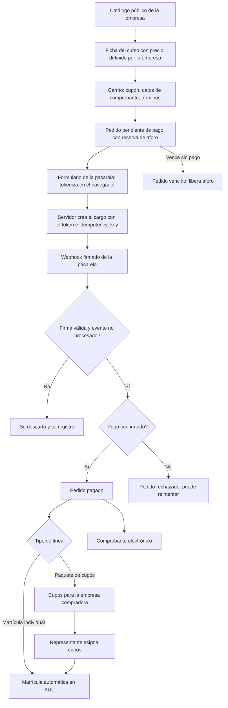

# M-VTA · 5.8 Venta de cursos y pagos

## 1. Encabezado

| Campo | Valor |
|---|---|
| Código | `VTA` |
| Número | 5.8 |
| Nombre | Venta de cursos y pagos |
| Grupo | 5. Personas y salud ocupacional |
| Plan | P · Profesional |
| Fase | 2 · Plan Profesional |
| Origen | Mercado |
| Resuelve | Catálogo de venta, pasarela de pagos, cupos para empresas y matrícula automática |
| Tablas del catálogo | `course_offers`, `coupons`, `orders`, `order_items`, `payment_gateways`, `payment_transactions`, `course_licenses`, `license_assignments`, `sales_documents`, `external_learners` |
| Dependencias | [AUL](M-AUL.md) (Aula virtual SST), [CAP](M-CAP.md) (Capacitaciones e inducciones), [SUS](M-SUS.md) (Suscripciones y facturación), [TEN](M-TEN.md) (Empresas, sedes y áreas), [USR](M-USR.md) (Usuarios, roles y permisos), [NOT](M-NOT.md) (Alertas y notificaciones) |
| Prefijo de permisos | `vta.<tabla>.<acción>` |

## 2. Objetivo y problema que resuelve

**Objetivo.** Permitir que una empresa con aula virtual (típicamente un instituto o una consultora SST) venda sus cursos: catálogo público propio, ficha del curso con precio definido por la empresa, cupones, carrito y pedido, cobro por una pasarela de pagos, matrícula automática al confirmarse el pago, matrícula manual para pagos fuera de la pasarela, venta de cupos (licencias) a empresas que los asignan a sus trabajadores, portal de participantes externos, comprobantes electrónicos de la empresa vendedora, reembolsos, reportes de ventas y recomendaciones de cursos a clientes y empresas compradoras (en el catálogo público y por campañas), usando el motor de recomendación de [AUL](M-AUL.md).

**Problema que resuelve.** Los institutos de seguridad venden cursos por WhatsApp y transferencias, matriculan a mano, pierden pagos sin conciliar y emiten certificados sin control; las empresas que compran cupos para su personal no ven quién avanzó. Sin un módulo de venta integrado al aula, cada venta exige trabajo manual y deja expuestos datos de pago y personales.

## 3. Base normativa

- Código de Protección y Defensa del Consumidor (Ley 29571): información previa del precio total, condiciones y política de devolución; Libro de Reclamaciones cuando se vende a consumidores (validar con abogado).
- Normativa SUNAT de comprobantes de pago electrónicos (boleta, factura, nota de crédito) a través de un proveedor por definir; tratamiento del IGV de los cursos (validar con contador).
- Ley 29733 y D.S. 016-2024-JUS: los participantes externos son titulares de datos de la empresa vendedora; aviso de privacidad, consentimiento para finalidades no necesarias (publicidad) y derechos ARCO.
- Estándar PCI DSS: EscudoSST no almacena, procesa ni transmite datos de tarjeta; la captura la hace el formulario o la página segura de la pasarela.

> Todo valor legal citado (plazos, periodicidades, umbrales, factores) se implementa como parámetro con vigencia y queda «a confirmar por especialista SST/legal»; nunca como constante en código.

## 4. Roles y permisos

| Rol | Qué hace en el módulo | Permisos |
|---|---|---|
| Administrador de cuenta (`account_admin`) | Activa o desactiva la venta para la empresa; configura pasarela, proveedor de comprobantes y políticas de venta y reembolso | `vta.payment_gateways.create`, `vta.payment_gateways.update`, `vta.sales_documents.view`, `vta.orders.view` |
| Jefe SST / Responsable del SG-SST (`sst_manager`) | Administra la venta: ofertas, precios definidos por la empresa, cupones, cupos corporativos, matrícula manual y reembolsos | `vta.course_offers.create`, `vta.course_offers.update`, `vta.coupons.create`, `vta.coupons.update`, `vta.orders.view`, `vta.orders.update`, `vta.payment_transactions.view`, `vta.payment_transactions.refund`, `vta.course_licenses.create`, `vta.course_licenses.update`, `vta.sales_documents.create`, `vta.external_learners.view`, `vta.external_learners.update` |
| Gerencia (`management`) | Consulta reportes de ventas | `vta.orders.view`, `vta.payment_transactions.view` |
| Capacitador (`trainer`) | Consulta los participantes externos de sus cursos | `vta.external_learners.view` |
| Participante externo (`external_learner`) | Compra, paga, ve sus pedidos y comprobantes; si representa a una empresa compradora, asigna los cupos a sus trabajadores | `vta.orders.create`, `vta.orders.view`, `vta.sales_documents.view`, `vta.license_assignments.create`, `vta.license_assignments.update`, `vta.external_learners.update` |

Roles no listados no tienen acceso al módulo. Los permisos se acotan además por `membership_scopes` (sede/área) y por el plan contratado (feature flag del módulo).

## 5. Tablas

| Tabla | Base | Propósito | Campos clave |
|---|---|---|---|
| `course_offers` | principal | Oferta de venta de un curso del aula | company_id, course_id, slug, public_title, short_description, syllabus_html, list_price, sale_price (precio definido por la empresa), currency (PEN), price_includes_tax, sale_starts_at, sale_ends_at, seats_total, seats_reserved, seats_sold, access_days, allows_company_purchase, min_licenses_per_order, is_public (catálogo público, enlace privado), refund_policy_text, status |
| `coupons` | principal | Cupón de descuento | company_id, code (único por empresa, sin distinguir mayúsculas), discount_type (porcentaje, monto fijo), discount_value, applies_to_offer_ids, min_quantity, valid_from, valid_until, max_redemptions, max_redemptions_per_buyer, redemptions_count, status |
| `orders` | principal | Pedido (carrito confirmado) | company_id, order_number, external_learner_id, buyer_type (persona, empresa), billing_document_type (boleta, factura), buyer_document_number (DNI o RUC, cifrado), billing_name, billing_address, coupon_id, subtotal, discount_total, igv_total, total, currency, channel (en línea, manual), manual_payment_method (transferencia, depósito, efectivo, otro), manual_payment_evidence_file_id, expires_at, paid_at, void_reason, consent_terms_version, status |
| `order_items` | principal | Línea del pedido | order_id, course_offer_id, item_type (matrícula individual, paquete de cupos), quantity, unit_price (precio vigente al crear el pedido), discount_amount, subtotal, igv_amount, total, enrollment_id (matrícula individual), course_license_id (paquete de cupos), refunded_quantity |
| `payment_gateways` | principal | Pasarela configurada por la empresa | company_id, provider (culqi, niubiz, izipay, mercadopago; por definir), mode (pruebas, producción), public_key, secret_key_ref (referencia al secreto), webhook_secret_ref (referencia al secreto), allowed_methods (tarjeta, Yape vía pasarela, otros que ofrezca la pasarela), is_active, last_webhook_at, last_error |
| `payment_transactions` | principal | Cobro o reembolso en la pasarela | company_id, order_id, gateway_id, transaction_type (cobro, reembolso), provider_reference (id externo del cargo, único por pasarela), idempotency_key, amount, currency, method_type, status, provider_status_raw (sin datos de tarjeta), id externo único por pasarela (eventos de webhook ya aplicados), refund_of_transaction_id, refund_reason, requested_by, occurred_at |
| `course_licenses` | principal | Cupos comprados por una empresa compradora | company_id, order_item_id, course_id, offer_id, buyer_company_ruc, buyer_company_name, manager_user_id (participante externo representante), seats_purchased, seats_used, assign_until, status |
| `license_assignments` | principal | Asignación de un cupo a una persona | course_license_id, external_learner_id, assigned_by, assigned_at, enrollment_id, released_at, release_reason, status |
| `sales_documents` | principal | Comprobante electrónico emitido por la empresa vendedora | company_id, order_id, document_type (boleta, factura, nota de crédito), series, number, related_document_id (nota de crédito), customer_doc_type, customer_doc_number (cifrado), customer_name, subtotal, igv_total, total, currency, provider (por definir), provider_reference, provider_status, pdf_file_id, xml_file_id, cdr_file_id, issued_at, status |
| `external_learners` | principal | Participante externo (no trabajador de la empresa) | company_id, user_id, document_type, document_number (cifrado), first_name, last_name, email, phone_e164 (cifrado), learner_type (persona, representante de empresa compradora), buyer_company_ruc, employer_name, job_title, privacy_notice_version, data_consent_at, marketing_consent, marketing_consent_at, status |

Todas las tablas de empresa llevan las columnas estándar (`id` UUID v7, `company_id`, `created_at`, `updated_at`, `created_by`, `updated_by`, `deleted_at`) salvo las inalterables, y quedan bajo RLS por `app.company_id`.

## 6. Pantallas

| ID | Pantalla | Propósito | Elementos principales |
|---|---|---|---|
| SCR-VTA-01 | Panel de ventas | Indicadores | Ventas del periodo, pedidos pagados, pendientes y reembolsados, ticket promedio, cupos vendidos y asignados, cursos más vendidos, cupones usados; montos en la moneda de la empresa |
| SCR-VTA-02 | Ofertas de cursos | Catálogo de venta | Lista de ofertas con curso, precio definido por la empresa, vigencia de venta, aforo y vendidos, estado; publicar, pausar, cerrar |
| SCR-VTA-03 | Ficha de oferta | Configuración | Curso del aula, texto público, temario, imagen, precio e impuesto incluido sí/no, aforo, acceso, cupos corporativos sí/no, mínimo de cupos, visibilidad, política de reembolso; vista previa pública |
| SCR-VTA-04 | Cupones | Descuentos | Código, tipo y valor, ofertas, vigencia, usos máximos y por comprador, usos realizados; activar o desactivar |
| SCR-VTA-05 | Pedidos | Gestión | Lista con número, comprador, canal, total, estado, comprobante; filtros; detalle con líneas, transacciones, matrículas o cupos generados y bitácora |
| SCR-VTA-06 | Registrar pago manual | Matrícula por pago fuera de la pasarela | Comprador, oferta, cantidad, medio (transferencia, depósito, efectivo), referencia y evidencia; genera pedido pagado, matrícula o cupos y comprobante |
| SCR-VTA-07 | Reembolsos | Devoluciones | Solicitudes con motivo, importe total o parcial, efecto en la matrícula y el certificado; confirmar reembolso en la pasarela o manual; nota de crédito |
| SCR-VTA-08 | Cupos corporativos | Licencias | Empresas compradoras con cupos comprados, asignados, disponibles, fecha límite de asignación; avance de sus asignados |
| SCR-VTA-09 | Participantes externos | Gestión | Lista con documento enmascarado, correo, tipo, cursos, consentimientos; bloquear; exportar para solicitud ARCO |
| SCR-VTA-10 | Pasarela de pagos | Integración | Elegir proveedor, entorno, llave pública, llave secreta y secreto del webhook guardados como referencia a secreto, URL del webhook, probar en entorno de pruebas, medios habilitados |
| SCR-VTA-11 | Comprobantes electrónicos | Facturación de la empresa vendedora | Series, proveedor, estado de envío y aceptación, reintentos, descarga PDF/XML; aviso «validar con contador» |
| SCR-VTA-12 | Catálogo público de cursos | Vitrina de la empresa (sin sesión) | Página con la marca de la empresa, cursos en venta con imagen, horas, precio definido por la empresa, certificado; búsqueda y filtros por categoría |
| SCR-VTA-13 | Recomendados en el catálogo público | Venta cruzada | Al iniciar sesión, bloque «Recomendados para ti» con los cursos recomendados al participante o a su empresa compradora; en la ficha del curso, «También te puede interesar» con los complementarios |
| SCR-VTA-14 | Campañas de recomendación | Envío a clientes | Elegir curso u oferta y audiencia (participantes que aprobaron un curso, empresas compradoras con cupos de un curso, perfil similar); vista previa del alcance excluyendo a quienes no tienen consentimiento o ya lo compraron; envío por correo o WhatsApp vía la recomendación manual de [AUL](M-AUL.md) |
| SCR-VTA-15 | Ficha pública del curso | Detalle y compra | Temario, capacitador, horas, modalidad, certificado verificable, precio, condiciones y política de reembolso; «Comprar» y «Comprar cupos para mi empresa» |
| SCR-VTA-16 | Carrito y pago | Checkout | Líneas, cupón, datos de comprobante (boleta o factura con RUC), aceptación de términos y aviso de privacidad, consentimiento de publicidad opcional; formulario de la pasarela embebido o página de la pasarela |
| SCR-VTA-17 | Resultado del pago | Confirmación | Pagado (acceso al curso), pendiente de confirmación o rechazado con opción de reintentar; nunca muestra datos de tarjeta |
| SCR-VTA-18 | Portal del participante externo | Inicio | Mis cursos con avance, Mis certificados, Mis pedidos y comprobantes, Mis datos y consentimientos |
| SCR-VTA-19 | Asignar cupos (representante de empresa compradora) | Gestión de licencias | Cupos disponibles, asignar por documento y correo o importar Excel, liberar un cupo no iniciado, avance y certificados de sus asignados |
| SCR-VTA-20 | Reportes de ventas | Exportación | Ventas por curso, periodo, canal, cupón y comprador; conciliación con la pasarela; comprobantes emitidos; Excel |

## 7. Flujos principales

**Compra individual**
1. El visitante abre el catálogo público de la empresa, elige un curso y pulsa «Comprar».
2. Se registra o inicia sesión como participante externo (documento, nombres, correo), acepta el aviso de privacidad y los términos; el consentimiento de publicidad es opcional y separado.
3. Elige boleta o factura (con RUC), aplica un cupón y confirma; se crea el pedido `pending_payment` con el precio vigente y se reserva el aforo hasta `expires_at`.
4. El formulario de la pasarela captura la tarjeta o Yape y entrega un token; el servidor crea el cargo con ese token y una `idempotency_key` del pedido.
5. La confirmación definitiva llega por webhook firmado; al validarse, el pedido pasa a `paid`, se crea la matrícula en [AUL](M-AUL.md) y se emite el comprobante.

**Venta de cupos a una empresa**
1. Un representante de la empresa compradora compra N cupos de una oferta que los permite (factura con RUC).
2. Al pagarse, se crea `course_licenses` con la cantidad; el representante asigna cupos a sus trabajadores por documento y correo (cada uno queda como participante externo con `buyer_company_ruc`).
3. Cada asignación crea la matrícula; el representante ve el avance y los certificados de sus asignados.

**Matrícula manual (pago fuera de la pasarela)**
1. El administrador de ventas registra el pago (transferencia, depósito, efectivo) con referencia y evidencia.
2. Se crea un pedido `paid` con canal manual, la matrícula o los cupos y el comprobante; todo queda en `audit_logs`.

**Reembolso**
1. El administrador registra la solicitud con motivo e importe (total o parcial) según la política de la oferta.
2. Se ejecuta el reembolso en la pasarela (o se registra el reembolso manual); al confirmarse, se emite nota de crédito, la matrícula pasa a `cancelled` y, si había certificado, se anula en [CAP](M-CAP.md) con motivo «reembolso».

## 8. Reglas de negocio

- **RN-VTA-01.** El módulo viene desactivado por defecto; se activa por empresa ([SUS](M-SUS.md)) solo si el plan lo incluye y [AUL](M-AUL.md) está activo en esa empresa. Una empresa que capacita solo a su personal mantiene VTA desactivado y usa el aula sin pasarela.
- **RN-VTA-02.** Los precios de los cursos los define cada empresa en `course_offers.price`; no son precios de EscudoSST y no se relacionan con los planes de la suscripción.
- **RN-VTA-03.** Jamás se almacenan, registran en logs ni transmiten por el servidor datos de tarjeta (número, fecha de vencimiento, código de seguridad): la pasarela tokeniza en el navegador y EscudoSST guarda solo el token de un solo uso al crear el cargo y la referencia externa del cargo.
- **RN-VTA-04.** Las llaves secretas de la pasarela y el secreto del webhook se guardan como referencia a un secreto (`secret_key_ref`, `webhook_secret_ref`), nunca en claro; solo la llave pública se guarda como dato.
- **RN-VTA-05.** Las pasarelas se integran detrás de la interfaz `PaymentGateway` (crear cargo, consultar, reembolsar, verificar webhook); la elección entre Culqi, Niubiz, Izipay o Mercado Pago no cambia el módulo. Yape se cobra a través de la pasarela, no por integración directa.
- **RN-VTA-06.** El webhook es un endpoint público por empresa y pasarela que exige firma válida (HMAC o el mecanismo de la pasarela) con el secreto configurado; una firma inválida se rechaza, se registra y no cambia ningún estado.
- **RN-VTA-07.** El procesamiento del webhook es idempotente: un evento ya incluido en la restricción única por (pasarela, id externo) de `payment_transactions`, o que lleva a un estado igual o anterior al actual, se responde como recibido sin efectos; los eventos se aplican en orden de estado (un `paid` no retrocede a `pending`).
- **RN-VTA-08.** La creación del cargo usa una `idempotency_key` por pedido e intento; reintentar no genera un segundo cobro. El estado se confirma por webhook o por consulta a la pasarela, nunca solo por la redirección del navegador.
- **RN-VTA-09.** Un job de conciliación consulta a la pasarela los pedidos `pending_payment` sin webhook dentro de `vta_reconcile_after_minutes` y aplica el resultado con las mismas reglas de idempotencia.
- **RN-VTA-10.** El pedido guarda el precio unitario vigente al crearse; cambiar el precio de la oferta no altera pedidos existentes. El total = subtotal − descuentos + impuestos según el tratamiento configurado (validar con contador).
- **RN-VTA-11.** El cupón se valida en el servidor (vigencia, ofertas, cantidad mínima, usos totales y por comprador); su uso se cuenta solo cuando el pedido queda pagado.
- **RN-VTA-12.** El aforo (`seats_total`) se reserva al crear el pedido pendiente y se libera si vence (`expires_at` según `order_payment_ttl_minutes`) o se cancela; no se vende por encima del aforo.
- **RN-VTA-13.** Al quedar pagado el pedido se crea la matrícula en [AUL](M-AUL.md) (o los cupos) en la misma transacción lógica; si falla, el pedido queda `paid` con alerta y un reintento idempotente por `order_item_id`.
- **RN-VTA-14.** La matrícula manual exige medio, referencia y evidencia del pago; queda con canal manual en `audit_logs` y aparece separada en la conciliación.
- **RN-VTA-15.** Los cupos asignados no pueden superar `quantity`; un cupo se puede liberar y reasignar solo si el asignado no inició el curso; después de `assign_until` no se asignan cupos nuevos.
- **RN-VTA-16.** El representante de la empresa compradora solo ve a las personas a las que asignó cupos, su avance, nota y certificado; no ve a otros participantes de la empresa vendedora.
- **RN-VTA-17.** Los comprobantes electrónicos son de la empresa vendedora (su RUC y sus series), no de EscudoSST; se emiten detrás de la interfaz `ElectronicInvoiceProvider` con proveedor por definir; boleta o factura según los datos del comprador; nota de crédito en reembolsos. Montos e impuestos se validan con el contador de la empresa.
- **RN-VTA-18.** Un reembolso se ejecuta contra la transacción de cobro original; el total reembolsado no supera lo cobrado; al confirmarse se cancela la matrícula o se descuentan cupos no asignados según la política, y se anula el certificado si existía.
- **RN-VTA-19.** El participante externo acepta el aviso de privacidad de la empresa vendedora antes de comprar; el consentimiento de publicidad es separado, opcional y revocable; puede ejercer ARCO desde su portal.
- **RN-VTA-20.** Los participantes externos no son trabajadores: no aparecen en [TRB](M-TRB.md), en la matriz por cargo ni en los indicadores legales de SST de la empresa vendedora.
- **RN-VTA-21.** Desactivar VTA no borra datos: pedidos, comprobantes y participantes quedan en solo lectura; las matrículas pagadas siguen activas hasta su `access_until` y el catálogo público deja de mostrarse.
- **RN-VTA-22.** Las recomendaciones a participantes externos y a representantes de empresas compradoras se crean en `course_recommendations` de [AUL](M-AUL.md) con la oferta vinculada; una campaña es una recomendación manual masiva y cumple las mismas reglas: solo con `marketing_consent` vigente para correo o WhatsApp, límite de envíos, exclusión de quienes ya compraron o aprobaron el curso y nunca datos médicos.
- **RN-VTA-23.** Un pedido de un curso recomendado registra la conversión de la recomendación (clic o vista dentro del periodo de atribución); a una empresa compradora se le puede recomendar la recompra de cupos para recapacitar a sus asignados cuyos certificados vencen.
- **RN-VTA-24.** El catálogo público, la ficha y el checkout tienen límite de uso por IP y protección contra automatización; no exponen datos de participantes.

## 9. Estados y transiciones

| Entidad | Estados | Transiciones |
|---|---|---|
| orders | draft → pending_payment → paid → fulfilled; pending_payment → expired / cancelled / failed; failed → pending_payment (reintento); paid / fulfilled → partially_refunded → refunded | `fulfilled` cuando todas las líneas generaron matrícula o cupos; `expired` por `order_payment_ttl_minutes` |
| payment_transactions | created → pending → succeeded / failed; succeeded → refunded / partially_refunded (en el cobro, por transacciones de reembolso) | Solo avanzan; un evento que llevaría a un estado anterior se ignora |
| course_offers | draft → published ↔ paused → closed | `closed` al vencer `sale_ends_at` o agotarse el aforo |
| course_licenses | active → exhausted / expired; active → refunded | `exhausted` al asignar todos los cupos; `expired` al pasar `assign_until` |
| license_assignments | assigned → started → completed; assigned → released | `released` solo antes de iniciar el curso |
| sales_documents | pending → sent → accepted / rejected → voided | Según respuesta del proveedor; reintentos ante error de envío |

## 10. Notificaciones y alertas

| Evento | Destinatario | Canal | Anticipación / momento (parámetro) |
|---|---|---|---|
| Pedido pagado y acceso al curso | Comprador y participante | Correo | Al confirmarse el pago |
| Pago rechazado | Comprador | Correo | Al recibir el evento |
| Pedido por vencer sin pago | Comprador | Correo | `order_expiry_notice_minutes` antes de `expires_at` |
| Pago confirmado sin matrícula creada | Administrador de ventas | App, correo | Inmediato |
| Webhook con firma inválida reiterado | Administrador de cuenta | Correo | Al superar `webhook_invalid_signature_threshold` |
| Cupos comprados disponibles | Representante de la empresa compradora | Correo | Al pagarse |
| Cupo asignado | Persona asignada | Correo | Al asignar |
| Cupos sin asignar por vencer | Representante | Correo | `license_assign_notice_days` antes de `assign_until` |
| Comprobante rechazado por el proveedor | Administrador de ventas | App, correo | Al recibir el rechazo |
| Reembolso confirmado | Comprador | Correo | Al confirmarse |

Los envíos se hacen mediante el módulo [NOT](M-NOT.md); cada regla es configurable por empresa y respeta las preferencias del usuario.

## 11. Reportes y exportaciones

- Ventas por curso, periodo, canal (en línea, manual), cupón y comprador.
- Conciliación de pedidos pagados con transacciones de la pasarela y con comprobantes emitidos.
- Cupos vendidos, asignados y completados por empresa compradora.
- Reembolsos y notas de crédito del periodo.
- Conversión de recomendaciones y campañas en ventas (pedidos atribuidos por curso, campaña y empresa compradora).
- Exportación Excel; ninguna exportación incluye datos de tarjeta.

## 12. Integración con otros módulos

**Consume:**

- [AUL](M-AUL.md): cursos, matrículas, avance; [CAP](M-CAP.md): certificados; [SUS](M-SUS.md): activación del módulo por empresa; [TEN](M-TEN.md): datos de la empresa vendedora y marca; [USR](M-USR.md): cuentas de participantes externos.
- Pasarela de pagos (`PaymentGateway`) y proveedor de comprobantes (`ElectronicInvoiceProvider`), por definir.

**Produce:**

- Matrículas por compra y por cupo en [AUL](M-AUL.md); anulaciones de certificados por reembolso en [CAP](M-CAP.md); indicadores de ventas en [DSH](M-DSH.md).

## 13. Criterios de aceptación clave

1. **Dado** una empresa con VTA desactivado, **cuando** se abre la URL de su catálogo público, **entonces** responde «no disponible» y no muestra cursos.
2. **Dado** un pedido pendiente, **cuando** llega el webhook de pago confirmado con firma válida, **entonces** el pedido pasa a pagado, se crea una matrícula y se emite el comprobante.
3. **Dado** el mismo evento de pago, **cuando** llega tres veces, **entonces** el pedido tiene una sola matrícula, un solo comprobante y una sola transacción exitosa.
4. **Dado** un webhook con firma inválida, **cuando** se recibe, **entonces** se rechaza, se registra y el pedido no cambia de estado.
5. **Dado** un comprador que vuelve del formulario de pago a la página de resultado, **cuando** aún no llega el webhook, **entonces** ve «pendiente de confirmación» y no se crea matrícula hasta confirmar.
6. **Dado** una oferta con aforo 30 y 30 cupos reservados o vendidos, **cuando** un nuevo comprador intenta pagar, **entonces** no puede crear el pedido y ve «sin cupos».
7. **Dado** un cupón con un uso máximo por comprador ya usado, **cuando** el mismo comprador lo aplica, **entonces** se rechaza.
8. **Dado** una empresa compradora con 10 cupos, **cuando** su representante intenta asignar el cupo 11, **entonces** se rechaza.
9. **Dado** un cupo asignado a una persona que ya inició el curso, **cuando** el representante intenta liberarlo, **entonces** se rechaza.
10. **Dado** un reembolso total confirmado, **cuando** se procesa, **entonces** se emite nota de crédito, la matrícula queda cancelada y el certificado, si existía, queda anulado.
11. **Dado** una campaña de un curso complementario, **cuando** se envía a quienes aprobaron el curso base, **entonces** se excluyen quienes no tienen consentimiento de publicidad y quienes ya compraron el complementario.
12. **Dado** la base de datos y los logs, **cuando** se revisan después de un pago con tarjeta, **entonces** no contienen número, vencimiento ni código de seguridad de la tarjeta.
13. **Dado** un pago por transferencia, **cuando** el administrador lo registra con evidencia, **entonces** se crea un pedido pagado de canal manual con su matrícula y queda en la bitácora.

## 14. Fuera de alcance y preguntas abiertas

**Fuera de alcance:**

- Pasarela propia o almacenamiento de tarjetas para cobros recurrentes.
- Suscripciones o membresías de cursos con cobro periódico.
- Marketplace de cursos entre empresas de EscudoSST (cada empresa vende solo sus cursos en su catálogo).
- Cobro de la suscripción de EscudoSST (se gestiona en [SUS](M-SUS.md)).

**Preguntas abiertas:**

- ¿Qué pasarela se integra primero: Culqi, Niubiz, Izipay o Mercado Pago? (decisión abierta).
- ¿Qué proveedor de comprobantes electrónicos se integra? Validar con contador el tratamiento del IGV de los cursos.
- ¿La empresa que vende cursos a consumidores debe ofrecer un Libro de Reclamaciones virtual dentro de su catálogo? Validar con abogado. Es distinto del Libro de Reclamaciones de EscudoSST como proveedor, que vive en [WEB](M-WEB.md); si se decide ofrecerlo, podría reutilizar su diseño con tablas propias por empresa.
- ¿Se aceptarán compras de menores de edad? Validar con abogado y oficial de datos personales.
