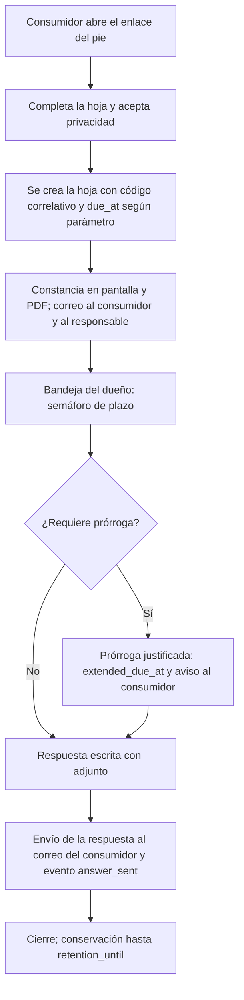
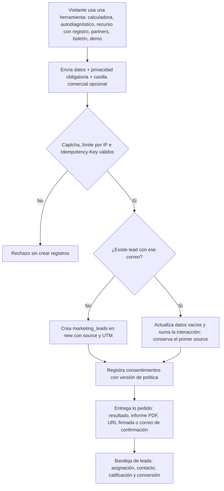
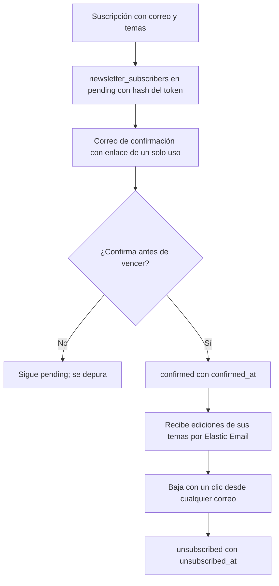
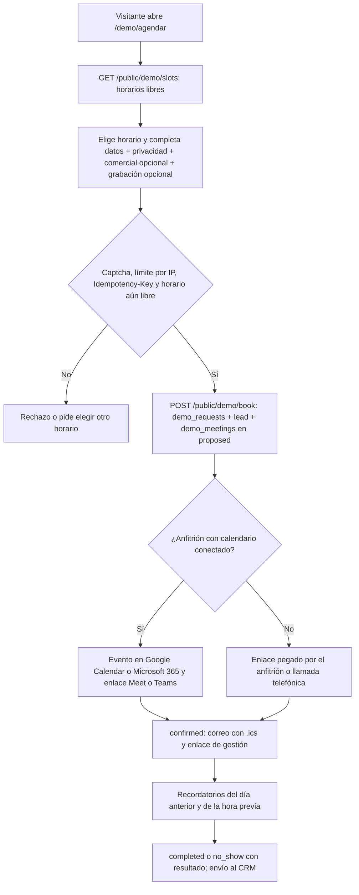
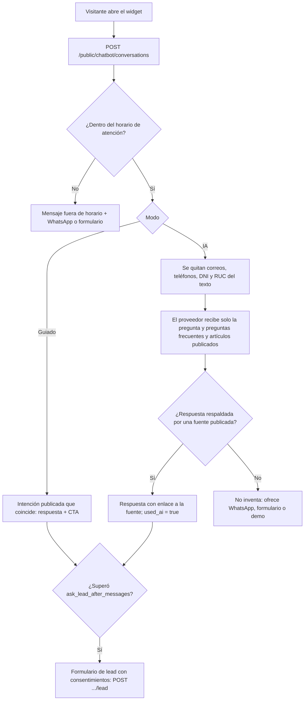
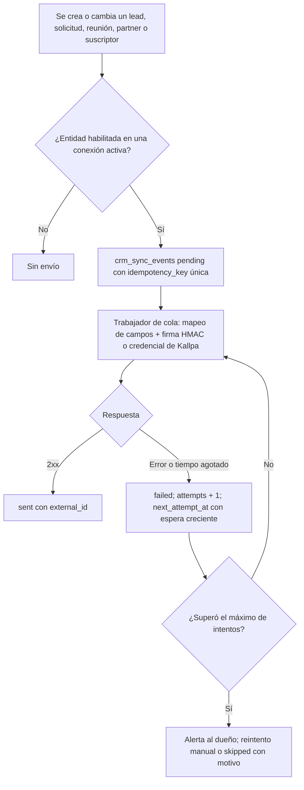

# M-WEB · 1.10 Sitio web público y CMS

## 1. Encabezado

| Campo | Valor |
|---|---|
| Código | `WEB` |
| Número | 1.10 |
| Nombre | Sitio web público y CMS |
| Grupo | 1. Núcleo de la plataforma |
| Plan | I · Interno |
| Fase | 1 · Plan Esencial |
| Origen | Plataforma |
| Resuelve | Web de venta de EscudoSST administrable por el dueño: páginas, videos, planes y precios editables, demo, WhatsApp, otros productos, testimonios, SEO, políticas, cookies, Libro de Reclamaciones, enlace al blog en WordPress y herramientas de captación (calculadora de multas, autodiagnóstico, recursos, casos de éxito, centro de ayuda, partners y referidos, boletín, centro de confianza y estado del servicio); métricas básicas, calendario de demos, chatbot, conexión con CRM, biblioteca de medios, portafolio, landings de campaña, ventanas emergentes, integraciones, novedades, webinars, reseñas de Google y calculadora de ahorro |
| Tablas del catálogo | `site_settings`, `site_pages`, `site_menus`, `site_products`, `site_testimonials`, `site_faqs`, `site_redirects`, `legal_documents`, `legal_document_versions`, `legal_acceptances`, `cookie_consents`, `consumer_complaints`, `complaint_events`, `demo_requests`, `marketing_leads`, `fine_calculations`, `assessment_questionnaires`, `assessment_questions`, `assessment_submissions`, `resource_items`, `resource_downloads`, `success_stories`, `help_categories`, `help_articles`, `help_article_feedback`, `partner_applications`, `referral_codes`, `referrals`, `newsletter_subscribers`, `newsletter_issues`, `subprocessors`, `status_components`, `status_incidents`, `status_incident_updates`, `site_media`, `site_analytics_daily`, `site_events`, `demo_booking_settings`, `demo_hosts`, `demo_availability_rules`, `demo_blackouts`, `demo_meetings`, `chatbot_settings`, `chatbot_intents`, `chatbot_conversations`, `chatbot_messages`, `crm_connections`, `crm_sync_events`, `success_story_media`, `campaigns`, `site_popups`, `site_integrations`, `product_updates`, `webinars`, `webinar_registrations`, `review_sources`, `review_snapshots`, `savings_calculator_settings`, `savings_calculations` |
| Dependencias | [SUS](M-SUS.md) (Suscripciones y facturación), [TEN](M-TEN.md) (Empresas, sedes y áreas), [USR](M-USR.md) (Usuarios, roles y permisos), [NOT](M-NOT.md) (Alertas y notificaciones), [DOC](M-DOC.md) (Gestión documental), [AUD](M-AUD.md) (Bitácora de auditoría) |
| Prefijo de permisos | `web.<tabla>.<acción>` |

## 2. Objetivo y problema que resuelve

**Objetivo.** Publicar y administrar la web de venta de EscudoSST (portada con barra de anuncio, menú de productos, héroe, videos, módulos con maqueta, cómo funciona, planes y precios, demostración, formularios, WhatsApp flotante, otros productos de GRUPO DE SOLUCIONES CREATIVAS, preguntas frecuentes, testimonios, sellos de confianza y CTA final; páginas de producto, diferenciadores, sectores, consultoras y casos; enlace al blog en WordPress con sus últimos artículos; registro autoservicio e inicio de sesión) desde un CMS del Dueño de la plataforma, con logo editable, SEO técnico, políticas legales versionadas con re-aceptación, aviso de cookies por categorías, Libro de Reclamaciones virtual y bandeja de solicitudes de demo; con métricas básicas propias, calendario de demos con agenda pública, chatbot, conexión con el CRM, biblioteca de medios, portafolio con galería, redes sociales, landings por campaña, ventanas emergentes, página de integraciones, novedades del producto, webinars, reseñas de Google y calculadora de ahorro, siguiendo el diseño de Stitch corregido; y operar las herramientas de captación (calculadora de multas SUNAFIL, autodiagnóstico Ley 29783, biblioteca de recursos, casos de éxito, comparativa «EscudoSST vs Excel y papel», centro de ayuda también contextual dentro de la aplicación, programa de partners y referidos, boletín normativo SST y centro de confianza con estado del servicio), todas alimentando una bandeja de leads con consentimiento comercial separado.

**Problema que resuelve.** Sin una web propia administrable, cada cambio de texto, video, plan o política exige tocar código y desplegar; los precios publicados se desalinean de la configuración de planes; las políticas cambian sin evidencia de quién aceptó qué versión; los testimonios y sellos pueden publicarse sin respaldo; y un proveedor que vende a consumidores en el Perú debe ofrecer un Libro de Reclamaciones virtual con constancia, plazos de respuesta y conservación, cuya omisión es sancionable. Además, una web que no se indexa bien ni facilita el contacto (demo, WhatsApp) no genera demanda para la venta directa ni para las consultoras.

## 3. Base normativa

- Código de Protección y Defensa del Consumidor (Ley 29571), modificado por la Ley 31435: deber de contar con Libro de Reclamaciones (físico o virtual) y aviso visible; información veraz y precio total cuando se publique; publicidad veraz (testimonios reales y sellos que se tengan) (a confirmar con abogado).
- Reglamento del Libro de Reclamaciones (D.S. 011-2011-PCM y modificatorias, incluido el D.S. 101-2022-PCM): contenido mínimo de la hoja (código correlativo, fecha, datos del proveedor y del consumidor, bien contratado, monto, tipo reclamo/queja, detalle, pedido), constancia al consumidor, plazo de respuesta (referencia: 15 días hábiles, prórroga justificada comunicada al consumidor) y conservación (referencia: 5 años). Todo como parámetro con vigencia `to_confirm = true`, **a confirmar con abogado**.
- Ley 29733 y D.S. 016-2024-JUS: información previa y consentimiento para formularios (demo, contacto, cotización, reclamo) y para publicar testimonios y casos de éxito con nombre, cargo o logo; finalidades separadas (la finalidad comercial de los leads y del boletín es independiente de la que motiva cada formulario); derechos ARCO; flujo transfronterizo informado en la Política de privacidad (servidores fuera del Perú).
- Normativa sobre cookies y comunicaciones comerciales: consentimiento previo para cookies no necesarias (incluidas las de videos incrustados y analítica) y para envíos publicitarios (a confirmar con abogado).
- Contrato de encargo de tratamiento de datos (Ley 29733) para los clientes y Acuerdo de nivel de servicio: textos a redactar y validar con abogado.
- Código de Protección y Defensa del Consumidor (Ley 29571): publicidad veraz; los sellos, cifras, promesas de resultado, plazos y condiciones comerciales publicados deben estar respaldados (base de los lineamientos de contenido del diseño Stitch corregido).
- Ley 29733 y su reglamento: consentimiento previo para cookies analíticas y de marketing (métricas propias, GA4, Tag Manager, Meta Pixel), para grabar reuniones de demo o webinars, para registrar conversaciones del chatbot asociadas a un lead y para enviar datos a encargados (CRM, proveedor de calendario, proveedor de IA, proveedor de reseñas); transferencias internacionales informadas en la lista de subencargados.
- Términos de uso de la API de Google (Business Profile / Places): atribución obligatoria, sin modificar el texto de las reseñas y caché limitada según el proveedor (parámetro `web.review_cache_max_hours`, a confirmar).

> Todo valor legal citado (plazos, periodicidades, umbrales, factores) se implementa como parámetro con vigencia y queda «a confirmar por especialista SST/legal»; nunca como constante en código.

## 4. Roles y permisos

| Rol | Qué hace en el módulo | Permisos |
|---|---|---|
| Dueño de la plataforma (`platform_owner`) | Administra todo el sitio: ajustes, logo y datos legales, páginas por bloques (videos, módulos con maqueta, cómo funciona), menú, WhatsApp, enlace al blog de WordPress, otros productos, testimonios (aprobación), preguntas frecuentes, redirecciones, políticas y sus versiones, Libro de Reclamaciones (respuesta, prórroga, cierre, reporte) y solicitudes de demo | `web.site_settings.update`, `web.site_pages.create`, `web.site_pages.update`, `web.site_pages.publish`, `web.site_menus.update`, `web.site_products.update`, `web.site_testimonials.create`, `web.site_testimonials.update`, `web.site_testimonials.approve`, `web.site_faqs.update`, `web.site_redirects.update`, `web.legal_documents.update`, `web.legal_document_versions.create`, `web.legal_document_versions.publish`, `web.legal_acceptances.view`, `web.cookie_consents.view`, `web.consumer_complaints.view`, `web.consumer_complaints.update`, `web.consumer_complaints.respond`, `web.consumer_complaints.export`, `web.complaint_events.create`, `web.demo_requests.view`, `web.demo_requests.update`, `web.demo_requests.assign` |
| Soporte de la plataforma (`platform_support`) | Atiende solicitudes de demo asignadas, carga testimonios recibidos para aprobación y consulta reclamos para preparar la respuesta (no responde, no aprueba ni cierra) | `web.demo_requests.view`, `web.demo_requests.update`, `web.site_testimonials.create`, `web.consumer_complaints.view`, `web.complaint_events.create` |
| Administrador de cuenta (`account_admin`) | Acepta las nuevas versiones de Términos, Privacidad, Encargo de tratamiento y SLA en nombre de su cuenta; consulta su historial de aceptaciones; puede enviar un testimonio de su empresa con consentimiento | `web.legal_acceptances.create`, `web.legal_acceptances.view`, `web.site_testimonials.create` |
| Trabajador (`worker`) | Como cualquier usuario autenticado, acepta Términos y Privacidad vigentes al iniciar sesión cuando cambia la versión y consulta la ayuda contextual de la pantalla en la que está | `web.legal_acceptances.create`, `web.help_articles.read`, `web.help_article_feedback.create` |
| Participante externo (`external_learner`) | Representa al visitante o consumidor sin cuenta (el catálogo no tiene rol «visitante»): navega el sitio, guarda preferencias de cookies, registra una hoja de reclamación, consulta su seguimiento por código y envía solicitudes de demo, contacto o cotización; usa la calculadora de multas y el autodiagnóstico, descarga recursos, vota «¿Te sirvió?», postula como partner y se suscribe, confirma o se da de baja del boletín y de los avisos de estado; los endpoints públicos no exigen sesión | `web.cookie_consents.create`, `web.consumer_complaints.create`, `web.consumer_complaints.track`, `web.demo_requests.create`, `web.marketing_leads.create`, `web.fine_calculations.create`, `web.assessment_submissions.create`, `web.resource_downloads.create`, `web.help_article_feedback.create`, `web.partner_applications.create`, `web.newsletter_subscribers.create`, `web.newsletter_subscribers.update` |
| Dueño de la plataforma (`platform_owner`) | Herramientas de captación: asigna y exporta leads; mantiene los parámetros de la calculadora (vía parámetros legales); edita y publica el autodiagnóstico; gestiona recursos, casos de éxito (aprobación), centro de ayuda (publicación), partners (aprobación) y códigos de referido, boletín (envío), subencargados, componentes e incidentes del estado del servicio (publicación) | `web.marketing_leads.read`, `web.marketing_leads.update`, `web.marketing_leads.assign`, `web.marketing_leads.export`, `web.fine_calculations.read`, `web.assessment_questionnaires.create`, `web.assessment_questionnaires.update`, `web.assessment_questionnaires.publish`, `web.assessment_questions.create`, `web.assessment_questions.update`, `web.assessment_questions.delete`, `web.assessment_submissions.read`, `web.resource_items.create`, `web.resource_items.update`, `web.resource_downloads.read`, `web.success_stories.create`, `web.success_stories.update`, `web.success_stories.approve`, `web.help_categories.create`, `web.help_categories.update`, `web.help_articles.create`, `web.help_articles.update`, `web.help_articles.publish`, `web.help_article_feedback.read`, `web.partner_applications.read`, `web.partner_applications.approve`, `web.referral_codes.create`, `web.referral_codes.update`, `web.referrals.read`, `web.referrals.update`, `web.newsletter_subscribers.read`, `web.newsletter_issues.create`, `web.newsletter_issues.update`, `web.newsletter_issues.send`, `web.subprocessors.create`, `web.subprocessors.update`, `web.status_components.create`, `web.status_components.update`, `web.status_incidents.create`, `web.status_incidents.update`, `web.status_incidents.publish`, `web.status_incident_updates.create` |
| Soporte de la plataforma (`platform_support`) | Herramientas de captación: atiende los leads que tiene asignados (no asigna ni exporta), carga casos de éxito para aprobación, redacta artículos de ayuda (no los publica), lee solicitudes de partner y la utilidad de los artículos, y registra incidentes y sus actualizaciones en borrador (los publica el dueño) | `web.marketing_leads.read`, `web.marketing_leads.update`, `web.success_stories.create`, `web.help_articles.create`, `web.help_articles.update`, `web.help_article_feedback.read`, `web.partner_applications.read`, `web.status_incidents.create`, `web.status_incidents.update`, `web.status_incident_updates.create` |
| Dueño de la plataforma (`platform_owner`) | Panel v1.5: ve el resumen con métricas y las exporta; configura la agenda pública, los anfitriones, su disponibilidad y bloqueos; asigna y confirma demos y registra su resultado; configura el chatbot y publica sus intenciones; gestiona la conexión con el CRM (Kallpa o webhook), el mapeo de campos y los reintentos de la cola; administra la biblioteca de medios, el portafolio con galería y las redes sociales | `web.site_analytics_daily.read`, `web.site_events.read`, `web.site_analytics.export`, `web.demo_booking_settings.update`, `web.demo_hosts.create`, `web.demo_hosts.update`, `web.demo_availability_rules.create`, `web.demo_availability_rules.update`, `web.demo_availability_rules.delete`, `web.demo_blackouts.create`, `web.demo_blackouts.update`, `web.demo_blackouts.delete`, `web.demo_meetings.read`, `web.demo_meetings.update`, `web.demo_meetings.assign`, `web.demo_meetings.confirm`, `web.chatbot_settings.update`, `web.chatbot_intents.create`, `web.chatbot_intents.update`, `web.chatbot_intents.publish`, `web.chatbot_conversations.read`, `web.chatbot_messages.read`, `web.crm_connections.read`, `web.crm_connections.manage`, `web.crm_sync_events.read`, `web.crm_sync_events.update`, `web.site_media.create`, `web.site_media.update`, `web.site_media.delete`, `web.success_story_media.create`, `web.success_story_media.update`, `web.success_story_media.delete` |
| Dueño de la plataforma (`platform_owner`) | Panel v1.5-b: crea y publica landings por campaña, ventanas emergentes, la página de integraciones, novedades del producto y webinars (asistencia y grabación); conecta y gestiona la fuente de reseñas de Google; configura y publica los supuestos de la calculadora de ahorro | `web.campaigns.create`, `web.campaigns.update`, `web.campaigns.publish`, `web.site_popups.create`, `web.site_popups.update`, `web.site_popups.publish`, `web.site_integrations.create`, `web.site_integrations.update`, `web.product_updates.create`, `web.product_updates.update`, `web.product_updates.publish`, `web.webinars.create`, `web.webinars.update`, `web.webinars.publish`, `web.webinar_registrations.read`, `web.webinar_registrations.update`, `web.review_sources.read`, `web.review_sources.manage`, `web.review_snapshots.read`, `web.savings_calculator_settings.update`, `web.savings_calculations.read` |
| Soporte de la plataforma (`platform_support`) | Panel v1.5: atiende el calendario (ve las demos, confirma, reprograma y registra el resultado de las que tiene asignadas; mantiene su propia disponibilidad y bloqueos) y el chatbot (redacta intenciones en borrador y lee conversaciones para dar seguimiento); ve el resumen sin exportar; sube medios; no asigna demos, no publica intenciones ni gestiona la conexión con el CRM; en v1.5-b redacta novedades y webinars en borrador y marca la asistencia de los webinars | `web.site_analytics_daily.read`, `web.demo_meetings.read`, `web.demo_meetings.update`, `web.demo_meetings.confirm`, `web.demo_availability_rules.create`, `web.demo_availability_rules.update`, `web.demo_blackouts.create`, `web.demo_blackouts.update`, `web.chatbot_intents.create`, `web.chatbot_intents.update`, `web.chatbot_conversations.read`, `web.chatbot_messages.read`, `web.site_media.create`, `web.product_updates.create`, `web.product_updates.update`, `web.webinars.create`, `web.webinars.update`, `web.webinar_registrations.read`, `web.webinar_registrations.update` |
| Participante externo (`external_learner`) | Visitante (v1.5 y v1.5-b): elige un horario en la agenda pública y gestiona su cita con el enlace seguro; envía eventos de métricas solo si aceptó cookies analíticas; conversa con el chatbot y deja sus datos con consentimiento; se inscribe en webinars y cancela con su enlace; usa la calculadora de ahorro | `web.demo_meetings.create`, `web.demo_meetings.update`, `web.site_events.create`, `web.chatbot_conversations.create`, `web.chatbot_messages.create`, `web.webinar_registrations.create`, `web.webinar_registrations.update`, `web.savings_calculations.create` |
| Administrador de cuenta (`account_admin`) | Ve las novedades del producto publicadas con «mostrar en la app» desde el menú «Novedades» | `web.product_updates.read` |

Roles no listados no tienen acceso al módulo. Los permisos se acotan además por `membership_scopes` (sede/área) y por el plan contratado (feature flag del módulo).

## 5. Tablas

| Tabla | Base | Propósito | Campos clave |
|---|---|---|---|
| `site_settings` | principal | Ajustes globales del sitio y datos legales del titular (una fila por clave; tabla global sin `company_id`) | key, value_json, is_public; claves: site_domain (escudosst.com, editable), logo_file_id y logo_dark_file_id (logo provisional hasta que el dueño suba el definitivo), favicon_file_id, legal_name (GRUPO DE SOLUCIONES CREATIVAS SAC), ruc (20607431117), legal_address (por completar), contact_email, contact_phone, complaints_officer_name, complaints_officer_email, social_links (Facebook, Instagram, LinkedIn, TikTok, YouTube, X; URL validada, se muestran en pie y contacto), analytics_ids (Google Analytics 4, Google Tag Manager, Meta Pixel y verificación de Search Console; opcionales, se cargan solo con consentimiento de la categoría), content_blocked_terms (expresiones no veraces que el CMS impide publicar), announcement_bar (texto, enlace, vigencia, activo), whatsapp_number, whatsapp_default_message, blog_url (WordPress, editable), blog_feed_enabled, blog_feed_count, blog_feed_cache_minutes (parámetro), interactive_demo_url, trust_badges_json (sello, evidencia, verificado sí/no), default_og_image_file_id, analytics_provider (por definir), captcha_provider (por definir), comparison_blocked_terms (lista de marcas de terceros que la comparativa no puede contener), assessment_level_thresholds (cortes de nivel bajo/medio/alto, ajuste interno no legal), newsletter_confirm_token_validity (vigencia del enlace de confirmación), status_history_days (días de historial de incidentes visibles), updated_by |
| `site_pages` | principal | Páginas del sitio editables por bloques | slug (único), page_type (home/product/differentiator/sector/plans/addons/consultancies/cases/how_it_works/demo/faq/contact/legal/comparison/custom), title, blocks_json (barra de anuncio, héroe con viñetas, video, módulo con maqueta y botones, cómo funciona, planes, demostración, formulario, otros productos, FAQ, testimonios, sellos, últimos artículos del blog, CTA final, ilustración SVG), whatsapp_message (mensaje predefinido de la página; vacío usa el general), status, seo_title, seo_description, og_image_file_id, canonical_url, noindex, structured_data_type, published_at, published_by, version |
| `site_menus` | principal | Menús de cabecera y pie | location (header/products_dropdown/footer/legal_footer), items_json (texto, destino, orden, abre en otra pestaña), is_active |
| `site_products` | principal | Otros productos de GRUPO DE SOLUCIONES CREATIVAS (menú «Productos» y sección de la portada) | name, short_description, logo_file_id, url (externa, puede quedar vacía), sort_order, is_published, show_in_menu; semilla con los 7 productos (Plannio, GestionaHub, Edunova, Yachay Campus, Qhatu POS, Ayni HR, TaskFlow), descripción marcada «descripción editable» y enlace vacío |
| `site_testimonials` | principal | Comentarios y testimonios con aprobación | author_name, author_role, company_name, company_logo_file_id, quote, rating (opcional), source (cliente/demo), is_example (los de demo se rotulan «ejemplo»), consent_file_id, consent_given_at, status, approved_by, approved_at, page_ids (opcional), sort_order |
| `site_faqs` | principal | Preguntas frecuentes por tema y página | topic, question, answer, page_id (opcional), sort_order, is_published |
| `site_redirects` | principal | Redirecciones 301/302 | source_path (único), target_url, http_status (301/302), is_active, hits, last_hit_at |
| `legal_documents` | principal | Documento legal (uno por tipo) | doc_type (terms/privacy/cookies/dpa/sla), title, slug, requires_reacceptance, audience (visitor/account_admin/all_users), current_version_id |
| `legal_document_versions` | principal | Versión de un documento legal | legal_document_id, version_label, body_html, change_summary, status, effective_at, reviewed_by_lawyer (sí/no), published_by, published_at, content_hash |
| `legal_acceptances` | principal | Aceptación de una versión (inalterable, solo INSERT) | legal_document_version_id, user_id (nulo si visitante), account_id (opcional), subject_email, accepted_at, ip_address, user_agent, channel (signup/login/checkout/form), content_hash |
| `cookie_consents` | principal | Preferencias de cookies por visitante | consent_id (anónimo, en cookie propia), categories_json (necessary siempre activa, preferences, analytics, marketing), policy_version_id, given_at, updated_at, ip_hash, user_agent, withdrawn_at |
| `consumer_complaints` | principal | Hoja de reclamación del Libro de Reclamaciones virtual de EscudoSST (no se borra) | code (correlativo único, p. ej. LR-AAAA-NNNNNN), registered_at, provider_snapshot_json (datos del titular tomados de site_settings), consumer_name, consumer_doc_type, consumer_doc_number, consumer_address, consumer_phone, consumer_email, is_minor, guardian_name, guardian_doc_number, item_type (producto/servicio), item_description, amount_claimed (opcional), complaint_type (reclamo/queja), detail, consumer_request, status, due_at (calculado con `complaint_response_days`), extended_due_at, extension_reason, answered_at, answer_text, answer_file_id, retention_until, tracking_token_hash |
| `complaint_events` | principal | Historial inalterable de cada hoja (solo INSERT) | complaint_id, event_type (registered/acknowledged_sent/assigned/note/extended/answered/answer_sent/closed/reported), actor_user_id, detail, file_id, created_at |
| `demo_requests` | principal | Solicitudes de demo, contacto y cotización | request_type (demo/contact/quote), full_name, email, phone, company_name, ruc (opcional), headcount_range, sector, is_consultancy, plan_interest, message, source_page, utm_json, consent_marketing, privacy_version_id, status, assigned_to, next_action_note, outcome (convertida a prueba/cuenta, descartada), account_id (si se convierte) |
| `marketing_leads` | principal | Lead comercial único por correo, alimentado por todos los formularios de captación y por las solicitudes de demo | email (normalizado, único), full_name, company_name, ruc, phone, sector, workers_range, source (fine_calculator/self_assessment/resource/partner/newsletter/demo/contact; conserva el primero), utm_source, utm_medium, utm_campaign, marketing_consent, marketing_consent_at, status (new/contacted/qualified/converted/discarded), assigned_to, demo_request_id, account_id |
| `fine_calculations` | principal | Cálculo referencial de multa SUNAFIL | lead_id (nulo si el visitante no pidió el detalle), company_size (micro/small/non_mype), affected_workers, severity (minor/serious/very_serious), infraction_code, uit_value, result_min_uit, result_max_uit, result_min_pen, result_max_pen, parameters_snapshot_json (claves, valores y vigencias usadas) |
| `assessment_questionnaires` | principal | Versión del cuestionario del autodiagnóstico Ley 29783 | title, version, status (draft/published/archived), to_validate (las preguntas iniciales vienen «a validar por especialista SST»), published_at |
| `assessment_questions` | principal | Pregunta del autodiagnóstico | questionnaire_id, section, question_text, help_text, weight, sort_order, legal_reference |
| `assessment_submissions` | principal | Respuesta de un visitante al autodiagnóstico | questionnaire_id, lead_id, answers_json, score_total, score_by_section_json, level (low/medium/high), report_file_id (PDF en B2) |
| `resource_items` | principal | Recurso descargable (plantillas y formatos SST) | title, slug (único), description, resource_type (template/guide/checklist/format), sector, file_id (B2), is_gated (pide datos), status (draft/published/archived), published_at, download_count |
| `resource_downloads` | principal | Descarga de un recurso (inalterable, solo INSERT) | resource_id, lead_id (nulo si es libre y anónima), ip_hash, downloaded_at |
| `success_stories` | principal | Caso de éxito con consentimiento escrito | slug (único), client_name, sector, logo_file_id, challenge, solution, results_json, quote, consent_file_id, is_example, status (draft/approved/published/hidden), approved_by, approved_at, project_year (año del proyecto), modules_json (servicios y módulos de EscudoSST usados); galería en `success_story_media` |
| `help_categories` | principal | Categoría del centro de ayuda | name, slug (único), icon, sort_order, status (active/hidden) |
| `help_articles` | principal | Artículo del centro de ayuda, también usado como ayuda contextual | category_id, title, slug (único), body, video_url (YouTube o Vimeo), screen_code (código `SCR-*` de la pantalla de la aplicación), related_article_ids, status (draft/published/archived), published_at, seo_title, seo_description |
| `help_article_feedback` | principal | Voto «¿Te sirvió?» (inalterable, solo INSERT) | article_id, was_helpful, comment (texto plano, opcional), account_id (nulo si visitante) |
| `partner_applications` | principal | Solicitud al programa de partners | lead_id, partner_type (consultancy/independent/institute), company_name, ruc, website, status (pending/approved/rejected), reviewed_by, reviewed_at, notes |
| `referral_codes` | principal | Código de referido de un partner aprobado | partner_application_id, code (único), reward_rule_json (tipo, valor y condición de la recompensa; vacío en semillas, por definir), is_active |
| `referrals` | principal | Seguimiento de un referido | referral_code_id, lead_id, account_id, status (registered/trial/customer/cancelled), converted_at |
| `newsletter_subscribers` | principal | Suscriptor del boletín normativo y de los avisos de estado | email, topics_json (regulations/sunafil/sectors/service_status), status (pending/confirmed/unsubscribed), confirm_token_hash, unsubscribe_token_hash, confirmed_at, unsubscribed_at, lead_id |
| `newsletter_issues` | principal | Edición del boletín | subject, slug (único), body, topics_json, status (draft/scheduled/sent), scheduled_at, sent_at, recipients_count, opens_count, clicks_count |
| `subprocessors` | principal | Subencargado del tratamiento publicado en el centro de confianza | name, purpose, country, data_categories, transfer_basis (base de la transferencia internacional), website, sort_order, status (active/inactive) |
| `status_components` | principal | Componente de la página de estado | name, code (app/api/medical_db/email/whatsapp/payment_gateway), description, current_status (operational/degraded/partial_outage/major_outage/maintenance), sort_order |
| `status_incidents` | principal | Incidente o mantenimiento del servicio | title, impact (minor/major/critical/maintenance), status (investigating/identified/monitoring/resolved), started_at, resolved_at, component_ids_json |
| `status_incident_updates` | principal | Actualización publicada de un incidente (inalterable, solo INSERT) | incident_id, status, message, published_at |
| `site_media` | principal | Biblioteca de medios del sitio (imágenes, videos, documentos e íconos en B2) | file_id (B2), kind (image/video/document/icon), title, alt_text (obligatorio en imágenes e íconos con significado), width, height, size_bytes, folder, tags_json, is_example (ilustraciones o capturas con datos ficticios), usage_count (dónde se usa, recalculado al guardar) |
| `site_analytics_daily` | principal | Métricas agregadas por día (solo de visitantes con consentimiento analítico) | day, path, source (organic/direct/social/referral/campaign/email), device (desktop/mobile/tablet), visits, unique_visitors, avg_seconds, bounces; UNIQUE (day, path, source, device) |
| `site_events` | principal | Evento de conversión o interacción (inalterable, solo INSERT; sin IP ni huella) | occurred_at, event_type (page_view, cta_click, form_view, form_submit, whatsapp_click, phone_click, demo_booked, calculator_used, assessment_completed, resource_download, chatbot_open, chatbot_lead; v1.5-b: popup_view, popup_click, popup_close, webinar_registered, savings_calculated, review_click, campaign_view), path, element_key, utm_source, utm_medium, utm_campaign, session_hash (rotado a diario), lead_id |
| `demo_booking_settings` | principal | Ajustes de la agenda pública (una sola fila) | public_booking_enabled, duration_minutes (configurable; la web no promete una duración fija), buffer_minutes, min_notice_hours, max_days_ahead, default_meeting_provider (meet/teams/phone), reminder_24h, reminder_1h |
| `demo_hosts` | principal | Anfitrión de demos (asesor comercial o especialista SST) | user_id, display_name, email, color, timezone (America/Lima por defecto), calendar_provider (google/microsoft/none), calendar_secret_ref (referencia al secreto del token OAuth, nunca el token), is_active, max_per_day |
| `demo_availability_rules` | principal | Disponibilidad semanal de un anfitrión | host_id, weekday (1 lunes a 7 domingo), start_time, end_time |
| `demo_blackouts` | principal | Bloqueo de agenda (feriado, vacaciones, evento) | host_id (nulo = todos los anfitriones), starts_at, ends_at, reason |
| `demo_meetings` | principal | Reunión de demo agendada desde la web o desde una solicitud | demo_request_id, host_id, starts_at, ends_at, status (proposed/confirmed/rescheduled/cancelled/completed/no_show), meeting_provider, meeting_url, calendar_event_ref, manage_token_hash (el enlace de gestión se guarda solo como hash), confirmed_at, reminder_24h_sent_at, reminder_1h_sent_at, cancel_reason, outcome (interested/not_interested/follow_up/converted), outcome_notes, recording_consent (falso por defecto) |
| `chatbot_settings` | principal | Ajustes del chatbot (una sola fila) | enabled, mode (guided/ai; guiado por defecto), greeting, avatar_media_id, business_hours_json, offline_message, handoff_whatsapp, ask_lead_after_messages, ai_provider_secret_ref |
| `chatbot_intents` | principal | Intención del modo guiado con su respuesta | name, trigger_phrases_json, answer, cta_type (none/demo/whatsapp/calculator/assessment/link), cta_url, faq_id, help_article_id, sort_order, status (draft/published/archived) |
| `chatbot_conversations` | principal | Conversación del widget | session_hash, started_at, ended_at, path, lead_id (solo si dejó sus datos con consentimiento), handoff (none/whatsapp/form), rating, message_count |
| `chatbot_messages` | principal | Mensaje de una conversación (inalterable, solo INSERT) | conversation_id, sender (visitor/bot), body, intent_id, used_ai |
| `crm_connections` | principal | Conexión con el CRM | provider (kallpa/generic_webhook), name, base_url, secret_ref (referencia al secreto; la firma HMAC del webhook usa este secreto), status (active/paused/error), entities_json (marketing_lead, demo_request, demo_meeting, partner_application, newsletter_subscriber), field_mapping_json, last_sync_at, last_error |
| `crm_sync_events` | principal | Cola de envíos al CRM con reintentos | connection_id, entity_type (marketing_lead/demo_request/demo_meeting/partner_application/newsletter_subscriber; nunca reclamos), entity_id, action (create/update), status (pending/sent/failed/skipped), attempts, next_attempt_at, external_id, response_code, last_error, idempotency_key (UNIQUE) |
| `success_story_media` | principal | Galería de un caso del portafolio | success_story_id, media_id (→ `site_media`), caption, sort_order |
| `campaigns` | principal | Campaña con su landing | name, channel (google_ads/meta_ads/linkedin/email/other), utm_source, utm_medium, utm_campaign, landing_page_id (→ `site_pages` de tipo `campaign`), form_type (demo/quote/contact/resource/assessment/calculator), starts_on, ends_on, status (draft/active/paused/finished), goal |
| `site_popups` | principal | Ventana emergente de captación | name, trigger_type (exit_intent/scroll_percent/time_on_page), trigger_value, pages_json, excluded_pages_json, devices (all/desktop/mobile), offer_type (fine_calculator/savings_calculator/self_assessment/resource/demo/newsletter/webinar), title, body, cta_label, image_media_id, frequency_days, status (draft/active/paused), starts_at, ends_at |
| `site_integrations` | principal | Integración mostrada en `/integraciones` con estado veraz | name, slug, category (messaging/lms/payments/crm/calendar/email/storage/ai/analytics), description, logo_media_id, availability (available/beta/planned), docs_url, sort_order, status (draft/published/hidden) |
| `product_updates` | principal | Novedad del producto | title, slug, body, category (new/improvement/fix), modules_json, status (draft/published/archived), published_at, notify_subscribers, show_in_app |
| `webinars` | principal | Webinar próximo o grabado | title, slug, description, speaker_name, speaker_title, starts_at, duration_minutes, meeting_provider (meet/teams/zoom/other), meeting_url, capacity, status (draft/published/live/finished/cancelled), recording_media_id, recording_public, cover_media_id |
| `webinar_registrations` | principal | Inscripción a un webinar | webinar_id, lead_id, status (registered/cancelled/attended/no_show), manage_token_hash, reminder_24h_sent_at, reminder_1h_sent_at, registered_at; UNIQUE (webinar_id, lead_id) |
| `review_sources` | principal | Fuente de reseñas (perfil de Google Business) | provider (google), place_id, api_secret_ref, min_rating, max_to_show, cache_ttl_hours (no mayor que `web.review_cache_max_hours`), last_fetched_at, status (active/paused/error), last_error |
| `review_snapshots` | principal | Copia temporal de reseñas reales del proveedor | review_source_id, author_name, author_photo_url, rating, body (texto íntegro, sin editar), review_published_at, provider_review_url, fetched_at, expires_at |
| `savings_calculator_settings` | principal | Supuestos de la calculadora de ahorro (una sola fila) | assumptions_json (horas por registro, costo hora referencial vacío por defecto, etc.), disclaimer, status (draft/published), to_validate |
| `savings_calculations` | principal | Cálculo de ahorro de un visitante | lead_id, inputs_json, assumptions_snapshot_json, result_hours_month, result_cost_month, idempotency_key |

Todas las tablas de empresa llevan las columnas estándar (`id` UUID v7, `company_id`, `created_at`, `updated_at`, `created_by`, `updated_by`, `deleted_at`) salvo las inalterables, y quedan bajo RLS por `app.company_id`.

## 6. Pantallas

| ID | Pantalla | Propósito | Elementos principales |
|---|---|---|---|
| SCR-WEB-01 | Portada (pública) | Presentar la propuesta de valor y llevar a prueba o demo | Barra de anuncio; cabecera fija con logo y menú del kit (Productos desplegable, Cómo funciona, Planes, Sectores, Consultoras, Recursos, Blog de WordPress, Contacto), «Iniciar sesión», «Agenda una demo» y «Prueba gratis» (sin duración ni condiciones prometidas); héroe con lema «Cumple la Ley 29783 y llega preparado a SUNAFIL» y ventajas en viñetas; videos de presentación y tutorial; bloques de módulos por grupo o diferenciador con descripción, viñetas, maqueta visual de la pantalla y botones «Probar gratis» y «Ver demo»; cómo funciona; planes y precios; demostración; formulario; otros productos; preguntas frecuentes; testimonios; sellos de confianza; últimos artículos del blog; CTA final; pie con datos legales de GRUPO DE SOLUCIONES CREATIVAS SAC, políticas, preferencias de cookies, «Otros productos», Libro de Reclamaciones y redes sociales; widget del chatbot y botón de WhatsApp sin tapar contenido; aspecto según el sistema visual del diseño Stitch corregido (docs/07 §1.5) |
| SCR-WEB-02 | Producto y módulos (pública) | Explicar qué hace EscudoSST | Módulos agrupados por los grupos del catálogo, con maqueta y plan que los incluye; enlaces a la comparativa |
| SCR-WEB-03 | Diferenciador (pública, una por cada uno de los 7) | Profundizar en Modo Inspección SUNAFIL, fotocheck con QR, reporte sin app, modo consultora, app offline, asistente IA y paquetes sectoriales | Bloques editables, maqueta o video, preguntas frecuentes propias, CTA |
| SCR-WEB-04 | Página por sector (pública) | Captar búsquedas por sector (construcción, minería, agroindustria, manufactura, retail, oficinas, clínicas) | Normativa sectorial de referencia, riesgos típicos, módulos recomendados, caso, CTA; metadatos y datos estructurados propios |
| SCR-WEB-05 | Cómo funciona (pública) | Explicar el recorrido en pasos | Pasos numerados (registro con RUC, línea base, configuración, operación, expediente SUNAFIL) con ilustraciones SVG y CTA |
| SCR-WEB-06 | Planes y comparativa (pública) | Mostrar planes y complementos | Tarjetas Esencial, Profesional, Corporativo y Consultora leídas de `plans`; precio desde `price_reference` o «Solicitar cotización»; conmutador mensual/anual si hay precio por periodo; tabla comparativa módulo × plan desde `plan_modules`; complementos desde `addons`; botón «Solicitar cotización» que abre el formulario con el plan elegido |
| SCR-WEB-07 | Complementos (pública) | Detallar MOC, OFF, IAA, PSE, ISO, AMB, HOM | Tarjeta por complemento con precio editable o «Solicitar cotización» |
| SCR-WEB-08 | Para consultoras (pública) | Vender el plan Consultora | Beneficios del modo consultora, gestión de varias empresas, CTA a demo marcada como consultora |
| SCR-WEB-09 | Casos de éxito (pública, `/casos`) | Mostrar casos de clientes | Listado filtrable por sector y ficha de portafolio con sector, año, módulos usados, reto, solución, resultados, cita, logo y galería de imágenes (de `success_story_media`, con texto alternativo), leídos de `success_stories` publicados; rótulo «Ejemplo» visible en los casos `is_example`; sin fotos de personas reales; CTA a demo |
| SCR-WEB-10 | Demostración (pública) | Ver el producto antes de registrarse | Agendar demo en la agenda pública (horarios libres) o con el formulario si la agenda está desactivada, y demo interactiva en línea (enlace configurable en `site_settings`, con datos ficticios rotulados) |
| SCR-WEB-11 | Preguntas frecuentes (pública) | Resolver dudas comunes | Acordeón por tema; datos estructurados FAQPage |
| SCR-WEB-12 | Formularios de demo, contacto y cotización (pública) | Captar solicitudes | Nombre, correo, teléfono, empresa, RUC opcional, tamaño, sector, ¿es consultora?, plan de interés (cotización), mensaje, casilla de privacidad (obligatoria) y de comunicaciones comerciales (opcional, desmarcada), captcha por definir; «Regístrate con tu RUC: completa razón social y dirección con tu RUC» (sin afirmar conexión directa con SUNAT) |
| SCR-WEB-13 | Botón flotante de WhatsApp (público) | Contacto inmediato | Botón fijo accesible en todas las páginas con el número de `site_settings` y el mensaje predefinido de la página (o el general); no tapa el banner de cookies ni los CTA en móvil |
| SCR-WEB-14 | Registro autoservicio e Iniciar sesión (pública) | Enlazar a «Prueba gratis» con RUC (especificado en [SUS](M-SUS.md)/[TEN](M-TEN.md)) y al acceso de usuarios ([USR](M-USR.md)) | Botones destacados en cabecera; aceptación de Términos y Privacidad vigentes en el registro |
| SCR-WEB-15 | Documento legal (pública) | Mostrar la versión vigente de cada política | Texto de la versión vigente, fecha de vigencia, enlace a versiones anteriores |
| SCR-WEB-16 | Banner y centro de preferencias de cookies (público) | Pedir consentimiento por categorías | Botones «Aceptar todas», «Rechazar no necesarias» y «Configurar» con el mismo peso visual; interruptores por categoría; enlace a la Política de cookies; reabrible desde el pie |
| SCR-WEB-17 | Libro de Reclamaciones: hoja (pública) | Registrar un reclamo o queja | Datos del proveedor (desde `site_settings`), datos del consumidor, apoderado si es menor, bien contratado, monto, tipo con su definición, detalle, pedido, aceptación de privacidad; al enviar, constancia en pantalla con código y descarga en PDF |
| SCR-WEB-18 | Libro de Reclamaciones: seguimiento (pública) | Consultar el estado por código | Código + documento del consumidor (o enlace con token de la constancia); estado, fechas, respuesta y archivo cuando existe; sin datos de otros reclamos |
| SCR-WEB-19 | Resumen del sitio con métricas (dueño, `#m-web/resumen`) | Ver de un vistazo tráfico, conversión y pendientes | Tarjetas con visitas, visitantes, tasa de conversión, leads del mes, demos pendientes y reclamos por vencer (plazos desde parámetros); gráfico de visitas por día; fuentes (orgánico, directo, redes, referidos, campañas UTM, correo); páginas más vistas; conversiones por formulario y CTA (demo, cotización, calculadoras, autodiagnóstico, WhatsApp, chatbot, webinars, ventanas emergentes); métricas por campaña; filtro por periodo y dispositivo; aviso «solo visitantes que aceptaron cookies analíticas»; recuadro «El embudo comercial (oportunidades y ventas) se mide en el CRM»; título único «EscudoSST · Panel de la plataforma»; pendientes: páginas en borrador, testimonios y casos de éxito por aprobar, reclamos por semáforo, solicitudes y leads nuevos sin asignar, solicitudes de partner pendientes, ediciones del boletín programadas, incidentes abiertos, políticas pendientes de re-aceptación, estado de la lectura del blog de WordPress |
| SCR-WEB-20 | Editor de páginas por bloques (dueño) | Editar páginas sin código | Lista de bloques arrastrables (incluye video de YouTube o Vimeo, módulo con maqueta, cómo funciona, demostración, testimonios, sellos, últimos artículos del blog), vista previa móvil/escritorio, pestaña SEO (título, descripción, URL, imagen Open Graph, canónica, `noindex`), mensaje de WhatsApp de la página, historial de versiones, publicar o programar |
| SCR-WEB-21 | Marca, menú, ajustes y datos legales (dueño) | Editar logo, cabecera, pie y datos del titular | Carga del logo (claro y oscuro) y favicon con vista previa; barra de anuncio; editor de menús (incluido «Productos»); número y mensaje general de WhatsApp; URL del blog de WordPress y cantidad de artículos a mostrar; URL de la demo interactiva; sellos de confianza con evidencia; razón social, RUC, domicilio legal, correo, teléfono, responsable del Libro de Reclamaciones, dominio (escudosst.com, editable), proveedores de analítica y captcha |
| SCR-WEB-22 | Planes visibles y precios (dueño) | Decidir qué se publica | Atajo a [SUS](M-SUS.md): visibilidad de cada plan y complemento en la web, precio de referencia por periodo o vacío («Solicitar cotización»), orden y plan destacado |
| SCR-WEB-23 | Otros productos, testimonios y preguntas frecuentes (dueño) | Gestionar contenido de apoyo | Otros productos (nombre, descripción, logo, enlace, orden, en menú); testimonios con estado, consentimiento adjunto, marca «ejemplo» y aprobación; preguntas por tema y página |
| SCR-WEB-24 | Políticas y versiones (dueño) | Versionar textos legales | Por documento: versiones con estado, resumen de cambios, marca «revisado por abogado», comparación entre versiones, publicar con o sin re-aceptación, conteo de aceptaciones por versión |
| SCR-WEB-25 | Bandeja del Libro de Reclamaciones (dueño) | Atender reclamos dentro del plazo | Tabla con código, tipo, consumidor, fecha, vencimiento y semáforo (verde en plazo, amarillo por vencer, rojo vencido, gris cerrado); ficha con historial, notas internas, prórroga con motivo, respuesta con adjunto; exportación del reporte para Indecopi |
| SCR-WEB-26 | Solicitudes de demo, contacto y cotización (dueño) | Seguimiento comercial | Bandeja con tipo, estado, responsable, origen (página, UTM), es consultora, plan de interés; ficha con notas y conversión a cuenta de prueba; cada solicitud también aparece como lead (origen `demo`) en la bandeja de leads |
| SCR-WEB-27 | Redirecciones y SEO técnico (dueño) | Mantener URLs | Tabla origen → destino con tipo 301/302 y contador; validación de bucles; vista del sitemap generado y del robots.txt |
| SCR-WEB-28 | Calculadora de multas SUNAFIL (pública, `/herramientas/calculadora-multas`) | Mostrar el riesgo económico de no cumplir | Selección de tamaño de empresa (micro, pequeña, no MYPE), número de trabajadores afectados y tipo de infracción (leve, grave, muy grave, con ejemplos); rango referencial en UIT y en soles con la UIT vigente y su fecha; escenario con descuento por subsanación; rótulo «valores a confirmar» si algún parámetro está `to_confirm`; aviso «Resultado referencial; no es asesoría legal»; formulario para recibir el resultado completo por correo (lead) con casilla comercial separada; CTA a demo |
| SCR-WEB-29 | Autodiagnóstico Ley 29783 (pública, `/herramientas/autodiagnostico`) | Medir el nivel de cumplimiento del visitante | Introducción y aviso referencial; rótulo «Cuestionario en validación por especialista SST» si `to_validate`; preguntas por sección con ayuda y barra de avance; datos de contacto para recibir el informe; resultado con puntaje total, puntaje por sección en gráfico, nivel bajo/medio/alto y recomendaciones por sección; «Te enviamos el informe en PDF»; CTA a demo |
| SCR-WEB-30 | Biblioteca de recursos (pública, `/recursos`) | Atraer con plantillas útiles | Tarjetas filtrables por tipo (plantilla, guía, lista de verificación, formato) y sector, buscador; distintivo «Libre» o «Con registro»; en los recursos con registro, formulario corto antes de la descarga; descarga por URL firmada |
| SCR-WEB-31 | Comparativa «EscudoSST vs Excel y papel» (pública, `/comparativa`) | Mostrar el cambio frente a la gestión manual | Página `comparison` del CMS: tabla de tareas SST (IPERC, capacitaciones, EPP, inspecciones, expediente SUNAFIL, alertas de vencimiento) con cómo se hacen en Excel y papel frente a EscudoSST, bloques editables y CTA; sin precios escritos y sin nombres de otras marcas |
| SCR-WEB-32 | Centro de ayuda (pública, `/ayuda`) | Resolver dudas de uso sin soporte | Buscador destacado, categorías con icono, artículos más vistos, enlace a WhatsApp y a contacto si no se encuentra respuesta |
| SCR-WEB-33 | Artículo de ayuda (pública, `/ayuda/{slug}`) | Explicar una tarea paso a paso | Título, cuerpo, video incrustado bajo la regla de cookies, artículos relacionados, «¿Te sirvió?» sí/no con comentario opcional, migas de pan y datos estructurados |
| SCR-WEB-34 | Ayuda contextual en la aplicación (autenticada) | Ayudar en la pantalla donde está el usuario | Botón «Ayuda» en la cabecera de cada pantalla que abre un panel lateral con los artículos publicados cuyo `screen_code` coincide con la pantalla, buscador y enlace al centro de ayuda; «¿Te sirvió?» con la cuenta del usuario |
| SCR-WEB-35 | Programa de partners y referidos (pública, `/partners`) | Captar consultoras e independientes que revendan o refieran | Beneficios del programa (recompensa «por definir» mientras no se configure), cómo funciona el código de referido, formulario de solicitud (tipo de partner, empresa, RUC, web, contacto, casilla comercial separada) y acuse en pantalla |
| SCR-WEB-36 | Boletín normativo SST (pública, `/boletin`) | Suscribir a novedades normativas | Correo, temas (normativa, SUNAFIL, sectores), casilla de privacidad; pantallas de «revisa tu correo», «suscripción confirmada», «enlace vencido» y «te diste de baja» con opción de volver a suscribirse; archivo de ediciones enviadas |
| SCR-WEB-37 | Centro de confianza (pública, `/confianza`) | Dar evidencia de seguridad y privacidad | Secciones de seguridad, cifrado, copias de respaldo, base médica separada, Ley 29733 y derechos ARCO; tabla de subencargados (proveedor, finalidad, país, datos tratados, base de la transferencia); documentos descargables (políticas vigentes, resumen de seguridad, modelo de encargo de tratamiento); enlace a la página de estado |
| SCR-WEB-38 | Estado del servicio (pública, `/estado`) | Informar la disponibilidad | Estado general y por componente (aplicación, API, base médica, correo, WhatsApp, pasarela) con colores y leyenda; incidentes abiertos con su línea de tiempo de actualizaciones; historial de los últimos días según ajuste; mantenimientos programados; suscripción a avisos por correo |
| SCR-WEB-39 | Bandeja de leads (dueño) | Seguimiento comercial unificado | Tabla con nombre, empresa, RUC, origen, UTM, sector, tamaño, consentimiento comercial (sí/no), estado, responsable y fecha; filtros por origen, estado, responsable y periodo; asignación masiva; exportación (solo con permiso); acceso a la solicitud de demo vinculada |
| SCR-WEB-40 | Ficha de lead (dueño) | Ver todo lo que hizo un lead | Datos y consentimientos con fecha y versión de política; línea de tiempo de interacciones (cálculos, autodiagnósticos, descargas, solicitudes, suscripciones, referido); notas; cambio de estado; conversión enlazada a la cuenta; botón de anonimización ante solicitud ARCO |
| SCR-WEB-41 | Calculadora: parámetros y cálculos (dueño) | Mantener la calculadora al día | Atajo a los parámetros legales (`web.uit_value`, tablas por tamaño, descuento) con su vigencia y marca `to_confirm`; catálogo de tipos de infracción con ejemplos; vista previa del cálculo; listado agregado de cálculos realizados |
| SCR-WEB-42 | Editor del autodiagnóstico (dueño) | Mantener el cuestionario sin código | Versiones con estado; secciones y preguntas arrastrables con texto, ayuda, peso y referencia legal; marca «a validar por especialista SST»; vista previa del puntaje; publicar nueva versión; envíos recibidos por nivel |
| SCR-WEB-43 | Recursos descargables (dueño) | Gestionar la biblioteca | Lista con tipo, sector, libre o con registro, estado y descargas; formulario con carga del archivo a B2, slug, SEO y publicación |
| SCR-WEB-44 | Casos de éxito (dueño) | Publicar casos respaldados | Lista con estado; ficha con sector, año del proyecto, módulos usados, reto, solución, resultados, cita, logo, galería ordenable con leyendas elegida de la biblioteca de medios, autorización escrita adjunta, marca «Ejemplo»; aprobar, publicar u ocultar |
| SCR-WEB-45 | Centro de ayuda: categorías y artículos (dueño) | Mantener la ayuda | Categorías ordenables; editor de artículo con video, relacionados, código de pantalla (`SCR-*`, con selector del inventario), SEO y publicación; utilidad por artículo y búsquedas sin resultado |
| SCR-WEB-46 | Partners y referidos (dueño) | Gestionar el programa | Solicitudes con estado; aprobar o rechazar con motivo; código generado; regla de recompensa (tipo y valor por definir); referidos por partner con su estado |
| SCR-WEB-47 | Boletín: suscriptores y ediciones (dueño) | Redactar y enviar el boletín | Suscriptores por estado y tema (sin exportar correos de no confirmados); editor de edición con temas, vista previa y envío de prueba; programar o enviar; métricas por edición (destinatarios, aperturas, clics) |
| SCR-WEB-48 | Subencargados (dueño) | Mantener la lista pública de subencargados | Tabla con proveedor, finalidad, país, datos tratados, base de la transferencia, web, orden y estado; publicar cambio con aviso a los administradores de cuenta |
| SCR-WEB-49 | Estado del servicio: componentes e incidentes (dueño) | Comunicar incidentes | Componentes con estado actual; crear incidente (título, impacto, componentes), agregar actualizaciones, publicar y resolver; programar mantenimientos; suscriptores de avisos |
| SCR-WEB-50 | Métricas del sitio: detalle y exportación (dueño) | Analizar tráfico y conversión | Tabla por página, fuente, dispositivo y campaña con visitas, visitantes, tiempo promedio, rebote y conversiones; embudo simple visita → CTA → formulario → lead; enlace «Ver en el CRM» por lead; exportar en Excel o CSV (permiso especial `web.site_analytics.export`, registrado en auditoría); estado de los IDs opcionales de GA4, Tag Manager, Meta Pixel y Search Console |
| SCR-WEB-51 | Agenda pública de demos (pública, `/demo/agendar`) | Que el visitante elija un horario libre | Calendario de días con horarios libres en hora de Lima según disponibilidad, bloqueos, margen, aviso mínimo y días hacia adelante; datos de contacto, empresa, RUC opcional, tamaño, sector, ¿es consultora?, tipo de reunión (Meet, Teams o teléfono), casilla de privacidad obligatoria, casilla comercial aparte sin marcar y casilla opcional de consentimiento para grabar; duración tomada del panel (sin minutos fijos en el texto) |
| SCR-WEB-52 | Confirmación de la demo (pública) | Confirmar lo agendado | Fecha, hora, anfitrión (asesor comercial o especialista SST), tipo y enlace de la reunión cuando exista, botón «Agregar a mi calendario» (.ics), enlace seguro para reprogramar o cancelar; texto «La reunión solo se graba si nos das tu consentimiento» (nunca «grabación automática») |
| SCR-WEB-53 | Gestionar mi cita (pública, `/demo/gestionar/{token}`) | Reprogramar o cancelar sin cuenta | Datos de la cita sin datos de terceros; elegir otro horario libre; cancelar con motivo opcional; respuesta idéntica ante token inexistente o vencido |
| SCR-WEB-54 | Calendario de demos (dueño, `#m-web/calendario`) | Organizar las demos | Vistas mes, semana, día y lista; colores por anfitrión; filtros por anfitrión, estado y tipo; solicitudes sin horario a la izquierda; arrastrar para reprogramar (avisa al visitante); estado de la conexión con Google Calendar o Microsoft 365 por anfitrión |
| SCR-WEB-55 | Confirmar demo y asignar anfitrión (dueño, modal) | Confirmar una solicitud o cita propuesta | Datos de la solicitud y del lead; anfitrión con disponibilidad (asesores comerciales y especialistas SST, sin afirmar «ingenieros colegiados»); fecha y hora; tipo de reunión; generar enlace de Meet o Teams por la integración o pegar uno; consentimiento de grabación tal como lo dio el visitante; confirmar y enviar |
| SCR-WEB-56 | Ficha de la reunión y resultado (dueño) | Cerrar el ciclo de la demo | Línea de tiempo (propuesta, confirmada, reprogramada, recordatorios enviados), notas, resultado (interesado, no interesado, seguimiento, convertido), marcar no asistió, envío al CRM y su estado |
| SCR-WEB-57 | Anfitriones, disponibilidad y bloqueos (dueño) | Mantener la oferta de horarios | Lista de anfitriones con usuario, color, zona horaria, máximo por día y activo; disponibilidad semanal por día con varios tramos; bloqueos por anfitrión o generales (feriados); conectar o desconectar calendario por OAuth |
| SCR-WEB-58 | Ajustes de la agenda (dueño) | Configurar la agenda pública | Activar o desactivar la agenda pública; duración, margen entre citas, aviso mínimo y días hacia adelante; tipo de reunión por defecto; recordatorios del día anterior y de la hora previa activables; vista previa de horarios |
| SCR-WEB-59 | Widget del chatbot (público) | Resolver dudas y llevar a la acción | Botón flotante que no tapa contenido ni el de WhatsApp; saludo; botones de intenciones publicadas (agendar demo, WhatsApp, calculadora, autodiagnóstico, enlace); en modo IA, respuestas solo con preguntas frecuentes y artículos de ayuda publicados citando la fuente; horario de atención y mensaje fuera de horario; derivación a WhatsApp o formulario; formulario de datos con privacidad y casilla comercial aparte; valoración; cerrar con Esc y foco atrapado accesible |
| SCR-WEB-60 | Chatbot: ajustes (dueño, `#m-web/chatbot`) | Configurar el chatbot | Activar; modo guiado o IA (IA desactivada si no hay proveedor configurado); saludo, avatar de la biblioteca, horario por día, mensaje fuera de horario, número de WhatsApp de derivación, pedir datos tras N mensajes; referencia al secreto del proveedor de IA; vista previa |
| SCR-WEB-61 | Chatbot: intenciones (dueño) | Mantener las respuestas del modo guiado | Lista ordenable con estado; frases de activación, respuesta, CTA, enlace, pregunta frecuente o artículo de ayuda vinculado; probar una frase; publicar (permiso especial `web.chatbot_intents.publish`) |
| SCR-WEB-62 | Chatbot: conversaciones (dueño) | Dar seguimiento | Lista con fecha, página, mensajes, derivación, valoración y lead; detalle de mensajes (marca «respondido con IA»); preguntas sin respuesta para crear intenciones o preguntas frecuentes; conservación según parámetro |
| SCR-WEB-63 | Conexión con CRM (dueño, `#m-web/crm`) | Enviar leads y demos al CRM | Proveedor Kallpa CRM o webhook genérico; nombre, URL base, referencia al secreto; entidades a sincronizar (leads, solicitudes de demo, reuniones, partners, suscriptores; el Libro de Reclamaciones no aparece); mapeo de campos origen → destino; probar conexión; pausar o reactivar; último envío y último error |
| SCR-WEB-64 | Cola de envíos al CRM (dueño) | Vigilar la sincronización | Tabla de `crm_sync_events` con entidad, acción, estado, intentos, próximo intento, código de respuesta, id externo y error; filtros; reintentar uno o varios fallidos; descartar (skipped) con motivo |
| SCR-WEB-65 | Biblioteca de medios (dueño, `#m-web/medios`) | Centralizar imágenes, videos, documentos e íconos | Cuadrícula y lista; carpetas y etiquetas; carga a B2 con texto alternativo obligatorio para imágenes; tamaño y dimensiones; marca «Ejemplo»; «Dónde se usa»; reemplazar el archivo conservando el enlace; eliminar solo si no se usa |
| SCR-WEB-66 | Selector de medios (dueño, componente) | Elegir un archivo desde cualquier editor | Ventana del selector desde páginas, casos, recursos, productos, logo, chatbot, integraciones y webinars; búsqueda, filtro por tipo y carpeta; subir uno nuevo sin salir del editor |
| SCR-WEB-67 | Redes sociales (dueño) | Mostrar las redes oficiales | Campos para Facebook, Instagram, LinkedIn, TikTok, YouTube y X con URL validada y activo; vista previa del pie y de la página de contacto |
| SCR-WEB-68 | Lineamientos de contenido (dueño) | Publicar solo contenido veraz | Lista de las correcciones del diseño Stitch (sellos veraces, sin tiempos, sin condiciones comerciales no decididas, planes del kit, fechas reales, sin empresas reales, normas «a validar»); términos bloqueados (`content_blocked_terms`) editables; resultado de la revisión automática de cada página antes de publicar |
| SCR-WEB-69 | Landing de campaña (pública, `/l/{slug}`) | Recibir el tráfico de un anuncio | Página `campaign` del CMS con bloques, formulario elegido, UTM por defecto; `noindex` por defecto; fuera de vigencia muestra un aviso y enlaza a la portada |
| SCR-WEB-70 | Campañas (dueño) | Crear y medir campañas | Lista con canal, UTM, landing, formulario, vigencia, estado y objetivo; editor de la landing; generador de URL con UTM; métricas de la campaña (visitas, conversiones, leads); publicar (permiso especial `web.campaigns.publish`) |
| SCR-WEB-71 | Ventana emergente (pública) | Ofrecer una herramienta útil sin interrumpir | Diálogo modal accesible con título, texto, imagen, CTA y botón cerrar visible; se cierra con Esc, al hacer clic fuera o en «No, gracias»; devuelve el foco; nunca en Libro de Reclamaciones, políticas ni formularios |
| SCR-WEB-72 | Ventanas emergentes (dueño) | Configurar las ofertas | Lista con disparador (intención de salida, % de scroll, tiempo en página), páginas incluidas y excluidas, dispositivos, oferta, frecuencia en días, vigencia y estado; vista previa; métricas de vistas, clics y cierres; publicar (permiso especial `web.site_popups.publish`) |
| SCR-WEB-73 | Integraciones (pública, `/integraciones`) | Mostrar con qué se conecta EscudoSST | Tarjetas por categoría con logo, descripción, estado veraz (Disponible, Beta, Planificada) y enlace a documentación; filtro por categoría |
| SCR-WEB-74 | Integraciones del sitio (dueño) | Mantener la página de integraciones | Lista ordenable con categoría, disponibilidad, estado y logo de la biblioteca; la disponibilidad «available» exige que la integración exista en el producto |
| SCR-WEB-75 | Novedades del producto (pública, `/novedades`) | Contar qué cambió | Listado por fecha con categoría (Nuevo, Mejora, Corrección) y módulos; ficha `/novedades/{slug}`; suscripción al boletín |
| SCR-WEB-76 | Novedades en la aplicación (autenticada) | Informar a los usuarios | Menú «Novedades» con contador de no leídas desde `GET /me/product-updates`, solo entradas publicadas con «mostrar en la app» |
| SCR-WEB-77 | Novedades (dueño) | Redactar y publicar novedades | Editor con categoría, módulos, cuerpo y SEO; «avisar a suscriptores del boletín»; «mostrar en la app»; publicar (permiso especial `web.product_updates.publish`) |
| SCR-WEB-78 | Webinars (pública, `/webinars` y `/webinars/{slug}`) | Captar con contenido en vivo | Próximos y grabados; ficha con ponente, fecha y hora de Lima, cupos disponibles, inscripción con privacidad obligatoria y casilla comercial aparte sin marcar, aviso de grabación; grabación publicada solo si corresponde; enlace para cancelar la inscripción |
| SCR-WEB-79 | Webinars e inscripciones (dueño) | Organizar webinars | Lista con estado; editor con ponente, fecha, duración, proveedor (Meet, Teams, Zoom u otro), enlace, cupo, portada y grabación de la biblioteca; inscritos con estado; marcar asistencia; publicar (permiso especial `web.webinars.publish`) |
| SCR-WEB-80 | Reseñas de Google (pública, bloque) | Mostrar opiniones reales | Reseñas reales con autor, foto, calificación, fecha y texto íntegro, atribución «Reseñas de Google» y enlace a la reseña; calificación mínima y cantidad configuradas; se oculta si no hay copia vigente |
| SCR-WEB-81 | Fuente de reseñas (dueño) | Conectar el perfil de Google Business | ID del lugar, referencia al secreto, calificación mínima, cantidad a mostrar, caché en horas (tope por parámetro), última lectura, estado y error; probar y actualizar (permiso especial `web.review_sources.manage`); sin edición ni selección manual de reseñas |
| SCR-WEB-82 | Calculadora de ahorro (pública, `/herramientas/calculadora-ahorro`) | Estimar el ahorro frente a Excel y papel | Trabajadores, sedes, registros por mes y horas dedicadas; resultado en horas y costo estimado por mes; supuestos visibles; rótulo «Estimación referencial, no garantizada»; resultado completo por correo a cambio de datos con privacidad y casilla comercial aparte |
| SCR-WEB-83 | Calculadora de ahorro: supuestos (dueño) | Mantener los supuestos | Editor de supuestos (horas por registro, costo hora referencial vacío por defecto, etc.), texto de aviso, marca «a validar», publicar; cálculos realizados (agregados) |

## 7. Flujos principales

**Renderizado y publicación**
1. El sitio público es una sección del mismo proyecto Next.js con renderizado en servidor (SSR/ISR); cada página publicada se sirve con su HTML completo, metadatos y datos estructurados para que los buscadores la indexen.
2. Al publicar una página se invalida la caché de su ruta, del sitemap y de los bloques que la listan.
3. Las páginas de planes y complementos leen `plans`, `plan_modules` y `addons` de [SUS](M-SUS.md); un cambio en el panel de suscripciones se refleja en la web tras invalidar la caché.

**Blog en WordPress (aparte)**
1. El blog lo crea y administra el dueño en WordPress, fuera de EscudoSST; la web enlaza a él con `blog_url` (editable) desde el menú y el pie.
2. El bloque «Últimos artículos» lee en el servidor la API REST pública de WordPress (`/wp-json/wp/v2/posts`) con caché de `blog_feed_cache_minutes`; solo toma título, extracto en texto plano, imagen destacada, fecha y enlace.
3. Si WordPress no responde, se muestra la última copia en caché o se oculta el bloque; la página nunca falla por el blog.

**Libro de Reclamaciones**

**Testimonios**
1. Soporte, el dueño o un administrador de cuenta cargan el testimonio con el consentimiento de la persona (y de la empresa si se muestra su logo).
2. El dueño lo revisa y lo aprueba; solo entonces puede publicarse en las páginas elegidas.
3. Los testimonios de la demo interactiva se marcan `is_example` y se rotulan «ejemplo»; nunca se presentan como de clientes reales.

**Re-aceptación de políticas**
1. El dueño crea una versión nueva, marca si fue revisada por abogado y la publica con fecha de vigencia y con o sin re-aceptación obligatoria.
2. Al llegar la vigencia, la versión pasa a `effective` y la anterior a `superseded`.
3. Si exige re-aceptación, al siguiente inicio de sesión el usuario (o el administrador de cuenta, para Encargo de tratamiento y SLA) ve un modal bloqueante con el resumen de cambios y el texto completo; al aceptar se inserta `legal_acceptances`.

**Solicitud de demo, contacto o cotización**
1. El visitante envía el formulario; se valida captcha y límite de uso; se crea `demo_requests` en `new` con su tipo y se notifica al dueño.
2. El dueño la asigna; el responsable registra contacto, demo agendada y resultado; si se convierte, se enlaza a la cuenta creada por el registro autoservicio o por el dueño.

**Captación de leads (común a las herramientas)**

**Calculadora de multas**
1. El visitante elige tamaño, trabajadores afectados y gravedad; el servidor lee los parámetros vigentes a la fecha y devuelve el rango en UIT y soles con el aviso referencial.
2. Si pide el detalle, deja sus datos: se crea o actualiza el lead, se guarda `fine_calculations` con `parameters_snapshot_json` y se envía el resultado completo por correo.

**Autodiagnóstico**
1. Se carga el cuestionario `published` vigente; el visitante responde y deja sus datos.
2. El servidor calcula puntajes y nivel, guarda `assessment_submissions`, genera el PDF en una cola, lo guarda en B2 y envía el enlace firmado por correo; la pantalla muestra el resultado y el CTA a demo.

**Partners y referidos**
1. La solicitud crea el lead (`partner`) y `partner_applications` en `pending`; el dueño aprueba o rechaza.
2. Al aprobar se genera el `referral_codes` y se envía al partner con su enlace `?ref=`.
3. Un registro autoservicio con código válido crea `referrals` en `registered`; los eventos de [SUS](M-SUS.md) lo pasan a `trial` y a `customer`; la recompensa se registra según la regla configurada.

**Boletín y avisos de estado (doble confirmación)**

**Incidentes del estado del servicio**
1. Soporte o el dueño registran el incidente con impacto y componentes; el dueño lo publica.
2. Cada actualización inserta `status_incident_updates` y cambia el estado del incidente y de los componentes; los suscriptores de `service_status` reciben aviso.
3. Al resolver se fija `resolved_at` y los componentes vuelven a `operational` si no tienen otro incidente abierto.

**Lineamientos de contenido y diseño (diseño Stitch corregido)**
La web debe parecerse al diseño de `spec/diseno-stitch/` (sistema visual en docs/07 §1.5) con estas 12 correcciones obligatorias:

| N.º | Corrección | Cómo se hace cumplir |
|---|---|---|
| 1 | Sellos veraces: fuera «Plataforma homologada Ley 29783», «ISO 27001», «SLA 99.9%», «AES-256» como certificación, «Real-time audit», «¡Auditoría SUNAFIL aprobada!», «Cero multas», «blindar», «Protección continua 24/7» | Solo sellos del kit (pensado para la Ley 29783, datos según Ley 29733, datos cifrados en la nube, soporte desde Perú) con evidencia en `trust_badges_json`; `content_blocked_terms` bloquea la publicación |
| 2 | Sin tiempos prometidos («Tiempo estimado 2/5/10 minutos», «Implementación en horas», «Configuración guiada en 15 min», «sesión de 25 minutos») | La duración de la demo sale de `demo_booking_settings.duration_minutes`; la revisión automática marca cifras de tiempo en textos |
| 3 | Sin condiciones comerciales no decididas («Prueba gratis 14 días», «Sin tarjeta de crédito», «Sin permanencia», «Soporte prioritario CIP», «Descuento anual», «Facturación semestral») | Precios: precio editable del panel o «Solicitar cotización»; condiciones solo desde la configuración de planes |
| 4 | Planes del kit: Esencial, Profesional («Recomendado»), Corporativo y Consultora | Rangos de trabajadores y módulos desde la configuración de planes, rotulados «referencial» mientras el dueño no los confirme |
| 5 | Fechas actuales | Nada de años o meses fijos en textos de campaña; el blog muestra las fechas reales de WordPress |
| 6 | Sin empresas reales como ejemplo | Datos ficticios marcados «Ejemplo» (`is_example`) |
| 7 | Normas por sector solo como referencia «a validar» | Solo normas de docs/11; sin referencias dudosas |
| 8 | Registro con RUC | «Regístrate con tu RUC: completa razón social y dirección con tu RUC»; sin «Conexión directa con SUNAT» |
| 9 | Demo con consentimientos | Privacidad obligatoria, comercial aparte sin marcar; grabación solo con consentimiento expreso |
| 10 | Menú y pie del kit | Productos, Cómo funciona, Planes, Sectores, Consultoras, Recursos, Blog, Contacto; pie con Libro de Reclamaciones, políticas, preferencias de cookies, «Otros productos» y datos legales; barra de anuncio y aviso de cookies |
| 11 | Panel con un solo nombre | «EscudoSST · Panel de la plataforma»; anfitriones como asesores comerciales o especialistas SST; plazos del Libro de Reclamaciones desde parámetros |
| 12 | Técnicas | Sin desborde horizontal a 390 px, cabecera fija con `scroll-margin-top` en anclas, WhatsApp y chatbot sin tapar contenido, íconos SVG propios, imágenes propias de la biblioteca, sin Tailwind por CDN en producción |

**Métricas propias (solo con consentimiento analítico)**
1. Sin consentimiento de la categoría analítica no se envía ningún evento ni se carga GA4, Tag Manager ni Meta Pixel.
2. Con consentimiento, el navegador guarda un identificador aleatorio en cookie propia; el servidor calcula `session_hash` con ese identificador y una sal diaria que se rota y descarta (nunca IP ni huella del navegador).
3. `POST /public/events` inserta `site_events` (sin datos personales; `lead_id` solo cuando el mismo envío creó un lead); una tarea diaria agrega en `site_analytics_daily` por página, fuente y dispositivo.
4. La fuente se deduce de los UTM y del referente: `campaign` si hay UTM de campaña, `email`, `social`, `organic`, `referral` o `direct`.
5. Reparto con el CRM: la web mide tráfico y conversión; el CRM mide embudo, oportunidades y ventas; se unen por el id del lead y los UTM enviados en `crm_sync_events`.

**Agenda pública de demos**

Si la agenda pública está desactivada, la demo entra como solicitud y el dueño la confirma con el modal «Confirmar demo y asignar anfitrión».

**Reprogramar o cancelar**
1. El correo de confirmación lleva un enlace con un token aleatorio cuyo hash está en `manage_token_hash`.
2. `GET /public/demo/manage/{token}` muestra la cita; `reschedule` libera el horario anterior, ocupa uno libre y pasa a `rescheduled` (luego `confirmed`); `cancel` pasa a `cancelled` con motivo opcional.
3. Cada cambio actualiza el evento del calendario externo, avisa al anfitrión y genera un envío al CRM.

**Chatbot**

**Envío al CRM**

Las hojas del Libro de Reclamaciones (`consumer_complaints`, `complaint_events`) nunca entran a la cola.

**Biblioteca de medios y portafolio**
1. Todo archivo del sitio se sube una vez a la biblioteca (B2, cifrado, URL firmada o CDN para lo publicado) y los editores lo eligen con el selector.
2. Reemplazar un medio cambia el `file_id` del mismo registro: las páginas, casos y productos que lo usan siguen funcionando.
3. Un caso del portafolio arma su galería con `success_story_media` (medios con texto alternativo y leyenda); se publica solo con consentimiento escrito y aprobación.

**Landings por campaña y ventanas emergentes**
1. El dueño crea la campaña con canal, UTM y formulario; su landing es una `site_pages` de tipo `campaign` con `noindex` por defecto; publicar exige `web.campaigns.publish`.
2. `GET /public/campaigns/{slug}` solo sirve campañas publicadas y vigentes; las conversiones llevan los UTM de la campaña y alimentan las métricas por campaña del resumen.
3. `GET /public/popups?path=` devuelve como máximo la ventana activa que corresponde a la página y al dispositivo; el navegador respeta `frequency_days` y `web.popup_max_per_visit`; vistas, clics y cierres se registran como eventos solo con consentimiento analítico.

**Webinars**
1. El dueño publica el webinar con cupo; la inscripción crea o actualiza el lead (`webinar`) y `webinar_registrations` en `registered` con token de gestión en hash.
2. Recordatorios del día anterior y de la hora previa con el enlace de la reunión; al terminar se marca `attended` o `no_show`.
3. La grabación se publica solo si `recording_public` y si el ponente y los asistentes fueron informados antes de grabar.

**Reseñas de Google**
1. Una tarea programada lee la API oficial con la referencia al secreto y guarda `review_snapshots` con `expires_at` según `cache_ttl_hours` (tope `web.review_cache_max_hours`).
2. El bloque público muestra solo copias vigentes que cumplen la calificación mínima, hasta la cantidad configurada, con atribución; si la lectura falla y la copia venció, el bloque se oculta.

**Calculadora de ahorro**
1. El visitante ingresa sus datos; el servidor aplica los supuestos publicados y devuelve horas y costo estimado por mes con los supuestos visibles y el aviso.
2. Si pide el resultado completo, deja sus datos: se crea o actualiza el lead (`savings_calculator`) y se guarda `savings_calculations` con `assumptions_snapshot_json` e `idempotency_key`.

## 8. Reglas de negocio

- **RN-WEB-01.** El sitio público es contenido global de la plataforma: sus tablas no llevan `company_id` y solo `platform_owner` (y `platform_support` o `account_admin` en lo indicado) puede escribirlas; los endpoints públicos solo leen contenido publicado.
- **RN-WEB-02.** Ningún precio se escribe en código, plantillas ni textos del CMS: la web lee `plans.price_reference` y `addons.price_reference` (y su periodo); si el valor es nulo o el plan no está marcado como visible con precio, se muestra «Solicitar cotización».
- **RN-WEB-03.** La tabla comparativa de planes se genera desde `plan_modules` y respeta la acumulación E ⊂ P ⊂ C; no se edita a mano en el CMS.
- **RN-WEB-04.** Los datos del titular (razón social, RUC, domicilio legal, contactos, responsable del Libro de Reclamaciones) y el dominio se leen de `site_settings` en el pie, las políticas y la hoja de reclamación; el dominio vigente es escudosst.com pero es un ajuste editable y ninguna plantilla lo escribe fijo.
- **RN-WEB-05.** El logo se sube desde el panel (SVG o PNG, versiones clara y oscura, tamaño y dimensiones máximos por parámetro); mientras el dueño no suba el definitivo se usa un logo provisional; cambiarlo actualiza cabecera, pie, correos y constancias.
- **RN-WEB-06.** Toda página publicable exige título SEO, descripción SEO y slug únicos; el slug solo admite minúsculas, números y guiones; cambiar el slug de una página publicada crea automáticamente una redirección 301 desde el anterior.
- **RN-WEB-07.** `sitemap.xml` incluye solo páginas publicadas sin `noindex`, con su fecha de última modificación (el blog de WordPress publica su propio sitemap); `robots.txt` bloquea panel, API, seguimiento de reclamos y vistas previas; las vistas previas y borradores llevan `noindex`.
- **RN-WEB-08.** Cada página publicada emite URL canónica (propia o la indicada) y datos estructurados según su tipo: Organization en todo el sitio, Product/Offer en planes (solo con precio publicado; sin precio se omite `price`), FAQPage y BreadcrumbList; los testimonios no se marcan como reseñas de producto.
- **RN-WEB-09.** Las redirecciones no pueden formar bucles ni cadenas de más saltos que el parámetro `max_redirect_hops`; el origen es único y no puede coincidir con un slug publicado.
- **RN-WEB-10.** El rendimiento es criterio de aceptación: cada plantilla pública debe cumplir los umbrales de Core Web Vitals definidos como parámetros (`cwv_lcp_target`, `cwv_inp_target`, `cwv_cls_target`) en móvil; imágenes en formatos modernos con tamaños declarados, ilustraciones y maquetas SVG optimizadas y videos con carga diferida (miniatura hasta que el visitante pulsa reproducir).
- **RN-WEB-11.** Los videos se incrustan solo desde YouTube o Vimeo por URL validada; usan el modo de privacidad del proveedor y, si este fija cookies, no se cargan hasta aceptar la categoría correspondiente (se muestra la miniatura con un enlace al video).
- **RN-WEB-12.** Un testimonio solo se publica con estado `approved`, consentimiento registrado de la persona (y de la empresa si se usa su nombre o logo) y aprobación del dueño; los de la demo se marcan `is_example` y se rotulan «ejemplo» en pantalla; retirar el consentimiento lo despublica de inmediato.
- **RN-WEB-13.** Los sellos de confianza solo se muestran si están marcados como verificados con evidencia en `trust_badges_json`; está prohibido mostrar certificaciones, premios, cifras de clientes o logos de clientes que no se tengan o no estén autorizados.
- **RN-WEB-14.** El botón flotante de WhatsApp usa el número de `site_settings` y el mensaje predefinido de la página (`whatsapp_message`) o, si está vacío, el mensaje general; el enlace se arma en el servidor con el texto codificado y no envía datos del visitante.
- **RN-WEB-15.** Los «Otros productos» se muestran solo si están publicados, con nombre, descripción, logo y enlace externo (abre en otra pestaña con `rel="noopener"`); no comparten sesión ni datos con EscudoSST.
- **RN-WEB-16.** El bloque de últimos artículos lee la API REST pública de WordPress solo desde el servidor, con caché de `blog_feed_cache_minutes` y tiempo de espera corto; el contenido recibido se trata como texto plano (sin HTML ni scripts) y un fallo de WordPress nunca rompe la página.
- **RN-WEB-17.** Las versiones de documentos legales no se editan una vez publicadas: un cambio exige nueva versión; solo una versión `effective` por documento a la vez; el texto publicado guarda `content_hash`.
- **RN-WEB-18.** Si una versión exige re-aceptación, ningún usuario del público objetivo puede continuar usando la aplicación sin aceptarla; la aceptación se registra en `legal_acceptances` (inalterable) con versión, fecha y hora, IP, navegador y canal.
- **RN-WEB-19.** Las cookies no necesarias (preferencias, analítica, marketing, videos incrustados que las usen) no se cargan hasta que el visitante las acepta; rechazar debe ser tan fácil como aceptar; el consentimiento se guarda en `cookie_consents` con la versión de la Política de cookies y se vuelve a pedir al cambiar esa versión o al vencer `cookie_consent_validity` (parámetro).
- **RN-WEB-20.** El enlace «Libro de Reclamaciones» aparece en el pie de todas las páginas públicas y en la pantalla de inicio de sesión; la hoja muestra los datos del proveedor tomados de `site_settings` en ese momento y los congela en `provider_snapshot_json`.
- **RN-WEB-21.** Cada hoja recibe un código correlativo único e irrepetible, fecha y hora de registro en America/Lima; si el consumidor es menor de edad, los datos del padre, madre o apoderado son obligatorios.
- **RN-WEB-22.** Al registrar la hoja se envía constancia con copia íntegra al correo del consumidor y al responsable; el plazo de respuesta `due_at` se calcula en días hábiles con el parámetro `complaint_response_days` (referencia 15, `to_confirm`) y el calendario de feriados nacionales parametrizado.
- **RN-WEB-23.** La prórroga solo se admite una vez, antes del vencimiento, con motivo obligatorio comunicado al consumidor, y su extensión sale del parámetro `complaint_extension_days` (`to_confirm`).
- **RN-WEB-24.** Las hojas de reclamación y su historial no se pueden eliminar ni editar en sus datos originales; las correcciones y notas se agregan como `complaint_events`; se conservan al menos hasta `retention_until`, calculado con el parámetro `complaint_retention_years` (referencia 5, `to_confirm`), y aun después solo se anonimizan con aprobación del dueño.
- **RN-WEB-25.** El semáforo de la bandeja usa los días hábiles restantes frente al parámetro `complaint_warning_days`: verde en plazo, amarillo por vencer, rojo vencido sin respuesta, gris respondido o cerrado.
- **RN-WEB-26.** El seguimiento público exige código y número de documento del consumidor (o el token de la constancia), aplica límite de uso por IP y muestra solo estado, fechas y respuesta de esa hoja.
- **RN-WEB-27.** Los formularios públicos (demo, contacto, cotización, reclamo) piden aceptación de la Política de privacidad vigente (registrada con su versión) y separan el consentimiento de comunicaciones comerciales, que es opcional y viene desmarcado; aplican captcha (proveedor por definir) y límite de uso.
- **RN-WEB-28.** El Libro de Reclamaciones de este módulo corresponde a EscudoSST como proveedor; es distinto del que cada empresa cliente que vende cursos al consumidor pueda necesitar en su catálogo ([VTA](M-VTA.md)), que no usa estas tablas.
- **RN-WEB-29.** Todo cambio de publicación, logo, ajuste legal, testimonio aprobado, versión de política, respuesta o prórroga de reclamo queda en `audit_logs`.
- **RN-WEB-30.** Todo formulario de captación (calculadora, autodiagnóstico, recurso con registro, partners, boletín) y toda solicitud de demo o contacto crea o actualiza un único `marketing_leads` por correo normalizado (minúsculas, sin espacios); un lead existente conserva su primer `source` y UTM, solo completa campos vacíos y suma la interacción a su ficha; la solicitud de demo se enlaza por `demo_request_id`.
- **RN-WEB-31.** El consentimiento de comunicaciones comerciales es una casilla propia, opcional y desmarcada, distinta de la aceptación de la Política de privacidad; se guarda `marketing_consent`, `marketing_consent_at` y la versión de la política; sin él, el lead solo recibe lo que pidió (resultado, informe, archivo o confirmación) y nunca entra en envíos publicitarios; revocarlo surte efecto de inmediato y queda en auditoría.
- **RN-WEB-32.** Los POST públicos de captación exigen captcha (proveedor por definir), límite de uso por IP, encabezado `Idempotency-Key` y validación estricta; repetir la misma clave devuelve la misma respuesta sin duplicar lead, cálculo, descarga ni correo; las respuestas nunca revelan si un correo ya estaba registrado.
- **RN-WEB-33.** Solo el Dueño de la plataforma asigna (`web.marketing_leads.assign`) y exporta (`web.marketing_leads.export`) leads; soporte ve y actualiza solo los que tiene asignados; cada exportación queda en `audit_logs` e incluye la columna de consentimiento comercial.
- **RN-WEB-34.** Un lead que no llegó a `converted` se anonimiza al cumplir el parámetro `web.lead_retention_months` (`to_confirm`) sin nueva interacción; el titular puede pedir acceso, rectificación o supresión en cualquier momento; anonimizar conserva los conteos agregados y borra correo, nombre, teléfono y RUC.
- **RN-WEB-35.** La calculadora de multas lee la UIT y las tablas (`web.uit_value`, `web.fine_table_micro`, `web.fine_table_small`, `web.fine_table_non_mype`, `web.fine_correction_discount_pct`) de los parámetros legales vigentes a la fecha del cálculo; nunca usa constantes; si algún parámetro usado está `to_confirm`, el resultado se rotula «valores a confirmar»; cada cálculo guardado conserva `uit_value` y `parameters_snapshot_json` para reproducirlo.
- **RN-WEB-36.** El resultado de la calculadora es un rango mínimo-máximo en UIT y en soles (UIT vigente por el valor en UIT) según el tamaño de empresa declarado, la gravedad y el tramo de trabajadores afectados; muestra el escenario con descuento por subsanación; el rango se ve sin dejar datos y el detalle completo (tramo, base legal, descuento, recomendaciones) se envía por correo a cambio del lead; el aviso «Resultado referencial; no constituye asesoría legal ni una liquidación de SUNAFIL» está siempre visible.
- **RN-WEB-37.** El autodiagnóstico usa un solo cuestionario `published` a la vez; una versión publicada no se edita (los cambios crean una versión nueva) y publicarla exige `web.assessment_questionnaires.publish`; mientras `to_validate` sea verdadero, la página y el informe muestran «Cuestionario en validación por especialista SST».
- **RN-WEB-38.** El puntaje por sección es la suma de los pesos de las respuestas favorables entre la suma de los pesos de la sección, en porcentaje; el total pondera todas las preguntas por su peso; el nivel bajo, medio o alto sale de `assessment_level_thresholds` (ajuste interno, no legal); cada envío guarda la versión del cuestionario respondida.
- **RN-WEB-39.** El informe del autodiagnóstico se genera en PDF en el servidor, se guarda en B2 (`report_file_id`) y se entrega por correo con una URL firmada de corta duración; incluye el aviso referencial y el CTA a demo, y nunca se envía a terceros.
- **RN-WEB-40.** Un recurso libre se descarga sin datos; uno con `is_gated` exige el formulario de lead antes de entregar la URL; en ambos casos la URL es firmada y de corta duración (nunca la del bucket), cada descarga inserta `resource_downloads` (inalterable) con `ip_hash` y nunca la IP en claro, y suma `download_count`; solo se listan recursos publicados.
- **RN-WEB-41.** Un caso de éxito solo se publica en estado `approved` por el Dueño de la plataforma (`web.success_stories.approve`) y con `consent_file_id` (autorización escrita del cliente para nombre, logo, cifras y cita), salvo los `is_example`, que llevan el rótulo «Ejemplo» visible; las cifras de resultados deben estar respaldadas por el cliente; retirar el consentimiento lo pasa a `hidden` de inmediato.
- **RN-WEB-42.** La comparativa es una página `site_pages` de tipo `comparison`; compara EscudoSST solo frente a Excel y papel con afirmaciones verificables, no nombra competidores ni marcas de terceros y no escribe precios; al publicarla se rechaza si contiene algún término de `comparison_blocked_terms`.
- **RN-WEB-43.** El centro de ayuda solo muestra artículos `published` (publicar exige `web.help_articles.publish`) de categorías activas; el buscador recorre título y cuerpo de publicados; los relacionados solo enlazan publicados; los videos siguen la regla de YouTube o Vimeo y cookies de este módulo.
- **RN-WEB-44.** La ayuda contextual (`GET /me/help?screen_code=`) exige sesión y devuelve los artículos publicados cuyo `screen_code` coincide con el código `SCR-*` de la pantalla abierta; si no hay ninguno, muestra el buscador del centro de ayuda; no envía datos de la empresa ni del usuario más allá del código de pantalla.
- **RN-WEB-45.** «¿Te sirvió?» inserta `help_article_feedback` (inalterable) con límite de uso por IP; el comentario es opcional, se guarda como texto plano y no pide correo; `account_id` solo se llena si hay sesión.
- **RN-WEB-46.** La solicitud de partner crea el lead (`partner`) y `partner_applications` en `pending`; el RUC se valida (11 dígitos y dígito verificador); solo el Dueño de la plataforma aprueba o rechaza (`web.partner_applications.approve`) con nota; al aprobar se genera un `referral_codes` único y activo.
- **RN-WEB-47.** La recompensa del referido es una regla en `reward_rule_json` (tipo, valor y condición) que las semillas dejan vacía; mientras no se configure, la web y el panel muestran «por definir»; el kit no fija montos ni paga recompensas automáticamente: se registra el derecho al pasar el referido a `customer` y el pago queda fuera del sistema.
- **RN-WEB-48.** Un referido se atribuye al primer código válido usado en el registro o en el enlace `?ref=`; una cuenta solo tiene un referido; no se atribuye si el RUC de la cuenta coincide con el del partner o si el código está inactivo; las transiciones a `trial`, `customer` y `cancelled` las disparan los eventos de [SUS](M-SUS.md), no el partner.
- **RN-WEB-49.** El boletín usa doble confirmación: la suscripción queda `pending` con el hash del token (nunca el token en claro) y solo pasa a `confirmed` al abrir el enlace dentro de `newsletter_confirm_token_validity`; solo los `confirmed` reciben envíos; suscribirse al boletín es consentimiento específico para el boletín y sus temas y no habilita otros envíos publicitarios.
- **RN-WEB-50.** Cada envío del boletín o de avisos de estado lleva un enlace de baja de un clic (token propio, sin iniciar sesión) y el encabezado `List-Unsubscribe`; la baja surte efecto de inmediato, deja `unsubscribed` con fecha y volver a suscribirse exige una nueva doble confirmación.
- **RN-WEB-51.** Solo el Dueño de la plataforma envía o programa ediciones (`web.newsletter_issues.send`), a los suscriptores `confirmed` con algún tema en común, mediante la interfaz de correo (Elastic Email) en lotes con idempotencia por edición y suscriptor; una edición `sent` no se edita; las métricas de aperturas y clics se guardan solo agregadas por edición.
- **RN-WEB-52.** El centro de confianza describe solo medidas reales e implementadas (cifrado, copias, base médica separada, control de acceso, Ley 29733) y aplica la misma regla de veracidad de los sellos; la lista de subencargados sale de `subprocessors` activos con proveedor, finalidad, país, datos tratados y base de la transferencia internacional; publicar un cambio en la lista avisa a los administradores de cuenta.
- **RN-WEB-53.** La página de estado muestra el estado actual de cada componente y los incidentes publicados (abiertos y del historial de `status_history_days`); un incidente solo es visible tras `web.status_incidents.publish`; cada actualización inserta `status_incident_updates` (inalterable); el estado general es el peor de los componentes; la página se sirve desde caché propia para seguir disponible si la aplicación cae y nunca muestra datos de clientes.
- **RN-WEB-54.** La suscripción a avisos de estado se guarda en `newsletter_subscribers` con el tema `service_status`, con la misma doble confirmación y baja de un clic; no crea un lead comercial salvo que la persona marque la casilla comercial.
- **RN-WEB-55.** «Otros productos» se siembra con los 7 productos de GRUPO DE SOLUCIONES CREATIVAS (Plannio, GestionaHub, Edunova, Yachay Campus, Qhatu POS, Ayni HR, TaskFlow) con su descripción marcada «descripción editable» en el panel y el enlace vacío; un producto sin `url` se muestra sin botón de enlace; ninguna plantilla ni semilla inventa URLs.
- **RN-WEB-56.** Las herramientas de captación no piden ni guardan datos de trabajadores identificables ni datos médicos o de salud; el autodiagnóstico pregunta por la gestión SST de la empresa, no por personas.
- **RN-WEB-57.** Las 20 tablas de captación son globales de la plataforma como el resto de WEB: RLS forzado, escritura solo con el rol `escudo_platform` y lectura pública únicamente de lo publicado mediante funciones `SECURITY DEFINER`; publicar, aprobar, enviar, exportar o asignar queda en `audit_logs`.
- **RN-WEB-58.** Lineamientos de contenido: ningún texto, sello, botón ni imagen publicada puede afirmar homologaciones, certificaciones, acuerdos de nivel de servicio, cifras de clientes, resultados garantizados («Cero multas», «Auditoría SUNAFIL aprobada») ni protección permanente; publicar una página, landing, ventana emergente, novedad o integración valida su texto contra `content_blocked_terms` y rechaza la publicación indicando el término.
- **RN-WEB-59.** La web no promete tiempos de implementación, configuración, duración de herramientas ni de reuniones; la duración de la demo se muestra solo desde `demo_booking_settings.duration_minutes`.
- **RN-WEB-60.** La web no publica condiciones comerciales que el dueño no haya decidido (días de prueba, tarjeta, permanencia, descuentos, periodos de facturación, soporte prioritario): solo las que existan en la configuración de planes; sin precio publicado se muestra «Solicitar cotización».
- **RN-WEB-61.** Los planes se muestran con sus nombres del kit (Esencial, Profesional con rótulo «Recomendado», Corporativo y Consultora); rangos de trabajadores y cantidad de módulos salen de la configuración de planes y llevan «referencial» mientras no estén confirmados.
- **RN-WEB-62.** Los textos de ejemplo, capturas e ilustraciones usan empresas y personas ficticias marcadas «Ejemplo»; ninguna página nombra empresas reales sin autorización escrita; las normas sectoriales se citan solo si están en docs/11 y con la marca «a validar».
- **RN-WEB-63.** El panel se llama «EscudoSST · Panel de la plataforma» en todas sus pantallas; los anfitriones de demo se presentan como asesores comerciales o especialistas SST, sin afirmar colegiatura salvo que esté registrada y verificada.
- **RN-WEB-64.** Requisitos técnicos del sitio: sin desborde horizontal entre 320 px y 390 px de ancho, cabecera fija que no tapa los destinos de anclas, botones flotantes de WhatsApp y chatbot que no tapan contenido ni el aviso de cookies, íconos SVG propios, imágenes servidas desde la biblioteca de medios y estilos compilados en el proyecto (sin Tailwind ni fuentes de íconos por CDN en producción).
- **RN-WEB-65.** Las métricas propias solo se registran si el visitante aceptó la categoría analítica; `site_events` no guarda IP, user agent completo ni huella del navegador; `session_hash` se calcula con una sal diaria que se descarta; los eventos se conservan según `web.analytics_event_retention_months` (`to_confirm`) y luego se eliminan, quedando solo `site_analytics_daily`.
- **RN-WEB-66.** Los IDs de Google Analytics 4, Tag Manager, Meta Pixel y la verificación de Search Console son opcionales (`site_settings.analytics_ids`); sus scripts solo se cargan tras el consentimiento de su categoría y se retiran si el visitante lo revoca.
- **RN-WEB-67.** El resumen muestra métricas agregadas; exportarlas exige el permiso especial `web.site_analytics.export` y queda en `audit_logs`; el embudo comercial (oportunidades, ventas) no se calcula en la web sino en el CRM, y ambos se unen por el id del lead y los UTM.
- **RN-WEB-68.** La agenda pública solo ofrece horarios libres: dentro de la disponibilidad semanal del anfitrión, fuera de bloqueos y feriados, respetando la duración, el margen entre citas, el aviso mínimo, los días hacia adelante y el máximo por día; dos reservas simultáneas del mismo horario no pueden confirmarse (bloqueo por anfitrión y horario).
- **RN-WEB-69.** Reservar una demo exige captcha, límite por IP, `Idempotency-Key`, aceptación de privacidad y crea o actualiza el lead (`demo`) y la `demo_requests`; la casilla comercial es aparte y desmarcada.
- **RN-WEB-70.** Solo el Dueño de la plataforma asigna anfitrión (`web.demo_meetings.assign`); confirmar (`web.demo_meetings.confirm`) lo puede hacer el dueño o el anfitrión asignado; soporte solo ve, confirma y actualiza las reuniones que tiene asignadas.
- **RN-WEB-71.** El enlace de gestión de la cita usa un token aleatorio cuyo hash se guarda en `manage_token_hash`; deja de servir al cancelar o al pasar la hora de inicio; ante token inexistente o vencido la respuesta es idéntica.
- **RN-WEB-72.** Los recordatorios del día anterior y de la hora previa se envían solo si están activos en los ajustes y la reunión está `confirmed`; cada envío fija `reminder_24h_sent_at` o `reminder_1h_sent_at` y no se repite.
- **RN-WEB-73.** La grabación de una reunión de demo exige `recording_consent = true` dado por el visitante (parámetro `web.demo_recording_requires_consent`, `to_confirm`); sin consentimiento la integración crea la reunión sin grabación automática y la confirmación lo indica.
- **RN-WEB-74.** La conexión con Google Calendar o Microsoft 365 se hace por OAuth por anfitrión; solo se guarda `calendar_secret_ref` (referencia al gestor de secretos); si el token vence, el anfitrión queda sin sincronización y el panel lo avisa sin perder las citas.
- **RN-WEB-75.** El chatbot funciona en modo guiado por defecto con intenciones `published`; publicar una intención exige `web.chatbot_intents.publish`; fuera del horario de atención muestra el mensaje fuera de horario y la derivación.
- **RN-WEB-76.** En modo IA el chatbot solo responde con preguntas frecuentes y artículos de ayuda publicados (cita la fuente) y nunca inventa precios, plazos, normas ni promesas; antes de llamar al proveedor se quitan correos, teléfonos, DNI y RUC del texto; los datos del formulario de lead nunca se envían a la IA; el proveedor va detrás de una interfaz y su secreto como referencia.
- **RN-WEB-77.** El chatbot pide datos solo después de `ask_lead_after_messages` mensajes o cuando el visitante elige una CTA que los necesita, con privacidad obligatoria y casilla comercial aparte; `chatbot_messages` es inalterable y las conversaciones se eliminan al cumplir `web.chatbot_retention_months` (`to_confirm`).
- **RN-WEB-78.** Gestionar la conexión con el CRM (crear, editar, mapear, probar, pausar) exige `web.crm_connections.manage`; soporte no tiene acceso a la conexión; el secreto se guarda como referencia y nunca se muestra.
- **RN-WEB-79.** Cada envío al CRM es un `crm_sync_events` con `idempotency_key` única (entidad, id, acción y versión); los fallos se reintentan con espera creciente hasta el máximo configurado y luego quedan `failed` con alerta; el reintento manual reutiliza la misma clave para que el CRM no duplique.
- **RN-WEB-80.** El webhook genérico firma cada envío con HMAC-SHA256 del cuerpo y una marca de tiempo usando el secreto de la conexión; Kallpa CRM usa su credencial de API; ningún envío lleva datos médicos.
- **RN-WEB-81.** El Libro de Reclamaciones nunca se envía al CRM: `consumer_complaints` y `complaint_events` no son entidades sincronizables y ninguna configuración de mapeo puede incluirlas.
- **RN-WEB-82.** Todo medio del sitio vive en `site_media` sobre B2; las imágenes exigen `alt_text` (las decorativas se marcan como tales con texto vacío explícito); un medio con `usage_count` mayor que cero no se elimina; reemplazarlo conserva el registro y sus usos.
- **RN-WEB-83.** El portafolio amplía `success_stories` con año, módulos usados y galería (`success_story_media`); sigue exigiendo autorización escrita (`consent_file_id`) y aprobación del dueño, o la marca «Ejemplo».
- **RN-WEB-84.** Las redes sociales se editan en `site_settings.social_links` (Facebook, Instagram, LinkedIn, TikTok, YouTube, X), se validan como URL https del dominio de cada red y se muestran en el pie y en contacto con íconos SVG propios y `rel="noopener"`.
- **RN-WEB-85.** Una landing de campaña es una `site_pages` de tipo `campaign` enlazada desde `campaigns.landing_page_id`, `noindex` por defecto y fuera del sitemap; fuera de su vigencia (`starts_on`–`ends_on`) o en estado distinto de `active` no se sirve; publicar exige `web.campaigns.publish`.
- **RN-WEB-86.** Las ventanas emergentes nunca se muestran en el Libro de Reclamaciones, las políticas, los formularios ni el checkout; respetan `frequency_days` por visitante y como máximo `web.popup_max_per_visit` (`to_confirm`) por visita; son diálogos accesibles (rol de diálogo, foco inicial, cierre con Esc y botón visible) y no bloquean el contenido en móvil; publicar exige `web.site_popups.publish`.
- **RN-WEB-87.** La página de integraciones muestra estados veraces: `available` solo si la integración existe en producción, `beta` si está en prueba y `planned` si está planificada sin fecha prometida.
- **RN-WEB-88.** Las novedades del producto se publican con `web.product_updates.publish`; «avisar a suscriptores» envía solo a suscriptores `confirmed` del boletín; «mostrar en la app» las expone en `GET /me/product-updates` con sesión.
- **RN-WEB-89.** Inscribirse a un webinar exige captcha, límite por IP, `Idempotency-Key` y privacidad; crea o actualiza el lead (`webinar`); una persona tiene una sola inscripción por webinar; sin cupo no se inscribe; el enlace de cancelación usa token guardado como hash; publicar exige `web.webinars.publish`.
- **RN-WEB-90.** La grabación de un webinar solo se publica (`recording_public`) si la ficha y la inscripción informaron que se grabaría y el ponente lo autorizó.
- **RN-WEB-91.** Las reseñas de Google se muestran reales, completas y con atribución; no se editan ni se eligen a mano; el único filtro es la calificación mínima y la cantidad; la copia en `review_snapshots` vence según `cache_ttl_hours` (tope `web.review_cache_max_hours`, `to_confirm`); gestionar la fuente exige `web.review_sources.manage`; nunca se publican reseñas inventadas ni testimonios como si fueran reseñas.
- **RN-WEB-92.** La calculadora de ahorro usa solo supuestos publicados y visibles, con el aviso «Estimación referencial, no garantizada»; el costo hora referencial viene vacío por defecto (sin él solo se muestran horas); cada cálculo guarda `assumptions_snapshot_json` e `idempotency_key`.

## 9. Estados y transiciones

| Entidad | Estados | Transiciones |
|---|---|---|
| consumer_complaints | registered → in_review → answered → closed; in_review → extended → answered | `registered` al enviar la hoja; `in_review` al asignarse o abrirse; `extended` una sola vez antes de `due_at` con motivo; `answered` al enviar la respuesta; `closed` por el dueño tras la respuesta. Nunca se elimina; el vencimiento sin respuesta se marca como alerta, no como estado |
| site_pages | draft → in_review → scheduled → published → archived; published → draft (nueva versión) | `scheduled` publica sola en `published_at`; `archived` retira la página y exige redirección o 410 |
| site_testimonials | draft → pending_approval → approved → published → withdrawn; pending_approval → rejected | `pending_approval` exige consentimiento adjunto (salvo `is_example`); `approved` solo el dueño; `withdrawn` al retirar el consentimiento o por decisión del dueño |
| legal_document_versions | draft → approved → scheduled → effective → superseded | `approved` exige marca «revisado por abogado» o aviso explícito; `effective` al llegar `effective_at`; la vigente pasa a `superseded` |
| demo_requests | new → contacted → demo_scheduled → demo_done → won / lost; new → spam | `won` se enlaza a la cuenta creada; `spam` excluye de reportes |
| marketing_leads | new → contacted → qualified → converted; new / contacted / qualified → discarded | `contacted` al registrar el primer contacto; `converted` exige `account_id`; `discarded` con motivo; la anonimización por conservación no cambia el estado, borra los datos personales |
| assessment_questionnaires | draft → published → archived | Publicar una versión archiva la anterior; solo una `published` |
| resource_items, help_articles | draft → published → archived | `published` exige su permiso de publicación (artículos) o el del CMS (recursos) |
| success_stories | draft → approved → published → hidden; hidden → published | `approved` exige `consent_file_id` (salvo `is_example`) y solo el dueño; `hidden` al retirar el consentimiento |
| partner_applications | pending → approved / rejected | `approved` genera el código de referido; `rejected` con nota |
| referrals | registered → trial → customer; registered / trial / customer → cancelled | Transiciones por eventos de [SUS](M-SUS.md); `customer` fija `converted_at` |
| newsletter_subscribers | pending → confirmed → unsubscribed; unsubscribed → pending (nueva suscripción) | `confirmed` solo con el token vigente; la baja no exige sesión |
| newsletter_issues | draft → scheduled → sent; draft → sent | `sent` es final y fija `sent_at` y `recipients_count` |
| status_incidents | investigating → identified → monitoring → resolved | Cada cambio publica una actualización; `resolved` fija `resolved_at`; un mantenimiento usa el impacto `maintenance` |
| demo_meetings | proposed → confirmed → completed / no_show; confirmed → rescheduled → confirmed; proposed / confirmed / rescheduled → cancelled | `confirmed` fija `confirmed_at` y envía el enlace; `rescheduled` al cambiar horario por el visitante o el anfitrión; `completed` exige `outcome`; `no_show` tras la hora de fin sin asistencia |
| crm_sync_events | pending → sent; pending → failed → pending (reintento) → sent; failed → skipped | `sent` fija `external_id` y `response_code`; `failed` suma `attempts` y fija `next_attempt_at`; `skipped` con motivo, final |
| crm_connections | active ⇄ paused; active → error → active | `error` tras fallos repetidos o prueba fallida; volver a `active` exige una prueba de conexión exitosa |
| chatbot_intents | draft → published → archived; published → draft (edición) | `published` exige `web.chatbot_intents.publish` y respuesta no vacía |
| chatbot_conversations | abierta → cerrada; handoff none → whatsapp / form | `ended_at` al cerrar el widget o por inactividad; `lead_id` solo con consentimiento |
| campaigns | draft → active → paused → active; active / paused → finished | `active` exige landing publicada y `web.campaigns.publish`; `finished` al pasar `ends_on` |
| site_popups | draft → active ⇄ paused | `active` exige `web.site_popups.publish`, al menos una página incluida y ninguna página excluida obligatoria |
| product_updates | draft → published → archived | `published` fija `published_at`; el aviso a suscriptores se envía una sola vez |
| webinars | draft → published → live → finished; draft / published → cancelled | `live` a la hora de inicio; `cancelled` avisa a los inscritos |
| webinar_registrations | registered → attended / no_show; registered → cancelled | `cancelled` por el inscrito con su enlace o al cancelar el webinar |
| review_sources | active ⇄ paused; active → error → active | `error` si la API falla de forma repetida; las copias vencidas dejan de mostrarse |
| savings_calculator_settings | draft → published | Publicar exige aviso no vacío; con `to_validate` la página muestra «supuestos en validación» |

## 10. Notificaciones y alertas

| Evento | Destinatario | Canal | Anticipación / momento (parámetro) |
|---|---|---|---|
| Hoja de reclamación registrada (constancia) | Consumidor, responsable del Libro de Reclamaciones | Correo | Inmediato |
| Reclamo por vencer | Responsable, dueño de la plataforma | Correo, app | `complaint_warning_days` hábiles antes de `due_at` |
| Reclamo vencido sin respuesta | Dueño de la plataforma | Correo, app | Al vencer `due_at` o `extended_due_at` |
| Prórroga del plazo | Consumidor | Correo | Al registrar la prórroga |
| Respuesta al reclamo | Consumidor | Correo con enlace de seguimiento | Al responder |
| Nueva solicitud de demo, contacto o cotización | Dueño de la plataforma, responsable asignado | Correo, app | Inmediato |
| Testimonio pendiente de aprobación | Dueño de la plataforma | App | Al cargarse |
| Nueva versión de política con re-aceptación | Usuarios del público objetivo | Correo y modal al iniciar sesión | `legal_notice_days` antes de la vigencia (parámetro) y al iniciar sesión |
| Lectura del blog de WordPress fallida de forma repetida | Dueño de la plataforma | App | Al superar `blog_feed_failure_threshold` (parámetro) |
| Nuevo lead | Dueño de la plataforma | App | Inmediato (agrupable en resumen periódico) |
| Lead asignado | Responsable asignado | Correo, app | Al asignar |
| Resultado completo de la calculadora | Visitante (lead) | Correo | Inmediato |
| Informe del autodiagnóstico | Visitante (lead) | Correo con enlace firmado | Al generar el PDF |
| Enlace de un recurso con registro | Visitante (lead) | Correo con enlace firmado | Inmediato |
| Solicitud de partner recibida | Dueño de la plataforma; solicitante (acuse) | App; correo | Inmediato |
| Partner aprobado o rechazado | Solicitante | Correo (con código y enlace si se aprueba) | Al decidir |
| Cambio de estado de un referido | Partner | Correo | Al pasar a `trial`, `customer` o `cancelled` |
| Confirmación de suscripción | Suscriptor | Correo | Inmediato; vence según `newsletter_confirm_token_validity` |
| Edición del boletín | Suscriptores confirmados con temas en común | Correo (Elastic Email) | Al enviar o en `scheduled_at` |
| Caso de éxito pendiente de aprobación | Dueño de la plataforma | App | Al cargarse |
| Incidente publicado o actualizado | Suscriptores de `service_status` | Correo | En cada actualización publicada |
| Cambio en la lista de subencargados | Administradores de cuenta | Correo, app | Al publicar el cambio |
| Leads próximos a anonimizar | Dueño de la plataforma | App | Antes de cumplir `web.lead_retention_months` |
| Demo agendada (confirmación con .ics y enlace de gestión) | Visitante | Correo | Inmediato al confirmar |
| Nueva demo en la agenda | Anfitrión asignado, dueño de la plataforma | Correo, app | Inmediato |
| Recordatorio de demo (día anterior) | Visitante, anfitrión | Correo | 24 h antes si `reminder_24h` está activo |
| Recordatorio de demo (hora previa) | Visitante, anfitrión | Correo | 1 h antes si `reminder_1h` está activo |
| Demo reprogramada | Visitante, anfitrión | Correo con el nuevo .ics | Al reprogramar |
| Demo cancelada | Visitante, anfitrión | Correo | Al cancelar |
| Demo sin resultado registrado | Anfitrión, dueño de la plataforma | App | Tras la hora de fin sin `outcome` |
| Calendario del anfitrión desconectado | Anfitrión, dueño de la plataforma | Correo, app | Al fallar la renovación del token OAuth |
| Lead captado por el chatbot o derivación a formulario | Dueño de la plataforma | App | Inmediato |
| Envío al CRM agotó los reintentos o conexión en error | Dueño de la plataforma | Correo, app | Al superar el máximo de intentos o al pasar a `error` |
| Inscripción a webinar (confirmación con enlace de cancelación) | Inscrito | Correo | Inmediato |
| Recordatorio de webinar | Inscritos `registered` | Correo con enlace de la reunión | 24 h y 1 h antes |
| Webinar cancelado o grabación publicada | Inscritos | Correo | Al cancelar o publicar |
| Novedad del producto publicada con aviso | Suscriptores confirmados del boletín | Correo (Elastic Email) | Al publicar |
| Lectura de reseñas fallida | Dueño de la plataforma | App | Al pasar `review_sources` a `error` |
| Campaña por terminar | Dueño de la plataforma | App | Antes de `ends_on` |
| Resultado completo de la calculadora de ahorro | Visitante (lead) | Correo | Inmediato |

Los envíos se hacen mediante el módulo [NOT](M-NOT.md); cada regla es configurable por empresa y respeta las preferencias del usuario.

## 11. Reportes y exportaciones

- Reporte del Libro de Reclamaciones para Indecopi: hojas por periodo con código, fecha, tipo, estado, fecha de respuesta y cumplimiento de plazo; Excel y PDF; formato a confirmar con abogado.
- Indicadores de reclamos: recibidos, respondidos en plazo, con prórroga, vencidos, por tipo.
- Aceptaciones por versión de política (conteo y detalle exportable) y pendientes de re-aceptación por cuenta.
- Consentimientos de cookies por categoría (agregado, sin identificar personas).
- Solicitudes por tipo (demo, contacto, cotización), estado, origen (página, UTM), sector y tasa de conversión a prueba o cuenta.
- Testimonios publicados con su consentimiento y fecha de aprobación.
- Redirecciones con más uso y enlaces rotos detectados (404 registrados por la aplicación).
- Leads por origen, UTM, sector, tamaño, estado, responsable y conversión a cuenta; exportación en Excel o CSV con permiso de exportación y registro en auditoría.
- Calculadora: cálculos por tamaño de empresa y gravedad (agregado, sin datos personales) y tasa de conversión a lead.
- Autodiagnóstico: envíos por nivel y puntaje promedio por sección y por versión del cuestionario.
- Recursos: descargas por recurso, libres frente a con registro y leads generados.
- Centro de ayuda: utilidad por artículo (sí/no), comentarios y búsquedas sin resultado.
- Partners: solicitudes por estado y referidos por partner y estado.
- Boletín: suscriptores por estado y tema, altas y bajas por periodo y métricas por edición.
- Estado del servicio: incidentes por componente e impacto y su duración desde `started_at` hasta `resolved_at`.
- Métricas del sitio: visitas, visitantes, fuentes, páginas más vistas, dispositivos, conversiones por formulario y CTA y tasa de conversión por periodo (agregado, sin datos personales); exportación con `web.site_analytics.export`.
- Demos: agendadas, confirmadas, reprogramadas, canceladas, no asistidas y completadas por anfitrión y por resultado; ocupación de la agenda.
- Chatbot: conversaciones, intenciones más usadas, preguntas sin respuesta, derivaciones, valoración y leads generados; respuestas con IA frente a guiadas.
- Cola del CRM: envíos por estado, entidad y conexión; errores frecuentes.
- Biblioteca de medios: archivos sin uso, imágenes sin texto alternativo (debe ser cero) y tamaño total.
- Campañas: visitas, conversiones y leads por campaña y canal; ventanas emergentes: vistas, clics y cierres por oferta.
- Webinars: inscritos, asistentes y no asistentes por webinar; calculadora de ahorro: cálculos y conversión a lead.

## 12. Integración con otros módulos

**Consume:**

- [SUS](M-SUS.md): `plans`, `plan_modules`, `addons` y `price_reference` para planes, comparativa y complementos; registro autoservicio (prueba).
- [TEN](M-TEN.md): creación de cuenta y empresa al convertir una demo o en el registro con RUC.
- [USR](M-USR.md): inicio de sesión, usuarios para aceptación de políticas.
- [DOC](M-DOC.md): archivos (logo, imágenes, maquetas, consentimientos de testimonios, PDF de constancia y respuesta) en B2.
- [NOT](M-NOT.md): constancias, alertas de plazo y avisos de nuevas versiones.
- Blog externo en WordPress del dueño: API REST pública de solo lectura (sin credenciales).
- Parámetros legales con vigencia (`legal_parameters`): UIT, tablas de multas, descuento por subsanación y conservación de leads.
- [SUS](M-SUS.md): eventos de registro, prueba y contratación para el estado de los referidos y la conversión de leads.
- [DOC](M-DOC.md): archivos de recursos, logos y autorizaciones de casos de éxito, informes PDF del autodiagnóstico y documentos del centro de confianza en B2.
- Interfaz de correo (Elastic Email) para el boletín, la doble confirmación, las bajas y los avisos de estado; proveedor de captcha por definir.
- Google Calendar y Google Meet, Microsoft 365 y Teams (OAuth por anfitrión) para eventos y enlaces de reunión; zona horaria America/Lima.
- Proveedor de IA del chatbot detrás de la interfaz de IA (ver docs/17), solo en modo IA.
- API oficial de Google Business Profile / Places para las reseñas, con atribución y caché limitada.
- `holidays` de [MRL](M-MRL.md) como referencia de feriados al crear bloqueos generales.
- [NOT](M-NOT.md) para confirmaciones y recordatorios de demos y webinars, alertas del CRM y avisos de novedades.

**Produce:**

- `legal_acceptances` exigidas por [USR](M-USR.md) en el inicio de sesión y por [SUS](M-SUS.md) en el registro y la contratación.
- Texto vigente de Términos, Privacidad, Encargo de tratamiento y SLA enlazado desde la aplicación y desde [VTA](M-VTA.md) como referencia de la plataforma.
- Logo vigente de EscudoSST para la aplicación, correos y PDF (salvo marca blanca de [CON](M-CON.md)).
- Solicitudes de demo convertidas en cuentas de prueba para [SUS](M-SUS.md).
- Eventos en [AUD](M-AUD.md) por publicaciones, cambios legales, testimonios y gestión de reclamos.
- Leads calificados y convertidos enlazados a cuentas de [SUS](M-SUS.md) y [TEN](M-TEN.md).
- Ayuda contextual por código de pantalla para todas las pantallas de la aplicación.
- Lista pública de subencargados que respalda el contrato de encargo de tratamiento y la Política de privacidad.
- Página de estado y avisos de incidentes para los clientes y el soporte.
- Envíos a Kallpa CRM o a un webhook genérico: leads, solicitudes de demo, reuniones, partners y suscriptores (nunca reclamos).
- Métricas agregadas de tráfico y conversión para el resumen del panel y para unir con el embudo del CRM por id de lead y UTM.
- Novedades del producto visibles dentro de la aplicación (`GET /me/product-updates`).
- Biblioteca de medios reutilizada por todos los editores del sitio.

## 13. Criterios de aceptación clave

1. **Dado** un plan sin `price_reference`, **cuando** un visitante abre la página de planes, **entonces** ve «Solicitar cotización» y el JSON-LD Product/Offer del plan no incluye precio.
2. **Dado** el dueño cambia en el panel de suscripciones qué módulos incluye un plan, **cuando** se publica el cambio, **entonces** la tabla comparativa de la web lo refleja sin editar la página.
3. **Dado** una página publicada con un slug, **cuando** el dueño cambia el slug, **entonces** la URL anterior responde con 301 a la nueva y el sitemap solo lista la nueva.
4. **Dado** una página con `noindex`, **cuando** se genera el sitemap, **entonces** la página no aparece en `sitemap.xml` y su HTML lleva la meta `robots` con `noindex`.
5. **Dado** el dueño sube un logo nuevo, **cuando** lo guarda, **entonces** cabecera, pie, correos y constancias usan el nuevo logo sin desplegar código.
6. **Dado** un visitante nuevo, **cuando** abre cualquier página, **entonces** ve el banner de cookies y no se carga ningún script de analítica, marketing ni video con cookies hasta que acepte esa categoría.
7. **Dado** la página de planes con mensaje de WhatsApp propio, **cuando** un visitante pulsa el botón flotante, **entonces** se abre WhatsApp con el número configurado y el mensaje de esa página.
8. **Dado** un testimonio sin consentimiento adjunto, **cuando** se intenta aprobarlo y publicarlo, **entonces** el sistema lo impide.
9. **Dado** un testimonio de la demo marcado como ejemplo, **cuando** se muestra, **entonces** lleva el rótulo «ejemplo» visible.
10. **Dado** un sello de confianza sin evidencia marcada como verificada, **cuando** se publica la portada, **entonces** el sello no aparece.
11. **Dado** el blog de WordPress caído, **cuando** se renderiza la portada, **entonces** se muestra la última copia en caché o se oculta el bloque, y la página responde normal.
12. **Dado** un consumidor, **cuando** envía una hoja de reclamación válida, **entonces** recibe en pantalla y por correo una constancia con código único, fecha y hora, y el responsable recibe copia.
13. **Dado** una hoja registrada, **cuando** pasan los días hábiles del parámetro sin respuesta, **entonces** la bandeja la muestra en rojo y el dueño recibe la alerta.
14. **Dado** una hoja con prórroga ya registrada, **cuando** se intenta prorrogar otra vez, **entonces** el sistema lo impide.
15. **Dado** un usuario con permisos de dueño, **cuando** intenta eliminar una hoja de reclamación o un evento de su historial, **entonces** la operación se rechaza y queda registrado el intento.
16. **Dado** un tercero con un código de reclamo pero sin el documento del consumidor, **cuando** consulta el seguimiento, **entonces** no obtiene ningún dato de la hoja.
17. **Dado** una nueva versión de Términos con re-aceptación vigente, **cuando** un usuario inicia sesión, **entonces** ve el modal bloqueante y, al aceptar, se inserta `legal_acceptances` con versión, IP y navegador.
18. **Dado** una solicitud de demo con la casilla de comunicaciones comerciales desmarcada, **cuando** se convierte en cuenta, **entonces** la persona no entra en envíos publicitarios.
19. **Dado** la plantilla de portada en un móvil de gama media con red lenta simulada, **cuando** se mide en la prueba de rendimiento, **entonces** cumple los umbrales de Core Web Vitals parametrizados.
20. **Dado** el formulario de Libro de Reclamaciones navegado solo con teclado y lector de pantalla, **cuando** se completa y envía, **entonces** todos los campos tienen etiqueta, el foco es visible y los errores se anuncian.
21. **Dado** un parámetro de la tabla de multas con `to_confirm = true`, **cuando** un visitante calcula una multa, **entonces** ve el rango en UIT y soles con el rótulo «valores a confirmar» y el aviso de que no es asesoría legal.
22. **Dado** una nueva UIT cargada con vigencia desde una fecha, **cuando** se calcula antes y después de esa fecha, **entonces** cada cálculo usa la UIT vigente a su fecha y guarda su `uit_value` y `parameters_snapshot_json`.
23. **Dado** un envío de la calculadora con una `Idempotency-Key` ya usada, **cuando** se repite el POST, **entonces** se devuelve la misma respuesta y no se crea un segundo lead, cálculo ni correo.
24. **Dado** un formulario de captación con la casilla comercial desmarcada, **cuando** se envía, **entonces** el lead queda con `marketing_consent` falso y no entra en ninguna lista de envíos publicitarios.
25. **Dado** un correo que ya es lead con origen `resource`, **cuando** usa la calculadora, **entonces** se actualiza el mismo lead, conserva `source = resource` y la ficha muestra la nueva interacción.
26. **Dado** un visitante que responde el autodiagnóstico, **cuando** envía sus respuestas y datos, **entonces** ve el puntaje por sección y el nivel, y recibe por correo un enlace firmado al informe PDF.
27. **Dado** un cuestionario publicado, **cuando** el dueño intenta editar una pregunta, **entonces** el sistema exige crear una versión nueva.
28. **Dado** un cuestionario con `to_validate`, **cuando** se muestra la página del autodiagnóstico, **entonces** aparece el rótulo «Cuestionario en validación por especialista SST».
29. **Dado** un recurso con registro, **cuando** se pide la descarga sin enviar datos, **entonces** no se entrega ninguna URL; con datos válidos se entrega una URL firmada y se inserta `resource_downloads` con `ip_hash`.
30. **Dado** una fila de `resource_downloads`, `help_article_feedback` o `status_incident_updates`, **cuando** se intenta un UPDATE o DELETE con cualquier rol, **entonces** la base lo rechaza.
31. **Dado** un caso de éxito sin autorización escrita adjunta y sin `is_example`, **cuando** se intenta aprobarlo, **entonces** el sistema lo impide; un caso `is_example` publicado muestra el rótulo «Ejemplo».
32. **Dado** la página comparativa con un término de `comparison_blocked_terms`, **cuando** el dueño la publica, **entonces** la publicación se rechaza indicando el término.
33. **Dado** un usuario con sesión en una pantalla con artículos de ayuda para su `screen_code`, **cuando** abre «Ayuda», **entonces** ve solo esos artículos publicados y el buscador del centro de ayuda.
34. **Dado** un visitante sin sesión, **cuando** vota «¿Te sirvió?» en un artículo, **entonces** se inserta `help_article_feedback` sin `account_id`.
35. **Dado** una solicitud de partner aprobada, **cuando** el dueño la aprueba, **entonces** se genera un código de referido único y activo, y la recompensa se muestra «por definir» mientras la regla esté vacía.
36. **Dado** un registro autoservicio con el código de un partner cuyo RUC coincide con el de la nueva cuenta, **cuando** se procesa la atribución, **entonces** no se crea el referido.
37. **Dado** un suscriptor en `pending`, **cuando** se envía una edición del boletín, **entonces** no la recibe; tras confirmar con el enlace vigente pasa a `confirmed` y recibe las siguientes.
38. **Dado** un suscriptor confirmado, **cuando** pulsa el enlace de baja de un correo, **entonces** queda `unsubscribed` sin iniciar sesión y no recibe más envíos.
39. **Dado** soporte con permisos de soporte, **cuando** intenta exportar leads o enviar una edición del boletín, **entonces** la operación se rechaza y el intento queda en auditoría.
40. **Dado** un incidente publicado sobre el componente de correo, **cuando** se abre la página de estado, **entonces** se ve el componente afectado con la línea de tiempo de actualizaciones y los suscriptores de avisos reciben el correo.
41. **Dado** la aplicación principal caída, **cuando** se abre `/estado`, **entonces** la página responde con el último estado publicado.
42. **Dado** un lead sin conversión ni interacción que cumple `web.lead_retention_months`, **cuando** corre la tarea de conservación, **entonces** sus datos personales se anonimizan y los reportes agregados no cambian.
43. **Dado** los 7 productos sembrados en «Otros productos» sin enlace, **cuando** se muestra la portada, **entonces** aparecen sin botón de enlace y el panel los marca «descripción editable».
44. **Dado** la portada publicada, **cuando** se revisa su texto, **entonces** no contiene «homologada», «ISO 27001», «SLA 99.9%», «Cero multas», «Prueba gratis 14 días», «Sin tarjeta de crédito» ni duraciones prometidas, y el menú tiene Productos, Cómo funciona, Planes, Sectores, Consultoras, Recursos, Blog y Contacto.
45. **Dado** una página con un término de `content_blocked_terms`, **cuando** el dueño intenta publicarla, **entonces** la publicación se rechaza indicando el término.
46. **Dado** la portada en un ancho de 390 px, **cuando** se recorre completa, **entonces** no hay desplazamiento horizontal, la cabecera fija no tapa el destino de las anclas y los botones de WhatsApp y chatbot no tapan el contenido ni el aviso de cookies.
47. **Dado** un visitante que rechazó las cookies analíticas, **cuando** navega y pulsa CTA, **entonces** no se envía ningún `POST /public/events` ni se carga GA4, Tag Manager ni Meta Pixel.
48. **Dado** un visitante con consentimiento analítico, **cuando** navega dos días seguidos, **entonces** sus eventos tienen `session_hash` distintos cada día y ninguno guarda IP ni user agent.
49. **Dado** soporte con sus permisos, **cuando** intenta exportar las métricas, **entonces** la operación se rechaza y el intento queda en auditoría; el dueño con `web.site_analytics.export` obtiene el archivo y queda registrado.
50. **Dado** un anfitrión con disponibilidad de lunes a viernes y un bloqueo el miércoles, **cuando** el visitante pide horarios, **entonces** solo ve horarios libres fuera del bloqueo, con el margen y el aviso mínimo configurados.
51. **Dado** dos visitantes, **cuando** reservan el mismo horario a la vez, **entonces** solo una reserva se confirma y la otra recibe la indicación de elegir otro horario.
52. **Dado** una reserva con una `Idempotency-Key` ya usada, **cuando** se repite el POST, **entonces** se devuelve la misma respuesta sin crear otra reunión, solicitud ni lead.
53. **Dado** una demo confirmada con recordatorios activos, **cuando** llega el día anterior y la hora previa, **entonces** se envía cada recordatorio una sola vez y se fijan `reminder_24h_sent_at` y `reminder_1h_sent_at`.
54. **Dado** el enlace de gestión de una cita, **cuando** el visitante reprograma, **entonces** el horario anterior queda libre, la reunión pasa a `rescheduled` y luego `confirmed`, y el anfitrión y el CRM reciben el cambio.
55. **Dado** un token de gestión inexistente y otro de una cita cancelada, **cuando** se consultan, **entonces** ambos reciben la misma respuesta sin datos.
56. **Dado** un visitante que no marcó el consentimiento de grabación, **cuando** se confirma la demo con Meet o Teams, **entonces** la reunión se crea sin grabación automática y la confirmación lo indica.
57. **Dado** soporte, **cuando** intenta asignar una demo a otro anfitrión, **entonces** la operación se rechaza; puede confirmar y registrar el resultado de las que tiene asignadas.
58. **Dado** el chatbot en modo IA, **cuando** un visitante pregunta algo que no está en preguntas frecuentes ni en artículos publicados, **entonces** el bot no inventa la respuesta y ofrece WhatsApp, formulario o demo.
59. **Dado** un visitante que escribe su correo y teléfono en el chatbot en modo IA, **cuando** se llama al proveedor, **entonces** el texto enviado no contiene el correo ni el teléfono.
60. **Dado** una intención en borrador, **cuando** soporte intenta publicarla, **entonces** se rechaza; el dueño con `web.chatbot_intents.publish` la publica y aparece en el widget.
61. **Dado** una fila de `chatbot_messages` o `site_events`, **cuando** se intenta UPDATE o DELETE con el rol de la aplicación, **entonces** la base lo rechaza.
62. **Dado** una conexión con Kallpa CRM activa con leads habilitados, **cuando** se crea un lead, **entonces** se inserta un `crm_sync_events` pending con `idempotency_key` única y, al responder el CRM, pasa a `sent` con `external_id`.
63. **Dado** el CRM caído, **cuando** se procesa la cola, **entonces** el envío pasa a `failed` con `next_attempt_at` creciente y, al agotar los intentos, el dueño recibe la alerta y puede reintentar sin duplicar en el CRM.
64. **Dado** un webhook genérico, **cuando** se envía un lead, **entonces** la petición lleva la firma HMAC del cuerpo con marca de tiempo y el receptor puede verificarla con el secreto.
65. **Dado** una hoja del Libro de Reclamaciones registrada, **cuando** existe una conexión con el CRM activa, **entonces** no se crea ningún `crm_sync_events` y el mapeo no ofrece reclamos.
66. **Dado** soporte, **cuando** abre la conexión con el CRM, **entonces** no tiene acceso; el dueño con `web.crm_connections.manage` la configura y prueba.
67. **Dado** una imagen sin texto alternativo, **cuando** se intenta guardarla en la biblioteca, **entonces** el sistema lo impide.
68. **Dado** un medio usado en una página y en un caso, **cuando** el dueño lo reemplaza, **entonces** ambos muestran el archivo nuevo con el mismo enlace y no se puede eliminar mientras se use.
69. **Dado** un caso del portafolio con galería de tres imágenes y año, **cuando** se publica con autorización escrita, **entonces** la ficha pública muestra año, módulos, galería con leyendas y texto alternativo.
70. **Dado** las redes sociales con Facebook y LinkedIn activas, **cuando** se muestra el pie, **entonces** aparecen solo esas dos con íconos SVG propios y abren en otra pestaña.
71. **Dado** una campaña con landing publicada y `ends_on` vencida, **cuando** se abre `/l/{slug}`, **entonces** no se sirve la landing y se ofrece ir a la portada; mientras estuvo vigente la landing llevaba `noindex` y no aparecía en el sitemap.
72. **Dado** una ventana emergente activa con intención de salida, **cuando** el visitante está en el Libro de Reclamaciones o en un formulario, **entonces** no se muestra; en otra página se muestra una vez según `frequency_days`, se cierra con Esc y devuelve el foco.
73. **Dado** una integración marcada `planned`, **cuando** se abre `/integraciones`, **entonces** aparece con el rótulo «Planificada» y sin fecha prometida.
74. **Dado** una novedad publicada con «mostrar en la app», **cuando** un usuario con sesión abre «Novedades», **entonces** la ve con su categoría y el contador de no leídas baja al abrirla.
75. **Dado** un webinar con cupo completo, **cuando** un visitante intenta inscribirse, **entonces** se rechaza indicando que no hay cupos; con cupo, se crea la inscripción y el lead `webinar` y recibe su enlace de cancelación.
76. **Dado** el mismo correo, **cuando** se inscribe dos veces al mismo webinar, **entonces** queda una sola `webinar_registrations`.
77. **Dado** reseñas de Google con una de calificación baja y la mínima en cuatro, **cuando** se renderiza el bloque, **entonces** solo aparecen las que cumplen la mínima, con texto íntegro y atribución, y no existe opción para ocultar una reseña concreta.
78. **Dado** una copia de reseñas con `expires_at` vencido y la API caída, **cuando** se renderiza el bloque, **entonces** el bloque se oculta y la fuente pasa a `error`.
79. **Dado** los supuestos de la calculadora de ahorro sin costo hora, **cuando** un visitante calcula, **entonces** ve solo horas estimadas con los supuestos visibles y el aviso «Estimación referencial, no garantizada».

## 14. Fuera de alcance y preguntas abiertas

**Fuera de alcance:**

- Editor de blog propio: el blog se hace en WordPress, aparte, y la web solo enlaza y muestra sus últimos artículos.
- Libro de Reclamaciones de las empresas clientes que venden cursos en su catálogo ([VTA](M-VTA.md)); se trata como decisión abierta propia.
- Redacción de los textos legales (Términos, Privacidad, Cookies, Encargo de tratamiento, SLA): la hace un abogado; el kit solo provee la estructura versionada.
- Diseño del logo definitivo (lo hará el dueño); la demo interactiva en sí (se enlaza por URL).
- Tienda o pago en línea de la suscripción desde la web (ver [SUS](M-SUS.md)).
- Sitio multidioma; chat en vivo atendido por personas dentro del widget (el chatbot deriva a WhatsApp o al formulario).
- Cálculo o pago automático de recompensas a partners: el sistema registra la regla y el estado del referido; el pago se hace fuera.
- Liquidación real de multas o asesoría legal: la calculadora y el autodiagnóstico son referenciales.
- CRM completo o automatizaciones de marketing por etapas: el embudo comercial, las oportunidades y las ventas viven en Kallpa CRM; la web envía leads y eventos y su bandeja cubre asignación, estado, notas y exportación.
- Monitoreo automático de los componentes del estado del servicio: el estado se actualiza a mano hasta que se decida integrar un monitor.
- Grabación, transcripción o resumen automático de reuniones por EscudoSST: si se graba, lo hace el proveedor de la reunión con consentimiento.
- Mapas de calor, grabación de sesiones de visitantes y pruebas A/B.
- Gestión de las cuentas de anuncios (Google Ads, Meta Ads, LinkedIn): la web solo hospeda landings y mide con UTM.
- Plataforma propia de transmisión de webinars: se usa Meet, Teams, Zoom u otro proveedor por enlace.
- Responder reseñas de Google desde el panel.

**Preguntas abiertas:**

- ¿La aplicación se sirve en un subdominio de escudosst.com o en una ruta? ¿Y el blog de WordPress (subdominio o ruta)?
- ¿Plazo de respuesta, prórroga, conservación y formato de reporte del Libro de Reclamaciones vigentes al publicar? Confirmar con abogado.
- ¿Se activarán Google Analytics 4, Tag Manager o Meta Pixel además de las métricas propias (siempre con consentimiento)? ¿Qué captcha se usará?
- ¿Las respuestas a reclamos se firman digitalmente con [FIR](M-FIR.md) o basta el PDF con hash?
- ¿Se publican casos y testimonios con nombre del cliente? Requiere autorización escrita.
- ¿Qué tipo y valor de recompensa tendrán los referidos (descuento, comisión, meses sin costo)? La decide el dueño.
- ¿Valores vigentes de UIT, tablas de multas por tamaño y gravedad y descuento por subsanación? Confirmar con abogado laboralista o especialista SST.
- ¿Quién valida las preguntas y pesos del autodiagnóstico (especialista SST interno o externo)?
- ¿Las herramientas de captación comparten el mismo proveedor de captcha que los formularios actuales?
- ¿El estado del servicio se alimentará después de un monitor automático?
- ¿Proveedor de calendario y reuniones: Google Workspace (Meet), Microsoft 365 (Teams) o ambos?
- ¿Proveedor de IA del chatbot y si el modo IA se activa en la versión 1?
- ¿Contrato de la API de Kallpa CRM (autenticación, entidades, idempotencia y respuestas)? Mientras no exista se usa el webhook genérico.
- ¿Plazos de conservación de eventos analíticos y conversaciones del chatbot (`web.analytics_event_retention_months`, `web.chatbot_retention_months`)? Confirmar con abogado.
- ¿Proveedor de webinars (Meet, Teams, Zoom) y API de reseñas (Business Profile o Places) con sus términos de caché?
- ¿Supuestos de la calculadora de ahorro y quién los valida?
